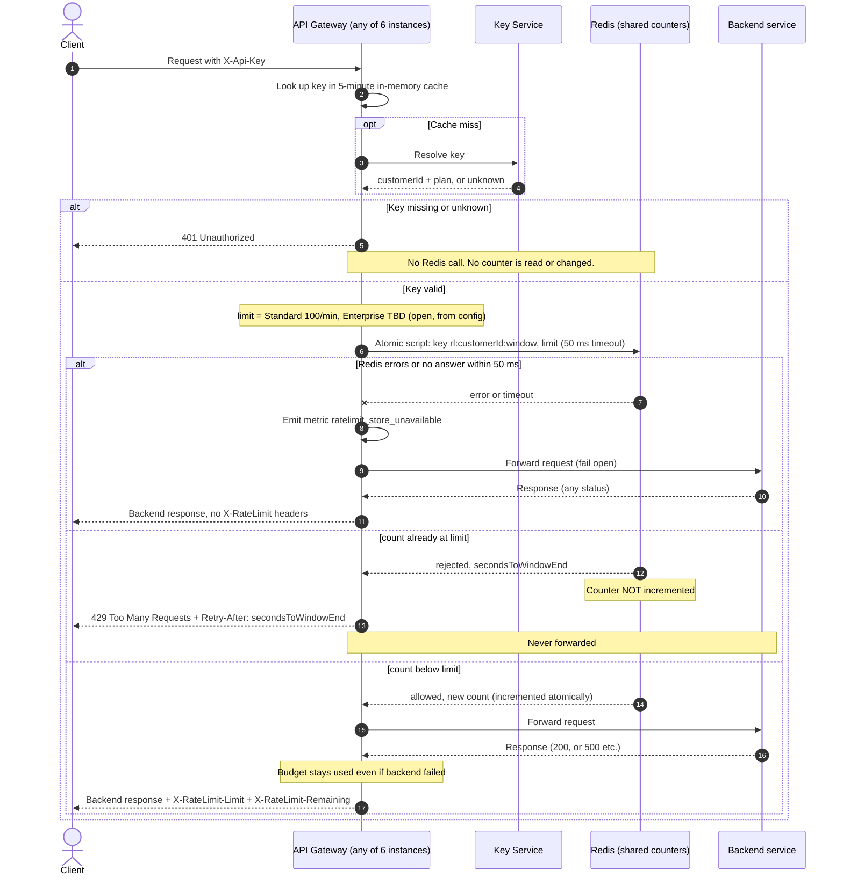

## Per-customer rate limiting: design

### Decisions

- **Store:** one shared Redis instance (a replicated primary with failover) used only for rate-limit counters. All 6 gateway instances talk to it, so counts are shared (req 7).
- **Window:** fixed one-minute window. Key is `rl:{customerId}:{floor(now_unix_seconds / 60)}`. The key expires 120 s after creation (it is only needed for the current window, the extra time covers clock skew). Known trade-off: a customer can send up to 2x the limit across a window boundary (100 at the end of one minute, 100 at the start of the next). Accepted for v1.
- **Time source:** the window index comes from the Redis server clock (`TIME` inside the script), not from the gateway instances, so instances with skewed clocks agree on the window.
- **No overshoot under concurrency:** the check is one atomic Lua script run by Redis. It reads the counter, and only if it is below the limit does it increment it. Redis runs scripts one at a time, so two instances cannot both take the last slot. There is no separate read then write.
- **Rejected requests cost nothing (req 4):** the script does not increment when the count is already at the limit.
- **Passed requests count even if the backend fails (req 5):** the increment happens in the check, before forwarding. Nothing is refunded afterwards.
- **Limit by plan:** the gateway passes the limit into the script. Standard = 100 per minute. **Enterprise = OPEN (TBD, Product has not decided).** Until it is decided, the Enterprise limit is a required config value with no default. It must be set before Enterprise customers are rate limited. Do not ship a guessed number.
- **Retry-After:** whole seconds until the current window ends, computed by the script as `60 - (redisNow mod 60)`, always between 1 and 60. It is only sent on 429.
- **Shared budget across keys (req 1):** the counter is keyed by customer ID from the Key Service, never by API key.
- **Headers:** `X-RateLimit-Limit` is the customer's limit. `X-RateLimit-Remaining` is `limit - count` after this request, never below 0. Both are added to the backend's response on every request that passed the check, including backend errors like 500.
- **Fail open (req 8):** the Redis call has a 50 ms timeout. On a timeout or any error, the gateway forwards the request, emits the `ratelimit_store_unavailable` metric, and adds no rate-limit headers (the gateway does not know the real count, so it does not guess). The client sees the backend's normal response, with no sign of the outage.

### Diagram

### Notes

**What the Redis script does (one atomic call):**
1. `now = TIME`; `window = floor(now / 60)`; key = `rl:{customerId}:{window}`.
2. `count = GET key` (0 if absent).
3. If `count >= limit`: return `rejected` and `60 - (now mod 60)`. No write.
4. Otherwise `INCR key`; if the result is 1, `EXPIRE key 120`. Return `allowed` and the new count.

**Edge cases**
- A customer with several keys: all resolve to the same customer ID, so they hit the same counter.
- Unknown key: a Key Service lookup that says "unknown" is a 401. If the Key Service itself is down and the key is not cached, that is an existing authentication failure and is out of scope here. Rate limiting never runs before a customer ID exists.
- Cached key data can be up to 5 minutes stale (for example after a plan change). The limit follows the cached plan. Accepted.
- Redis failover can lose some recent counts, which lets a few extra requests through. Acceptable for a first version and consistent with the fail-open choice.

**Out of scope for v1:** sliding window or token bucket, per-route limits, a local in-memory fallback during Redis outages, and the Enterprise limit value.

**Open item**
- Enterprise requests per minute: decision needed from Product. Blocks enabling limits for Enterprise customers.
