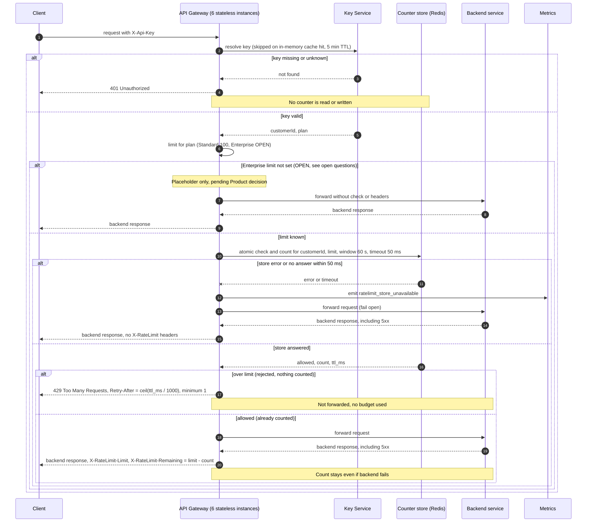

# Per-customer rate limiting on the public API

## What this is

Today every public request goes through the API Gateway. The gateway runs as six stateless instances behind a load balancer. For each request it reads the API key, asks the Key Service which customer and plan the key belongs to (the answer is cached in memory for 5 minutes), forwards the request to the backend that owns the route, and returns that backend's response.

This design adds a limit of 100 requests per minute per customer on Standard plans. The gateway counts requests in a shared Redis counter. A request over the limit gets `429` and is never forwarded. Authentication runs first, so a request with a missing or unknown key never touches the counter. The Enterprise limit is not decided yet and is left open.

## Terms

- **Customer**: the account that owns one or more API keys. All of a customer's keys share one budget.
- **Counter**: how many counted requests a customer has made in the current window. It is stored in Redis under the key `rl:<customerId>`.
- **Window**: 60 seconds. It starts at the customer's first counted request.
- **Counted request**: a request that passed the check. It uses budget, even if the backend then fails.
- **Fail open**: when the counter store cannot answer in time, the gateway forwards the request anyway.

## Sequence

## Steps

Each step says what starts it, what it does, what keeps its data, and what happens when it goes wrong.

1. **Authenticate.** Starts when a client request reaches any gateway instance. The gateway reads `X-Api-Key` and resolves it with the Key Service, unless its in-memory cache already has the answer. The cache is kept on each instance for 5 minutes. If the key is missing or unknown, the gateway returns `401`. No counter is read or written.

2. **Choose the limit.** Starts when the key is valid and the Key Service has returned a customer ID and plan. Standard plans get 100 requests per minute. Enterprise has no limit yet (see Open questions). Nothing is stored in this step.

3. **Check and count.** Starts when the plan has a limit. The gateway runs one Redis script on `rl:<customerId>`. Redis runs the script as one unit, so two gateway instances cannot both pass when only one slot is left. The script works like this:
   - If the count is already at the limit, it rejects the request and does not increment the count.
   - Otherwise it increments the count. On the first count, it sets the key to expire after 60 seconds, so the key's expiry is the window end.
   - It returns allowed or rejected, the current count, and the time left in the window.

   The counter lives in Redis, which all six gateway instances share. If the store errors or does not answer within 50 ms, go to step 5.

4. **Reject or forward.** Starts with the script's answer.
   - If rejected, the gateway returns `429 Too Many Requests` with `Retry-After` set to the time left, rounded up to whole seconds, with a minimum of 1. The time comes from Redis, so the gateway's clock does not matter. The request is not forwarded and not counted. The 429 may also carry `X-RateLimit-Limit` and `X-RateLimit-Remaining: 0`.
   - If allowed, the gateway forwards the request to the backend and returns the backend's response with `X-RateLimit-Limit` and `X-RateLimit-Remaining` (limit minus count). If the backend fails and returns a 5xx, that response is passed on unchanged and the count stays.

5. **Fail open.** Starts when the store errors or misses the 50 ms limit. The gateway forwards the request anyway, emits the metric `ratelimit_store_unavailable`, and sends no `X-RateLimit` headers, because the check did not run. A timed-out increment may still have applied in Redis, so the count can be off by one. This is accepted for v1.

## When things fail

| Situation | What the client gets | Counter changed? |
|---|---|---|
| Key missing or unknown | `401 Unauthorized` | No |
| Over the limit | `429`, with `Retry-After` | No |
| Store error, or no answer in 50 ms | Backend response, no `X-RateLimit` headers | Possibly, off by one |
| Backend returns 5xx after a counted request | Backend's 5xx response | Yes, the count stays |
| Enterprise, placeholder in use | Backend response, no headers | No |

A plan change takes up to 5 minutes to apply, because the Key Service answer is cached for 5 minutes.

## Open questions

- **Enterprise limit.** Product has not chosen a number, and this design does not pick one. The gateway must not guess a value. Proposed for v1, for Product to confirm: Enterprise traffic skips the check (no counter, no headers) behind a config flag, so this open decision does not block launch. If Product does not accept this, another v1 behavior must be chosen.
- **Key Service down.** This design does not say what the gateway does when it cannot resolve a key.
- **Redis deployment and failover.** Not covered here.
- **Per-route limits.** Out of scope for v1.
- **Boundary bursts.** A customer can send up to about twice the limit across a window boundary. This is a known trade-off for v1. A sliding window is a later upgrade if it matters.