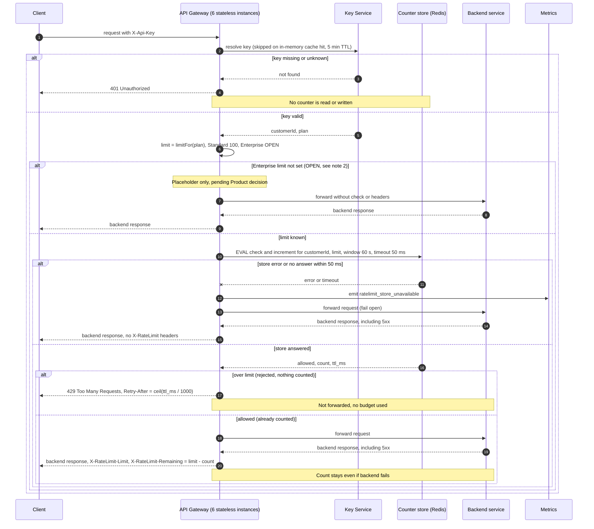

# Per-customer rate limiting on the public API

## Sequence



## Notes

1. **Counter scope and store.** One counter per customer, keyed `rl:<customerId>`. The customerId comes from the Key Service answer, so all keys of a customer share one budget (requirement 1). Redis is the shared store (requirement 7). All six instances read and write the same key, so spreading traffic across instances does not multiply the limit.

2. **Enterprise limit is OPEN.** Product has not chosen a number, and this design does not pick one. `limitFor(plan)` returns Standard = 100 per minute and has no value for Enterprise. Proposed for v1, for Product to confirm: Enterprise traffic skips enforcement (no counter, no headers) behind a config flag, so the open decision does not block launch. The gateway must not guess a value.

3. **Window.** A fixed 60 s window. The window starts at a customer's first counted request, and the key's TTL is the window end. This is the simplest option. Known trade-off: a customer can send up to about 2x the limit across a window boundary. A sliding window is a later upgrade if that matters.

4. **Atomic check and increment.** One Redis script runs the check and the increment together, so two instances cannot both see 99 and both pass. Rejected requests are not incremented, which satisfies requirement 4.

   ```lua
   -- KEYS[1] = rl:<customerId>   ARGV[1] = limit   ARGV[2] = window seconds
   local count = tonumber(redis.call('GET', KEYS[1]) or '0')
   if count >= tonumber(ARGV[1]) then
     return {0, count, redis.call('PTTL', KEYS[1])}   -- rejected, not counted
   end
   count = redis.call('INCR', KEYS[1])
   if count == 1 then redis.call('EXPIRE', KEYS[1], ARGV[2]) end
   return {1, count, redis.call('PTTL', KEYS[1])}
   ```

5. **Retry-After.** Computed from Redis PTTL, so gateway clock skew does not matter. Retry-After = ceil(ttl_ms / 1000), with a minimum of 1 second. On a 429 the gateway also sends `X-RateLimit-Limit` and `X-RateLimit-Remaining: 0` (my choice, optional).

6. **Fail open.** The gateway sets a 50 ms timeout on the store call, which covers both errors and slow answers. On failure it forwards the request, emits `ratelimit_store_unavailable`, and omits the X-RateLimit headers, because the check did not run. A timed-out INCR may still apply in Redis, so a count can be off by one. This is accepted for v1. Alert on the rate of `ratelimit_store_unavailable`.

7. **Ordering.** A 401 happens before any store access (requirement 3). The check runs after authentication and before forwarding (requirement 4). A backend failure does not refund budget (requirement 5).

8. **Plan changes.** The Key Service answer is cached for 5 minutes, so a plan change takes up to 5 minutes to apply.

## Open items

- Enterprise limit value, owned by Product (note 2).
- Confirm the enforcement-skip placeholder for Enterprise, or choose another v1 behavior.
- Redis deployment and failover are not covered here.
- Per-route limits are not in scope for v1.
