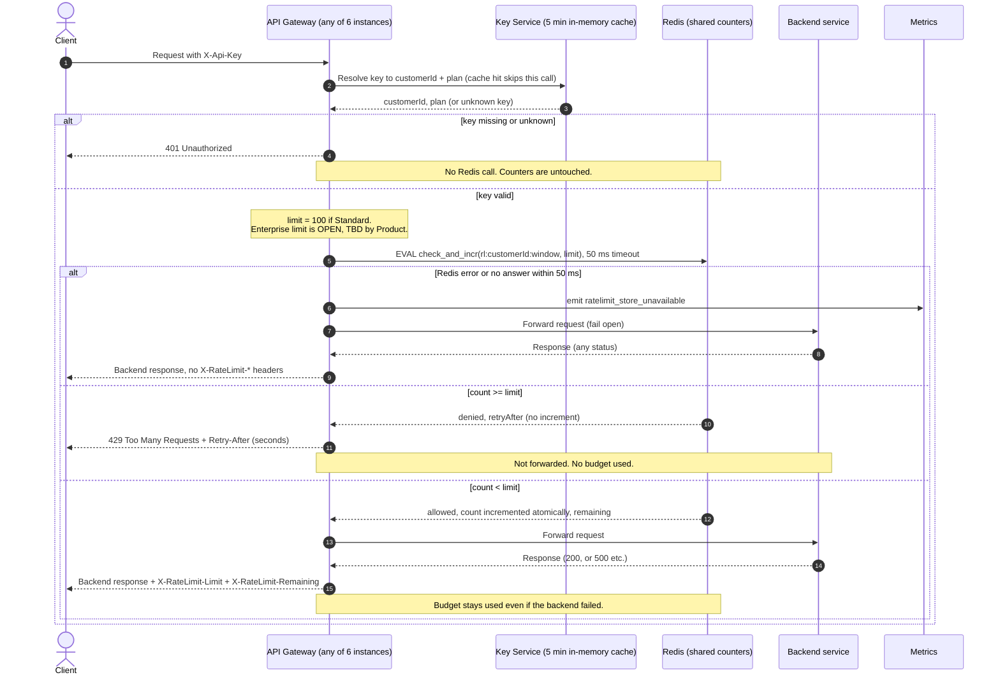

# Per-customer rate limiting on the public API

## Summary

Today every public request goes through the API Gateway (6 stateless instances). The gateway resolves the `X-Api-Key` header to a customer ID and plan through the Key Service, caching the answer in memory for 5 minutes. It then forwards the request to the backend.

This design adds a rate-limit check between authentication and forwarding. Each customer has one shared counter in Redis. The gateway asks Redis, in one atomic step, whether the customer is under their limit. If so, the request is counted and forwarded. If not, the gateway answers `429` and does not forward. If Redis is down or slow, the gateway lets the request through.

## Terms

- **Customer ID:** the ID the Key Service returns for an API key. A customer with several keys has one ID, so all their keys share one budget.
- **Plan:** Standard or Enterprise. It decides the limit.
- **Window:** a fixed one-minute slice of the wall clock. The counter resets at each minute boundary.
- **Fail open:** forward the request anyway when the rate-limit check cannot be done.

## Decisions

- **Store:** one shared Redis, used only for rate-limit counters. All 6 instances use the same counters, so a customer's traffic spread over 6 instances cannot get 6x the limit.
- **Counter key:** `rl:{customerId}:{windowNumber}`, where the window number is the minute number taken from Redis `TIME`. Key TTL is 120 s. Using Redis time means gateway clock skew cannot split a window.
- **Atomic check:** one Lua script per check. Redis runs scripts one at a time, so concurrent requests on different instances cannot overshoot. If the count is below the limit, the script adds 1 and returns `allowed` with the remaining budget. Otherwise it returns `denied` and the seconds until the next window, and adds nothing. So 429s use no budget, and every allowed request is counted whatever the backend does later.
- **Retry-After:** the whole seconds until the next window starts, rounded up (1 to 60). The script computes it.
- **Limits:** Standard is 100 per minute. **Enterprise is OPEN, to be set by Product.** The Enterprise value is a config entry that must be set before launch. Until then Enterprise requests skip the check, and the gateway emits `ratelimit_limit_unconfigured`.
- **Known cost of the fixed window:** a customer can burst up to 2x their limit across a window boundary. We accept this in v1 for simplicity.

## Sequence

## Notes

- **Failure handling:**

  | Failure | What happens |
  |---|---|
  | Missing or unknown key | `401`. Redis is never called. |
  | Redis error or no answer in 50 ms | Forward the request, emit `ratelimit_store_unavailable`, add no `X-RateLimit-*` headers. No retries and no local fallback counter. |
  | Backend fails after an allowed check | Pass the backend response through. The budget stays used. |
  | Enterprise limit not set | Skip the check and emit `ratelimit_limit_unconfigured`. |
  | Key Service fails | Outside this design. It behaves as it does today. |

- **Headers on allowed requests:** `X-RateLimit-Limit` is the plan limit. `X-RateLimit-Remaining` is the limit minus the count after this request, so it is 0 on the last allowed request.
- **429 headers:** `Retry-After` only. `X-RateLimit-*` headers are optional there and the brief requires them only on requests that passed the check.
- **Plan changes** take effect when the 5-minute cache expires. The counter key has no plan in it, so a mid-window upgrade keeps the existing count.
- **Known v1 limits:** boundary bursts of up to 2x, and no enforcement while Redis is down. Both follow from keeping v1 simple and from failing open.

## Open questions

- The Enterprise limit needs Product's number before launch.
