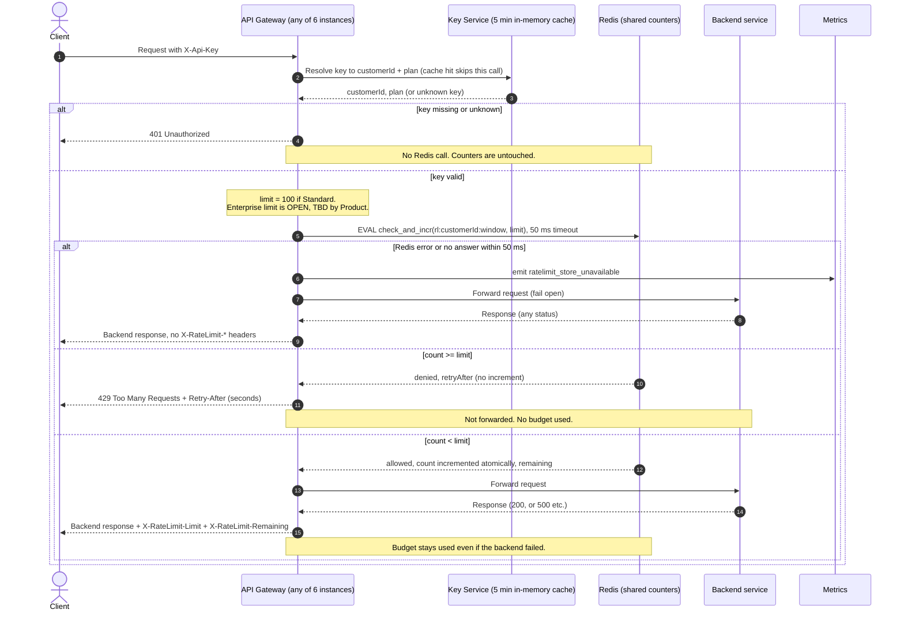

# Per-customer rate limiting on the public API

## Decisions

- **Store:** a shared Redis (primary plus replica, one logical key space) used only for rate-limit counters. All 6 gateway instances read and write the same counters, which meets requirement 7.
- **Window:** fixed one-minute window, aligned to the wall clock. The counter key is `rl:{customerId}:{floor(now/60)}`, with a TTL of 120 s. Customers can burst up to 2x their limit across a window boundary. We accept this in v1 because it is simple and cheap.
- **Atomicity:** one Lua script runs in Redis per check. Redis runs scripts one at a time, so concurrent requests from different instances cannot overshoot. The script reads the count. If the count is below the limit, it increments the count and returns `allowed`, the limit and the remaining budget. If the count is at or above the limit, it returns `denied` without incrementing. This keeps 429s from using budget (req. 4) and counts every allowed request whatever the backend does later (req. 5).
- **Time source:** the gateway sends its own clock reading in the script call. Redis `TIME` is used for the window boundary instead, so instance clock skew cannot split a customer's window.
- **Retry-After:** `ceil(secondsUntilNextWindowStart)`, which is between 1 and 60. Redis computes it in the same script.
- **Limits:** Standard is 100 per minute. **Enterprise is OPEN (TBD by Product).** The limit lookup is by plan, and the Enterprise value is a config entry that must be set before launch. Until it is set, Enterprise customers get no limit check, which is the same as fail-open for them, and the gateway emits `ratelimit_limit_unconfigured`. The Enterprise limit is the only part of this design left undecided.
- **Customer ID:** the limiter key uses the customer ID from the Key Service, never the API key, so all of a customer's keys share one budget (req. 1).
- **Fail open (req. 8):** the Redis call has a 50 ms timeout. On an error or a timeout, the gateway forwards the request, emits `ratelimit_store_unavailable`, and adds **no** `X-RateLimit-*` headers, because it does not know the real values. The response is otherwise the normal backend response. There are no retries and no local fallback counter in v1.

## Sequence

## Notes

- **Header values on allowed requests:** `X-RateLimit-Limit` is the plan limit. `X-RateLimit-Remaining` is `limit - count` after this request's increment, so it is 0 on the last allowed request.
- **429 headers:** a 429 carries `Retry-After` only. It may also carry `X-RateLimit-Limit` and `X-RateLimit-Remaining: 0`. The brief requires these headers only on requests that passed the check.
- **Key Service failures** are outside this design. They behave as they do today.
- **Plan changes** take effect when the 5-minute cache expires. The counter key does not include the plan, so a mid-window upgrade keeps the existing count.
- **Known v1 limits:** boundary bursts of up to 2x from the fixed window. While Redis is down, the limit is not enforced at all. Both follow from keeping v1 simple and from the fail-open rule.
- **Open item:** the Enterprise limit. It needs Product's number before launch.
