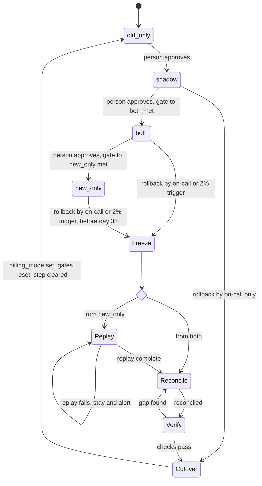

# Billing engine rollout: state machine

## Summary

Today the old billing engine does all billing. It reads usage events, computes invoices, writes them to the ledger and charges customers. The rollout moves billing to a new engine through four modes: `old_only`, `shadow`, `both` and `new_only`. A person makes each forward move, one step at a time, only when its gate is met. A rollback always ends in `old_only`. No customer is charged twice for a period, and no due charge is dropped.

## Terms

- **Usage event**: a record of customer usage. The log keeps it for 35 days.
- **Invoice**: what one engine computes that a customer owes for one billing period.
- **Ledger**: the system of record. A charge row in the ledger means the period was charged.
- **Shadow store**: where an engine writes invoices it does not charge.
- **billing_mode**: a global flag in the config service. Its value is one of the four modes. Billing workers read it.
- **Rollout record**: a store beside `billing_mode`. It holds the entry time of the current mode, the nightly counters, the Finance sign-off reference, the rollback step (`none` when no rollback runs) and an audit log. (A proposal. The brief names no store.)
- **Idempotency key**: customer, billing period and invoice version. Every charge uses it. Both engines check the ledger for the key before each charge.
- **Mismatch**: an invoice total that differs by more than one cent between the two engines.
- **Open period**: a customer and billing period with no charge row in the ledger.
- **Gate to both**: 7 consecutive nightly comparison days. Each day has a mismatch rate under 0.1 percent. The 7 days together compare at least 5,000 invoices.
- **Gate to new_only**: 14 days in `both` with no unresolved mismatches, and a Finance sign-off reference in the rollout record.

## Diagram

The diagram shows the modes and the rollback path. The rollback steps are described below.

## Modes

- **old_only**: the old engine does everything: it computes, charges and writes the ledger. The new engine is off. This is the start state and the only rollback target.
- **shadow**: the old engine works as before. The new engine reads the same usage events and writes its invoices to the shadow store. It never charges and never writes the ledger. Each night a comparison job matches the two engines' invoices per customer and period, and writes the night's counts to the rollout record. New-engine errors are recorded but never start a rollback.
- **both**: the new engine charges and writes the ledger. The old engine keeps computing every invoice into the shadow store without charging, so it stays current. The nightly comparison continues.
- **new_only**: the new engine does everything. The old engine stops computing. The 35-day clock starts on entry. On day 35 the rollback edges are removed. `billing_mode` still reads `new_only`, and the old engine may be decommissioned.

## Forward moves

A forward move happens only when all three hold:

1. A person approves it.
2. The gate for that move is met, as shown by the rollout record's counters and sign-off reference.
3. No rollback is running, so the rollback step is `none`.

The rollout controller checks the record. It refuses the move if any check fails, and changes the mode only after all pass.

## Where the state lives

`billing_mode` is in the config service. The rollout record sits beside it. Before each new-engine charge, workers read `billing_mode` and the rollback step. If the step is anything other than `none`, they submit no new-engine charges. If the config service is unavailable, workers keep the last mode and step they read. They never default to the new engine.

## Rollback

### How a rollback starts and runs

- **Start.** On-call writes a rollback request to the rollout record, naming the source mode. The automatic trigger does the same when, in `both` or `new_only`, the new engine's charge failure rate is above 2 percent in any 10-minute window. In `shadow`, new-engine errors never start a rollback.
- **One at a time.** While a rollback runs, a second request, from on-call or the trigger, is written to the audit log and changes nothing. The running rollback keeps its source mode and continues from its current step.
- **Route.** The route depends on the source mode:
  - From `shadow`: Cutover only. The new engine has charged nothing.
  - From `both`: Freeze, Reconcile, Verify, Cutover.
  - From `new_only`: Freeze, Replay, Reconcile, Verify, Cutover.
- **Moving on.** The rollout controller (not yet written) moves the rollback on. When a step's check passes, it writes the next step into the rollout record. Each step can be repeated safely.

### Steps

Each step lists what starts it, what it does, which part keeps its data, what happens when it goes wrong, and when it moves on.

1. **Freeze**
   - Starts: the controller writes Freeze as the rollback step.
   - Does: new-engine workers see a step other than `none` and submit no new charges. Charges already submitted are not resubmitted. The controller checks each one's status at the payment provider by idempotency key, until the provider reports it final. A succeeded charge is written to the ledger by the worker that submitted it. A failed charge leaves no charge row, so its period is open. A charge that comes due during the rollback also becomes an open period.
   - Keeps its data: the rollout record's step, and the provider's charge status.
   - If it goes wrong: if the config service is unavailable, workers keep the last step they read. Resuming when it returns is safe.
   - Moves on when: every submitted charge is final.

2. **Replay** (from `new_only` only)
   - Starts: Freeze has finished.
   - Does: the old engine reads the usage events in the 35-day log for each period with no invoice in the shadow store. It computes those invoices and writes them to the shadow store.
   - Keeps its data: the shadow store invoices.
   - If it goes wrong: a failed replay, or a gap in the event log, keeps the rollback in Replay and alerts. It does not move on.
   - Moves on when: every such period has an invoice.

3. **Reconcile**
   - Starts: Freeze has finished (from `both`), or Replay has finished (from `new_only`).
   - Does: the controller checks each customer and period the new engine handled. A period with a charge row in the ledger is done. The old engine never charges it, whatever amount was charged. A period with no charge row stays open.
   - Keeps its data: the ledger.
   - If it goes wrong: if the provider shows a succeeded charge under a period's key but the ledger has no row, the controller writes the row first, so the period is done. If the charged amount differs from the old invoice, the plan does not yet say what happens (see open questions).
   - Moves on when: every period is either done or open.

4. **Verify**
   - Starts: Reconcile has finished.
   - Does: checks every customer and period. No period may have two charge rows. Every open period must have an invoice in the shadow store, so the old engine can charge it.
   - Keeps its data: nothing new. It reads the ledger and the shadow store.
   - If it goes wrong: any failure is a gap, and the rollback goes back to Reconcile.
   - Moves on when: both checks pass.

5. **Cutover**
   - Starts: Verify has passed. From `shadow`, it starts at once.
   - Does: sets `billing_mode` to `old_only`, then resets the gates and clears the rollback step to `none`. The old engine's normal billing run then charges each open period once, using its own invoice for that period. Before each charge it checks the ledger for the key. No separate job runs. Forward moves need a person again.
   - Keeps its data: `billing_mode`, and the rollout record with reset counters, the step `none` and an audit entry.
   - If it goes wrong: if the config service is unavailable, the step is kept and resumed when it returns.
   - Moves on when: the mode and the cleared step are written. The rollback is then complete.

## When things fail

| Situation | What happens |
|---|---|
| Nightly comparison fails or does not run | That night counts toward neither gate. It breaks the 7-day run for the gate to both. |
| A night's mismatch rate is 0.1 percent or more | That night does not count toward the gate to both. |
| Charge failure above 2 percent in any 10-minute window (`both` or `new_only`) | Automatic rollback starts at Freeze, unless one is already running. The brief sets no minimum number of attempts (see open questions). |
| New-engine errors in `shadow` | Recorded only. They never start a rollback. |
| Second rollback request while one runs | Written to the audit log. It changes nothing. |
| Forward move with the gate not met, a rollback running, or no person approval | Refused. The mode stays the same. |
| A submitted charge fails at the provider | No charge row exists, so the period is open. The old engine charges it at Cutover. |
| A submitted charge succeeds at the provider, but the ledger has no row | Reconcile writes the row first, so the period is done and is not charged again. |
| Replay fails, or the event log has a gap | Rollback stays in Replay and alerts. |
| Verify finds a gap | Rollback goes back to Reconcile. |
| Rollback still open at day 35 in `new_only` | Rollback cannot reach `old_only`. It escalates (see open questions). Open periods stay open. None are dropped. |
| Day 35 in `new_only`, with no rollback | Rollback edges are removed. `billing_mode` stays `new_only`. |
| Finance sign-off missing | The rollout stays in `both`. Nothing moves to `new_only`. |
| Config service unavailable | Workers keep their last mode and step. They never default to the new engine. |
| Rollback completes | Gates reset. The nightly counter returns to zero. The 7-day count restarts at the next entry to `shadow`. |

## Open questions

- How does a person approve forward moves and set `billing_mode`, and how does on-call write a rollback request (a tool, a command or a ticket)?
- Which job runs the nightly comparison, and who owns it?
- Does the 0.1 percent limit apply per night, or over the whole 7-day window?
- What counts as an unresolved mismatch for the gate to new_only?
- If the new engine charged a different amount from the old invoice during a rollback, who decides what happens?
- What is the invoice version in the idempotency key, and what changes it?
- Does the payment provider return the original result when a key is repeated? Reconcile depends on this to avoid a second charge.
- How does the event log show a gap? Replay needs this to detect one.
- What makes a period due? The brief uses the word without defining it. An open period is defined above, as a period with no charge row.
- Who handles a rollback still open at day 35, and what charges its open periods in the meantime?
- If a worker cannot read the rollout record, it keeps its last step. If that step was `none`, it could charge during a freeze. The idempotency key stops double charges, but not charges during a freeze.
- The 2 percent trigger has no minimum number of attempts, as the brief states. A very small window could trip it.
- Which component measures the new engine's charge failure rate for the 2 percent trigger, and where does it get the failures from (workers, the provider or the ledger)?
- How often does Freeze check each submitted charge, and where does the controller get the list of submitted charges?