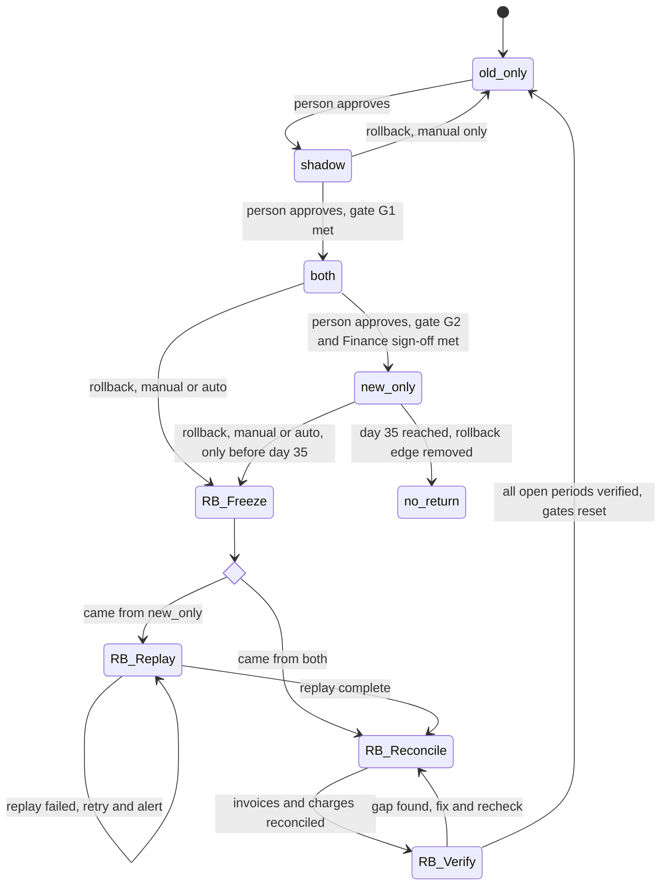

# Billing engine rollout: state machine

## Modes

- **old_only**: The old engine does everything. The new engine is off. This is the starting state and the only rollback target.
- **shadow**: The old engine still computes, charges and writes the ledger. The new engine reads the same usage events and writes invoices to the shadow store. It never charges and never writes the ledger. A nightly job compares the two engines per customer. A mismatch is any invoice total that differs by more than one cent. New-engine errors are recorded here but never trigger rollback.
- **both**: The new engine charges and writes the ledger. The old engine keeps computing every invoice into the shadow store without charging, so it stays current and can take over. The comparison continues.
- **new_only**: The new engine does everything. The old engine stops computing. Usage events it skips are recoverable only while they are inside the 35-day usage log retention. The 35-day clock starts when the rollout enters `new_only`.

## Rollback steps

Rollback can start from `shadow`, `both` or `new_only`, and always ends in `old_only`.

1. **Freeze.** Stop new-engine charge submissions. Charges already submitted are not resubmitted. Their status is read from the payment provider by idempotency key and waited on until final. Any charge that comes due during the rollback is queued, not dropped, and is charged by the old engine after Verify passes.
2. **Replay** (only when starting from `new_only`). The old engine reprocesses the usage events it skipped, writing invoices to the shadow store. A failed replay stays in this step and alerts. It never moves on to a partial state.
3. **Reconcile.** For every billing period and customer, the ledger decides what has already been charged. The old engine's invoices are matched to the ledger. Any period the new engine already charged is marked done, so the old engine cannot charge it again.
4. **Verify.** Every open period has exactly one charge or one queued charge. Any gap goes back to Reconcile.
5. **Cutover.** `billing_mode` is set to `old_only`. Gates reset: the shadow day counter returns to zero and the 7-day count starts again from the next `shadow` entry. Forward moves need a person again.

## Where the rollout state lives

- **`billing_mode`** is one global flag in the config service. Billing workers read it. If a read fails, workers keep their last known mode. They never default to the new engine.
- **Rollout record** (assumed to sit beside the flag in the config service, with an audit log): mode entry timestamps, the shadow and both day counters, the Finance sign-off reference, and for an active rollback its source mode and current step. The brief does not name a store for these, so this is a proposal.
- **Shadow store**: a separate store for the old engine's and new engine's shadow invoices. It is never read for charging.
- **Ledger**: the system of record for what has been charged.
- **Idempotency**: every charge uses a key of customer, billing period and invoice version. Both engines check the ledger before each charge.

## What happens when something fails

- **Nightly comparison job fails or does not run.** That day does not count toward the 7-day or 14-day gates, and it breaks the consecutive run. (Assumption.)
- **Shadow gate.** A day counts only if its mismatch rate is under 0.1 percent. The 5,000-invoice minimum is counted across the 7-day window. (Assumption.)
- **Charge failure rate above 2 percent in any sliding 10-minute window** in `both` or `new_only` starts rollback automatically. The brief sets no minimum attempt count, so a very small window could trip it. (Assumption to confirm.)
- **Replay fails or the event log has a gap.** The rollback stays in Replay and alerts. It does not flip to `old_only` until Verify passes.
- **Rollback reaches day 35 before Verify passes.** The old engine can no longer rebuild the skipped events. The rollback is stuck and must escalate. The rollout cannot return to `old_only` by rollback.
- **Day 35 in `new_only`.** The rollback edge is removed. The old engine may be decommissioned, and it may also be decommissioned earlier if the team does not need rollback. `billing_mode` still reads `new_only`, so the rollback edge is a rule, not a flag value.
- **Config service unavailable during rollback.** Workers keep the last written step. Steps are idempotent, so resuming after the service returns is safe.
- **Finance sign-off missing.** The rollout stays in `both`. Nothing moves to `new_only` automatically.

## Open questions

- Does cutover to `old_only` after Verify need a person, or is it automatic?
- Does a missed comparison day break the 7-day count, or pause it?
- Should the 2 percent trigger need a minimum number of charge attempts in the window?