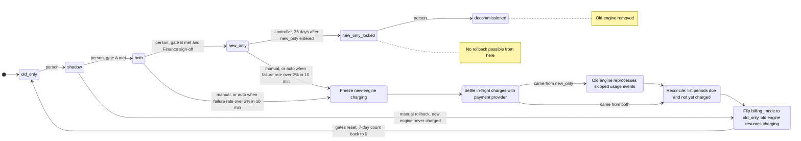

# Billing engine rollout: state machine

Billing moves from the old engine to the new one through four modes: `old_only`, `shadow`, `both`, `new_only`. A person moves forward one step at a time, and a gate must be met first. If the new engine misbehaves, a rollback returns everything to `old_only` without charging anyone twice or dropping a due charge.

Today, billing workers run the old engine. They read usage events from the usage event log (kept 35 days), compute invoices, write them to the billing ledger (the system of record) and charge customers through the payment provider.

## Terms

- **Mode.** The value of the `billing_mode` flag in the config service. It is the only thing that selects what each engine may do.
- **Rollout controller.** A small service we will build. It is the only writer of `billing_mode`. A person asks it, through an authenticated admin command, to move forward or roll back. It also watches the clock, the nightly results and the charge failure rate.
- **Rollout record.** A small durable record, which I assume sits in the ledger's database. It holds the gate counters, the Finance sign-off, the date `new_only` was entered, the "charging frozen" switch, the list of periods due, and the current rollback step with the mode it started from.
- **Shadow store.** Where the non-charging engine writes its invoices. In `shadow` that is the new engine. In `both` it is the old engine.
- **Mismatch.** An invoice total that differs between the two engines by more than one cent.
- **Gate A** (`shadow` to `both`). 7 consecutive days with a mismatch rate under 0.1% and at least 5,000 invoices compared.
- **Gate B** (`both` to `new_only`). 14 days in `both` with no unresolved mismatches, plus Finance sign-off.
- **Charge key.** One idempotency key per customer and billing period, used at the ledger and at the payment provider. Both engines use the same key, so a period cannot be charged twice.

## Diagram

`new_only_locked` and `decommissioned` are my additions. The brief says there is no way back from day 35 on, and the old engine may be decommissioned after that.

Rollback steps run one after another with no person confirming each one. A person only starts a manual rollback and answers pages. After any rollback the rollout goes through `shadow` again with every gate counter at zero.

## What each mode does

| Mode | Old engine | New engine | Who charges and writes the ledger |
|---|---|---|---|
| `old_only` | Computes, charges, writes ledger | Off | Old |
| `shadow` | Computes, charges, writes ledger | Reads the same usage events, writes invoices to the shadow store only | Old |
| `both` | Computes every invoice into the shadow store, no charges | Computes, charges, writes ledger | New |
| `new_only` | Stops computing | Does everything | New |

## Where state lives

- **Mode:** the `billing_mode` flag.
- **Everything else:** the rollout record. Only one rollback is active at a time. A second trigger, such as an alarm firing again, joins it.
- **Invoices and charges:** the billing ledger stays the system of record in every mode. Rollback never deletes ledger entries the new engine wrote.
- **Pending charges:** before the new engine sends a charge, it writes a "pending" ledger entry under the charge key. It does this in the same ledger transaction that checks "charging frozen". The entry becomes charged or not charged when the provider answers.

## Forward steps

1. **Nightly comparison** (in `shadow` and `both`). A nightly job compares the two engines' invoices per customer. It reads the ledger and the shadow store, and writes the day's mismatch rate and invoices compared to the rollout record. The controller adds a clean day, restarts the count on a bad day, and checks the gate before it allows a move.
2. **Forward move.** A person asks the controller. It accepts only one step forward, only from a person, and only if the gate is met. Otherwise it rejects the request.

## Rollback steps

Starts: a person, from `shadow`, `both` or `new_only`; or the controller automatically, when in `both` or `new_only` the new engine's charge failure rate is above 2% over any 10-minute window. Automatic starts also page on-call. Errors from the new engine in `shadow` never start a rollback.

From `shadow` the new engine never charged and the old engine never stopped. The controller only does the flip step, and the mode change turns the new engine off.

From `both` or `new_only`:

1. **Freeze.** The controller sets "charging frozen" in the rollout record. The new engine checks it before every charge and sends none. A charge already sent is left to finish or stay pending. The flag keeps its old value. Nothing is queued: periods that come due while frozen are found again at reconcile.
   - If it fails: stay at this step, retry, page on-call.
2. **Settle.** Every "pending" ledger entry is looked up at the payment provider by its key. Each ends as charged or not charged. A "not charged" result is only recorded, not retried here, because reconcile finds that period as due.
   - If the outcome is unknown: query the provider again. Never re-charge until the provider says it was not charged. If the step fails, stay, retry, page on-call.
3. **Reprocess** (from `new_only` only). The old engine was off from the date `new_only` was entered. It recomputes the usage events from that date up to the freeze into the shadow store, with no charging. This gives reconcile the invoices that exist nowhere else.
   - If it fails: stay at this step, retry, page on-call.
4. **Reconcile.** Take every invoice for a finished billing period, from the ledger (written by the new engine) and from the shadow store (written by the old engine in `both`, or by reprocess). A period is due when it has an invoice and no charged entry under its key at the ledger or the provider. A "not charged" entry counts as no charge. Store the list of periods due in the rollout record. This step is finished once the list is stored.
   - If it fails: stay at this step, retry, page on-call.
5. **Flip.** Set `billing_mode` to `old_only`. The new engine is now off, so any work it had in progress is dropped. Ledger entries it already wrote stay. Then clear all gate counters, the Finance sign-off and "charging frozen". The old engine resumes charging: first the periods on the list, then normal runs. It removes a period from the list once that period has a charged entry. A period that comes due after reconcile is charged by the normal run.
   - If the old engine crashes: it restarts and continues from what is left in the list. The charge key prevents double charges.

The mode does not flip until reconcile has stored its list. Charging stays frozen meanwhile, so customers may be billed late but not twice.

## Other failures

| Failure | Behaviour |
|---|---|
| New-engine errors in `shadow` | Recorded. No rollback. They affect the gate only through mismatches. |
| Nightly comparison job fails or is missing | That day does not count, and the 7-day count restarts. Missing data is not a pass. |
| Mismatch rate 0.1% or more in `shadow` | The 7-day count restarts. No automatic rollback. |
| Unresolved mismatch in `both` | Gate B cannot be met. It stays in `both` until resolved. |
| Finance sign-off missing | `both` to `new_only` is blocked. |
| Skipping a step, or moving forward without a person | Rejected. |
| Rollback trigger on day 35 or later in `new_only` | No rollback. Page on-call and fix forward. |

## Open questions

- **Charge failure definition.** The brief does not define it. I assume failures are charge attempts the provider declines or errors on, divided by all attempts by the new engine in the window, measured by the controller from provider responses. Customer card declines may need to be excluded. Please confirm.
- **Few charges in a window.** The brief sets no minimum. Read literally, 1 failure in 3 attempts is 33% and starts a rollback. A minimum count avoids that but adds a rule the brief lacks. The owner decides.
- **What "resolved" means for a mismatch.** The brief does not say. One option: a person marks it resolved through the controller, or a later nightly run shows the invoices within one cent. The owner decides who resolves and how it is recorded.
- **Counting invoices for gate A.** I read the 5,000 as the total over the 7 days, not per day. Please confirm.
- **Rollback near the day-35 limit.** The usage log keeps events 35 days, and `new_only` skips events from the day it was entered. A rollback started at day 34 could lose the oldest skipped events before reprocess finishes. I suggest a hard cutoff before day 35 for starting a rollback, sized by how long reprocess takes. The owner decides.
- **Mode during a rollback.** The flag still shows `both` or `new_only` while charging is frozen. A visible fifth mode would change the fixed rules, so I did not add one.
- **Automatic rollback after day 35.** I made it a page, not an action, because no way back exists. Confirm that is the intent.
