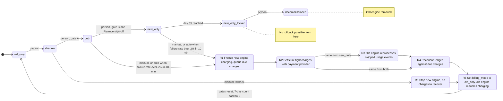

# Billing engine rollout: state machine

## Diagram

Gate A is 7 consecutive days with a mismatch rate under 0.1% and at least 5,000 invoices compared. Gate B is 14 days in `both` with no unresolved mismatches. A mismatch is any invoice total that differs by more than one cent.

`new_only_locked` and `decommissioned` are my additions. The brief says there is no way back from day 35 on, and the old engine may be decommissioned after that. Both are terminal for rollback.

## What each mode does

| Mode | Old engine | New engine | Who charges and writes the ledger |
|---|---|---|---|
| `old_only` | Computes, charges, writes ledger | Off | Old |
| `shadow` | Computes, charges, writes ledger | Reads the same usage events and writes invoices to the shadow store only | Old |
| `both` | Computes every invoice into the shadow store, no charges | Computes, charges, writes ledger | New |
| `new_only` | Stops computing | Does everything | New |

- In `shadow` and `both`, a nightly job compares the two engines' invoices per customer.
- Forward moves go one step at a time in the order `old_only`, `shadow`, `both`, `new_only`. A person makes each one, and the gate must be met first.
- Rollback always ends in `old_only`. After it, the rollout goes through `shadow` again with every gate counter at zero.

## Where the rollout state lives

- **Mode.** The `billing_mode` flag in the config service holds the mode. It is the only thing that selects a mode.
- **Gate and rollback state.** The flag cannot hold counters or rollback progress, so a small durable rollout record holds them. I assume it sits in the same database as the ledger, so it survives a restart. It holds:
  - the days of clean comparison, the invoices compared, and the days in `both`
  - the Finance sign-off
  - the date `new_only` was entered, for the day-35 limit
  - the current rollback step and the mode it started from
- **Rollback record.** There is at most one active rollback record. A second trigger, such as an alarm firing again, joins it instead of starting another.
- **Ledger.** The billing ledger remains the system of record in every mode. Rollback never deletes ledger entries the new engine wrote.
- **Charge identity.** Every charge uses one idempotency key per customer and billing period, at the ledger and at the payment provider. Both engines use the same key.

## How rollback avoids double charges and dropped charges

1. **R1 Freeze.** The new engine stops sending charges. Charges that come due are queued, not dropped.
2. **R2 Settle.** Any charge sent but not confirmed is looked up at the payment provider by its key. Each one ends as charged or not charged.
3. **R3 Reprocess** (from `new_only` only). The old engine recomputes the usage events it skipped, into the shadow store, with no charging. This is the "reprocess first" rule.
4. **R4 Reconcile.** For each customer and billing period, compare the ledger and the provider against what is due. Build the list of periods that are due and not yet charged.
5. **R5 Flip.** Set `billing_mode` to `old_only`. The old engine resumes charging. It charges only the periods on the R4 list, plus the queued charges. It skips any period that already has a charge under its key.
6. **Reset.** Clear all gate counters and the Finance sign-off.

From `shadow` the new engine never charged, so only R0 (stop the new engine) and R5 are needed.

## What happens when something fails

| Failure | Behaviour |
|---|---|
| New-engine errors in `shadow` | Recorded. No rollback. They count against the gate only through mismatches. |
| New-engine charge failure rate over 2% in any 10-minute window, in `both` or `new_only` | Automatic rollback starts at R1 and pages on-call. |
| On-call starts a rollback by hand | Same path as the automatic one. It works from `shadow`, `both` or `new_only`. |
| A rollback step fails or times out | The rollback stays at that step and retries. It pages on-call. The mode does not flip until R4 is clean. Charging stays frozen meanwhile, so customers may be billed late but not twice. |
| A payment outcome is unknown at R2 | Treat it as unresolved. Query the provider again. Never re-charge until the provider says it was not charged. |
| Nightly comparison job fails or is missing | That day does not count toward gate A or gate B, and the 7 consecutive days restart. Missing data is not treated as a pass. |
| Mismatch rate reaches 0.1% or more in `shadow` | The 7-day count restarts. There is no automatic rollback. |
| Unresolved mismatch in `both` | The 14-day count cannot be met. It stays in `both` until resolved. |
| Finance sign-off missing | `both` to `new_only` is blocked. |
| Someone tries to skip a step or move forward without a person | Rejected. The controller only accepts one step forward, from a person. |
| Rollback trigger on day 35 or later in `new_only` | No rollback. Page on-call and fix forward. |

## Open questions

- **Counting invoices for gate A.** I read the 5,000 compared invoices as the total over the 7 days, not per day. Please confirm.
- **Rollback running into the day-35 limit.** The usage log keeps events for 35 days, and `new_only` skips events from day 0. A rollback started at day 34 could lose the oldest skipped events before R3 finishes. I suggest a hard cutoff before day 35 for starting a rollback, with the margin set by how long R3 takes. The brief does not say which, so the owner needs to decide.
- **Charging between R1 and R5.** The flag still shows `both` or `new_only` while charging is frozen. If you would rather have a visible fifth mode, that changes the fixed rules, so I did not add one.
- **Automatic rollback after day 35.** I made it a page, not an action, because no way back exists. Confirm that is the intent.
