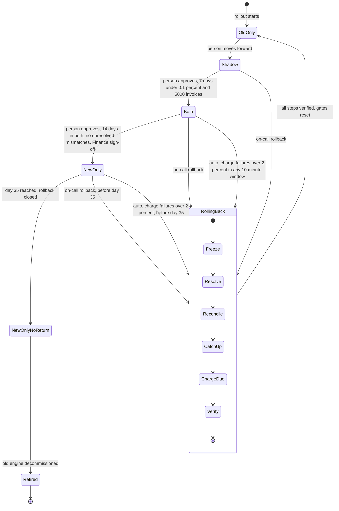

# Billing engine rollout: state machine

## Summary

Today, billing workers run the old engine. It reads usage events from the usage event log (kept 35 days), computes invoices, writes them to the ledger and charges customers through the payment provider.

The rollout moves the work to a new engine in four modes: `old_only`, `shadow`, `both` and `new_only`. One global flag, `billing_mode`, selects the mode. A person makes each forward move, one step at a time, after its gate passes. No mode can be skipped. A rollback can start from `shadow`, `both` or `new_only` and always ends in `old_only`, with the gates reset. The goal is a switch that is gradual, reversible and never charges a customer twice.

## Terms

- **Usage event log**: where usage events are kept for 35 days.
- **Ledger**: the billing system of record.
- **Shadow store**: a separate store for invoices that the new engine writes without charging.
- **Mismatch**: an invoice total that differs by more than one cent between the two engines for the same customer.
- **Mismatch rate**: mismatches as a share of invoices compared.
- **Gate**: a condition that must pass before a forward move.
- **Gate evidence**: the nightly per-day rows from the comparison job: invoices compared, mismatches and rate.
- **Streak**: consecutive days that count toward a gate, counted only after the last rollback.
- **Idempotency key**: one key per customer and billing period.
- **Rollback marker**: a flag that halts charging during Freeze. Proposed.
- **Transition log**: an append-only record of each mode change. Proposed.
- **Finance sign-off**: Finance's approval, required for the move from `both` to `new_only`.

## Diagram

## Modes

How the system runs in each mode.

- **old_only**: The old engine reads usage events, computes invoices, writes the ledger and charges. The new engine is off.
- **shadow**: The old engine still charges and writes the ledger. The new engine reads the same usage events and writes invoices to the shadow store only. It never charges and never writes the ledger. A nightly job compares the two engines per customer. New-engine errors are recorded here and never trigger a rollback.
- **both**: The new engine charges and writes the ledger. The old engine keeps computing every invoice into the shadow store without charging, so it stays current and the comparison continues. Charge failures can trigger an automatic rollback.
- **new_only**: The new engine charges and writes the ledger. The old engine stops computing, so it skips usage events from this point. The 35-day clock starts on entry. Rollback is possible only before day 35.
- **NewOnlyNoReturn**: `new_only` from day 35 on. Rollback is closed. The old engine may be retired.
- **RollingBack**: Entered from `shadow`, `both` or `new_only`, by a person or automatically. Always ends in `old_only`.
- **Retired**: Terminal. The old engine has been decommissioned.

## Forward moves

Each move is a person's decision, and its gate is checked at that move.

1. **old_only to shadow.** Starts when a person moves it forward. The brief sets no gate for this move. It sets `billing_mode` to `shadow`, starts the new engine writing to the shadow store and starts the nightly comparison. It keeps its data in `billing_mode` and the transition log. If the move fails, the mode stays `old_only`.
2. **shadow to both.** Starts when a person approves. Gate: 7 consecutive days with a mismatch rate under 0.1% and at least 5,000 invoices compared. It sets `billing_mode` to `both` and starts the new engine charging. It keeps its evidence in the gate evidence rows and the transition log. If the gate is not met, the move is refused and the mode stays `shadow`.
3. **both to new_only.** Starts when a person approves. Gate: 14 days in `both` with no unresolved mismatches, plus Finance sign-off. It sets `billing_mode` to `new_only`, starts the 35-day clock and stops the old engine computing. It keeps the new_only entry time (proposed), the Finance sign-off reference and the transition log. If the gate or sign-off is missing, the mode stays `both`.

## Rollback

**Starts when:** a person starts it by hand from `shadow`, `both` or `new_only`, within the 35-day limit. Or it starts automatically when, in `both` or `new_only`, the new engine's charge failure rate is above 2% in any 10-minute window. Charge errors in `shadow` never start it.

Every step is idempotent. A failed step is retried from the same point, and on-call is paged. From `shadow`, Freeze, Resolve, CatchUp and ChargeDue have nothing to undo, so they finish at once.

1. **Freeze.** Starts the rollback. It halts new-engine charge submissions and ledger writes. Each new-engine worker must acknowledge the halt before the next step starts. It keeps its data in the rollback marker (proposed). If a worker does not acknowledge, the rollback does not advance, and that worker is treated as still charging.
2. **Resolve.** Starts when every worker has acknowledged Freeze. For each charge the new engine sent without a confirmed result, it queries the payment provider by idempotency key until the charge is succeeded or failed. A charge that looked failed may have succeeded. Due charges still queued go to the old engine unchanged. It keeps its data in the provider results and the ledger. If it fails, it is retried from this step.
3. **Reconcile.** Starts when Resolve finishes. It sorts each customer and billing period into one of three groups:
   - **Charged:** a ledger entry and a provider success. Never charged again.
   - **Due and uncharged:** the old engine must charge it.
   - **Charged, with an invoice that differs by more than one cent:** logged for Finance, not charged again.

   It keeps its data in the ledger and the shadow store. If it fails, it is retried from this step.
4. **CatchUp.** Starts when Reconcile finishes. The old engine computes invoices for periods it has not computed. In `shadow` or `both` this is near zero. In `new_only` it reprocesses the skipped usage events, which must still be in the 35-day log. It keeps its data in the shadow store. If it fails, it is retried. If the events have expired, see the failures table.
5. **ChargeDue.** Starts when CatchUp finishes. The old engine charges only the due and uncharged set, using the customer and billing period idempotency key. It keeps its data in the ledger and the provider. If it fails, it is retried, and the same key stops a second charge.
6. **Verify.** Starts when ChargeDue finishes. It confirms zero due-and-uncharged periods, zero double-charged periods and every period accounted for. Then it sets `billing_mode` to `old_only`, releases the rollback marker and resets the gates. The 7-day shadow count and the 14-day `both` count start over. It keeps its data in the transition log. If it fails, the rollout stays in RollingBack, the step is retried and on-call is paged.

## Where state lives

- **`billing_mode`** in the config service is the one source of truth. Every worker reads it before it charges. If a worker cannot read it, the worker does not charge and raises an alert. This is fail-closed.
- **Proposed, not fixed by the brief:** the new_only entry time, the rollback marker and the gate evidence. Streaks are derived from the gate evidence rows, counting only days after the last rollback.
- **Proposed:** an append-only transition log. Each entry records the time, the person, the Finance sign-off reference where one applies and the reason.
- **Double-charge guard:** the ledger enforces one idempotency key per customer and billing period. Both engines send that key to the payment provider. This holds even if a worker reads a stale mode.

## What happens when something fails

| What fails | What happens |
|---|---|
| New-engine errors in `shadow` | Recorded only. No rollback. |
| Charge failures above 2% in any 10-minute window, in `both` or `new_only` | Automatic rollback starts. Resolve handles charges that may have succeeded. |
| Comparison job fails or misses a night | That day does not count toward the gate. The streak breaks (proposed). |
| A rollback step fails | The rollout stays in RollingBack. The step is retried and on-call is paged. The rollout cannot move forward, and cannot abort back to `both`, because every rollback ends in `old_only`. |
| A worker does not acknowledge Freeze | The rollback does not advance to Resolve. The worker is treated as still charging. |
| Config service unavailable | Workers stop charging and raise an alert. Due charges queue and are not dropped. |
| Finance sign-off missing at the `both` to `new_only` move | The rollout stays in `both`. |
| Old engine cannot finish CatchUp before day 35 | The skipped usage events expire, and the old engine cannot reprocess them. This is a critical risk. The rollback start deadline should be set well before day 35. |

## Open questions

1. Does a mismatch reset the 14-day count in `both`, or does it only block the move to `new_only`?
2. Does the comparison job keep running in `new_only`? The brief is silent.
3. Is the rollback start deadline also the completion deadline? A rollback started on day 34 may not finish CatchUp before the events expire.
4. What is the recovery path if usage events expire before CatchUp completes?
5. Does a missing comparison day break the 7-day streak, or is it skipped?