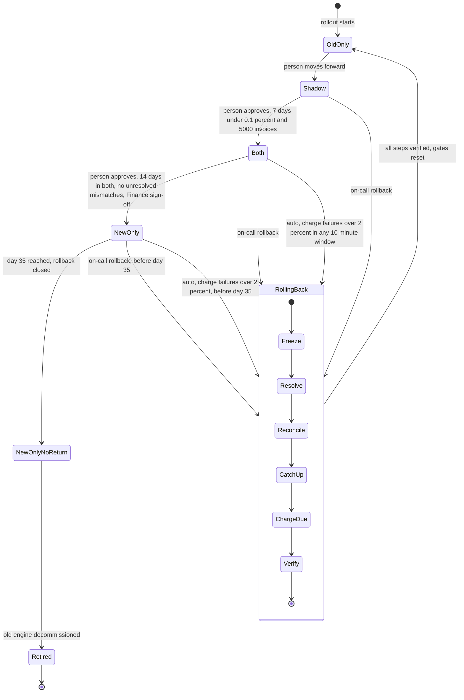

# Billing engine rollout: state machine

## Diagram

## Modes

- **old_only**: The old engine reads usage events, computes invoices, writes the ledger and charges. The new engine is off.
- **shadow**: The old engine still charges and writes the ledger. The new engine reads the same usage events and writes invoices to the shadow store only. It never charges and never writes the ledger. A nightly job compares the two engines per customer. A mismatch is any invoice total that differs by more than one cent. New-engine errors are recorded here and never trigger a rollback.
- **both**: The new engine charges and writes the ledger. The old engine keeps computing every invoice into the shadow store without charging, so it stays current and the comparison continues. Charge failures here can trigger an automatic rollback.
- **new_only**: The new engine charges and writes the ledger. The old engine stops computing, so usage events from this point are skipped by the old engine. The 35-day clock starts on entry, which matches the usage event log retention. Rollback is possible only while the clock is under 35 days.
- **NewOnlyNoReturn**: new_only past day 35. Rollback is closed. The old engine may be retired.
- **RollingBack**: Entered from shadow, both or new_only, by a person or automatically. It always ends in old_only.
- **Retired**: Terminal. The old engine has been decommissioned.

There is no edge that skips a mode. Every forward move is a person's decision, and every gate is checked at that move.

## Rollback steps

Every step is idempotent, so a failed step is retried from the same point.

1. **Freeze**: Halt the new engine's charge submissions and ledger writes. Each new-engine worker must acknowledge the halt before the next step starts. Nothing charges while the rollback runs.
2. **Resolve**: For every charge the new engine sent without a confirmed result, query the payment provider by idempotency key until it is either succeeded or failed. A charge that looked failed may have succeeded at the provider. Due charges still queued are handed to the old engine unchanged.
3. **Reconcile**: For each customer and billing period, classify it as charged (ledger entry and provider success, so never charged again), due and uncharged (the old engine must charge it), or charged with an invoice that differs by more than one cent (logged for Finance, not charged again).
4. **CatchUp**: The old engine computes invoices for periods it did not compute. In shadow or both this is near zero. In new_only it reprocesses the skipped usage events, which must still be in the 35-day log.
5. **ChargeDue**: The old engine charges only the due and uncharged set, using the customer and billing period idempotency key that the new engine also uses.
6. **Verify**: Confirm zero due-and-uncharged periods, zero double-charged periods and every period accounted for. Then set `billing_mode` to `old_only`, release the rollback marker and reset the gates. The 7-day shadow count and the 14-day both count both start over.

For a rollback from shadow, Freeze, Resolve, CatchUp and ChargeDue have nothing to undo, so they complete immediately.

## Where the rollout state lives

- **`billing_mode`** in the config service is the one source of truth for the mode. Every worker reads it before it charges. If a worker cannot read it, the worker does not charge, and it raises an alert. This is fail-closed.
- **Proposed, not fixed by the brief**: the new_only entry time (which starts the 35-day clock), the rollback marker that halts charging during Freeze, and the gate evidence. Gate evidence is the nightly per-day rows from the comparison job (invoices compared, mismatches, rate). Streak counts are derived from those rows, counting only days after the last rollback.
- **Proposed**: an append-only transition log. Each entry records the time, the person, the Finance sign-off reference where one applies, and the reason.
- **Double-charge guard**: The ledger is the system of record. The idempotency key per customer and billing period is enforced at the ledger and sent to the payment provider by both engines. This guard holds even if a worker reads a stale mode.

## What happens when something fails

- **New-engine errors in shadow**: Recorded only. No rollback.
- **Charge failures above 2 percent in any 10-minute window, in both or new_only**: An automatic rollback starts. The Resolve step handles charges that may have succeeded despite the failure.
- **Comparison job fails or misses a night**: That day does not count toward the gate. The consecutive streak breaks (proposed).
- **A rollback step fails**: The rollout stays in RollingBack, the step is retried, and on-call is paged. The rollout cannot move forward while in RollingBack. It cannot abort back to both, because every rollback must end in old_only.
- **A worker does not acknowledge the Freeze**: The rollback does not advance to Resolve. The worker is treated as still charging.
- **Config service unavailable**: Workers stop charging and alert. Due charges queue and are not dropped.
- **Finance sign-off missing at the both to new_only move**: The rollout stays in both.
- **The old engine cannot finish CatchUp before day 35**: The skipped usage events expire, and the old engine cannot reprocess them. This is a critical risk. The rollback start deadline should be set well before day 35.

## Open questions

1. Does a mismatch reset the 14-day count in both, or does it only block the move to new_only?
2. Does the comparison job keep running in new_only? The brief is silent.
3. Is the rollback start deadline also the completion deadline? A rollback started on day 34 may not finish CatchUp before the events expire.
4. What is the recovery path if usage events expire before CatchUp completes?
5. Does a missing comparison day break the 7-day streak, or is it skipped?