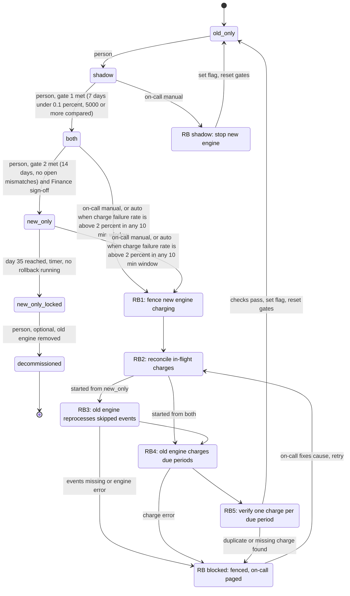

# Billing engine rollout: state machine

## Summary

Today, billing workers run the old engine. They read usage events (kept 35 days), compute invoices, write them to the billing ledger and charge customers through the payment provider.

The rollout moves from the old engine to a new one through four modes, held in the `billing_mode` flag. A person makes every forward move, one step at a time. Rollback is a separate set of steps that always ends in `old_only`. Day 35 in `new_only` is a one-way lock.

No customer is charged twice because every charge carries one idempotency key, `(customer, billing_period)`. Rollback never relies on timing to avoid a duplicate.

## Terms

- **Old engine / new engine:** the current billing code, and its replacement.
- **Shadow store:** a separate store for invoices from the engine that is not charging. It is never the ledger.
- **Billing ledger:** the system of record for what was charged.
- **Mismatch:** an invoice total that differs between the engines by more than one cent.
- **Idempotency key:** `(customer, billing_period)`. A second charge with the same key is rejected.
- **Rollback record:** a record in the config service saying a rollback is running, from which mode, and at which step.
- **Gate:** a condition that must be met before a person may make a forward move.

## State diagram

Notes on the diagram:

- There are no backward moves between `shadow`, `both` and `new_only`. The only way back is rollback, and it goes to `old_only`.
- From `old_only` the only exit is `shadow`. Re-entering `shadow` is how the gates reset: the 7-day count starts at zero.
- `new_only_locked` has no rollback edge. That is the "no way back from day 35" rule.
- A met gate allows a move but does not make it. A person still does.

## What each mode does

| Mode | Old engine | New engine | Charges and writes ledger | Comparison |
|---|---|---|---|---|
| `old_only` | Computes, charges, writes ledger | Off | Old | None |
| `shadow` | Computes, charges, writes ledger | Reads same events, writes to shadow store only | Old | Nightly, per customer |
| `both` | Computes every invoice into shadow store, never charges | Computes, charges, writes ledger | New | Continues nightly |
| `new_only` | Stopped | Does everything | New | None |
| `new_only_locked` | Stopped, may be decommissioned | Does everything | New | None |

Gates:

- **`shadow` to `both`:** 7 consecutive days with a mismatch rate under 0.1% and at least 5,000 invoices compared.
- **`both` to `new_only`:** 14 days in `both` with no unresolved mismatches, plus Finance sign-off.

## Where the rollout state lives

- **`billing_mode` in the config service** is the single source of truth for the mode. Workers read it. Only the four listed values are valid. The time the mode was entered is written in the same update. The 14-day and 35-day clocks run from it.
- **The rollback record, in the config service,** keeps the flag to four values while telling workers a rollback is running. While it is open, the new engine must not charge, even if the flag still reads `both` or `new_only`. The flag flips to `old_only` only at the last step, together with closing the record. This record is an addition to the brief.
- **The billing ledger** is the system of record for charges. Rollback asks "was this period charged?" of the ledger and the payment provider, never of an engine's memory.
- **The shadow store** holds the non-charging engine's invoices. Comparison results and gate counts are computed from it, not stored as a count, so a gate reset is just a new start date.
- **Gate and sign-off decisions** are recorded with who made them and when.

## Running the rollout: steps

Forward moves (each started by a person, data in the config service, failure handling in the failure table):

1. **`old_only` to `shadow`.** Person sets the flag. The new engine starts writing to the shadow store.
2. **`shadow` to `both`.** Person sets the flag once gate 1 is met.
3. **`both` to `new_only`.** Person sets the flag once gate 2 is met and Finance has signed off.
4. **Day 35 lock.** A timer moves `new_only` to `new_only_locked` 35 days after entry, if no rollback record is open. A person may later decommission the old engine.

## Rollback steps

Started by on-call by hand from `shadow`, `both` or `new_only`, before day 35 of `new_only`. Also started automatically, with a page to on-call, when the new engine's charge failure rate is above 2% in any 10-minute window in `both` or `new_only`. The record lives in the config service and charges are checked against the ledger.

Two layers stop double charges: both engines send the idempotency key to the payment provider, and the ledger enforces uniqueness on the same key. A worker with a stale view of the flag still cannot charge a period twice.

Rollback from `shadow` only turns the new engine off, flips the flag to `old_only` and resets the gates. The old engine was already charging. The shadow store is discarded or kept for diagnosis.

Rollback from `both` or `new_only`:

1. **RB1, fence.** Open the rollback record. The new engine starts no new charges. In-flight calls finish. Charges are delayed, not lost.
2. **RB2, reconcile.** For each charge with an unknown outcome (sent, no ledger row), look it up by key. Write the missing ledger row, or mark the period not charged.
3. **RB3, reprocess (from `new_only` only).** The old engine computes the usage events from the whole `new_only` period into the shadow store. A retention hold on the event log is placed when the rollback starts, so events cannot expire mid-run.
4. **RB4, charge due periods.** The old engine charges each due period with no ledger charge, using the key. Periods already in the ledger are skipped, whichever engine charged them.
5. **RB5, verify.** Every due period has exactly one ledger charge. Then the flag flips to `old_only`, the record closes, and the gates reset.

## What happens when something fails

| Failure | Behavior |
|---|---|
| New engine errors in `shadow` | Recorded and counted in mismatch data. Never triggers rollback. |
| Charge failure rate above 2% in 10 minutes, in `both` or `new_only` | Automatic rollback starts at RB1 and pages on-call. Ignored if a rollback is already running. |
| Same failure in `new_only_locked` or after decommission | No rollback is possible. Page on-call to fix forward. |
| Nightly comparison does not run | That day does not count toward the 7-day gate, so the consecutive count restarts. The mode does not change. |
| Mismatch found in `both` | Blocks gate 2 until resolved. No rollback. |
| A step in RB2 to RB5 fails | Goes to `rb_blocked`. The fence stays on, the flag does not flip, on-call is paged. On-call fixes the cause and retries from RB2. Re-running is safe because charges are idempotent. |
| Config service unreadable | Workers keep their last known mode. Idempotency keys prevent double charges if workers briefly disagree. |
| Day 35 arrives during a rollback | The rollback finishes. The lock timer fires only when no rollback record is open. |

## Open questions

1. **Gate 1 volume.** This model reads "at least 5,000 invoices compared" as the total across the 7 days. If it means per day, the gate is stricter.
2. **Auto-trigger minimum volume.** 2% over 10 minutes can be reached with very few charges. Should there be a minimum charge count?
3. **Stuck rollback.** There is no automatic exit from `rb_blocked`, because lifting the fence would put charging back on the failing engine. Should on-call have an "abort rollback" action, and should it reset the gates?
4. **Day-35 boundary.** The model locks exactly 35 days after entering `new_only`, when that day's first events leave the log. Confirm that rollback must start before this point, with the retention hold covering the run.
5. **Decommissioning.** The brief says the old engine "may" be decommissioned. This model locks automatically at day 35 and treats decommissioning as an optional later step by a person.
