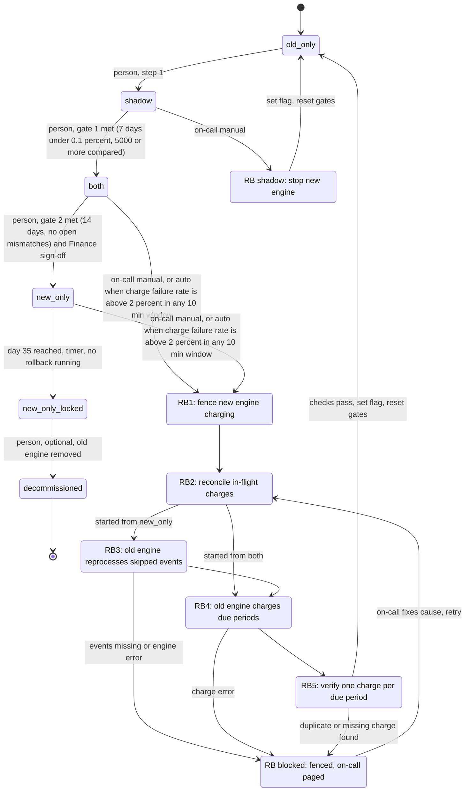

# Billing engine rollout: state machine

## Summary

The rollout has four modes, held in the `billing_mode` flag. Rollback is a separate set of steps that always ends in `old_only`. Day 35 in `new_only` is a derived, one-way lock.

The no-double-charge rule is enforced by one idempotency key per charge, `(customer, billing_period)`. Rollback never relies on timing to avoid a duplicate. Rollback steps and failure handling are below. Open questions are at the end.

## State diagram

Rules the diagram implies:

- There are no backward moves between `shadow`, `both` and `new_only`. The only way back is rollback, and it goes to `old_only`.
- From `old_only` the only exit is `shadow`. This is also how the gates reset: the 7-day count starts at zero on re-entry.
- `new_only_locked` has no rollback edge. That is the "no way back from day 35" rule.

## What each mode does

| Mode | Old engine | New engine | Who charges / writes the ledger | Comparison |
|---|---|---|---|---|
| `old_only` | Computes, charges, writes ledger | Off | Old | None |
| `shadow` | Computes, charges, writes ledger | Reads same events, writes to the shadow store only | Old | Nightly, per customer. A mismatch is a total differing by more than 1 cent. |
| `both` | Computes every invoice into the shadow store, never charges | Computes, charges, writes ledger | New | Continues nightly |
| `new_only` | Stopped | Does everything | New | None (old engine no longer produces invoices) |
| `new_only_locked` | Stopped, may be decommissioned | Does everything | New | None |

Gates, which must be met before a person makes the move:

- **`shadow` to `both`:** 7 consecutive days with a mismatch rate under 0.1% and at least 5,000 invoices compared.
- **`both` to `new_only`:** 14 days in `both` with no unresolved mismatches, plus Finance sign-off.
- A met gate allows the move but does not trigger it. A person still makes it.

## Where the rollout state lives

- **`billing_mode` in the config service** is the single source of truth for the mode. All workers read it. Only the four listed values are valid.
- **A rollback record in the config service** holds the origin mode, the current step (RB1 to RB5, or blocked), and the start time. This is an addition to the brief. It keeps the flag to four values while still telling workers that a rollback is in progress.
  - While a rollback record is open, the new engine must not charge, even though the flag still reads `both` or `new_only`.
  - The flag flips to `old_only` only at the last step, together with closing the record.
- **Mode entry time** is stored with the flag, written in the same update. The 14-day and 35-day clocks are measured from it.
- **The billing ledger** is the system of record for what was charged. Rollback decisions ("was this period charged?") are made from the ledger and the payment provider, never from either engine's memory.
- **The shadow store** holds the non-charging engine's invoices. Nightly comparison results and the gate counters are derived from it. Gate state is recomputed, not stored as a mutable count, so a reset is just a new start date.
- **Sign-off and gate decisions** are recorded with who made them and when.

## No double charge, no dropped charge

The no-double-charge guarantee rests on two layers. Both engines use the same idempotency key, `(customer, billing_period)`, on every charge sent to the payment provider. The ledger also enforces uniqueness on that same pair. Even if a worker has a stale view of the flag, a second charge for the same period is rejected.

The "no dropped charge" guarantee comes from the rollback steps:

1. **RB1, fence.** Set the rollback record. The new engine stops starting new charges. In-flight calls are allowed to finish. From here until the flag flips, nobody starts a charge. Charges are delayed, not lost.
2. **RB2, reconcile.** For every charge whose outcome is unknown (sent to the provider, no ledger row), look it up by idempotency key. Write the missing ledger row, or mark the period as not charged.
3. **RB3, reprocess (from `new_only` only).** The old engine stopped computing when `new_only` began. It now processes the usage events from the whole `new_only` period into the shadow store. Retention is 35 days, so the events must still exist. On starting a rollback, place a retention hold on the log so that events cannot expire mid-run. The rollback is still only allowed to start before day 35.
4. **RB4, charge due periods.** For each period that is due and has no ledger charge, the old engine charges it with the idempotency key. Periods already in the ledger are skipped, whichever engine charged them. From `both` this is small, because the old engine kept its invoices current.
5. **RB5, verify.** Every due period has exactly one charge in the ledger, and no period has two. Only then does the flag flip to `old_only`, the record closes, and gates reset.

Rollback from `shadow` needs only RB1 and the flip. The old engine was already charging and writing the ledger, so the stop step is just turning the new engine off. The shadow store contents are discarded, or kept only for diagnosis, and the gates reset.

## What happens when something fails

| Failure | Behavior |
|---|---|
| New engine errors in `shadow` | Recorded. They count in the mismatch data. They never trigger a rollback. |
| Charge failure rate above 2% in any 10-minute window, in `both` or `new_only` | Automatic rollback starts at RB1 and pages on-call. If a rollback is already running, the signal is ignored. |
| Same failure in `new_only_locked` or after decommission | No rollback is possible. Page on-call to fix forward. |
| On-call starts a rollback by hand | Allowed from `shadow`, `both` or `new_only` at any time before day 35 of `new_only`. |
| Nightly comparison job does not run or fails | That day does not count toward the 7-day gate, which restarts the consecutive count. The mode does not change. |
| Mismatch found in `both` | Blocks the `new_only` gate until resolved. It does not roll back by itself. |
| Step fails in RB2 to RB5 (provider error, missing events, duplicate or missing charge) | The rollback goes to `rb_blocked`. The fence stays on, the flag does not flip, and on-call is paged. On-call fixes the cause and retries from RB2. Re-running is safe because every charge is idempotent. |
| Config service unreadable | Workers keep their last known mode and never infer a change. Idempotency keys prevent double charges even if two workers briefly disagree. |
| Day 35 arrives while a rollback is running | The rollback finishes. The lock timer only fires when no rollback record is open. |

## Open questions

1. **Gate 1 volume.** The brief says "at least 5,000 invoices compared." This model reads that as the total across the 7 days. If it means per day, the gate is stricter.
2. **Auto-trigger minimum volume.** A 2% failure rate over 10 minutes can be reached with very few charges. Should there be a minimum charge count in the window?
3. **Stuck rollback.** The model has no automatic exit from `rb_blocked`, because lifting the fence would put charging back on the failing engine. Should on-call have an explicit "abort rollback" action, and should it count as a rollback for gate reset?
4. **Day-35 boundary.** This model locks at exactly 35 days after entering `new_only`, which is also when that day's first events leave the log. Confirm that "within the 35-day limit" means rollback must start before this point, with the retention hold covering the run.
5. **Decommissioning.** The brief says the old engine "may" be decommissioned. This model treats the lock at day 35 as automatic and decommissioning as an optional later step by a person.
