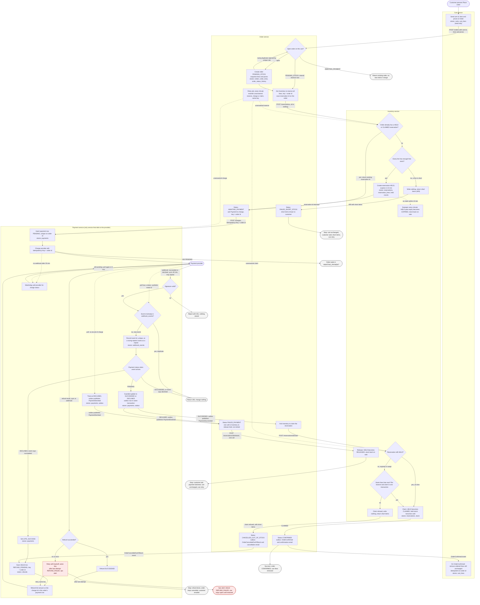

# Checkout across Cart, Inventory, Payment and Order

Checkout moves out of the monolith into four services. Order drives the flow. Inventory holds and sells stock. Payment is the only service that talks to the payment provider. Each service keeps its own database and talks to the others over HTTP or the message broker.

The main flow: Place order snapshots the cart, reserves stock, charges the customer and waits for the provider's webhook. On success, Order claims the stock and confirms the order. Checkout ends in one of three places: a confirmed order, a cancelled order with a full refund, or a stopped checkout with the cart unchanged.

## Terms

- **Hold:** stock set aside for one order for 10 minutes. It is not sold yet.
- **Claim:** turns a hold into sold stock.
- **Idempotency key:** a value sent with a request. The receiver does the work once per key, so a repeat is safe. Every call in this flow uses the order id as its key.
- **Outbox:** a table in a service's own database. A service writes an event row in the same transaction as its state change. A background relay publishes it to the broker. An event is never published without its state change, and never lost after it.
- **Retry job:** a job in Order that runs every minute and resends each reserve, charge or claim call that has no answer yet, with the same key.
- **Webhook:** the provider's HTTP call to Payment that reports a charge result.
- **Open order:** an order with status PENDING_STOCK or AWAITING_PAYMENT. Any other status is closed. A cart has at most one open order.

## Flowchart

Dashed arrows are timers or background jobs, not customer actions.

## Steps

Each step lists what starts it, what it does, which service keeps its data, and what happens when it goes wrong.

1. **Place order.**
   - Starts: the customer presses Place order.
   - Does: Cart sends its id, lines and prices to Order. Order looks for an open order on this cart. If one is AWAITING_PAYMENT, Order returns it and makes no new hold or charge. If one is PENDING_STOCK, Order resends the reserve call now. If none is open, Order creates an order with status PENDING_STOCK and a snapshot of the lines and prices. Later cart edits and price changes do not change this snapshot.
   - Keeps data: Order (orders, order_lines, order_status_history).
   - If it goes wrong: a second Place order that races the first hits the unique rule on cart id and follows the same open-order check.

2. **Reserve stock.**
   - Starts: step 1 creates an order, or the retry job finds an unanswered reserve.
   - Does: Order asks Inventory to reserve all lines, keyed on the order id. If the order already has a HELD or CLAIMED reservation, Inventory returns it and makes no new hold. Otherwise Inventory checks every line in one transaction. If any line is short, it writes nothing and returns the short items. If every line is free, it creates a HELD reservation that expires in 10 minutes. Order saves the reservation id on the order.
   - Keeps data: Inventory (reservations, reservation_lines, stock). Order (the reservation id).
   - If it goes wrong: if a line is short, Order sets FAILED_SHORT_STOCK and shows the short items. Nothing is held or charged, and the cart is unchanged. A lost reply is resent by the retry job with the same key.

3. **Charge the customer.**
   - Starts: Order has saved the reservation id.
   - Does: Order sets AWAITING_PAYMENT and asks Payment to charge, keyed on the order id. Payment inserts a PENDING payment row, unique on order id, and charges the provider with the order id as the idempotency key. Payment replies 202 PENDING, and Order waits for the webhook. The customer sees "Awaiting payment".
   - Keeps data: Payment (payments).
   - If it goes wrong: if the provider refuses before it accepts the charge, Payment returns an error and the retry job resends with the same key. If the reply is lost, the unique payment row returns the same payment.

4. **Receive the outcome.**
   - Starts: the provider's webhook. If no webhook arrives 35 minutes after the charge, the watchdog starts and polls the provider.
   - Does: Payment checks the signature first. If the event id is already recorded, Payment changes nothing. Otherwise it records the event id and applies the change only if the payment is in the state the event expects. A PENDING payment becomes SUCCEEDED or DECLINED. A DECLINED payment that receives a success event becomes LATE_SUCCESS. Any other case changes nothing. Each applied change writes one outbox row in the same transaction.
   - Watchdog: if the charge is still pending, the watchdog polls again in 5 minutes, and Order keeps waiting. If the provider returns a status, Payment treats it like a webhook, using a synthetic event id made of the charge id and the status. If the provider has no record of the charge, Payment treats the charge as DECLINED and publishes PaymentDeclined.
   - Keeps data: Payment (webhook_events, payments, outbox).
   - If it goes wrong: an invalid signature is rejected with 401 and nothing is stored. A repeated event is acknowledged and changes nothing. Two copies that race are handled by the unique constraint on the event id, so only one is processed.

5. **Payment declined.**
   - Starts: the PaymentDeclined event from Payment's outbox.
   - Does: Order acts only while the order is AWAITING_PAYMENT. It sets FAILED_PAYMENT and makes one call to Inventory to release the hold. The customer sees "Payment declined" and the cart is unchanged. The customer can press Place order again, which starts a new order with a new key.
   - Keeps data: Order (orders, order_status_history). Inventory (reservations).
   - If it goes wrong: if the release gets no answer, it is not retried. The sweeper frees the hold within 10 minutes.

6. **Payment succeeded: claim the stock.**
   - Starts: the PaymentSucceeded event from Payment's outbox. Order acts only while the order is AWAITING_PAYMENT.
   - Does: Order asks Inventory to claim the reservation. If the reservation is still HELD, Inventory marks it CLAIMED and the held stock becomes sold. If the hold has expired or been swept, Inventory tries once to re-reserve and claim the same lines in one transaction. If the lines are still free, the claim succeeds. If not, Inventory writes nothing and returns the short items.
     - On success, Order sets CONFIRMED and writes an OrderConfirmed event and a confirmation email row in the same transaction. Cart then removes each ordered line that still matches the snapshot. Lines added or changed after Place order stay in the cart.
     - On short stock, Order sets CANCELLED_OUT_OF_STOCK and writes an OrderCancelledOutOfStock event and a cancellation email row in the same transaction. This starts step 7.
   - Keeps data: Inventory (reservations, stock). Order (orders, outbox).
   - If it goes wrong: a lost claim reply is resent by the retry job. A claim on a CLAIMED reservation returns CLAIMED.

7. **Refund a cancelled order.**
   - Starts: the OrderCancelledOutOfStock event, or LATE_SUCCESS from step 4.
   - Does: Payment saves a refund row (REFUND_PENDING, keyed on the order id) before it calls the provider. It refunds the full amount on the charge id stored in this order's own payment row. On success the refund row becomes SUCCEEDED. Order is not told, and the order stays CANCELLED_OUT_OF_STOCK.
   - Keeps data: Payment (refunds, payments).
   - If it goes wrong: a failed refund is retried with backoff, using the same key. After the last attempt the row becomes REFUND_FAILED and an ops alert is raised. The row stays open until someone resolves it. A repeated event finds the same row and starts nothing new.

## Notes

- **Retry job.** It runs every minute in Order. For each call, it stops once that call gets an answer. Each call is safe to repeat. Order never cancels or refunds because a call timed out. While the job retries, the status does not change: "Checking stock" during reserve, and "Awaiting payment" during charge and claim.
- **Customer page.** The page asks Order for the status every 10 seconds while the order is open, then stops. Order pushes nothing. The page never calls Payment.
- **Emails.** Order writes each email to its outbox in the same transaction as the status change. A mailer job sends it and retries until the send succeeds. If Order crashes after sending but before marking the row sent, the customer may get one duplicate email.
- **Slow broker.** The cart can still show ordered items for a short time after confirmation. The order id makes this safe.

## What happens when things fail

| Failure | What happens | Customer sees |
|---|---|---|
| A line is short | Nothing reserved or charged. Order sets FAILED_SHORT_STOCK. | Short items listed, cart unchanged |
| Payment declined | Hold released, or swept within 10 minutes | "Payment declined", cart unchanged, can retry |
| Success after hold lapsed, same lines still free | Inventory re-reserves and claims, order confirmed | Confirmation email |
| Success after hold lapsed, lines gone | Claim refused, order cancelled, full refund | Cancellation and refund email |
| Success after a no-record decline | Payment sets LATE_SUCCESS, full refund | Nothing yet (see open questions) |
| Refund fails at provider | Retry with backoff, then REFUND_FAILED and ops alert | Cancellation email; refund still open |
| Duplicate or racing webhook | Acknowledged, nothing changed | Nothing |
| Invalid webhook signature | Rejected with 401, nothing stored | Nothing |
| Charge fails before provider accepts it | Payment returns an error; retry job resends with same key | "Awaiting payment" |
| Reserve, charge or claim reply lost | Retry job resends with the same key | "Checking stock" or "Awaiting payment" |
| Charged, but Order never got the reply | Webhook still reaches Payment, which publishes the outcome | Same as the outcome |
| No webhook 35 min after charge | Watchdog polls the provider | Same as the outcome found |
| Provider has no record of the charge | Treated as declined | "Payment declined", cart unchanged |
| Broker slow | Events arrive late | Cart may show ordered items briefly |

## What each service stores

| Service | Owns | Notes |
|---|---|---|
| Cart | carts, cart_lines | Written only by customer edits and the OrderConfirmed consumer. Never read by other services. |
| Order | orders (including reservation id), order_lines (price snapshot), order_status_history, outbox | Holds checkout state, the open-order check and the email rows. |
| Inventory | stock, reservations, reservation_lines | Hold, claim, release and expiry are all state changes on reservations. |
| Payment | payments (PENDING, SUCCEEDED, DECLINED or LATE_SUCCESS), webhook_events, refunds, outbox | webhook_events gives duplicate protection. refunds gives refund durability. |

## Open questions

- **Claim at payment success, not at reservation.** Stock is held only while payment is pending. The cost is that a payment finishing after the hold lapses can be cancelled even when the stock is still free. Extending the hold to about 35 minutes would avoid most of these cancellations, but locks stock longer after declines. The brief fixes the hold at 10 minutes, so this design does not extend it. Confirm the business accepts this.
- **Late success retries the reservation once.** If the same lines are still free, the order is fulfilled. Otherwise the customer is refunded. Confirm the business wants this, not an immediate refund.
- **Refund outcome channel.** The brief covers charge webhooks only. This design assumes refunds return a synchronous result or a webhook handled by the same dedupe path. Confirm with the provider.
- **No record means declined.** At the watchdog poll, no record means no money was taken under that key, so the charge is treated as declined. Confirm with the provider that no charge will follow a missing record. A charge still in flight could succeed later, and step 7 covers that refund.
- **Email ownership.** Order sends the confirmation and cancellation emails. Confirm that no separate notifications service is planned.
- **Cart keeps later edits.** On success, Cart removes only the ordered lines that are still unchanged. Confirm the business wants this rather than emptying the whole cart.
- **Retry job limit.** The brief sets no limit on how long the retry job keeps resending a call with no answer before it alerts ops.
- **Pending charge limit.** The brief sets no limit on how long a charge may stay pending before ops is alerted. The order waits until the provider answers.
- **Email after a no-record decline.** If a charge succeeds after a no-record decline, the customer is refunded but this design sends no email. Confirm whether they should be emailed.
- **Refund after the last attempt.** The row stays open until someone resolves it. Confirm whether ops should also retry automatically after the last attempt.
- **Payment details.** The brief does not say how the customer's payment details are captured and passed to the provider.