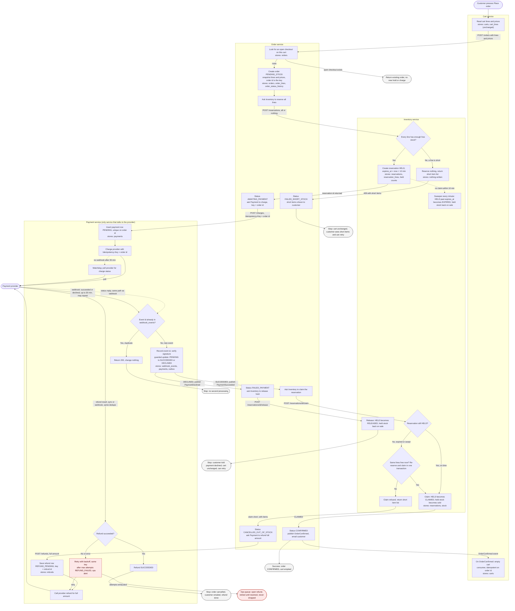

# Checkout across Cart, Inventory, Payment and Order

This flowchart shows checkout from **Place order** to a confirmed order, a cancelled order with refund, or a stopped checkout with the cart unchanged. Each subgraph is one service. Each node says what the service does and what it stores. Dashed arrows are timers or background jobs, not customer actions.

Before reading the chart, note three rules that shape it:

- **The order is the unit of work.** The order id is the idempotency key for the charge, for the refund and for the cart-emptying event, so a retry at any step is safe.
- **Stock is held first, paid second, and claimed only after payment succeeds.** A 10-minute hold runs while payment is pending. If the webhook arrives after the hold has lapsed, the late-success branch decides whether the order can still be fulfilled.
- **The cart is never changed by a failed checkout.** Only a `OrderConfirmed` event empties it.

## Notes on the flow

**Happy path.** Cart sends its lines and prices to Order. Order snapshots them, asks Inventory to reserve all lines, then asks Payment to charge with the order id as the key. Payment's provider webhook arrives, Payment records it, and Payment publishes `PaymentSucceeded`. Order asks Inventory to claim the reservation (HELD to CLAIMED). Order then sets CONFIRMED and publishes `OrderConfirmed`, which Cart consumes to empty the cart.

**Short stock.** Inventory checks all lines in one transaction. If any line is short, it writes nothing and returns the short items. No hold and no charge happen. The cart is unchanged.

**Declined payment.** Payment publishes `PaymentDeclined`. Order moves to FAILED_PAYMENT and releases the hold. If the release call fails, the 10-minute sweeper still returns the stock. The customer can press Place order again, which creates a new order and a new key.

**Late success after the hold lapsed.** The provider can take up to 30 minutes, so the 10-minute hold can expire first. When the success arrives, the claim checks whether the hold still exists. If it has expired, Inventory tries once to re-reserve and claim the same lines in one transaction. If that fails, the claim returns the short items, Order sets CANCELLED_OUT_OF_STOCK, and Payment refunds the full amount. The customer gets an email. We never ship a partial order.

**Failed refund.** The refund row is saved before the provider call, so a crash cannot lose the intent. Failures retry with backoff under the same key. After the last attempt the row becomes REFUND_FAILED and an ops alert is raised. The row stays open until someone resolves it, so a refund is never silently dropped.

**Duplicate webhooks.** Payment records each provider event id with a unique constraint. A repeat is acknowledged and changes nothing. The status update is also guarded (PENDING only), so two different events that both claim success cannot process twice.

**Timers.** Inventory's sweeper expires holds every minute. Payment's watchdog polls the provider if a payment is still pending after 35 minutes, so a lost webhook cannot leave an order stuck.

## What each service stores

| Service | Owns | Notes |
|---|---|---|
| Cart | `carts`, `cart_lines` | Written only by customer edits and the `OrderConfirmed` consumer. Never read by other services. |
| Order | `orders`, `order_lines` (price snapshot), `order_status_history`, outbox | Holds the checkout state and the open-checkout check. |
| Inventory | `stock`, `reservations`, `reservation_lines` | Hold, claim, release and expiry are all state changes on `reservations`. |
| Payment | `payments`, `webhook_events`, `refunds`, outbox | `webhook_events` gives duplicate protection. `refunds` gives refund durability. |

## Decisions to confirm

1. **Claim at payment success, not at reservation.** This keeps stock held only while payment is pending. The cost is that a payment finishing after the hold lapses can be cancelled even when the stock is still free. Extending the hold to about 35 minutes would avoid most of those cancellations, but would lock stock longer after declines. The brief fixes the hold at 10 minutes, so this design does not extend it.
2. **Late success retries the reservation once.** If the same lines are still free, the order is fulfilled. The alternative is to refund immediately. Confirm which the business wants.
3. **Refund outcome channel.** The brief covers charge webhooks only. This design assumes refunds return a synchronous result or a webhook handled by the same dedupe path. Confirm with the provider.
4. **Who sends email.** Order sends the confirmation and cancellation emails in this design. Confirm that a separate notifications service is not planned.
5. **Duplicate checkout.** A second Place order while the first is AWAITING_PAYMENT returns the existing order, which prevents a second hold and charge. This check is in Order, so the cart is not touched.
6. **Cart lag.** If the broker is slow, the cart can still show items after confirmation for a short time. The order id dedupe makes this safe, but the customer may see stale items briefly.