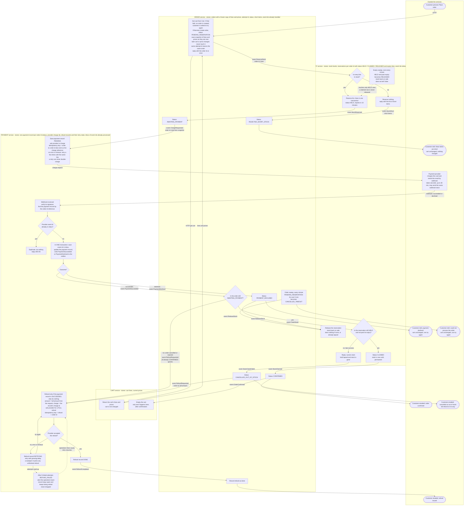

# Checkout across Cart, Inventory, Payment and Order

## What this is

Checkout moves out of the monolith into four services: Cart, Inventory, Payment and Order. When the customer presses Place order, Order freezes a copy of the cart and asks Inventory to hold the stock. Only after the hold succeeds does Payment ask the provider to charge the card. The provider reports the result later by webhook, in seconds or up to 30 minutes. On success, Inventory turns the hold into a sale, Order confirms, and Cart is emptied. If the hold lapsed first, the customer is refunded in full and the order is cancelled.

Each service owns its database and never reads another's tables. Services talk by HTTP or by events on the shared message broker.

## Terms

- **orderId**: made when Place order is pressed. It ties together the reservation, the charge, the refund and the idempotency keys.
- **attemptId**: a random id the checkout page makes when it opens, and makes again after any order ends in failure. Order stores it with a unique key. A double click (same `attemptId`) returns the same order. A retry after a failure (new `attemptId`) makes a new order.
- **Event**: a message on the broker. Names in `code font` in the diagram are events. "HTTP" in the diagram is a direct call.
- **Outbox**: each service saves its state change and its outgoing event in one database transaction. A relay publishes the event afterwards.
- **Inbox**: each consumer saves the ids of events it has handled, in the same transaction as its state change. It does nothing for an id it has seen. Each handler also checks the current status and ignores an event that no longer fits, such as a late `StockReserved`.
- **Reservation**: Inventory's record of held stock for one order. Status is HELD, CLAIMED or RELEASED, with an expiry 10 minutes after it was made.
- **Idempotency key**: a value sent with a provider request so that a repeat of the request has no extra effect. For charges it is the order id. For refunds it is "refund" plus the order id.
- **Status page**: Place order returns the `orderId` at once. The customer's page then polls Order for the status. The "Customer told" boxes mean the page shows that status. While the status is `AWAITING_PAYMENT` it shows "waiting for payment". Order sends every customer email after saving the new status. A failed email is retried and never changes the order.

## What each service stores

| Service | Stores |
|---|---|
| Cart | Cart lines and current prices |
| Order | Orders with a frozen copy of lines and prices, attempt id, status, short items, handled event ids |
| Inventory | Stock levels, one reservation per order id, handled event ids |
| Payment | One payment record per order id (status, provider charge id), refund records with retry state, inbox of handled event ids |

## Flowchart

Boxes sit inside the service that does the step. Customers and the payment provider are outside the services.

## Order statuses

`PENDING_RESERVATION` goes to one of:
- `REJECTED_SHORT_STOCK` (end).
- `CANCELLED_TIMEOUT` (end), if Inventory never answers.
- `AWAITING_PAYMENT`, which goes to one of:
  - `PAYMENT_DECLINED` (end).
  - `CONFIRMED` (end).
  - `CANCELLED_OUT_OF_STOCK` (end, refund follows).

## Steps

1. **Place order** (Order)
   - Starts: the customer presses Place order.
   - Does: asks Cart for the lines and prices over HTTP, creates the order as `PENDING_RESERVATION` with a frozen copy of them, replies with the order id, and sends `ReserveStock`.
   - Keeps: Order's database (the order, its snapshot, the attempt id).
   - If it goes wrong: if the Cart call fails, no order is created and the customer is asked to try again. The cart is untouched.

2. **Reserve stock** (Inventory)
   - Starts: `ReserveStock`.
   - Does: checks all lines. If every line is in stock, it holds all of them in one transaction, status HELD, expiring in 10 minutes, and sends `StockReserved`. Otherwise it reserves nothing and sends `StockShort` with the short items.
   - Keeps: Inventory's database (stock levels, the reservation).
   - If it goes wrong: on `StockShort`, Order sets `REJECTED_SHORT_STOCK`, no payment is requested, and the customer is told which items are short. If Inventory never answers, see the failure table.

3. **Request the charge** (Order, then Payment)
   - Starts: `StockReserved`. Order sets `AWAITING_PAYMENT` and sends `ChargeRequested` with the total from the snapshot.
   - Does: Payment saves a payment record `PENDING`, then asks the provider to charge. The idempotency key is the order id, which is also sent as the charge reference.
   - Keeps: Payment's database (the payment record).
   - If it goes wrong: on error or timeout, Payment retries a few times with the same key. The order stays `AWAITING_PAYMENT`. If there is still no answer, the lost-webhook check settles it.

4. **Receive the result** (Payment)
   - Starts: the provider's webhook, succeeded or declined.
   - Does: verifies the signature and finds the payment record by the order id reference. In one transaction it inserts the provider's event id into the inbox (unique key), updates the payment record, and writes `PaymentSucceeded` or `PaymentDeclined` to the outbox. It replies `200 OK`.
   - Keeps: Payment's database (inbox, payment record, outbox).
   - If it goes wrong: if the event id is already in the inbox, nothing happens and the reply is still `200 OK` so the provider stops resending. Payment status only moves one way: a `SUCCEEDED` payment never becomes `DECLINED`.

5. **Declined** (Order, Inventory)
   - Starts: `PaymentDeclined`.
   - Does: Order sets `PAYMENT_DECLINED`, shows the customer "payment declined", and sends `ReleaseStock`. Inventory releases the hold. The cart is unchanged. The customer can try again with a new `attemptId`, which gives a new order id and a new idempotency key.
   - Keeps: Order and Inventory databases.
   - If it goes wrong: if the hold already lapsed, the release does nothing.

6. **Claim the stock** (Order, Inventory)
   - Starts: `PaymentSucceeded` while the order is `AWAITING_PAYMENT`. Order sends `ClaimStock`.
   - Does: Inventory checks that the reservation is still HELD and not past its expiry, and sets it to CLAIMED, in one transaction. It sends `StockClaimed`.
   - Keeps: Inventory's database (the reservation status).
   - If it goes wrong: if the hold is gone, Inventory sends `StockClaimFailed`. See step 7.

7. **Finish the order** (Order)
   - Starts: `StockClaimed` or `StockClaimFailed`.
   - Does on `StockClaimed`: Order sets `CONFIRMED`, emails the customer, and sends `OrderConfirmed`.
   - Does on `StockClaimFailed`: Order sets `CANCELLED_OUT_OF_STOCK`, emails the customer, and sends `RefundRequested` for the full amount from the snapshot. An order is never shipped in part.
   - Keeps: Order's database (the status).
   - If it goes wrong: a failed email is retried and never changes the order.

8. **Refund** (Payment)
   - Starts: `RefundRequested` with the order id and full amount.
   - Does: looks up the charge in the payment record. If the record is not `SUCCEEDED`, it does nothing. Otherwise it saves a refund record, then asks the provider for a full refund with the key "refund" plus order id. On success the record is DONE and Payment sends `RefundCompleted`. Order records the refund and emails the customer.
   - Keeps: Payment's database (refund records and retry state).
   - If it goes wrong: see the failure table. A refund is never dropped.

9. **Empty the cart** (Cart)
   - Starts: `OrderConfirmed`. This is the only thing that ever empties the cart.
   - Does: empties the cart. Doing it twice is harmless.
   - Keeps: Cart's database.
   - If it goes wrong: the outbox redelivers the event until it works. The order stays `CONFIRMED` meanwhile.

Three sweeps run on their own every minute. Each is covered in the failure table: the Order sweep, the Inventory expiry sweep and the Payment status check.

## When things fail

| Situation | What happens |
|---|---|
| Cart call fails | Step 1 creates nothing. The customer is asked to try again. |
| Short stock | Nothing reserved, nothing charged, customer told which items are short, cart unchanged. |
| Inventory never answers | The Order sweep cancels an order that stays `PENDING_RESERVATION` for over 5 minutes (`CANCELLED_TIMEOUT`) and sends `ReleaseStock`, which does nothing if no hold exists. The page shows "could not process the order, try again". No payment was requested. A late `StockReserved` or `StockShort` is ignored because the order is no longer pending. A late hold lapses by itself after 10 minutes. |
| Charge request fails or times out | Retried with the same key (step 3). |
| Payment declined | Step 5. |
| Duplicate webhook | Dropped by the inbox (step 4). A repeated event is never processed twice. |
| Late success after the hold lapsed | The Inventory expiry sweep turns HELD rows past expiry into RELEASED and puts the stock back on sale. It does not tell Order, so the page keeps showing "waiting for payment" until the claim fails. Claim and expiry cannot both win: the claim checks and changes status in one transaction, and the sweep touches only HELD rows. When the claim fails, the order is cancelled and fully refunded (step 7). A payment that takes over 10 minutes therefore always ends in a refund, even if the stock is still free. This is intended, because unclaimed stock must go back on sale after 10 minutes. Stock is not re-reserved after a lapse. |
| Success for an order no longer waiting | If `PaymentSucceeded` arrives and the order is `CANCELLED_*` or `REJECTED_*`, Order sends `RefundRequested` for a full refund. Any hold is already released or lapsed. If the order is already `CONFIRMED`, the event is ignored. |
| Refund fails at the provider | The refund record goes to `RETRYING` and is retried with growing delays. A sweeper re-picks any unfinished refund, which also covers a crash between the save and the provider call. After N failed attempts the record becomes `REFUND_FAILED` and the operations team is alerted. It stays open and retries continue after the cause is fixed. Nothing is dropped until the provider confirms the refund. Refund results sent by webhook use the same inbox. |
| Lost webhook | A Payment sweep finds payment records still `PENDING` after about 35 minutes. For each it asks the provider for the charge status and processes the answer through the same path as a webhook. "No such charge" counts as declined. |
| Anything else that ends the order | The cart stays exactly as it was. Only `OrderConfirmed` empties it. |

## Open questions

- The number of refund attempts (N) and the retry delays.
- Who receives the operations alert for `REFUND_FAILED`.
- Whether to re-reserve stock when a payment succeeds just after a lapse. This design says no.
- The 5-minute limit for `PENDING_RESERVATION` is a proposal.
- How many times a failed charge request is retried.
