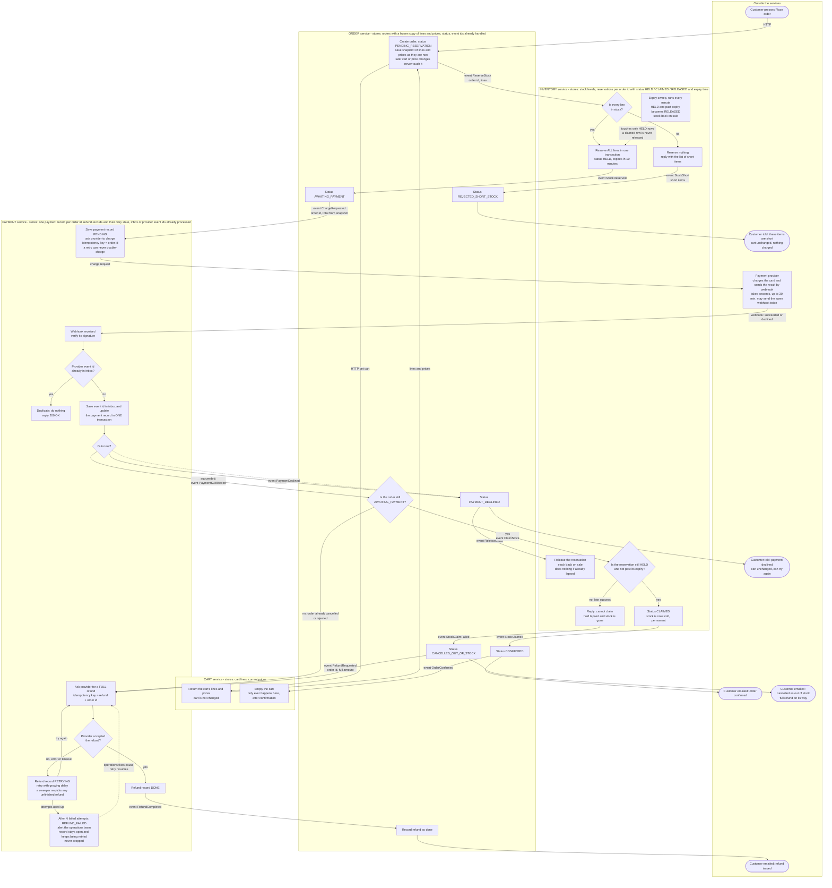

# Checkout across Cart, Inventory, Payment and Order

## How to read this

- Each box is one step. Boxes sit inside the service that does the step. Customers and the payment provider are outside the services.
- Arrows say what triggers the next step. "HTTP" is a direct call. Names in `code font` are events on the shared message broker.
- Every service writes its events through a **transactional outbox**. The state change and the event are saved in one database transaction, and a relay publishes the event afterwards. Every consumer is idempotent, so a redelivered event does nothing.
- `orderId` is created when Place order is pressed. It ties together the reservation, the charge, the refund and the idempotency keys.

## Flowchart

## What each service stores

| Service | Stores | Never touches |
|---|---|---|
| Cart | Cart lines and current prices | Orders, stock, payments |
| Order | Orders, each with a frozen copy of the lines and prices, plus status and handled event ids | The cart's tables, stock tables |
| Inventory | Stock levels, plus one reservation per order id (HELD, CLAIMED or RELEASED, with an expiry time) | Orders, payments |
| Payment | One payment record per order id, refund records with retry state, and an inbox of provider event ids already processed | Orders, the cart |

Services only exchange data through the HTTP call and the events in the diagram.

## Order statuses

`PENDING_RESERVATION` goes to one of:
- `REJECTED_SHORT_STOCK` (end).
- `AWAITING_PAYMENT`, which goes to one of:
  - `PAYMENT_DECLINED` (end).
  - `CONFIRMED` (end).
  - `CANCELLED_OUT_OF_STOCK` (end, refund follows).

## Notes on each failure branch

**Short stock.**
- Inventory checks all lines and takes stock only if every line is available, in one transaction. If any line is short it reserves nothing and returns the list of short items.
- No payment is requested. The customer is told which items are short. The cart is untouched.

**Declined payment.**
- Payment reports `PaymentDeclined`. Order marks `PAYMENT_DECLINED` and asks Inventory to release the hold. If the hold has already lapsed, the release does nothing.
- The customer is told and can try again. The cart is unchanged. A new attempt creates a new order id, so it gets a new idempotency key.

**Late success after the hold lapsed.**
- The 10-minute hold can lapse while the provider is still working. The expiry sweep releases stock only from rows still `HELD`, and stock then goes back on sale.
- When `PaymentSucceeded` arrives, Order sends `ClaimStock`. Inventory claims only if the reservation is still `HELD` and not past its expiry. The check and the status change happen in one transaction.
- Expiry and claim are therefore mutually exclusive. A reservation is either claimed or released, never both.
- If the claim fails, Order marks `CANCELLED_OUT_OF_STOCK`, emails the customer, and sends `RefundRequested` for the full amount. The order is never shipped in part.
- This design does not try to re-reserve stock after a lapse, even if some happens to be free. That keeps the rule simple: no valid hold means no fulfilment. It could be added later as a deliberate change.

**Failed refund.**
- Refund requests use `refund + order id` as the idempotency key, so retries cannot refund twice. The refund record is saved before the provider is called.
- On error or timeout, the record goes to `RETRYING` and is retried with growing delays. A sweeper re-picks any unfinished refund, which also covers a crash between the save and the call.
- After N failed attempts, the record becomes `REFUND_FAILED` and the operations team is alerted. The record stays open and retries continue after the cause is fixed. Nothing is deleted or ignored until the provider confirms the refund.
- If the provider reports refund results by webhook, they go through the same inbox and duplicate check.

**Duplicate webhooks.**
- Payment verifies the signature, then, in one transaction, inserts the provider's event id into the inbox (unique key) and updates the payment record.
- If the insert finds the id already there, nothing happens and the reply is still `200 OK` so the provider stops resending.
- State changes are also one-way. A payment already `SUCCEEDED` cannot go to `DECLINED`.

**Success for an order that is no longer waiting.**
- If `PaymentSucceeded` arrives and the order is not `AWAITING_PAYMENT`, the money is refunded in full. This covers any order that was cancelled or rejected while the charge was in flight.

**Cart emptied only on confirmation.**
- Only `OrderConfirmed` makes Cart empty the cart. Every other end state leaves it exactly as it was.
- Emptying the cart is idempotent, so a redelivered event does nothing more.

## Other protections

- **Double click on Place order.** Order creation is keyed on the cart's checkout attempt, so a repeat returns the same order id instead of creating a second order.
- **Retried charge requests.** The idempotency key is always the order id, so a timeout followed by a retry cannot charge twice.
- **Lost webhook.** If no webhook has arrived after about 35 minutes, Payment asks the provider for the charge's status. It processes the answer through the same inbox path as a webhook.
- **Order of events.** Every handler checks the current status before acting. An out-of-order or repeated event is ignored or leads to a refund. It never causes a double charge or a lost refund.

## Open points to confirm

- The number of refund attempts (N) and the retry delays.
- Who receives the operations alert for `REFUND_FAILED`.
- Whether to re-reserve stock when a payment succeeds just after a lapse. This design says no.
