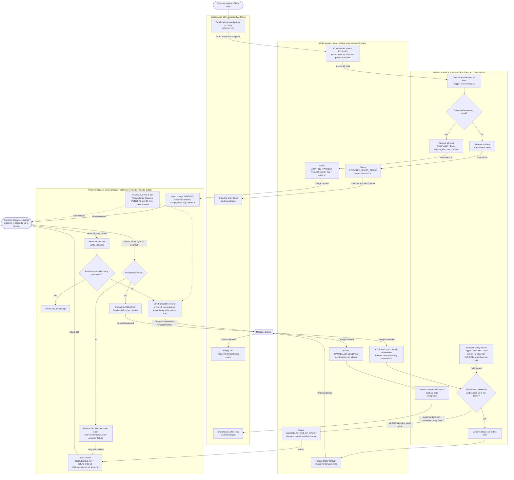

# Checkout across Cart, Inventory, Payment and Order

## Summary

Today checkout runs inside the monolith. This design splits it across four services: Cart, Inventory, Payment and Order. When the customer presses **Place order**, Order records the cart as it is at that moment. Inventory holds the stock for 10 minutes, and Payment takes the money through the payment provider. The provider's answer comes back by webhook, which can take up to 30 minutes. If the payment succeeds after the stock has gone, Order cancels the order and Payment refunds the full amount. We never keep money for an order we cannot fulfil, and we never ship partial orders.

## Terms

- **Reservation (hold):** stock set aside for one order for 10 minutes.
- **Commit (claim):** turning a held reservation into stock sold to the order. This happens after payment succeeds. The brief does not define "claim", so this design reads it this way.
- **Sweeper:** a timer in Inventory that runs every minute and releases holds that have passed their expiry time.
- **Idempotency key:** a key sent with each charge or refund request. A retried request with the same key cannot charge or refund twice. For a charge, the key is the order id.
- **Webhook:** a message the provider sends to Payment when a charge is decided. It may arrive late and more than once. Duplicates are ignored, because each consumer checks the current state before it acts.
- **Outbox:** a row written in the same transaction as a state change. A process then sends it to the broker, so the event is not lost if the broker is down.
- **Message broker:** the shared bus that services use to send events to each other.
- **Price snapshot:** the copy of cart lines and prices that Order stores when the customer presses Place order.

## Diagram

## Steps

Each step lists what starts it, what it does, what it stores, and what happens when it goes wrong.

### 1. Place order (Cart)

- **Starts:** the customer presses Place order.
- **Does:** Cart sends its lines and prices to Order over HTTP. Cart changes nothing yet.
- **Stores:** nothing.
- **If it goes wrong:** the cart stays as it was. The customer sees the failure and can retry.

### 2. Create order (Order)

- **Starts:** the request from Cart.
- **Does:** Order creates an order with its own id and status PENDING. It stores a copy of the lines and prices as they are now. Later cart edits do not change the copy.
- **Stores:** the order, its lines and its prices.
- **If it goes wrong:** the customer sees the failure and the cart stays as it was.

### 3. Reserve stock (Inventory)

- **Starts:** Order asks Inventory to reserve all lines.
- **Does:** Inventory checks every line in one transaction.
  - If any line is short, it reserves nothing and returns the short items. Order sets REJECTED_SHORT_STOCK and stores them. Cart shows them. No payment is requested.
  - If every line has enough stock, Inventory holds all of them for 10 minutes (status HELD, expires_at = now + 10 min). Order sets AWAITING_PAYMENT.
- **Stores:** stock on hand and reservations.
- **If it goes wrong:** a short line means nothing is held and no payment is requested. If the hold runs out before the stock is claimed, see the failure table.

### 4. Request charge (Payment)

- **Starts:** Order asks Payment to charge the order.
- **Does:** Payment inserts a PENDING charge, unique on the order id. It then calls the provider with the order id as the idempotency key. A retried request finds the existing charge and returns it, so the customer cannot be charged twice.
- **Stores:** the charge, keyed by order id.
- **If it goes wrong:** a retry uses the same key, so the provider does not charge twice.

### 5. Record provider result (Payment)

- **Starts:** a webhook from the provider. It can arrive up to 30 minutes later, and it may arrive more than once.
- **Does:** Payment checks the webhook signature.
  - If this provider event id was already processed, Payment returns 200 and changes nothing.
  - Otherwise Payment, in one transaction, records the event id, moves the charge forward only, and writes an outbox row. The outbox sends ChargeSucceeded or ChargeDeclined to the broker.
- **Stores:** processed event ids, the charge state, and outbox rows.
- **If it goes wrong:** if the broker is down, the outbox row waits and is sent later. If no webhook arrives, a reconcile timer runs every 5 minutes. It finds charges still PENDING after 35 minutes, asks the provider for their status, and handles the answer the same way.

### 6. Declined (Order and Inventory)

- **Starts:** ChargeDeclined from the broker.
- **Does:** Order sets CANCELLED_DECLINED and asks Inventory to release the hold at once. Inventory puts the stock back on sale.
- **Stores:** the order status, and the released reservation.
- **If it goes wrong:** release is idempotent, so a repeat does no harm. The cart stays unchanged and the customer may retry.

### 7. Confirm (Order, Inventory and Cart)

- **Starts:** ChargeSucceeded from the broker.
- **Does:**
  - Order asks Inventory to commit the reservation.
  - Inventory, in one transaction, checks that the reservation is still HELD and that expires_at is in the future. If both are true, the stock is sold to this order.
  - Order sets CONFIRMED and publishes OrderConfirmed.
  - Cart removes the confirmed lines only, so items the customer adds during checkout are kept.
- **Stores:** sold stock, the order status, and the cart lines removed.
- **If it goes wrong:** if the commit times out, Order retries it with the same key. Order never refunds on a timeout, because the customer may have received the stock. If Inventory says the reservation is gone, the order goes to late success.

### 8. Late success (Order and Payment)

- **Starts:** Inventory says the hold has lapsed or the stock has gone, so the commit fails.
- **Does:**
  - Order sets CANCELLED_OUT_OF_STOCK, emails the customer, and asks Payment for a full refund.
  - Payment inserts a refund row with status REQUESTED. It calls the provider for the full amount with a key tied to the order.
  - When the provider confirms, Payment sets the refund to SUCCEEDED and publishes RefundSucceeded.
- **Stores:** the order status, and the refund row until the refund succeeds.
- **If it goes wrong:** if the refund fails, the row stays open. Payment retries with backoff until the provider confirms, and it alerts operations after N tries. The row is never dropped.

## What happens when things fail

| Case | Order status | Stock | Money | Cart |
|---|---|---|---|---|
| Short stock | REJECTED_SHORT_STOCK | Nothing held | Not charged | Unchanged. Short items shown. |
| Declined | CANCELLED_DECLINED | Released at once | Not charged | Unchanged. Customer may retry. |
| Confirmed | CONFIRMED | Sold to this order | Charged | Confirmed lines removed |
| Hold lapses before payment | Unchanged until the provider answers | Marked EXPIRED, back on sale | Depends on the provider's answer | Unchanged |
| Late success | CANCELLED_OUT_OF_STOCK | Not sold to this order | Refunded in full. Retried until it succeeds. | Unchanged |
| Commit times out | Unchanged until the commit answers | Retried with the same key | Not refunded on a timeout | Unchanged |
| Refund fails | CANCELLED_OUT_OF_STOCK | Not sold to this order | Refund row stays open and is retried. Ops alerted after N tries. | Unchanged |
| Duplicate webhook | No change | No change | No change | No change |
| Webhook never arrives | Found by reconcile after 35 min, then handled as in step 5 | As the result requires | As the result requires | As the result requires |
| Broker down | No change until the outbox sends the event | No change | No change | No change |

## Open questions

- **Claim means commit.** The brief does not say what "claims the stock" means. This design reads it as the commit after payment succeeds. Customers whose payment takes longer than 10 minutes will often reach the late-success path. Does product accept that cost?
- **Email owner.** The brief names no notification service, so Order sends the emails. Confirm this.
- **Provider key lifetime.** The provider must keep idempotency keys for longer than the 35-minute window. Otherwise the no-double-charge rule depends on the provider. Confirm the provider's key lifetime.
- **Reconcile at 35 minutes.** This is an assumption added for safety. It is not in the brief. Confirm it.
- **Re-reserve instead of refund.** If the stock is still free when a late payment arrives, Payment could re-reserve it instead of refunding. The brief says refund, so this design does not do that. It is a candidate change to discuss.