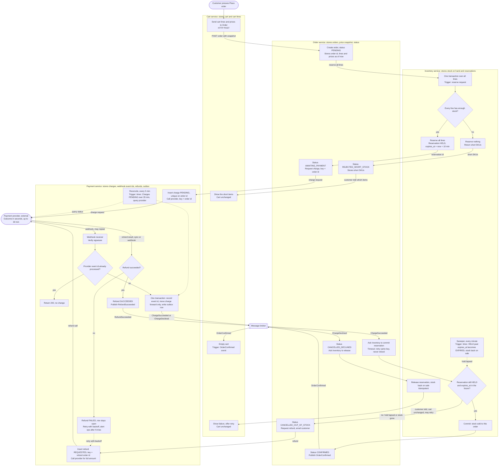

# Checkout across Cart, Inventory, Payment and Order

This document shows the whole checkout flow as one Mermaid flowchart. Each box is one step, labelled with the service that runs it. Boxes also say what triggers the step and what the service stores. Dotted arrows are timers or fallback paths. Solid arrows are the normal path and the failure branches.

**Rules the diagram enforces:**
- Stock is reserved before any charge is requested.
- Reservation is all-or-nothing.
- A reservation holds stock for 10 minutes.
- Only Payment talks to the provider, and it uses the order id as the idempotency key.
- The provider's result arrives by webhook, and duplicate webhooks are ignored.
- Money is never kept for an order that cannot be fulfilled.
- Refunds are tracked until they succeed.
- The cart is emptied only after the order is confirmed.

## Step by step

1. **Place order (Cart).** Cart sends the cart's lines and prices to Order. Cart does not change anything yet.
2. **Create order (Order).** Order stores a PENDING order with its own id and a copy of the lines and prices. Later cart edits do not change this copy.
3. **Reserve (Inventory).** Inventory checks every line in one transaction.
   - If any line is short, it reserves nothing. Order records REJECTED_SHORT_STOCK, and Cart shows the short items. No payment is requested.
   - If every line is available, Inventory holds all of them for 10 minutes. Order moves to AWAITING_PAYMENT.
4. **Charge (Payment).** Payment records a PENDING charge keyed by the order id and calls the provider with the same key. A retried request returns the existing charge, so the customer cannot be charged twice.
5. **Provider result (Payment).** The webhook is checked for a valid signature. If its provider event id was already processed, Payment returns 200 and changes nothing. Otherwise Payment records the event id and moves the charge forward only. The new state is published through an outbox row, so the event is not lost if the broker is down.
6. **Declined.** Order cancels and asks Inventory to release the hold at once. The cart is unchanged and the customer can retry.
7. **Succeeded in time.** Order asks Inventory to commit the reservation. Inventory checks `HELD` and `expires_at` in the same transaction that the sweeper uses, so a late commit cannot succeed after the hold has lapsed. Order becomes CONFIRMED and publishes OrderConfirmed. Cart empties on that event.
8. **Succeeded late.** If the hold has lapsed or the stock has gone, the commit fails. Order cancels as out of stock, emails the customer, and asks Payment for a full refund. Payment keeps the refund row open and retries with backoff until the provider confirms it. After repeated failures it alerts operations. The row is never dropped.

## Stores by service

| Service | What it stores |
|---|---|
| Cart | Cart and cart lines. Emptied only on OrderConfirmed. |
| Order | Orders, status, the price snapshot, short SKUs, and the outbox. |
| Inventory | Stock on hand, reservations with `expires_at`, and the release and commit records. |
| Payment | Charges keyed by order id, processed webhook event ids, refund rows, and the outbox. |

## Terminal states

| Outcome | Order status | Stock | Money | Cart |
|---|---|---|---|---|
| Short stock | REJECTED_SHORT_STOCK | Nothing held | Not charged | Unchanged, short items shown |
| Declined | CANCELLED_DECLINED | Released now | Not charged | Unchanged, retry allowed |
| Confirmed | CONFIRMED | Sold | Charged | Emptied |
| Late success | CANCELLED_OUT_OF_STOCK | Not sold to this order | Refund requested until it succeeds | Unchanged |

## Decisions and open points

- **Claim means commit.** The brief does not say what "claims the stock" means. This design treats it as the commit made after payment succeeds. That makes the 10-minute hold and the up-to-30-minute webhook wait collide, which is what produces the late-success path. Customers whose payment takes longer than 10 minutes will often hit that path, and product should accept that cost.
- **No re-reserve before refund.** If the stock is still free when a late payment arrives, the design could re-reserve it instead of refunding. The brief says to refund, so this is not included. It is a candidate change to discuss.
- **Timeouts are not rejections.** Order retries a commit that times out, using the same key. It refunds only when Inventory actually says the reservation is gone. Refunding on a timeout could refund a customer who did get the stock.
- **Lost webhooks.** Payment reconciles charges still pending after 35 minutes by querying the provider. This is an assumption added for safety, not part of the brief.
- **Delivery is at least once.** Every consumer checks the order's current state before acting. Duplicate events do nothing.
- **Cart edits during checkout.** If the customer edits the cart before OrderConfirmed arrives, the cart should remove only the confirmed lines, not clear everything. Otherwise new items would be lost.
- **Email owner.** The brief names no notification service, so this design has Order send the emails.
- **Provider key lifetime.** The provider must keep idempotency keys for longer than the 35-minute window, or the duplicate-charge guarantee depends on it.