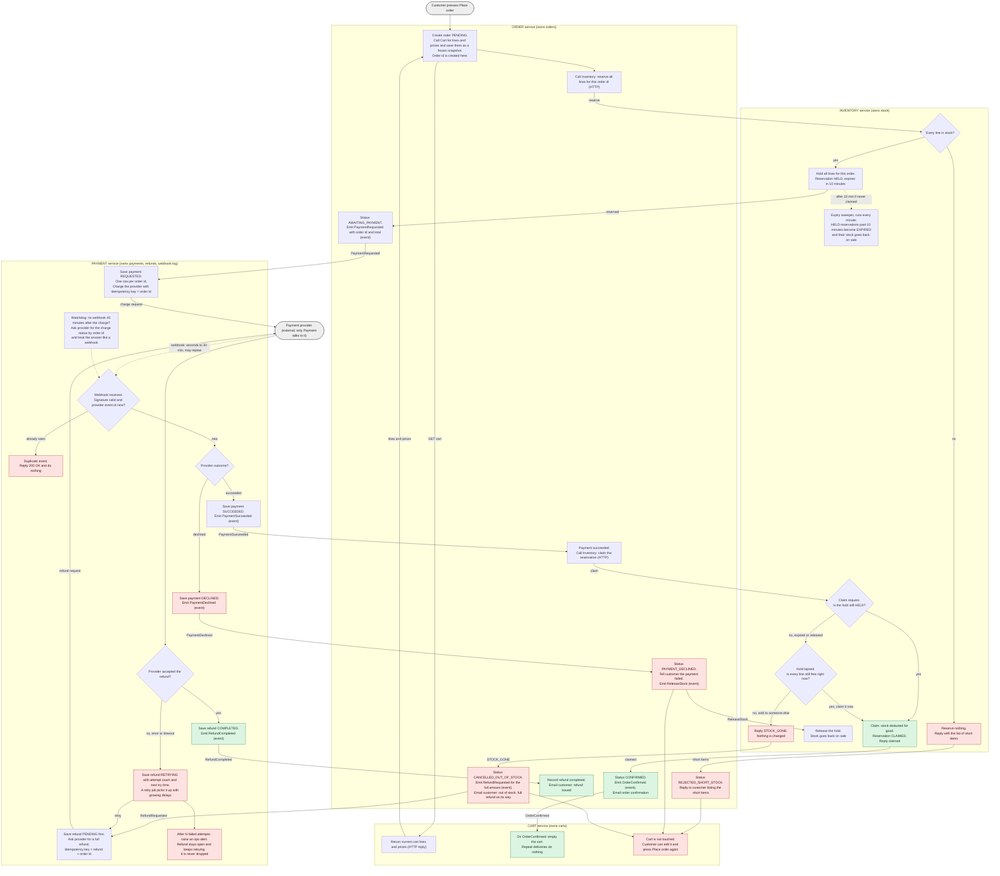

# Checkout design: Cart, Inventory, Payment, Order

Checkout is moving out of the monolith into four services: Cart, Inventory, Payment and Order. When the customer presses Place order, Order freezes a copy of the cart and asks Inventory to hold the stock. If the hold works, Payment charges the customer through an outside provider. When the provider reports success, Order claims the held stock and confirms the order, and the cart is then emptied. If anything fails, the cart stays untouched, and a customer who paid for stock that is now gone is refunded in full.

## Terms

- **Service**: one of the four parts. Each owns its own database. No service reads another's tables. They talk by HTTP or by events on the shared message broker.
- **Event**: a message on the broker. The broker may deliver the same event twice, so every consumer ignores repeats (by event id or order id).
- **Outbox**: a table in each service. A step that changes state writes its outgoing event to the outbox in the same database transaction. A relay then publishes outbox rows to the broker. This stops "state changed" and "event sent" from drifting apart.
- **Reservation (hold)**: stock set aside for one order for 10 minutes. It is `HELD`, then `CLAIMED` (sold), `RELEASED` (freed early) or `EXPIRED` (freed by timeout).
- **Claim**: turning a hold into a real stock deduction, after payment succeeds.
- **Idempotency key**: an id sent with a provider request so that a repeat of the same request has no extra effect. For charges it is the order id.
- **Webhook**: the provider's call to Payment reporting the outcome of a charge. It takes seconds, up to 30 minutes, and may arrive more than once.

## Diagram

Each box sits inside the service that does the work. Arrows are HTTP calls or broker events, and the label says which. Red boxes are failure branches. Green boxes are happy-path endings.

The customer gets an answer from Place order at once, with the order id. A short-stock result is in that same response. Payment and refund outcomes show on the customer's order page, which reads the order's status, and in emails. Order only publishes the email events. The existing mailer sends them.

## Steps

Each step lists what starts it, what it does, what it stores and what happens if it goes wrong.

1. **Place order (Order)**
   - Starts when: the customer presses Place order.
   - Does: creates the order with a new id, asks Cart for its lines and prices, and keeps them as the order's own snapshot. Order never reads Cart again, so later cart edits and price changes cannot affect this order.
   - Stores: Order keeps the order (status `PENDING`), the snapshot, the total and the customer contact.
   - If it fails: the cart is untouched. The customer tries again.

2. **Reserve stock (Inventory)**
   - Starts when: Order sends all lines in one HTTP request.
   - Does: checks every line and holds all of them or none. The hold expires in 10 minutes.
   - Stores: Inventory keeps stock levels, and a reservation with its lines (order id is unique), `expires_at` and status. Checking and changing all lines happens in one transaction.
   - If any line is short: nothing is held. Inventory returns the short items. Order sets `REJECTED_SHORT_STOCK` and replies with those items. Payment is never contacted.
   - If the hold is never claimed: a sweeper runs every minute and marks holds older than 10 minutes `EXPIRED`, which puts the stock back on sale.

3. **Request payment (Payment)**
   - Starts when: Order sets `AWAITING_PAYMENT` and emits `PaymentRequested`.
   - Does: saves a payment row (unique on order id), then charges the provider with the order id as the idempotency key.
   - Stores: Payment keeps the payment (order id, amount, provider charge id, status).
   - If it fails: a retried call or a re-delivered `PaymentRequested` cannot charge twice, because the order id is the key.

4. **Receive the webhook (Payment)**
   - Starts when: the provider calls the webhook, seconds to 30 minutes after the charge.
   - Does: checks the signature, then looks up the provider's event id in the webhook log, which has a unique constraint on that id. A new event is recorded and the payment updated in one transaction, then the result event is emitted.
   - Stores: Payment keeps the webhook log.
   - If it fails: a seen event gets a 200 reply and nothing else. If no webhook arrives within 45 minutes, a watchdog asks the provider for the charge status by order id and handles the answer like a webhook.

5. **Declined (Order, Inventory)**
   - Starts when: Order receives `PaymentDeclined`.
   - Does: sets `PAYMENT_DECLINED`, tells the customer and emits `ReleaseStock`. Inventory then frees the hold early (`RELEASED`).
   - Stores: Order keeps the status. Inventory keeps the released reservation.
   - If it fails: the cart is unchanged. A retry is a new Place order with a new order id. The old id stays tied to the declined charge.

6. **Claim the stock (Inventory)**
   - Starts when: Order receives `PaymentSucceeded` and sends a claim request.
   - Does: if the hold is still `HELD`, marks it `CLAIMED` and deducts the stock for good. If the hold has lapsed, tries once to take the same quantities again, all lines together. If they are all still free, the claim succeeds. If any line was sold, it replies `STOCK_GONE` and changes nothing.
   - Stores: Inventory keeps the reservation status and the stock levels.
   - If it fails: see step 8.

7. **Confirm (Order, Cart)**
   - Starts when: the claim succeeds.
   - Does: Order sets `CONFIRMED`, emails the confirmation and emits `OrderConfirmed`. Cart reacts by emptying the cart. This is the only place the cart is emptied.
   - Stores: Cart keeps the list of order ids already used to clear a cart, so a repeat of the same event does nothing.
   - If it fails: a repeated `OrderConfirmed` has no effect.

8. **Late success, stock gone (Order)**
   - Starts when: Inventory replies `STOCK_GONE`.
   - Does: Order sets `CANCELLED_OUT_OF_STOCK`, emits `RefundRequested` for the full amount, and emails the customer that the item is out of stock and a full refund is on its way. The whole order is cancelled. Nothing ships in part.
   - Stores: Order keeps the status.
   - If it fails: the cart stays as it was.

9. **Refund (Payment)**
   - Starts when: Payment receives `RefundRequested`.
   - Does: saves the refund as `PENDING` before calling the provider, so a crash cannot lose it. It asks the provider for a full refund, with its own idempotency key (refund plus order id) so retries cannot refund twice. On success it saves `COMPLETED` and emits `RefundCompleted`, and Order emails the customer that the refund is issued.
   - Stores: Payment keeps the refund (order id, amount, status `PENDING`, `RETRYING` or `COMPLETED`, attempt count, next try time).
   - If it fails: the refund becomes `RETRYING`, and a retry job repeats it with growing delays. After N attempts it raises an ops alert but keeps retrying. A refund row is never deleted before `COMPLETED`.

## What happens when things fail

| Situation | Who detects it | What happens | Cart |
|---|---|---|---|
| Any line short | Inventory | Nothing reserved, no payment requested. Customer sees the short items. Order is `REJECTED_SHORT_STOCK`. | Unchanged |
| Payment declined | Payment | Order is `PAYMENT_DECLINED`. Hold released. Customer told. | Unchanged |
| Payment succeeds after the hold lapsed, stock gone | Inventory, on the claim | Full refund. Order is `CANCELLED_OUT_OF_STOCK`. Customer emailed. | Unchanged |
| Payment succeeds after the hold lapsed, stock still free | Inventory, on the claim | Claimed late. Order confirmed as normal. | Emptied |
| Refund fails at the provider | Payment | Kept as `RETRYING` and retried with growing delays. Ops alert after N attempts. Never dropped. | Unchanged |
| Same webhook delivered again | Payment | Found in the webhook log. Replied 200 and ignored. | No effect |
| Charge request retried, or `PaymentRequested` redelivered | Provider and Payment | Same order id as idempotency key, so one charge only. | No effect |
| Webhook never arrives | Payment watchdog | After 45 minutes, asks the provider for the charge status and handles it like a webhook. | Unchanged until confirmed |

## Open questions

- **Late claim.** The brief does not say what to do if a late payment arrives and the stock is still free. I chose to claim it, because refunding a fulfillable order is worse for everyone. To always refund after a lapse, remove the "Is every line still free right now?" check and send every lapsed hold to `STOCK_GONE`.
- **Numbers to tune.** The 45-minute watchdog delay and the N attempts before an ops alert are my placeholders. The 30-minute webhook limit is from the brief.
- **Emptying the cart.** I assumed `OrderConfirmed` empties the whole cart. If customers can add items while payment is pending, Cart may need to remove only the lines in the order's snapshot.
- **Mailer.** I assumed an existing mailer sends the emails from Order's events, because the brief names only four services.
