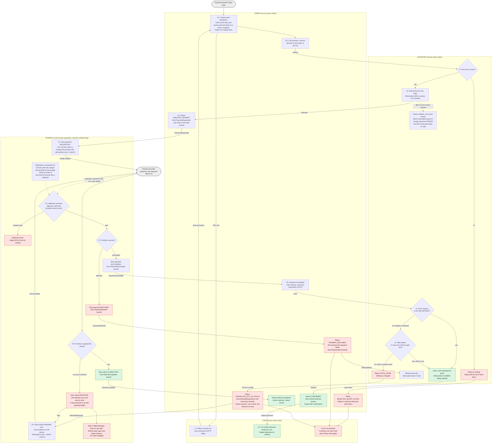

# Checkout design: Cart, Inventory, Payment, Order

## How to read this

- Each box in the diagram sits inside the service that does the work.
- Solid arrows are HTTP calls or broker events. The label says which.
- Red boxes are failure branches. Green is the happy path ending.
- Every step that changes state also writes its outgoing event to an **outbox table** in the same database transaction. A separate relay publishes outbox rows to the broker. Brokers deliver at least once, so every consumer ignores repeats by event id or order id. This is what keeps "state changed" and "event sent" from drifting apart.

## Flowchart

## Step by step

1. **Place order (Order).** Order creates the order with a new id, asks Cart for its lines and prices, and stores them as the order's own snapshot. From here on, Order never looks at Cart again, so cart edits and price changes cannot affect this order.
2. **Reserve (Inventory).** Order sends all lines in one request. Inventory checks every line and holds all of them or none.
   - Any line short: nothing is held, and Inventory returns the short items. Order marks the order `REJECTED_SHORT_STOCK` and replies to the customer with those items. Payment is never contacted.
   - All lines available: Inventory records a reservation for this order id that expires in 10 minutes.
3. **Request payment (Order to Payment).** Order moves to `AWAITING_PAYMENT` and emits `PaymentRequested`. Payment saves a payment row keyed by order id, then calls the provider with the order id as idempotency key. A retried call, or a re-delivered `PaymentRequested`, cannot charge twice.
4. **Webhook (Payment).** The provider reports the result in a few seconds, or up to 30 minutes later. Payment checks the signature and looks up the provider's event id in its webhook log. The log has a unique constraint on that id.
   - Already seen: reply 200 and do nothing.
   - New: record the event and update the payment in one transaction, then emit the result event.
5. **Declined.** Payment emits `PaymentDeclined`. Order marks `PAYMENT_DECLINED` and tells the customer. It also emits `ReleaseStock`, so Inventory frees the hold early. The cart is unchanged. A retry is a new Place order with a new order id. The old id stays tied to the declined charge.
6. **Succeeded.** Payment emits `PaymentSucceeded`. Order asks Inventory to **claim** the reservation.
   - Hold still active: Inventory marks it `CLAIMED` and deducts the stock for good.
   - Hold lapsed: Inventory tries once to take the same quantities again, all lines together. If they are still free, the claim succeeds. If any line was sold, it replies `STOCK_GONE`.
7. **Confirmed.** On a successful claim, Order marks `CONFIRMED`, emails the confirmation and emits `OrderConfirmed`. Cart reacts to that event by emptying the cart. This is the only place the cart is emptied.
8. **Late success, stock gone.** Order marks `CANCELLED_OUT_OF_STOCK` and emits `RefundRequested`. It emails the customer that the item is out of stock and the full amount is being refunded. The whole order is cancelled. Nothing ships in part. The cart stays as it was.
9. **Refund (Payment).** Payment saves the refund as `PENDING` before calling the provider, so a crash cannot lose it. The refund uses its own idempotency key (refund plus order id), so retries cannot refund twice.
   - Accepted: `COMPLETED`. Payment emits `RefundCompleted` and Order emails the customer that the refund is issued.
   - Failed or timed out: `RETRYING`, with an attempt count and next-try time. A retry job repeats it with growing delays. After N attempts it raises an ops alert but keeps retrying. Nothing deletes a refund row until it is `COMPLETED`.

## What each service stores

| Service | Stores | Key fields and rules |
|---|---|---|
| **Cart** | Carts and cart lines. List of order ids already used to clear a cart. | Current items and prices only. Emptied on `OrderConfirmed`, and a repeat of the same event does nothing. |
| **Order** | Orders with frozen line and price snapshot. Outbox. Processed-event ids. | Status: `PENDING`, `AWAITING_PAYMENT`, `CONFIRMED`, `REJECTED_SHORT_STOCK`, `PAYMENT_DECLINED`, `CANCELLED_OUT_OF_STOCK`. Total and customer contact. |
| **Inventory** | Stock levels. Reservations and their lines. | Reservation: order id (unique), lines, `expires_at` (now + 10 min), status `HELD`, `CLAIMED`, `RELEASED` or `EXPIRED`. Reserving or claiming checks and changes all lines in one transaction. |
| **Payment** | Payments. Refunds. Webhook log. Outbox. | Payment: unique order id, amount, provider charge id, status. Refund: order id, amount, status `PENDING`, `RETRYING` or `COMPLETED`, attempts, next try time. Webhook log: unique provider event id. |

## Every failure branch

| Situation | Who detects it | What happens | Cart |
|---|---|---|---|
| Any line short | Inventory | Nothing reserved. No payment requested. Customer sees the short items. Order is `REJECTED_SHORT_STOCK`. | Unchanged |
| Payment declined | Payment, from the webhook | Order is `PAYMENT_DECLINED`. Hold is released. Customer is told. | Unchanged |
| Payment succeeds after the hold lapsed, stock gone | Inventory, on the claim | Full refund. Order is `CANCELLED_OUT_OF_STOCK`. Customer is emailed. | Unchanged |
| Payment succeeds after the hold lapsed, stock still free | Inventory, on the claim | Claimed late. Order is confirmed normally. | Emptied |
| Refund fails at the provider | Payment | Kept as `RETRYING` and retried with backoff. Ops alert after N attempts. Never dropped. | Unchanged |
| Same webhook delivered again | Payment | Found in the webhook log. Replied 200 and ignored. | No effect |
| Charge request retried, or `PaymentRequested` redelivered | Provider and Payment | Same order id as idempotency key, so one charge only. | No effect |
| Webhook never arrives | Payment watchdog | After 45 minutes, Payment asks the provider for the charge status and handles the answer like a webhook. | Unchanged until confirmed |

## Decisions I made that you should check

- **Late claim retries the stock.** The brief says the hold lapses and the stock goes back on sale. It does not say what to do if a late payment arrives and the stock is still free. I chose to claim it if every line is still available, because refunding a fulfillable order is worse for everyone. If you would rather always refund after a lapse, drop the "I4" check and send every lapsed hold straight to `STOCK_GONE`.
- **The email comes from an existing mailer.** Order publishes the event, and whatever sends your emails today consumes it. The brief names only four services, so I did not add a fifth.
- **The 45-minute watchdog and the "N attempts" for refund alerts are my numbers.** The 30-minute webhook limit is from the brief. The rest are placeholders for you to tune.
- **Emptying the cart.** I assumed `OrderConfirmed` empties the whole cart. If customers can add items while payment is pending, you may want Cart to remove only the lines in the order's snapshot. The brief does not say.
- **Customer-facing result.** Place order returns at once with the order id. Short stock is answered in that same response. Payment and refund outcomes are shown by the customer's order page reading the order's status, plus the emails.
