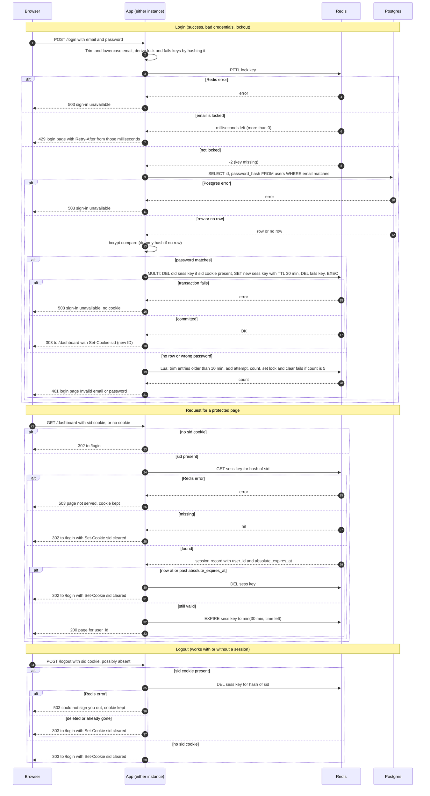

# Login with server-side sessions: design

## Summary

The team-scheduling app is one codebase. Two identical copies run it behind a load balancer that does not keep a user on one copy. Today every page is public and nobody signs in. After this change, every page except `/login` needs a signed-in user.

A correct login creates a session with a random ID. The session is stored in Redis, a shared store that both copies can read. The browser gets only that ID, in a cookie. Each protected page request looks the session up in Redis. Redis deletes idle and expired sessions on its own timer, and the app also checks the 12-hour limit on every request. Failed logins are counted per email in Redis. Five failures within 10 minutes lock that email for 15 minutes. If Redis or Postgres fails, the app returns 503 and lets nothing through.

The session cannot live in one copy's memory, because the other copy would not see it. Postgres could hold sessions, but every page request would then write to it, and expired rows would need a cleanup job. Redis removes expired keys by itself.

Design choices:

- **Session store: Redis, a new service.** Cost: one more service to run. A Redis outage stops sign-in and protected pages.
- **Session ID.** 32 random bytes from a secure random generator, base64url encoded (43 characters).
- **Stored key.** Redis keys hold a SHA-256 hash of the ID, never the ID. A Redis read gives no usable cookie.
- **Session record.** `user_id`, `created_at` and `absolute_expires_at` (created_at plus 12 hours). Nothing else. No user data goes in the cookie.
- **Expiry.** A Redis key TTL, plus a time check on every request.
- **Failure counts.** A sliding 10-minute window per email, kept in Redis.
- **Cookie.** Name `sid`. Attributes `HttpOnly; Secure; SameSite=Lax; Path=/`. No `Max-Age`, so the browser drops it when it closes.
- **Storage failures.** Fail closed. Return 503 and do not check or set anything.
- **Timing.** An unknown email still runs bcrypt against a fixed dummy hash with the same cost, so response time does not show whether an account exists.

## Terms

- **App.** The team-scheduling web app. Two identical copies run it.
- **Postgres.** The existing database. It holds the `users` table, with `id`, `email` (stored lowercase, unique) and `password_hash`.
- **bcrypt.** A slow, one-way password hash. Checking a password means hashing the attempt and comparing the results.
- **Dummy hash.** A fixed bcrypt hash used when no user matches the email. It makes an unknown email take as long as a known one.
- **Session.** A server-side record of one signed-in visit. The browser never sees it.
- **Session ID (`sid`).** The random string in the cookie. It is the only thing the browser holds.
- **Cookie.** A small value that the browser stores and sends with each request to this site.
- **Redis.** A fast key-value store that keeps data in memory. It is new to this stack. Both copies share it.
- **Key.** A Redis name that holds one value. The app uses three kinds: `sess:` plus the hash of the session ID, `fails:` plus the hash of the email, and `lock:` plus the hash of the email.
- **TTL (time to live).** How long Redis keeps a key before it deletes the key itself.
- **PTTL.** A Redis command that returns the milliseconds left on a key. It returns -2 if the key does not exist.
- **Idle expiry.** A session ends 30 minutes after its last request.
- **Absolute expiry.** A session ends 12 hours after login, even if it is still in use.
- **Failure count.** A Redis sorted set of the times of recent failed logins for one email. Times older than 10 minutes are removed.
- **Lock.** A Redis key that refuses logins for one email for 15 minutes.
- **Lua script.** A short program that Redis runs as one step, so no other command runs in between.
- **MULTI/EXEC.** A Redis transaction. Its commands apply together or not at all.
- **Hash (SHA-256).** A one-way scramble. Keys use it, so a leaked key reveals neither a session ID nor an email.
- **Session fixation.** An attack where someone sets a victim's session ID before login. A new ID at each login blocks it.
- **Fail closed.** When storage breaks, refuse the request with 503. Never let it through unchecked.
- **Retry-After.** A response header that tells the client how many seconds to wait.

## Diagram

## Notes on the diagram

- **Keys are per email, not per IP.** The requirements set only per-email limits. Because the lock is keyed by email, the 429 reply does not show whether an account exists.
- **The protected-page check reads only Redis.** It never reads Postgres. A page that needs the user's name or email loads it by `user_id`. A disabled user keeps access until the session ends.
- **`GET /login` always shows the form,** even to a signed-in user. This keeps the behavior simple and does not reveal session state.
- **Redirect codes.** Login success and logout use 303. Auth failures on protected pages use 302.
- **Both timers use UTC,** on hosts whose clocks are synced by NTP.
- **Successful login** clears the email's failure count, inside the transaction in step 5 below.

## Steps: login

Starts when the browser sends `POST /login` with an email and a password.

1. **Normalize.** Trim and lowercase the email. Build the `lock:` and `fails:` key names by hashing it. No storage is used yet.
2. **Check the lock.** Send one PTTL on the `lock:` key. PTTL returns -2 when no lock exists, which means the email is not locked. Otherwise it returns the milliseconds left on the lock. If the lock exists, return 429 with `Retry-After` set to those milliseconds rounded up to whole seconds, and stop. The database is not read and the password is not checked. One call gives both the lock state and the time left, so no second read can race with the lock expiring.
   - If Redis errors: return 503 `Sign-in is unavailable right now. Try again in a few minutes.` Nothing changes, and no password is checked.
3. **Read the user.** Select `id` and `password_hash` from `users` where the email matches. If there is no row, use the dummy hash.
   - If Postgres errors: return the same 503. No counter changes.
4. **Check the password.** Run bcrypt. Both a match and a no-match continue to step 5 or step 6.
5. **If the password matches:**
   - Run one Redis transaction (MULTI/EXEC). It deletes the old session if the browser sent a `sid`, creates the new session under a new random ID with a 30-minute TTL, and deletes the `fails:` key. All three apply or none do. Deleting the `fails:` key clears the email's failure count.
   - Send 303 to `/dashboard` with the new cookie. The new ID always replaces the old one, which blocks session fixation.
   - Each new session record holds `user_id`, `created_at` and `absolute_expires_at`.
   - If the transaction fails: return the same 503 with no cookie. If the connection drops after Redis applied the transaction, the new session exists with no cookie, so it expires by TTL.
6. **If there is no row, or the password is wrong:**
   - Run one Lua script in Redis. It removes `fails:` entries older than 10 minutes, adds this attempt, and counts what is left. If the count is 5, the same script sets the `lock:` key with a 15-minute TTL and deletes the `fails:` key. The script returns only the count.
   - Return 401 `Invalid email or password`. This is the same for an unknown email and a wrong password, whatever the count. The app does not read the lock after the script.
   - The lock takes effect on the next attempt. That attempt fails at step 2 and gets 429. After the lock expires, the count starts from zero.
   - If the script fails: return the same 503. The failed attempt is not counted, and the error is logged.

## Steps: a protected page

Starts when the browser asks for any page other than `/login`.

1. **Check the route.** A middleware runs on every route. Only `/login` and the static files it needs (CSS and images) are public. Every other route needs a session.
2. **No cookie.** If there is no `sid` cookie, return 302 to `/login`. Redis is not read.
3. **Look up the session.** Read the `sess:` key for the hash of `sid`. If the key is missing, return 302 to `/login` and clear the cookie. An unknown session and an expired one look the same, so both get this reply.
   - If Redis errors: return 503 with a short message. Keep the cookie. No redirect and no page.
4. **Check absolute expiry.** Compare the current UTC time with `absolute_expires_at`. If the time has passed, delete the key and redirect as in step 3. This check runs even if the TTL has not fired yet, so TTL drift or a clock problem cannot extend a session.
   - If the DEL fails: return 503, keep the cookie, and serve no page. The expired record stays, and this step denies access on every request until the record is removed.
5. **Extend the idle timer and serve the page.** Set the key's TTL to the smaller of 30 minutes and the time left until `absolute_expires_at`. Then serve the page for `user_id`.
   - If the EXPIRE fails: return 503, keep the cookie, and serve no page. The session is unchanged.
   - This step enforces the 12-hour limit. Until 11.5 hours have passed, the time left is more than 30 minutes, so every request sets a full 30-minute TTL. After 11.5 hours, the time left is under 30 minutes, so the TTL shrinks and the key expires exactly at 12 hours. For example, a request at 11 h 50 min sets a 10-minute TTL.

Abandoned sessions need no sweeper. Redis deletes a key when its TTL passes and never returns an expired key. A session found to be logged out or expired is deleted at that moment.

## Steps: logout

Starts when the browser sends `POST /logout`. Logout does not need a valid session.

1. **No cookie.** If there is no `sid` cookie, skip to step 3.
2. **Delete the session.** Delete the `sess:` key for the hash of `sid`. A key that is already gone counts as success.
   - If the DEL fails: return 503 `Could not sign you out. Try again.` and keep the cookie. The session may still exist, so the user can try again. The app does not report a sign-out while the session may still exist.
3. **Reply.** Return 303 to `/login` with the cookie cleared. The reply is the same with or without a session, so logout can be repeated safely.

## What happens when things fail

Every storage error is logged and counted as a metric. Every login error returns the same 503, so the reply reveals nothing about an account.

| Where | What goes wrong | What the user gets | State left behind |
|---|---|---|---|
| Login, step 2 | Redis error on the PTTL lock check | 503 `Sign-in is unavailable right now. Try again in a few minutes.` | Nothing changed. No password check. |
| Login, step 3 | Postgres error on the user read | Same 503 | Nothing changed. No counter change. |
| Login, step 5 | Redis transaction fails | Same 503, no cookie | Nothing applied. If the connection drops after Redis applied it, the new session exists with no cookie and expires by TTL. |
| Login, step 6 | Redis error in the Lua script | Same 503 | The failed attempt is not counted. The error is logged. |
| Protected page, step 3 or 5 | Redis error on GET or EXPIRE | 503 with a short message. Cookie kept. No redirect, no page. | Session unchanged. |
| Protected page, step 4 | Redis error on the DEL after expiry | 503. Cookie kept. No page. | The expired record stays. Access is denied on every request until it is removed. |
| Logout, step 2 | Redis error on the DEL | 503 `Could not sign you out. Try again.` Cookie kept. | The session still exists. The user can try again. |

## Build and rollout

- Add Redis as a new service next to the app. Production needs replication or a managed service with failover. A single Redis instance is a single point of failure.
- Local development needs HTTPS or a development-only flag, because `Secure` cookies are dropped over plain HTTP.
- Fallback, if the team will not run Redis: a `sessions` table in Postgres, with a cleanup job every 5 minutes and last-seen writes limited to once per minute. This would replace the Redis TTLs and the Lua script with table writes, and it needs its own design review.

## Open questions

- Does the reviewer approve Redis? Approval is needed before the build starts. The requirements do not name the reviewer.
- The login page's static files must be public. The requirements do not say this, so the reviewer should confirm it.
- Login CSRF: `SameSite=Lax` does not stop a cross-site POST to `/login`. A per-form token is recommended, but it is not in the requirements, so it is not included here.
- Lockout denial of service: anyone can lock any email for 15 minutes. Per-IP limits would reduce this, but they need a trusted-proxy setting first.
- Disabled users keep access until their session expires. Deleting sessions on disable is out of scope.
- A Redis restart forces every user to sign in again, because sessions are not durable.
- Local development: HTTPS or a development-only flag is not yet chosen.
