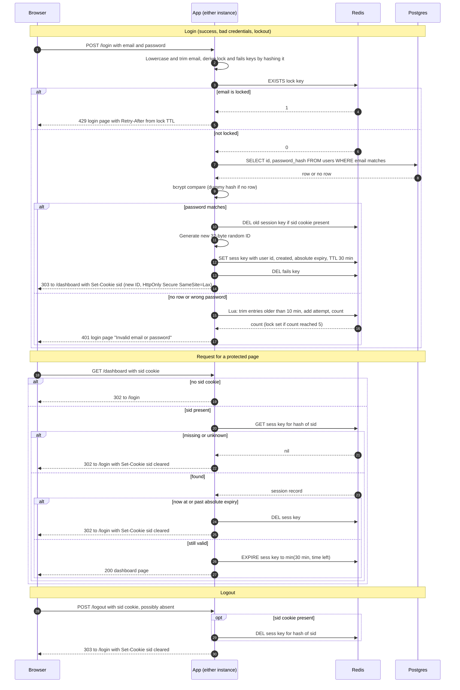

# Login with server-side sessions: design

## Summary

Sessions and failed-login counters live in Redis, which is added as a new service. The browser holds only an opaque random session ID. Idle and absolute expiry are enforced by Redis key TTLs, backed by an explicit check on every request. Storage failures fail closed with a 503 and never fall through to an unchecked login or an unchecked session.

## Choices

1. **Session store: Redis (new dependency).** Two instances with no sticky sessions need shared state, so process memory is out. Postgres could hold sessions, but a 30-minute idle timeout means a write on every protected request, and expiring rows means running a sweeper. Redis gives every key a TTL, so Redis itself removes idle and expired sessions. Cost: one more service to run, and a Redis outage stops sign-in and protected pages. Fallback if the team will not run Redis: a `sessions` table in Postgres, with a sweeper every 5 minutes and last-seen writes throttled to once per minute. **Decision needed from the reviewer: approve Redis.**

2. **Session ID.** 32 bytes from a CSPRNG, base64url encoded (43 characters). Redis stores the key `sess:` plus SHA-256 of the ID, never the raw ID, so a Redis read does not yield usable cookies.

3. **Session record (server side only).** `user_id`, `created_at`, `absolute_expires_at` (= created_at + 12 h). No user data goes in the cookie.

4. **Expiry: two layers.**
   - Redis key TTL is `min(30 min, time left until absolute_expires_at)`. Every valid protected request resets it with EXPIRE.
   - On every request the app also compares the current time with `absolute_expires_at`. If the time has passed, it deletes the key and redirects. This guards against TTL drift or a clock problem.
   - Both timers use UTC on NTP-synced hosts.

5. **Abandoned sessions.** No sweeper is needed. Redis removes a key when its TTL passes and never returns an expired key. Logged-out or expired sessions are deleted at the moment they are found.

6. **Failure counting: sliding 10-minute window.** Key `fails:` plus SHA-256 of the normalized email (trimmed, lowercase), holding a sorted set of attempt timestamps.
   - On each failed attempt, one atomic Lua script removes entries older than 10 minutes, adds this attempt, and counts. A fixed window is not used because 4 failures at t=0.3 s and 1 more at t=600 s would not lock, though 5 fall within a 10-minute period.
   - When the count reaches 5, the script sets `lock:` plus SHA-256 of the email with a 15-minute TTL and deletes the `fails:` set. Counting restarts after the lock expires.
   - The check for `lock:` happens before any database read or password check.
   - Unknown emails are counted and locked the same way, so the 429 cannot reveal whether an account exists.
   - A successful login deletes the `fails:` key.

7. **Cookie.** Name `sid`, value is the opaque ID only. Attributes: `HttpOnly; Secure; SameSite=Lax; Path=/`, no `Max-Age` (browser-session cookie). Clearing uses the same attributes with `Max-Age=0`. The server, not the browser, enforces 30 minutes and 12 hours.

8. **Storage failure policy: fail closed.**
   - Login: any Redis or Postgres error returns HTTP 503 with "Sign-in is unavailable right now. Try again in a few minutes." No password check, no counter change, no cookie is set. The same 503 is used for every error, so it reveals nothing about the account.
   - Protected request: a Redis error returns 503 with a short message. The cookie is kept and the user is not redirected, so the login page is not shown to someone who may still have a valid session.
   - Logout: if the session cannot be destroyed, return 503 "Could not sign you out. Try again." and keep the cookie. The app must not say the user is signed out while the server session still exists.
   - Log every storage error and count it as a metric.

9. **Timing equalization.** An unknown email runs bcrypt against a fixed dummy hash of the same cost, so response time does not reveal account existence.

## Sequence

## Rules that the arrows do not show

- **Login outcomes.** The 5th failed attempt returns 401, as does every failure before it. Attempts after the 5th, within the 15-minute lock, return 429 with no password check. A successful login after a lock has expired starts from a zero count.
- **Session fixation.** Login always creates a new ID, even if the browser sent one. The old session is deleted first. If that delete fails, the login returns 503 and sets no cookie.
- **Protected routes.** Default-deny: a middleware checks every route except `/login`. Static assets needed by the login page (CSS, images) must also be public. The brief does not say this, so the reviewer should confirm it.
- **GET /login.** Always renders the form. It does not redirect a signed-in user, to keep behavior simple and avoid revealing session state.
- **Redirect codes.** Login success and logout use 303. Auth failures on protected pages use 302.
- **Logout.** Same response whether or not a session exists. It is idempotent.
- **Failure counts and locks** are keyed by email, not by IP. The brief sets only per-email limits.

## Open risks for the reviewer

- **Lockout denial of service.** Anyone can lock any email for 15 minutes by failing 5 times. This follows from the brief. Per-IP limits would reduce it, but they need a trusted-proxy setting first.
- **Login CSRF.** SameSite=Lax blocks cross-site POSTs that carry the cookie, so logout CSRF is blocked. It does not stop a cross-site POST to `/login`, which carries no cookie. A per-form token on the login form is recommended. It is not in the brief.
- **Disabled users.** Sessions stay valid until they expire even if a user is deleted or disabled. Deleting sessions on disable would fix this and is out of scope.
- **Redis restart.** Sessions are not persisted in any durable sense. A restart forces re-login. Acceptable for this app, but it should be stated. Redis is a single point of failure unless run with replication or a managed HA service.
- **HTTPS required.** The Secure flag means the cookie is dropped over plain HTTP, so local development needs HTTPS or a dev-only flag.