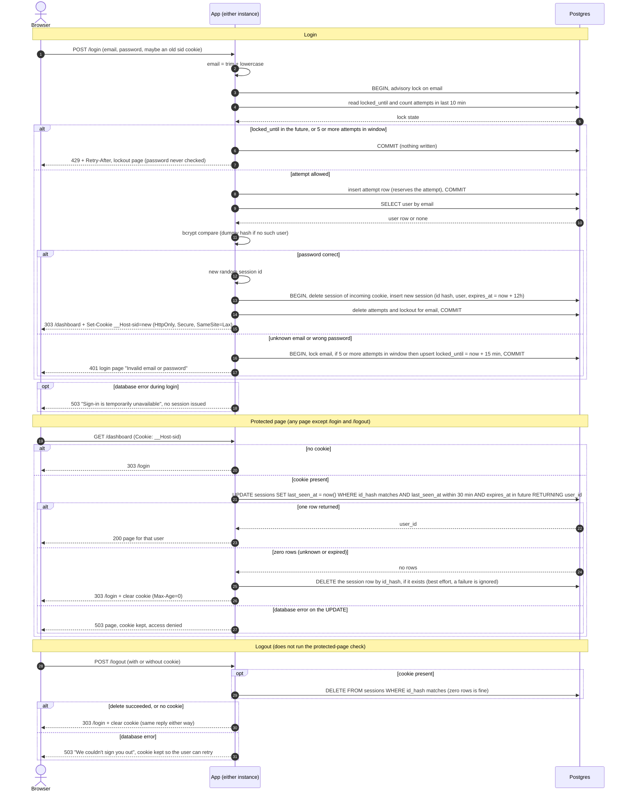

# Login with server-side sessions: design

## Overview

Today every page of this server-rendered scheduling app is public. After this change every page except `/login` needs a signed-in user. The app runs as two identical instances behind a load balancer that can send any request to either one, so no instance may keep state in memory. All state therefore lives in the existing Postgres, which both instances share. The browser holds only an opaque random session ID in a cookie. On a protected request the app looks the ID up in Postgres and decides, using the database clock, whether the session is still valid. Login is rate limited per email, and every successful login creates a fresh session. Redis is not used: it would be a second service to run and a second thing whose failure locks everyone out, and a small team app does not need its speed. If the per-request session write ever shows up in database metrics, only the session store module needs to change.

## Terms

- **Load balancer**: the front door that sends each request to either instance, with no promise which one.
- **Session**: a row in `sessions` meaning "this browser is signed in as this user".
- **Session ID**: 32 random bytes from the operating system's secure random generator, base64url encoded. It is the only thing in the cookie. The database stores only its SHA-256 hash, so a leaked dump holds no usable IDs.
- **Idle limit**: a session ends after 30 minutes with no requests. Every request restarts this clock (`last_seen_at`).
- **Absolute limit**: a session ends 12 hours after login, however active the user is. `expires_at` holds this time and is never extended.
- **Attempt row**: a row in `login_attempts`, written for each allowed login try before the password is checked. If the password is wrong, it counts as a failure. A successful login deletes all of that email's attempt rows.
- **Lockout**: a row in `login_lockouts` saying an email is refused until `locked_until`.
- **`users` table**: already in the same Postgres, with `id`, `email` (lowercase, unique) and `password_hash` (bcrypt).
- **bcrypt**: a deliberately slow password hash. The app runs the comparison itself, not the database.
- **Advisory lock**: a Postgres lock on an arbitrary number. We take one per email so concurrent attempts for the same email run one at a time.

## Decisions

| Choice | Decision and reason |
|---|---|
| Where sessions and attempt counts live | Existing Postgres. Adds no service, sessions survive restarts and deploys, and transactions make session replacement atomic. |
| How expiry is checked | One atomic `UPDATE ... WHERE` per protected request, using the database `now()`, so instances never compare their own clocks. |
| How expiry is recorded | `expires_at` (login + 12 h) and `last_seen_at` on the session row. |
| Removing abandoned sessions | A periodic delete job, plus deletion when an expired session is seen. Security never depends on the job. |
| When storage fails | Fail closed: show a 503 page and never grant access. |

```sql
CREATE TABLE sessions (
  id_hash      bytea PRIMARY KEY,                 -- sha256(session id), never the raw id
  user_id      bigint NOT NULL REFERENCES users(id) ON DELETE CASCADE,
  created_at   timestamptz NOT NULL DEFAULT now(),
  expires_at   timestamptz NOT NULL,              -- created_at + 12 hours (absolute limit)
  last_seen_at timestamptz NOT NULL DEFAULT now() -- restarted by every request (idle limit)
);
CREATE INDEX sessions_last_seen_idx ON sessions (last_seen_at);
CREATE INDEX sessions_expires_idx   ON sessions (expires_at);

CREATE TABLE login_attempts (        -- one row per allowed attempt, written before the password is checked
  email      text        NOT NULL,   -- lowercased, whether or not an account exists
  attempt_at timestamptz NOT NULL DEFAULT now()
);
CREATE INDEX login_attempts_idx ON login_attempts (email, attempt_at);

CREATE TABLE login_lockouts (
  email        text PRIMARY KEY,
  locked_until timestamptz NOT NULL
);
```

## Sequence diagram



## How it runs

### The cookie

`__Host-sid=<id>; Path=/; HttpOnly; Secure; SameSite=Lax`. The `__Host-` prefix makes browsers require Secure and Path=/ and forbid a Domain attribute. There is no `Max-Age` or `Expires`: the server decides when a session ends, and the cookie carries no user data. To clear it, send the same name and attributes with `Max-Age=0`. Login and protected pages send `Cache-Control: no-store`. All redirects are 303. `SameSite=Lax` keeps the cookie off cross-site POSTs.

### Login: POST /login

1. **Normalise.** Trim and lowercase the email and cap it at 254 characters. This is the key for everything below. Unknown emails are limited exactly like known ones, otherwise a 429 would reveal which accounts exist.
2. **Reserve the attempt.** In one short transaction, under `pg_advisory_xact_lock(hashtext(email))`:
   - If `locked_until > now()`, or the email already has 5 or more attempt rows in the last 10 minutes, commit without writing and reply **429** with `Retry-After`. The password is not checked, and retries during a lockout do not extend it.
   - Otherwise insert an attempt row and commit. Counting the attempt before the password is checked stops a burst of parallel guesses from slipping past the limit. The lock is released before bcrypt runs, because bcrypt is slow.
3. **Check the password.** Read the user by email and run bcrypt. If there is no such user, run bcrypt against a fixed dummy hash of the same cost, so timing does not reveal whether the account exists.
4. **Wrong password or unknown email.** In one transaction under the same lock: if there are now 5 or more attempt rows in the last 10 minutes, upsert `locked_until = now() + 15 minutes`. Reply **401** with the login page showing exactly "Invalid email or password", the same for both cases. No cookie is set or cleared, and any existing session is left alone.
5. **Correct password.** In one transaction: delete the session the incoming cookie pointed to (if any), insert a new session with a new random ID and `expires_at = now() + 12 h`, and delete all attempt and lockout rows for the email. Reply **303 to `/dashboard`** with the new cookie. The old ID never becomes valid again, which defeats session fixation (an attacker planting a known ID before login).

Why a lockout row exists as well as the attempt rows: attempt rows are counted for only 10 minutes, but the lock must last 15 minutes from the 5th failure. Without the lockout row, a locked email would get back in after about 10 minutes. The lockout changes the outcome only in the gap between those two times.

Known limitations: while the 5th attempt is still being checked, a 6th concurrent request gets 429 even if the 5th turns out correct. This is the safe direction and rare. A per-IP limit and login CSRF protection are out of scope.

### Protected page: any request except /login and /logout

`/login` and `/logout` have their own rules and never run this check.

1. **No cookie:** reply 303 to `/login`.
2. **Otherwise** hash the cookie value and run one atomic statement. It checks both limits and restarts the idle clock in the same step, so the two instances cannot disagree:

```sql
UPDATE sessions SET last_seen_at = now()
 WHERE id_hash = $1
   AND last_seen_at > now() - interval '30 minutes'   -- idle limit
   AND expires_at   > now()                           -- 12 h absolute limit
RETURNING user_id;
```

3. **One row back:** the session is valid, and the page is served for that user. `last_seen_at` is updated on every request with no throttling, because throttling would break "every request restarts the clock".
4. **Zero rows:** the session is unknown or expired, and both are handled the same way. Run a separate best-effort `DELETE FROM sessions WHERE id_hash = $1` (it removes an expired row, or does nothing). If that delete fails, ignore the error: the session is already known to be invalid and the cleanup job removes the row later. Then clear the cookie and reply 303 to `/login`. Anything the user was typing is lost, and after logging in they land on `/dashboard`, not the page they were on.
5. **The UPDATE itself fails:** see failures below.

When the 12 hours run out, an active user is treated like any expired session on their next request: sent to `/login` without warning. The idle clock never extends `expires_at`.

### Logout: POST /logout

If a cookie is present, delete the session row with that hash (zero rows is fine, so an expired or unknown session is no problem). Then clear the cookie and reply 303 to `/login`. The reply is the same with or without a session. Logout skips the protected-page check so that it behaves identically in every session state.

### Cleanup of abandoned sessions

Expired rows are never honoured, so cleanup only limits table size. Each instance runs this every 5 minutes, guarded by `pg_try_advisory_lock` so only one runs at a time:

```sql
DELETE FROM sessions
 WHERE last_seen_at < now() - interval '30 minutes' OR expires_at < now();
DELETE FROM login_attempts WHERE attempt_at < now() - interval '10 minutes';
DELETE FROM login_lockouts WHERE locked_until < now();
```

Deleting attempts after 10 minutes never weakens the limit, since only the last 10 minutes are counted.

## What happens when things fail

The rule is to fail closed: access is never granted on an error. No 503 page says whether an email exists.

| Where | Behaviour |
|---|---|
| Login, before the attempt is recorded | 503 page: "Sign-in is temporarily unavailable. Please try again in a moment." No session, no password check. |
| Login, after the attempt was recorded (user lookup or session insert fails) | Same 503 page. The attempt row is already committed, so it still counts toward the limit. The session transaction rolls back whole: the old session stays and no new one exists. Repeated outage errors can lock a real user out for up to 15 minutes. We accept that as rare and safe. |
| Protected page, the session UPDATE fails | Same 503 page. The cookie is not cleared and there is no redirect, so a brief outage neither logs users out nor causes redirect loops. |
| Protected page, the cleanup delete after zero rows fails | Ignored. The cookie is still cleared and the reply is still 303 to `/login`. |
| Logout | 503 page: "We couldn't sign you out. Please try again." The cookie is kept, because the session may still exist and the user can retry. |
| Cleanup job | Logs, and retries on the next tick. |

## Rollout

Add the three tables in one migration before deploying the new code. Nothing else about existing data changes. Sign-up and password reset are out of scope.

## Open questions

- After an expiry redirect, should login return the user to the page they were on? Today it always goes to `/dashboard`.
- Should outage errors count toward the lockout? Today they do, because the attempt is recorded first.
