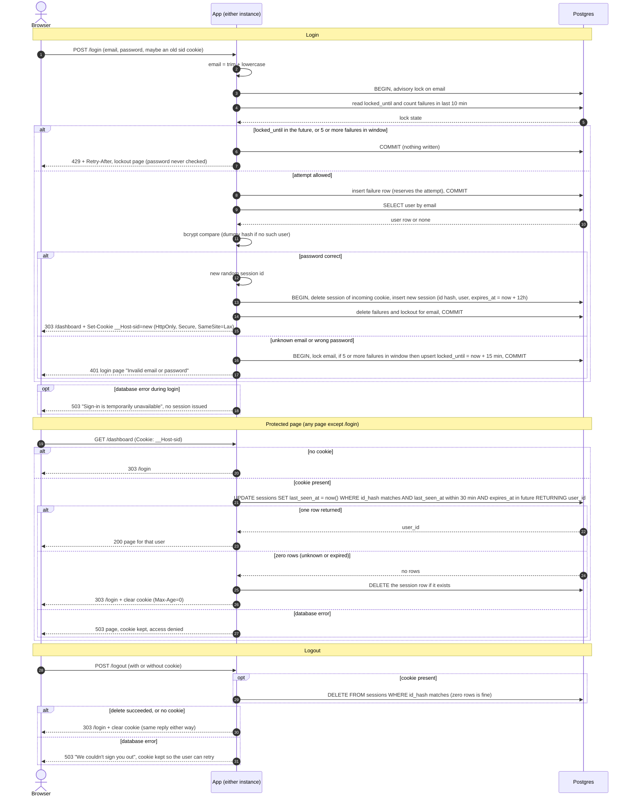

# Login with server-side sessions: design

## Summary of decisions

| Choice | Decision |
|---|---|
| Where sessions and failure counts live | The existing Postgres. No Redis. |
| Session ID | 32 bytes from a CSPRNG, base64url. Only its SHA-256 is stored. |
| How expiry is checked | One atomic `UPDATE ... WHERE` on every protected request, using the database clock. |
| How expiry is recorded | `created_at`, `expires_at` (login + 12 h) and `last_seen_at` columns. |
| How abandoned sessions are removed | A periodic delete job, plus deletion when an expired session is seen. Correctness does not depend on the job. |
| When storage fails | Fail closed. Show a 503 page and never grant access. Details are in the failure table below. |

## Where state lives: Postgres, not Redis

Both instances already share one Postgres, and the state is small. A team-scheduling app has a modest number of users, so a session write on each request is cheap.

**Why Postgres:**
- It adds no new service to deploy, secure, monitor or back up.
- Transactions make the multi-step operations atomic. Login rotation (destroy the old session, create the new one, clear failures) is one transaction. The attempt counter can be serialized per email.
- Sessions survive an app restart or a deploy.
- One clock (`now()` in the database) decides all expiry. The two instances never compare their own clocks.

**Why not Redis:**
- Redis would give faster key expiry and cheaper per-request writes. Neither is needed at this scale.
- Redis would add a second system whose failure also locks everyone out.

**What would change this:** sustained load where the per-request `UPDATE` shows up in database metrics. Moving to Redis later only touches the session store module, because the rules below are written against operations (create, touch, destroy, record failure), not against SQL.

```sql
CREATE TABLE sessions (
  id_hash      bytea PRIMARY KEY,                 -- sha256(session id), never the raw id
  user_id      bigint NOT NULL REFERENCES users(id) ON DELETE CASCADE,
  created_at   timestamptz NOT NULL DEFAULT now(),
  expires_at   timestamptz NOT NULL,              -- created_at + 12 hours (absolute limit)
  last_seen_at timestamptz NOT NULL DEFAULT now() -- restarted by every request (idle limit)
);
CREATE INDEX sessions_last_seen_idx ON sessions (last_seen_at);
CREATE INDEX sessions_expires_idx   ON sessions (expires_at);

CREATE TABLE login_failures (        -- one row per attempt, written before the password is checked
  email     text        NOT NULL,    -- lowercased, whether or not an account exists
  failed_at timestamptz NOT NULL DEFAULT now()
);
CREATE INDEX login_failures_idx ON login_failures (email, failed_at);

CREATE TABLE login_lockouts (
  email        text PRIMARY KEY,
  locked_until timestamptz NOT NULL
);
```

## Rules that don't fit on the arrows

### Session ID and cookie (requirements 4, 5)
- The ID is 32 random bytes from the OS CSPRNG, encoded as base64url. The database stores only `sha256(id)`. A leaked database dump or backup therefore contains no usable session IDs.
- The cookie is `__Host-sid=<id>; Path=/; HttpOnly; Secure; SameSite=Lax`. The `__Host-` prefix makes browsers require Secure and Path=/ and forbid a Domain attribute.
- There is no `Max-Age` or `Expires`, so it is a browser-session cookie. The server decides when a session ends, and the cookie never carries user data or timestamps.
- Clearing the cookie means sending the same name and attributes with `Max-Age=0`.
- Protected and login pages send `Cache-Control: no-store`.
- Redirects after POST use 303. Redirects after GET to `/login` also use 303.

### Expiry check and record (requirements 6, 7)
- Each protected request runs one atomic statement. Idle and absolute limits are checked and the idle clock is restarted in the same step, so two instances cannot disagree.

```sql
UPDATE sessions SET last_seen_at = now()
 WHERE id_hash = $1
   AND last_seen_at > now() - interval '30 minutes'   -- idle limit
   AND expires_at   > now()                           -- 12 h absolute limit
RETURNING user_id;
```

- One row back means the session is valid. Zero rows means missing, unknown or expired, and all three get the same handling: delete that row if it exists, clear the cookie, and redirect to `/login`.
- `last_seen_at` is updated on every request, not throttled to once a minute. Throttling would break "every request restarts that clock". The cost is one small indexed write per request, which is acceptable at this scale.
- `expires_at` is fixed at login and never extended.

### Brute-force limit (requirement 3)
- The key is the submitted email after trim and lowercase, and it is capped at 254 characters. Unknown emails are throttled exactly like known ones. Otherwise the 429 would reveal which accounts exist.
- Each attempt is recorded before the password is checked. A burst of parallel guesses therefore cannot slip past the limit, because every in-flight attempt already counts.
- Attempts for the same email are serialized with `pg_advisory_xact_lock(hashtext(email))`. The lock is held only for the short check-and-record transaction, never during the bcrypt comparison.
- **Start of an attempt**, in one transaction:
  1. If `locked_until > now()`, or there are already 5 or more rows for the email in the last 10 minutes, return 429 with `Retry-After`. No password is checked and no row is written, so retries during the lockout do not extend it.
  2. Otherwise insert a `login_failures` row.
- **After a wrong password**, in one transaction under the same lock: if there are 5 or more rows in the last 10 minutes, upsert `locked_until = now() + 15 minutes`. The 15 minutes therefore run from the 5th failure.
- **After a correct password**, delete all `login_failures` and `login_lockouts` rows for the email as part of the login transaction.
- Known limitation: while the 5th attempt is still being checked, a 6th concurrent request gets 429 even if the 5th turns out to be correct. This is the safe direction and is rare. A per-IP limit is out of scope.

### Indistinguishable failures (requirement 2)
- An unknown email and a wrong password take the same code path. For an unknown email the app runs bcrypt against a fixed dummy hash of the same cost, so response time does not reveal whether the account exists.
- Both return the same 401 status and the same login page, containing exactly "Invalid email or password". Neither sets or clears a cookie.
- The 429 page is also identical for every email.

### Session fixation and rotation (requirement 4)
- On success, one transaction does three things: delete the session the incoming cookie pointed to (if any), insert a new session with a new random ID, and clear the failure rows. The old ID never becomes valid again.
- A failed or locked-out login leaves any existing session alone.

### Cleanup of abandoned sessions
- Expired rows are never honoured, so cleanup affects only table size, not security.
- Each instance runs this every 5 minutes, guarded by `pg_try_advisory_lock` so that only one runs at a time:

```sql
DELETE FROM sessions
 WHERE last_seen_at < now() - interval '30 minutes' OR expires_at < now();
DELETE FROM login_failures WHERE failed_at < now() - interval '10 minutes';
DELETE FROM login_lockouts WHERE locked_until < now();
```

- A request that finds an expired session also deletes it immediately.
- Deleting a failure row after 10 minutes never weakens the limit, because the limit only counts the last 10 minutes.

### CSRF note
- `SameSite=Lax` keeps the cookie off cross-site POSTs, which covers logout and the form posts. Login CSRF is not addressed here.

### When storage fails (left-to-you item)
The rule is to fail closed and never guess.

| Request | Behaviour |
|---|---|
| `POST /login` | 503 page: "Sign-in is temporarily unavailable. Please try again in a moment." No session is issued and the password is not checked unless the attempt was recorded. The page does not say whether the email exists. |
| Protected page | 503 page with the same wording. The cookie is not cleared and there is no redirect to `/login`, so a brief database outage does not log users out or cause redirect loops. |
| `POST /logout` | 503 page: "We couldn't sign you out. Please try again." The cookie is not cleared, because the server-side session may still exist and the user can retry. |
| Cleanup job | Logs and retries on the next tick. |

## Sequence diagram



## Requirement coverage

| # | Where it is handled |
|---|---|
| 1 | Email is trimmed and lowercased before every lookup and every counter key. |
| 2 | Same code path, same dummy bcrypt work, same 401 page. The 429 is also identical for every email. |
| 3 | Attempts are reserved before the check and serialized per email. Lock starts at the 5th failure and lasts 15 minutes. Success clears the counts. |
| 4 | New ID on every success, and the old session is deleted in the same transaction. |
| 5 | Only the opaque ID is in the cookie, with HttpOnly, Secure and SameSite=Lax. |
| 6 | The single `UPDATE` enforces the 30-minute idle limit and the 12-hour absolute limit, and restarts the idle clock. |
| 7 | Zero rows, or no cookie, leads to clearing the cookie and a redirect to `/login`. |
| 8 | The session row is deleted before the reply. With no session the reply is identical. |
