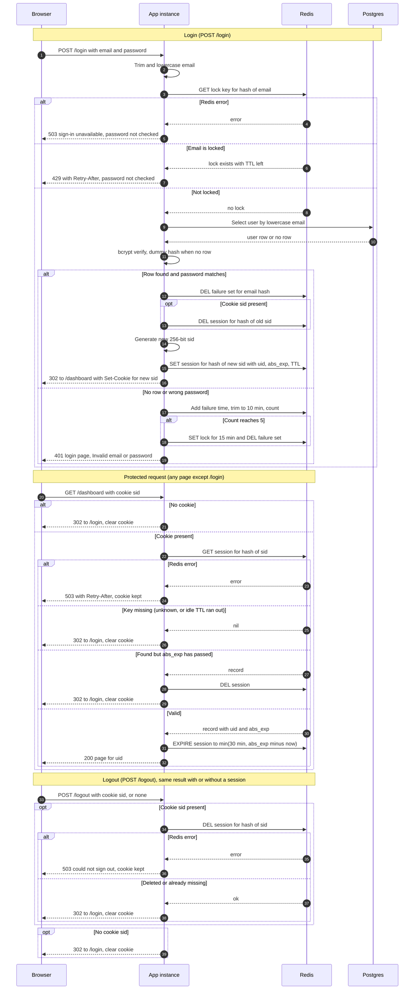

# Login with server-side sessions: design

## What this is

The team-scheduling app has no sign-in today, so every page is public. After this change, every page except `/login` needs a signed-in user. A user posts an email and password to `/login`. The app checks them against the existing `users` table in Postgres. On success it creates a session record in Redis and gives the browser a random session ID in a cookie. Every later request to a protected page sends that ID back, and the app looks up the session in Redis. The browser never holds user data. Failed logins are counted per email in Redis. Five failures within 10 minutes lock that email for 15 minutes.

The design uses Redis because the app runs as two instances behind a load balancer with no sticky sessions. Both instances must see the same sessions and failure counts, so the state cannot live in process memory. Postgres could hold it, but the idle timeout would write to the primary on every page view and would need a cleanup job. Redis can expire each key on its own timer, so abandoned sessions and old failure counts disappear without extra code. The cost is one more service to run and secure. A Redis restart signs everyone out. That is acceptable because sessions are not business data.

Sign-up and password reset are out of scope.

## Terms

- **Session:** The server-side record of one signed-in visit. It holds the user ID, the login time and the absolute expiry time. It lives in Redis.
- **Session ID (sid):** 256 random bits from a cryptographically secure random source, written as 43 base64url characters. It is the only thing in the cookie.
- **Cookie `__Host-sid`:** The browser's copy of the sid. HttpOnly means scripts cannot read it. Secure means it is sent only over HTTPS. SameSite=Lax means browsers usually do not send it on cross-site requests. It has no Max-Age, so it is a browser-session cookie and the server alone decides when the session ends. It has Path=/ and no Domain.
- **Session key:** The Redis key `sess:` plus the SHA-256 hash of the sid. Redis stores the hash, so someone who reads Redis cannot use what they see as a cookie.
- **abs_exp:** The absolute expiry time, which is the login time plus 12 hours.
- **TTL (time to live):** A timer on a Redis key. Redis deletes the key when the timer runs out.
- **Idle expiry:** The session key's TTL, set to the smaller of 30 minutes and the time left until abs_exp.
- **Failure set:** The Redis sorted set `fail:` plus the SHA-256 hash of the lowercased email. Its members are the timestamps of recent failed logins.
- **Lock:** The Redis key `lock:` plus the email hash, with a 15-minute TTL. While it exists, that email cannot log in.
- **bcrypt:** A deliberately slow password hash. The app uses one cost factor for every check.
- **Dummy hash:** A fixed bcrypt hash that the app checks when no user row exists, so an unknown email takes about as long as a known one.
- **Lua script:** A small program that Redis runs as one indivisible step.
- **Fail closed:** When storage is down, the app refuses the request. It never lets the request through.
- **Retry-After:** A response header that tells the client how many seconds to wait.
- **NTP:** Network Time Protocol, which keeps each server's clock accurate.

## Choices

| Area | Choice |
|---|---|
| Session and failure store | One new Redis instance on the private network, with TLS and AUTH on and persistence off |
| Session ID | 256 random bits from a CSPRNG, base64url encoded (43 characters) |
| Session key | `sess:` plus SHA-256 of the sid |
| Cookie | `__Host-sid`, Path=/, no Domain, HttpOnly, Secure, SameSite=Lax, no Max-Age. Holds only the sid |
| Session record | Fields `uid`, `created_at`, `abs_exp` |
| Idle expiry | Redis key TTL, set to min(30 min, abs_exp minus now) at login and on every valid request |
| Absolute expiry | Checked in the app on every request against `abs_exp`, so the 12-hour cap holds even if a TTL update fails |
| Failure counts | Sorted set `fail:` plus email hash. Entries older than 10 minutes are trimmed on each write |
| Lockout | Key `lock:` plus email hash, TTL 15 min, set by the 5th failure in any 10-minute window. The failure set is deleted when the lock is set |
| Unknown emails | Counted and locked exactly like known emails. bcrypt always runs, against the dummy hash when no row exists |
| Cleanup | No sweeper job. Every key has a TTL: session at most 30 min, failure set 10 min after its last entry, lock 15 min |
| Session on login | Always a new sid. Any session named by an incoming cookie is deleted first |
| Logging | Login success, failure, lock set and expiry reason, keyed by the email hash. Never raw emails or passwords |

## How it runs

## Notes on the flows

**Login.** It starts when the browser posts the form. The app checks the lock before it touches Postgres or bcrypt. A locked email gets 429 and its password is never checked. The attempt is not recorded and the lock does not extend. Each Redis call has a 150 ms timeout. If Redis fails or times out, the app returns 503 and does not check the password, so the lockout still holds.

On a correct password, the app clears the failure set, deletes any session named by the old cookie, and creates a new session with a new sid. The old session is deleted even if the browser sent it, so nobody keeps a session that was active before login.

On a wrong password, or an unknown email, the app runs one Lua script. The script trims the failure set, adds the new timestamp and counts the entries. At 5 or more, it sets the lock for 15 minutes and deletes the failure set. The 5th failure still returns 401. The next attempt returns 429. The bad-credentials and unknown-email responses must match exactly: same status, same page, same headers and no Set-Cookie.

Lockout is per email, not per IP, because the brief asks for that.

**Protected request.** It starts when the browser asks for any page except `/login`. The app reads the session key using the hash of the sid. A session is active only when its key exists and the current time is before abs_exp. Any other state counts as signed out. The app then clears the cookie and redirects to `/login`. The states are:
- Active: the key exists and the time is before abs_exp.
- Idle-expired: Redis removed the key when its TTL ran out.
- Absolute-expired: the time is at or after abs_exp. The app deletes the key.
- Destroyed: the session was removed by logout or by login rotation.

Only requests to protected pages count as activity. `GET /login` does not touch the session.

**Logout.** It starts when the browser posts to `/logout`. The app deletes the session key only if a cookie is present. Deleting a key that is already gone does nothing, so the response is the same whether or not a session existed. The app then clears the cookie. The clearing Set-Cookie uses the same name and attributes with Max-Age=0. If Redis fails, the app does not claim success, keeps the cookie and asks the user to try again.

## What happens when storage fails

| Failure | Login | Protected page | Logout |
|---|---|---|---|
| Redis down or slower than 150 ms | 503 "Sign-in is temporarily unavailable. Try again in a minute." Password is not checked, so the lockout stays on | 503 with the same kind of message and Retry-After. Cookie kept, no redirect | 503 "Could not sign you out. Try again." Cookie kept |
| Postgres down | 503 as above. Not counted as a failed attempt | Not involved | Not involved |
| Redis error after the password check | 503. No session is created and the failure is not recorded | Not applicable | Not applicable |

The app fails closed because a Redis outage must never open a way past the lockout or a way in. Keeping the cookie during an outage stops a short blip from signing everyone out. Logout reports success only when the server record is gone, because the server must destroy the session before replying.

## Open questions

- **Per-email lockout can be abused.** Anyone who guesses a user's email can lock that user out. The brief asks for per-email lockout. A per-IP limit should be added later as a separate control.
- **Small overshoot under concurrency.** Requests that passed the lock check just before the lock was set can still reach bcrypt. The overshoot is limited by concurrency, and each of those attempts is still recorded.
- **Login CSRF is not covered.** SameSite=Lax protects the session cookie, but it does not stop a cross-site form from logging a victim into the attacker's account. The login form needs a token. The brief does not mention one.
- **No revocation when a user changes.** A deleted or disabled user keeps an active session for up to 30 minutes idle, or 12 hours absolute. Per-user revocation is out of scope.
- **Static assets.** This design assumes static files are served without a session because they hold no user data. This needs confirmation.
- **Clock sync.** The absolute check uses each instance's own clock, so both instances need NTP. Clock skew moves the 12-hour cap by seconds.
- **Redis restarts.** TLS, AUTH and a private network are required, and persistence is off. A Redis restart signs everyone out and clears all lockouts. This needs a decision: accept it, or turn on persistence and accept its cost.