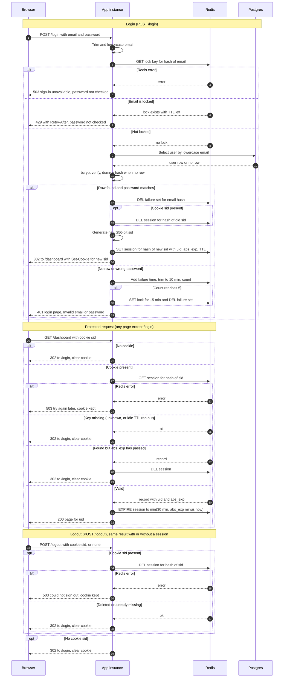

# Login with server-side sessions: design

## Choices

| Area | Choice |
|---|---|
| Session and failure store | Redis, one new instance on the private network, TLS and AUTH on, persistence off |
| Session ID | 256 random bits from a CSPRNG, base64url encoded (43 characters) |
| Session key | `sess:` plus SHA-256 of the session ID. A Redis read does not yield a usable cookie |
| Cookie | Name `__Host-sid`, Path=/, no Domain, HttpOnly, Secure, SameSite=Lax, no Max-Age (browser session cookie; the server decides expiry). Holds only the ID |
| Session record | Fields `uid`, `created_at`, `abs_exp` (login time plus 12 h) |
| Idle expiry | Redis key TTL. Set to min(30 min, abs_exp minus now) at login and on every valid request |
| Absolute expiry | Checked in the app on every request against `abs_exp`, so the 12-hour cap holds even if a TTL update fails |
| Failure counts | Redis sorted set `fail:` plus SHA-256 of the lowercased email, holding failure timestamps. Entries older than 10 min are trimmed on each write |
| Lockout | Redis key `lock:` plus email hash, TTL 15 min, set by the 5th failure inside any 10-minute window. The failure set is deleted when the lock is set |
| Unknown emails | Counted and locked exactly like known emails. bcrypt always runs, against a dummy hash when no row exists |
| Cleanup | No sweeper job. Every key has a TTL: session at most 30 min, failure set 10 min after its last entry, lock 15 min |
| Session on login | Always a new ID. The session named by any incoming cookie is deleted first |

**Why Redis.** Two instances with no sticky sessions means session state must be shared. Postgres could hold it, but the idle timeout would force a write to the primary on every page view, and expired rows would need a cleanup job. Redis gives per-key TTLs that match the three clocks (idle, absolute, lockout), so abandoned sessions and stale failure counts disappear without application code. The costs are one more service to run, secure and monitor, and a Redis restart signs everyone out. That is acceptable because sessions are not durable business data. The brief allows adding Redis, and this is the reason to add it.

## Rules that do not fit on the arrows

**Lockout.**
- Before any database or bcrypt work, check `lock:` for the normalized email. If it exists, return 429 with Retry-After set to the remaining TTL. The password is not checked and the attempt is not recorded. The lock does not extend.
- On a failed attempt, one Lua script trims the failure set, adds the timestamp, and counts. At 5 or more entries, it sets `lock:` for 15 min and deletes the failure set. The 5th failure itself returns 401, like any failed attempt. The next attempt returns 429.
- On success, delete the failure set. A success cannot happen while locked, because the lock is checked first.
- Lockout is per email, not per IP, as the brief requires.

**Session states.** Active (key present, `now` before `abs_exp`), Idle-expired (key gone by TTL), Absolute-expired (`now` at or after `abs_exp`; the app deletes the key), and Destroyed (logout or login rotation). Any state other than Active is treated as unauthenticated. The cookie is cleared.

**Expiry clock.** Only requests to protected pages count as activity. `GET /login` does not touch the session.

**Logout.** It deletes the server record only if a cookie is present. Deleting a missing key is a no-op, so the response is identical with or without a session. The Set-Cookie that clears the cookie uses the same name and attributes with Max-Age=0.

**Responses.** The bad-credentials and unknown-email responses must match exactly: same status, same page, same headers, and no Set-Cookie. Both use bcrypt and the same cost factor, so timing is close.

**Logging.** Log login success, failure, lock set, and expiry reason, keyed by the email hash. Never log raw emails or passwords.

## Sequence

## Failure behavior (storage fails)

| Failure | Login | Protected page | Logout |
|---|---|---|---|
| Redis down or over 150 ms | 503 "Sign-in is temporarily unavailable. Try again in a minute." No password check, so brute-force protection stays on | 503 with the same kind of message and Retry-After. Cookie kept, no redirect | 503 "Could not sign you out. Try again." Cookie kept |
| Postgres down | 503 as above. Not counted as a failed attempt | Not involved | Not involved |
| Redis error after password check | 503. No session is created. Failure not recorded | Not applicable | Not applicable |

Why fail closed: a Redis outage must never become a way past the lockout or a way in. Keeping the cookie during an outage stops a brief blip from signing everyone out. Logout does not claim success unless the server record is gone, because the requirement is to destroy it before replying. The user can retry.

## Open boundaries

- **Per-email lockout can be abused.** Anyone can lock out a known user by guessing their email. This is what the brief asks for. A per-IP limit should be added as a separate control later.
- **Small overshoot under concurrency.** Requests that passed the lock check before the lock was set can still reach bcrypt. The overshoot is bounded by concurrency, and every one of those attempts is still recorded.
- **Login CSRF is not covered.** SameSite=Lax protects the session cookie, but it does not stop a cross-site form from logging a victim into the attacker's account. A token on the login form is needed. The brief does not mention it.
- **No revocation on user change.** A deleted or disabled user keeps an active session for up to 30 min idle, or 12 h absolute. Adding a per-user revoke is out of scope.
- **Static assets.** This design assumes assets under a static path are served without a session because they contain no user data. This needs confirmation.
- **Clock sync.** The absolute check uses each instance's clock, so both instances need NTP. Skew shifts the cap by seconds.
- **Redis operations.** TLS, AUTH and a private network are required. Persistence is off. Losing Redis means everyone signs in again, and no lockouts survive the restart. That last point needs a decision.