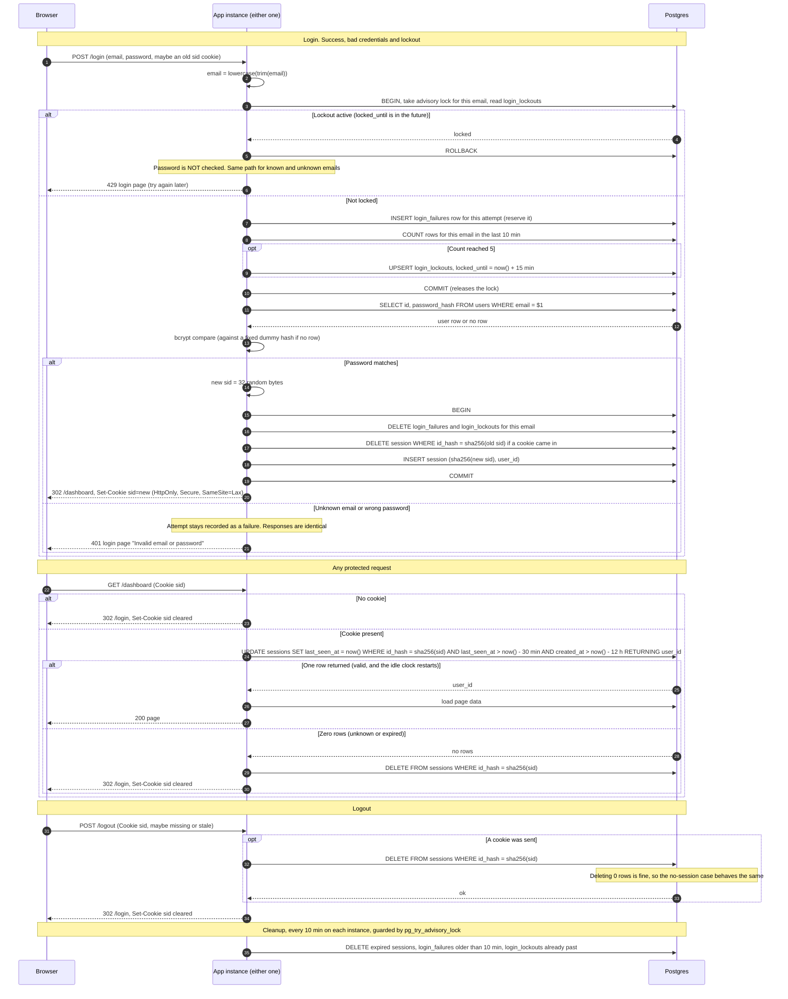

# Login with server-side sessions: design

## Summary

Today every page of this server-rendered app is public. The app runs as two identical instances behind a load balancer with no sticky sessions, and one Postgres database. This change makes every page except `/login` require a signed-in user.

The flow: the browser posts an email and password to `/login`. The app first checks and records the attempt against a per-email limit. It then checks the password. On success it creates a session row in Postgres and sends the browser a cookie holding a random ID. Every later request looks that ID up in Postgres, which also restarts the 30-minute idle clock. Logout deletes the row.

Everything lives in Postgres because both instances already share it. Redis would add a service to deploy, secure and monitor, and a second store that could disagree with the first. The cost is one indexed write per protected request, which is cheap for a small team app. Revisit this only if that write is measured to be a problem.

Sign-up and password reset already exist elsewhere or are out of scope. The existing `users` table has `id`, `email` (lowercase, unique) and `password_hash` (bcrypt).

## Terms

- **Session**: one row in `sessions`, meaning "this browser is signed in as this user".
- **Session ID**: 32 random bytes from a secure random generator, base64url-encoded. It is the only thing in the cookie. Only its SHA-256 hash is stored, so a leaked database gives an attacker no usable cookies.
- **Idle limit**: a session dies after 30 minutes with no requests. **Absolute limit**: it dies 12 hours after login. Whichever comes first wins. Both values live in one config constant used by the request check and the cleanup job.
- **Failure row**: a row in `login_failures` recording one login attempt for an email. It is written before the password is checked, so it counts as a failure until the login succeeds.
- **Lockout**: a row in `login_lockouts` saying an email is refused until `locked_until`.
- **Advisory lock**: a Postgres lock on an arbitrary key, here the hash of the email. It makes parallel attempts for one email take turns.
- **Fail closed**: when storage breaks, deny access and show an error. Never skip a check.
- **Database clock**: all time checks use Postgres `now()`, never an instance's own clock, so the two instances cannot disagree.

## Schema

```sql
CREATE TABLE sessions (
  id_hash      bytea       PRIMARY KEY,                 -- sha256(session id)
  user_id      bigint      NOT NULL REFERENCES users(id) ON DELETE CASCADE,
  created_at   timestamptz NOT NULL DEFAULT now(),      -- never updated
  last_seen_at timestamptz NOT NULL DEFAULT now()
);
CREATE INDEX sessions_last_seen_idx ON sessions (last_seen_at);
CREATE INDEX sessions_created_idx   ON sessions (created_at);

CREATE TABLE login_failures (          -- one row per attempt, counted as a failure
  email     text        NOT NULL,      -- lowercase, whether or not a user exists
  failed_at timestamptz NOT NULL DEFAULT now()
);
CREATE INDEX login_failures_idx ON login_failures (email, failed_at);

CREATE TABLE login_lockouts (
  email        text        PRIMARY KEY,
  locked_until timestamptz NOT NULL
);
```

## Sequence diagram



## Notes on the diagram

**Email.** The email is trimmed and lowercased once, at the start. The throttle tables and the user lookup all use that value. Throttling is keyed by the string, not by whether a user exists, so a lockout on a made-up email looks exactly like one on a real email.

**Brute-force limit** (5 failures in any 10 minutes locks the email for 15 minutes).
- The attempt is recorded before the password is checked, under the per-email advisory lock. That way a burst of parallel guesses cannot all pass a check made before any of them was counted.
- The lock is released before the slow bcrypt compare, so it is held only for the lockout read, the insert and the count.
- The attempt that brings the count to 5 is still verified. If it fails, the lockout is already in place, so the next attempt gets 429 with no password check. If it succeeds, the login clears all failure and lockout rows.
- A 429 inserts nothing, so repeated tries during a lockout do not extend it. When the lock ends, every counted failure is older than 10 minutes, so the count starts fresh.
- Counting rows by `failed_at` gives a sliding window, with no fixed buckets.

**Identical failure responses.** An unknown email runs bcrypt against a fixed dummy hash of the same cost, so timing does not reveal existence. Both cases return the same status, template and text, with no extra header, redirect or cookie. The 429 page is the same for every email.

**Session fixation.** Login never reuses an incoming ID. It deletes the old session and creates the new one in one transaction. If that transaction fails, no cookie is issued.

**Cookie.** `sid=<id>; Path=/; HttpOnly; Secure; SameSite=Lax`, with no `Max-Age` or `Expires`, so it is a browser-session cookie and only the server decides expiry. Clearing sends the same name and attributes with `Max-Age=0`. `SameSite=Lax` keeps the cookie off cross-site POSTs, which covers `/logout` and form posts. No separate CSRF token is added in this change.

**Expiry.** The one `UPDATE` both checks and renews the session, so there is no read-then-write race. It enforces the idle limit with `last_seen_at` and the absolute limit with `created_at`, which is never updated.

**Cleanup.** Every instance runs the cleanup job on a timer. `pg_try_advisory_lock` lets only one do the work at a time. The deletes remove sessions past either limit, failure rows older than 10 minutes, and lockouts already past. They are safe to repeat. Correctness never depends on the job, because the request check enforces expiry. The job only bounds table size.

## What happens when storage fails

The rule is to fail closed: show a generic 503 page, grant nothing, and log the error server-side with a request ID and no secrets.

| Where it fails | What the user sees | Why |
|---|---|---|
| Lockout check or recording during login | 503: "Sign-in is temporarily unavailable. Please try again in a few minutes." The password is not checked and no session is created. | A broken throttle must not let guesses through unlimited. |
| Session insert during login | The same 503, and no cookie is set. | The user must never hold a cookie that points to nothing. |
| Session check on a protected request | 503. The cookie is kept and there is no redirect. | A database error says nothing about whether the session is valid. Wiping the cookie would sign users out during every blip. |
| Session delete during logout | 503: "We couldn't sign you out. Please try again." The cookie is kept so a retry works. | The user must not be told they are signed out while the session is live. |

Other failures are covered in the flow itself: wrong password or unknown email gives 401, a lockout gives 429, and a missing, unknown or expired session clears the cookie and redirects to `/login`.

## Rollout

Add the three tables with a migration, deploy both instances with the new code, and start the cleanup timer. No Redis or other new service is needed. The 30-minute, 12-hour, 5-failure, 10-minute and 15-minute values are config constants.

## Out of scope

Sign-up, password reset, per-IP limits, remember-me, a "sign out everywhere" action, and CSRF tokens beyond `SameSite=Lax`.

## Open questions

- None that block the design.
