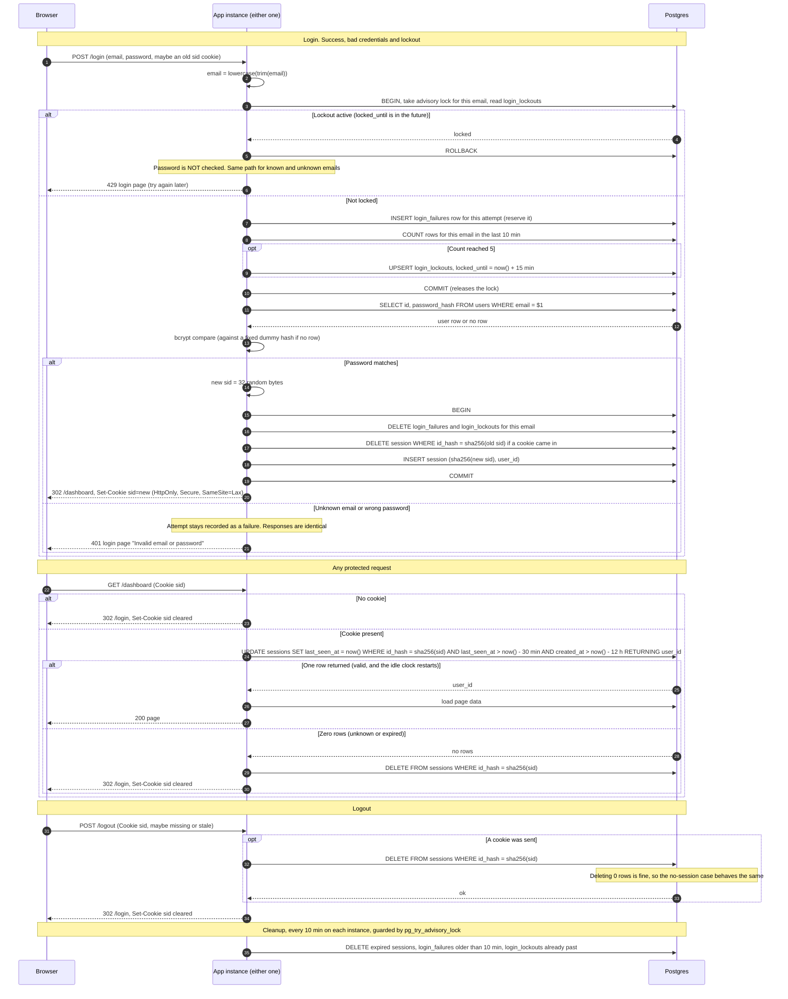

# Login with server-side sessions: design

## Decisions

| Question | Choice | Why |
|---|---|---|
| Where sessions and failure counts live | **Postgres**, three new tables. No Redis. | Both instances already share Postgres, so there is no shared-state problem to solve. A small team app has low login and request volume. One extra indexed `UPDATE` per request is cheap. Redis would add a service to deploy, secure, back up and monitor. It would also leave two stores that can disagree during an outage. Revisit it only if request volume makes the per-request write a measured problem. |
| Session ID | 32 bytes from a CSPRNG, base64url-encoded. Only `SHA-256(id)` is stored. | IDs are random, so a fast hash is enough. A database leak or read-only SQL injection then yields no usable cookies. |
| Cookie | `sid=<id>; Path=/; HttpOnly; Secure; SameSite=Lax`, with no `Max-Age` or `Expires`. | It is a browser-session cookie. The server alone decides expiry, so the cookie is never extended. Clearing sends the same name and attributes with `Max-Age=0`. |
| How expiry is checked and recorded | `created_at` and `last_seen_at` are stored per session. One atomic statement both checks and renews the session, using the database clock (`now()`). | There is no separate read-then-write race. Clock skew between the two instances cannot matter because neither instance supplies a timestamp. |
| How abandoned sessions are removed | A cleanup job every 10 minutes, plus lazy deletion when an expired session is presented. | Correctness never depends on the job, because the check enforces expiry. The job only bounds table size. |
| Storage failure | **Fail closed.** The user gets a generic 503 page and no access is granted. See the failure table below. | A broken store must never turn into a bypass of the lockout or of session checks. |

## Schema

```sql
CREATE TABLE sessions (
  id_hash      bytea       PRIMARY KEY,                 -- sha256(session id)
  user_id      bigint      NOT NULL REFERENCES users(id) ON DELETE CASCADE,
  created_at   timestamptz NOT NULL DEFAULT now(),
  last_seen_at timestamptz NOT NULL DEFAULT now()
);
CREATE INDEX sessions_last_seen_idx ON sessions (last_seen_at);
CREATE INDEX sessions_created_idx   ON sessions (created_at);

CREATE TABLE login_failures (          -- one row per failed or in-flight attempt
  email     text        NOT NULL,      -- lowercase, whether or not a user exists
  failed_at timestamptz NOT NULL DEFAULT now()
);
CREATE INDEX login_failures_idx ON login_failures (email, failed_at);

CREATE TABLE login_lockouts (
  email        text        PRIMARY KEY,
  locked_until timestamptz NOT NULL
);
```

## Sequence diagram



## Rules that do not fit on the arrows

**Email handling**
- The email is trimmed and lowercased once, at the start. Everything after that, including the throttle tables and the user lookup, uses that value.
- Throttling is keyed by this string and not by whether a user exists. A lockout on a made-up email is indistinguishable from one on a real email.

**Brute-force limit**
- Each attempt is reserved: a `login_failures` row is inserted before the password is checked, under a per-email advisory lock (`pg_advisory_xact_lock(hashtext(email))`).
- The lock is held only for the lockout check, the insert and the count. It is released before the slow bcrypt compare.
- Reserving first means a burst of parallel guesses cannot all slip past a check made before any of them is counted.
- The attempt that brings the count in the last 10 minutes to 5 is still verified. If it fails, the lockout row is already in place, so the next attempt gets 429 with no password check. This matches "once an email has 5 failed attempts".
- If that fifth attempt succeeds, step 15 deletes the failure rows and the lockout row. A successful login always clears the count.
- Requests refused with 429 insert nothing, so repeated tries during a lockout do not extend it. The lock lasts 15 minutes from the fifth failure.
- When the lock ends, every counted failure is older than 10 minutes, so the count starts fresh.
- A sliding "any 10-minute period" window falls out of counting rows by `failed_at`. No fixed buckets are used.

**Identical failure responses**
- An unknown email takes the same code path: bcrypt runs against a fixed dummy hash (same cost factor), so timing does not leak existence.
- Both cases return the same status, template and text. Neither has an extra header, redirect or cookie.
- The lockout response is also the same for every email.

**Session fixation**
- Login never reuses an incoming ID. A new one is generated, and the old one is deleted in the same transaction that creates the new session.
- If that transaction fails, no cookie is issued.

**Expiry**
- A session is valid only if both `last_seen_at > now() - 30 minutes` and `created_at > now() - 12 hours` hold. The second condition is the absolute limit, because `created_at` is never updated.
- Each valid request moves `last_seen_at` forward in the same statement.
- The cost is one primary-key write per protected request. It is accepted because requirement 6 says every request restarts the clock.
- The 30-minute and 12-hour values live in one config constant and are used by both the request check and the cleanup job.

**Cleanup**
- The job deletes sessions where `last_seen_at < now() - 30 min OR created_at < now() - 12 h`, failure rows older than 10 minutes, and lockouts whose time has passed.
- Every instance runs it on a timer, and `pg_try_advisory_lock` makes sure only one does the work at a time.
- All three deletes are safe to repeat.

**Cookie and CSRF**
- The cookie holds only the opaque ID.
- `SameSite=Lax` keeps the cookie off cross-site POSTs, which covers `/logout` and the form posts. A dedicated CSRF token is out of scope for this change.

## Storage-failure behavior

| Where it fails | What the user sees | Why |
|---|---|---|
| Lockout check or reservation during login | 503 page: "Sign-in is temporarily unavailable. Please try again in a few minutes." The password is not checked and no session is created. | A broken throttle must not let guesses through unlimited. |
| Session insert during login | The same 503 page, and no cookie is set. | The user is never given a cookie that points to nothing. |
| Session check on a protected request | 503 page. The cookie is kept and there is no redirect to `/login`. | A database error says nothing about whether the session is valid. Wiping the cookie would sign out users during every blip. |
| Session delete during logout | 503 page: "We couldn't sign you out. Please try again." The cookie is kept so a retry still works. | Requirement 8 says the session is destroyed before replying. The user should not be told they are signed out while the session is live. |

- All 503s are logged server-side with a request ID and no secrets.
- No failure path ever returns a protected page or a redirect to `/dashboard`.

## Out of scope

Sign-up, password reset, per-IP limits, remember-me, a "sign out everywhere" action, and CSRF tokens beyond `SameSite=Lax`.
