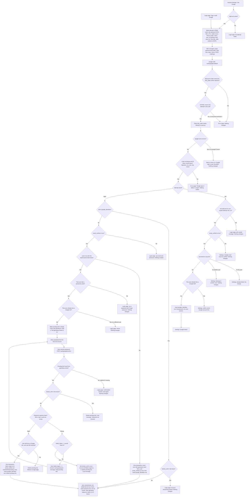

# Sign in with Google: flow and state design

## What this is

Today a user signs in with an email and password at `POST /login`. The server checks a bcrypt hash. After five wrong passwords it locks the account for 15 minutes. A correct password calls `start_session`, which writes a `sessions` row and sets the `sid` cookie. Redis is used only for short-lived rate limits.

This plan adds "Sign in with Google" beside that. A user starts on the login page, or links Google from Account Settings. The browser goes to Google with a random `state`, a PKCE challenge and a `nonce`. Google sends the browser back to our callback. The callback is accepted once, and only in the browser that started the trip. The server trades the one-time code for an ID token and reads only `sub`, `email` and `email_verified`.

Then one of four things happens. A linked Google account signs in. An unknown verified email creates a new account. Settings links the account. An existing password account with the same verified email asks for that account's password before it is linked. Every successful path ends in the same `start_session` that a password login uses.

Google accounts are matched by `sub`, never by email. A verified Google email proves control of the Google account. It does not prove control of our account with that email. So an existing password account is linked only after its password is entered.

## Terms

- **Attempt**: a Redis record for one trip to Google. Its key is the `state`. It holds the nonce, the PKCE verifier, the intent, `user_id` (settings only) and `return_to`. It expires after 600 seconds.
- **state**: a random value the server makes at start. Google returns it unchanged to the callback.
- **oidc_state cookie**: a browser cookie holding the same `state`. The callback needs this cookie and the attempt. A link that an attacker sends to a victim's browser has no matching cookie, so it is refused.
- **nonce**: a random value sent to Google and returned inside the ID token. It stops an ID token from another request being used here.
- **PKCE**: the server keeps a random `code_verifier` in Redis. At start it sends only the hash of the verifier to Google. At the code exchange it sends the verifier. A stolen code cannot be exchanged without it.
- **Code exchange**: a server-to-server request to Google's token endpoint that trades the one-time code for tokens.
- **ID token**: a signed statement from Google about the user. We read only `sub`, `email` and `email_verified`.
- **sub**: Google's permanent ID for an account. It does not change when the Google email changes.
- **Pending link**: a Redis record that waits for password confirmation. It holds `user_id`, `sub` and `return_to`. It expires 600 seconds after the callback.
- **gpending cookie**: a browser cookie holding the random id of the pending link.
- **google_identities**: a new permanent table that pairs one `sub` with one user.
- **intent**: `login` if the attempt started on the login page. `link` if it started in Account Settings.
- **return_to**: the relative path the user goes to afterwards.
- **sid cookie**: the existing session cookie. "Valid" means it matches a live `sessions` row.
- **locked_until, failed_logins**: the existing lockout fields on `users`.

## Flowchart



## Notes on the flowchart

- The cookie check comes before the `GETDEL`. A bad cookie does not use up the attempt.
- A Google error and a failed code exchange both use up the attempt. The user must start again.
- Google never changes our stored email. A linked user whose Google email changes still reaches the same account, because login uses `sub`.
- A linked login checks `locked_until`. It does not re-check `email_verified` on the Google token (see open questions).
- On a wrong password, the pending link is kept until its 600 seconds end, so the user can try again. The fifth failure deletes it.
- Unlinking is not in the flowchart. It is step 11 below.

## How it runs

1. **Start.** Starts when the user clicks Sign in with Google on the login page, or Link Google in settings. On the login page, `return_to` is the `next` parameter if it is a relative path on this site, otherwise `/home`. In settings, the sid cookie must be valid. If it is not, the user goes to the login page and no attempt is made. Otherwise `return_to` is the settings page, set by the server. The server writes the attempt to Redis with a 600-second TTL and sets the `oidc_state` cookie. If Redis is down, the flow does not start.

2. **Google consent.** The browser goes to Google with scope `openid email profile`, the `state`, the `nonce` and the PKCE challenge. Google sends the browser back to `/auth/google/callback`. Nothing we store changes here.

3. **Callback check.** The server first checks that an attempt exists for the `state` and that the `oidc_state` cookie matches. If either check fails, it shows an error page and changes nothing. Then one atomic Redis `GETDEL` removes the attempt and returns it only to the call that removed it. A duplicate callback gets the error page. The `oidc_state` cookie is cleared. From here the attempt is used up, whatever happens next.

4. **Google error.** If Google sent an error, such as Cancel, the user goes to `return_to` with "Google sign-in was cancelled. Nothing changed."

5. **Code exchange.** The server posts the code, its client id and secret, the redirect URI and the PKCE verifier to Google's token endpoint. It checks the ID token's signature, `iss`, `aud`, `exp` and `nonce`. It reads `sub`, `email` and `email_verified`, and discards Google's tokens. If any check fails, the user sees "Google sign-in failed, try again." Nothing is written.

6. **Link, from settings.** Starts from step 3 when the intent is `link`. The sid cookie must be valid and belong to the attempt's `user_id`. If not, the user goes to the login page with a neutral message. Then, in order:
   - `email_verified` is not true: refuse.
   - This `sub` is already linked to this user: say so, and change nothing.
   - This `sub` is linked to another user: refuse.
   - This user already has a Google link: refuse, and ask them to unlink first.
   - Otherwise insert the `google_identities` row. No password is asked. The emails need not match. The Google email is not stored. No new session is started, because linking is not signing in.

7. **Login, linked `sub`.** Starts from step 5 when the intent is `login` and the `sub` is already in `google_identities`. If `locked_until` is in the future, show the lock message and change nothing. Otherwise go to Sign in (step 10).

8. **Login, unlinked `sub`.** Starts from step 5 when the intent is `login` and the `sub` is not linked. Checked in this order:
   - `email_verified` is not true: refuse, and point to email and password. Nothing is created.
   - No user has this lowercased email: in one transaction, create a user with no password and `email_verified_at` set to now, then insert the `google_identities` row. The user's email is the Google email. Go to Sign in (step 10). The user can set a password later with Forgot password.
   - The matching user has no password: refuse, and point to Forgot password. Nothing changes.
   - The matching user already has a Google link: refuse. Nothing changes.
   - Otherwise create a pending link in Redis for 600 seconds from the callback, set the `gpending` cookie, and show a password form for that one account. The pending link holds the `user_id`, the `sub` and `return_to`. The password is then checked in step 9.

9. **Password confirmation.** Starts when the user submits the password to `POST /auth/google/confirm`. The step reads the `gpending` cookie to find the pending link.
   - No pending link, because it expired or is missing: go to the login page with "confirmation expired, start again." Nothing changes.
   - `locked_until` is in the future: delete the pending link and show the lock message. The password is not checked.
   - Wrong password, or no hash (a NULL hash counts as wrong): if this would not be the fifth failure, save `failed_logins + 1`, show the generic message and keep the pending link. On the fifth failure, set `locked_until` to now plus 15 minutes, set `failed_logins` to 0, delete the pending link and show the lock message.
   - Right password: check again that the user still has no Google link and the `sub` is still unlinked. If either is untrue, delete the pending link and refuse. Otherwise, in one transaction, set `failed_logins` to 0, set `email_verified_at` to its existing value or now, insert the `google_identities` row and delete the pending link. Then go to Sign in (step 10).
   - Every exit from this step clears the `gpending` cookie.

10. **Sign in.** `start_session(user_id)` runs for every successful Google sign-in. It deletes the old `sessions` row if the browser sent a sid, even if that row belonged to another user, as a password login does today. It inserts a new `sessions` row and sets the `sid` cookie. It clears `gpending`, then redirects to `return_to` or `/home`. The result is the same session a password login gives.

11. **Unlink, from settings.** Starts when the user chooses Unlink Google. If `password_hash` is NULL, refuse, and tell the user to set a password with Forgot password. Otherwise delete the `google_identities` row. Sessions are not touched.

## What happens when things fail

| Where | What fails | Result | State changed |
|---|---|---|---|
| Start | Redis unavailable | Flow does not start | Nothing |
| Start (settings) | No valid sid cookie | Login page, no attempt | Nothing |
| Callback | Unknown, expired, used or mismatched state, or Redis unavailable | Error page | Nothing. A bad cookie does not use up the attempt. |
| Callback | Google error, for example Cancel | Neutral message at `return_to` | Attempt used up |
| Code exchange | Network, HTTP error, bad signature, `iss`, `aud`, `exp` or `nonce` | Error page; start again | Nothing written. Attempt used up. |
| Settings callback | sid cookie invalid or belongs to another user | Login page, neutral message | Attempt used up |
| Settings link | `email_verified` not true, `sub` linked to another user, or this user already linked | Refuse | Nothing |
| Login, linked `sub` | Account locked | Lock message | Nothing |
| Login | `email_verified` not true | Refuse; use email and password | Nothing created |
| Login | Matched account has no password | Refuse; use Forgot password | Nothing |
| Login | Matched account has another Google link | Refuse | Nothing |
| Login or settings | Unique violation on `users.email` or `google_sub` | Refuse; user retries | No second row |
| Confirm | Pending link expired or missing | Login page; start again | Nothing |
| Confirm | Redis unavailable | Error page | Nothing written |
| Confirm | Account locked | Lock message; password not checked | Pending link deleted |
| Confirm | Wrong password, fewer than five failures | Generic message | `failed_logins` + 1; pending link kept until its TTL |
| Confirm | Fifth wrong password | Lock message | `locked_until` set; pending link deleted |
| Confirm | Recheck finds a Google link now exists | Refuse | Pending link deleted |
| Unlink | No password set | Refuse; use Forgot password | Nothing |

## Where each piece of state lives

| State | Where | Lifetime | Removed by |
|---|---|---|---|
| Attempt: nonce, PKCE verifier, intent, user_id (settings only), return_to | Redis `oidc:attempt:<state>` | 600 s TTL, which enforces the 10-minute round trip | Used up at the first valid callback, whatever the outcome. Otherwise the TTL removes it. |
| `oidc_state` cookie | Browser; HttpOnly, Secure, SameSite=Lax, Max-Age 600 | Round trip | Cleared at the callback. Expires on its own. |
| Pending link: user_id, sub, return_to | Redis `oidc:pending:<id>` | 600 s from the callback | Success, lock, refusal at confirm, or TTL. A wrong password keeps it. |
| `gpending` cookie | Browser; HttpOnly, Secure, SameSite=Lax, Max-Age 600 | Same as the pending link | Cleared on every exit from the confirm step |
| Google link | Postgres `google_identities` (new, permanent) | Until unlinked | Unlink in settings, or deletion of the user (CASCADE) |
| Google-created user | Postgres `users`, with `password_hash` NULL | Permanent | Normal account removal only |
| Lockout counters | `users.failed_logins`, `users.locked_until` (existing) | Lock lasts 15 minutes | Expiry of `locked_until`. A correct password resets the counter. |
| Session | `sessions` row (existing) and `sid` cookie | 14 days, slid on each request | Sign-out, password reset (deletes all), or expiry |

Google's access and refresh tokens are never stored. The nonce and PKCE verifier exist only in the Redis attempt, and they are discarded with it.

## How to build it

**Schema changes:**

```sql
ALTER TABLE users ALTER COLUMN password_hash DROP NOT NULL;

CREATE TABLE google_identities (
  google_sub TEXT PRIMARY KEY,                -- ID token sub. Never the email.
  user_id    BIGINT NOT NULL UNIQUE REFERENCES users(id) ON DELETE CASCADE,
  linked_at  TIMESTAMPTZ NOT NULL DEFAULT now()
);
```

The primary key on `google_sub` allows one user per Google account. The unique `user_id` allows at most one Google account per user.

**Change to `POST /login`:** a NULL `password_hash` counts as a wrong password. It gets the same generic message and the same lockout counting. The response therefore does not reveal that an account has no password.

## Open questions

- Step 3 uses Redis `GETDEL`, which needs Redis 6.2 or later. The Redis version is not known. On an older Redis, a short Lua script does the same job.
- A linked login does not check `email_verified` on the current Google token. It is not decided whether it should refuse when Google reports it as false.
- The code exchange and ID token checks follow the OpenID Connect and PKCE standards. They were not re-checked against Google's current documentation.