# Sign in with Google: flow and state design

This design adds Google sign-in (OpenID Connect) beside email and password. It builds on the existing `users`, `sessions` and `password_reset_tokens` tables and on `start_session`. Google sign-in ends in the same `sid` session as a password login.

## What the existing system does

- `users` holds `email` (lowercased), `password_hash` (bcrypt), `email_verified_at`, and lockout columns `failed_logins` and `locked_until`.
- `sessions` holds one row per signed-in browser, identified by the `sid` cookie. Sessions last 14 days and are removed on sign-out, on password reset, or on expiry.
- `start_session(user_id)` deletes any old `sid` row, inserts a new one, sets the cookie, and redirects to a validated relative `next` path or `/home`.
- Redis is used today only for short-lived data such as rate limits.

## Flowchart

```mermaid
flowchart TD
    LOGIN["Login page: Sign in with Google"]
    SETTINGS["Account Settings: Link Google"]
    LOGIN --> START
    SETTINGS --> SESS_CHK{"Valid sid cookie?"}
    SESS_CHK -- "No" --> TO_LOGIN["Send to login page. No attempt is made."]
    SESS_CHK -- "Yes" --> START

    START["Create attempt in Redis, key oidc:attempt:state, TTL 600 s<br/>Holds nonce, PKCE code_verifier, intent (login, or link with user_id), return_to<br/>Sets HttpOnly cookie oidc_state with the same state"]
    START --> AUTH["302 to Google authorize<br/>scope openid email profile, code flow, PKCE, state, nonce"]
    AUTH --> CB["Google redirects to /auth/google/callback"]

    CB --> STATE{"Attempt for state exists and oidc_state cookie matches?"}
    STATE -- "No: unknown, expired, cookie mismatch" --> ERR_STATE["Error page. Nothing changes."]
    STATE -- "Yes" --> DEL_ATT{"Delete attempt. Did this call delete it? Single use"}
    DEL_ATT -- "No: already used by a concurrent call" --> ERR_STATE
    DEL_ATT -- "Yes" --> GERR{"Google sent an error param?"}
    GERR -- "Yes, for example user pressed Cancel" --> NEUTRAL["Back to return_to with neutral message: Google sign-in was cancelled. Nothing changed."]
    GERR -- "No" --> EXCH["Server-side code exchange at Google token endpoint, with PKCE verifier"]
    EXCH -- "Fails: network, HTTP error, bad signature, iss, aud, exp or nonce" --> ERR_EXCH["Error page: Google sign-in failed, try again. Nothing written. Attempt stays consumed."]
    EXCH -- "OK" --> CLAIMS["Read ID token sub, email, email_verified only. Google tokens are discarded."]

    CLAIMS --> INTENT{"Attempt intent?"}
    INTENT -- "login" --> LOGIN_LINKED{"sub already in google_identities?"}
    INTENT -- "link" --> LINK_CHK{"sid cookie valid and its user equals attempt user_id?"}

    LOGIN_LINKED -- "Yes" --> SIGNIN
    LOGIN_LINKED -- "No" --> VERIFIED{"email_verified is true?"}
    VERIFIED -- "No" --> REFUSE_UNVER["Refuse on login page: use email and password. Nothing created."]
    VERIFIED -- "Yes" --> MATCH{"users row with this lowercased email exists?"}
    MATCH -- "No" --> CREATE["One transaction: insert users row with password_hash NULL and email_verified_at now, then insert google_identities row"]
    CREATE --> SIGNIN
    MATCH -- "Yes" --> NOPW{"That user has a password_hash?"}
    NOPW -- "No" --> REFUSE_NOPW["Refuse on login page: set a password with Forgot password. Nothing changes."]
    NOPW -- "Yes" --> HAS_LINK{"That user already has a Google link?"}
    HAS_LINK -- "Yes, to a different sub" --> REFUSE_OTHER["Refuse on login page. Nothing changes."]
    HAS_LINK -- "No" --> PENDING["Create pending link in Redis, key oidc:pending:id, TTL 600 s<br/>Holds user_id, sub, return_to<br/>Sets HttpOnly cookie gpending with id"]
    PENDING --> PW_FORM["Show password form for that one account"]

    PW_FORM --> PW_POST["User submits password: POST /auth/google/confirm"]
    PW_POST --> PEND_CHK{"Pending link found from gpending cookie?"}
    PEND_CHK -- "No: expired or missing" --> EXPIRED["Back to login page: confirmation expired, start again. Nothing changes."]
    PEND_CHK -- "Yes" --> LOCKED{"locked_until in the future?"}
    LOCKED -- "Yes" --> DROP_LOCKED["Delete pending link. Show Account temporarily locked. Password not checked."]
    LOCKED -- "No" --> BCRYPT{"Password matches bcrypt hash? NULL hash counts as wrong"}
    BCRYPT -- "Wrong" --> COUNT{"failed_logins + 1 reaches 5?"}
    COUNT -- "No" --> WRONG["Show generic wrong-password message. Keep pending link until its TTL ends."]
    WRONG --> PW_FORM
    COUNT -- "Yes" --> LOCK["Set locked_until to now + 15 min and failed_logins to 0. Delete pending link."]
    LOCK --> LOCK_MSG["Show Account temporarily locked"]
    BCRYPT -- "Right" --> RECHECK{"User still has no Google link, and sub still unlinked?"}
    RECHECK -- "No" --> REFUSE_RACE["Delete pending link. Refuse on login page. Nothing changes."]
    RECHECK -- "Yes" --> COMMIT["failed_logins to 0. Insert google_identities row. Delete pending link."]
    COMMIT --> SIGNIN

    SIGNIN["start_session(user_id): delete old sid row if sent, insert sessions row, set sid cookie, clear gpending, redirect to return_to or /home"]

    LINK_CHK -- "No" --> TO_LOGIN2["Send to login page with neutral message. Nothing changes."]
    LINK_CHK -- "Yes" --> LINK_SUB{"sub already linked to anyone?"}
    LINK_SUB -- "Yes, to this user" --> ALREADY["Back to settings: already linked. No change."]
    LINK_SUB -- "Yes, to another user" --> REFUSE_LINKED["Refuse on settings: this Google account belongs to another user."]
    LINK_SUB -- "No" --> USER_LINK{"This user already has a Google link?"}
    USER_LINK -- "Yes" --> REFUSE_HAS["Refuse on settings: unlink the current Google account first."]
    USER_LINK -- "No" --> INSERT["Insert google_identities row. No password asked. Email need not match. Google email not stored."]
    INSERT --> LINKED_OK["Back to settings: Google linked"]

    UNLINK["Settings: Unlink Google"] --> PW_SET{"users.password_hash set?"}
    PW_SET -- "No" --> REFUSE_UNLINK["Refuse: set a password first. Forgot password emails a reset link."]
    PW_SET -- "Yes" --> DELETE_LINK["Delete google_identities row. Sessions are not touched."]
    DELETE_LINK --> UNLINKED["Settings: Google unlinked"]

    classDef fail fill:#fde2e2,stroke:#b00020,color:#000
    class ERR_STATE,ERR_EXCH,NEUTRAL,REFUSE_UNVER,REFUSE_OTHER,REFUSE_NOPW,REFUSE_RACE,REFUSE_LINKED,REFUSE_HAS,REFUSE_UNLINK,LOCK_MSG,DROP_LOCKED,EXPIRED,TO_LOGIN,TO_LOGIN2 fail
```



## Where each new piece of state lives

| State | Where | Lifetime | Removed by |
|---|---|---|---|
| Attempt: state key, nonce, PKCE code_verifier, intent, user_id (link only), return_to | Redis `oidc:attempt:<state>` | 600 s TTL, which enforces the 10-minute round trip | Deleted at the first valid callback, whatever the outcome. Otherwise the TTL removes it. |
| `oidc_state` cookie | Browser, HttpOnly, Secure, SameSite=Lax, Max-Age 600 | Round trip | Cleared at callback. Expires on its own. |
| Pending link: user_id, sub, return_to | Redis `oidc:pending:<id>` | 600 s TTL from the callback, which is the 10-minute confirm window | Success, lock, refusal at confirm, or TTL. A wrong password keeps it. |
| `gpending` cookie holding the pending id | Browser, HttpOnly, Secure, SameSite=Lax, Max-Age 600 | Same as the pending link | Cleared on every exit from the confirm step |
| Google link | Postgres `google_identities` (new, permanent) | Until unlinked | Settings unlink, or user deletion (CASCADE) |
| Google-created user | Postgres `users` (existing table), with `password_hash` NULL | Permanent | Only by the usual account removal |
| Lockout counters | `users.failed_logins`, `users.locked_until` (existing) | Lock lasts 15 min | Expiry of `locked_until`; a successful password check resets the counter |
| Session | `sessions` (existing) and `sid` cookie | 14 days, slid on each request | Sign-out, password reset (deletes all), or expiry |

Google's access and refresh tokens are never stored. The nonce and PKCE verifier exist only in the Redis attempt and are discarded with it.

## Schema changes

```sql
ALTER TABLE users ALTER COLUMN password_hash DROP NOT NULL;

CREATE TABLE google_identities (
  google_sub TEXT PRIMARY KEY,                -- ID token sub. Never the email.
  user_id    BIGINT NOT NULL UNIQUE REFERENCES users(id) ON DELETE CASCADE,
  linked_at  TIMESTAMPTZ NOT NULL DEFAULT now()
);
```

The primary key on `google_sub` means one user per Google account. The unique `user_id` means at most one Google account per user. Login by `sub` means a changed Google email still reaches the same account.

Because `password_hash` can now be NULL, `POST /login` must treat a NULL hash as a wrong password. It must use the same generic message and the same lockout counting, so the response does not reveal that an account has no password.

## Failure behaviour

- **Unknown, expired, already-used state, or cookie mismatch:** error page. Nothing changes.
- **Google returns an error (for example Cancel):** neutral message on the page where the user started. The attempt is consumed.
- **Code exchange or ID token check fails:** error page. Nothing is written, no pending link is made, and the user must start again. The attempt is already consumed, so there is no retry on the same state.
- **Redis unavailable:** fail closed. The flow does not start, or the callback shows an error page, and nothing is written.
- **email_verified is not true:** refuse and point to email and password. Nothing is created.
- **Matched account has no password:** refuse and point to Forgot password. Nothing changes.
- **Matched account already has a different Google link:** refuse. Nothing changes.
- **Wrong password during confirm:** generic message. The pending link stays until its TTL ends.
- **Fifth wrong password, or account locked at confirm:** lock the account, delete the pending link, and show Account temporarily locked. The password is not checked while locked.
- **Pending link expired:** back to the login page. Nothing changes.
- **Settings link to a Google account owned by another user, or when the user already has a Google link:** refuse. Nothing changes.
- **Settings unlink with no password set:** refuse. Tell the user to use Forgot password, which sends the reset email.
- **Concurrent inserts (unique violation on `users.email` or `google_sub`):** treat as a refusal and let the user retry. Do not create a second row.

## Open decisions with recommendations

1. **Google sign-in during a lock.** The brief does not say whether `locked_until` blocks Google sign-in. Recommend that it does, so a lock cannot be bypassed through Google.
2. **Settings link with unverified Google email.** The brief does not require `email_verified` on this path. Recommend the same refusal as login, for consistency.
3. **Confirmed link and `email_verified_at`.** Google has verified the email, so recommend setting `email_verified_at = COALESCE(email_verified_at, now())` when a password confirmation links an account. This does not change `users.email`.
4. **Redirect targets.** Validate `return_to` as a relative path when the attempt starts, and use only that stored value at callback. Do not take it from callback parameters.
