# Sign in with Google: flow and state

Today the app is one server-rendered service. Users sign in with email and password at `POST /login`, which on success calls `start_session` to create a login session. PostgreSQL holds users and sessions. Redis holds short-lived data such as rate limits. This plan adds "Sign in with Google" (OpenID Connect) next to that, and reuses `start_session` unchanged, so a Google login ends in the same session as a password login.

The flow: the user starts at the login page or at Account Settings. We save a short-lived record in Redis and send them to Google. Google sends them back to our callback. The callback finds the record, exchanges the code for an ID token, and reads who the Google account is. Then it signs the user in, creates a user, asks for a password to confirm a link, or links the account (from Settings). Every failure leaves the data as it was.

## Terms

- **OIDC / authorization-code flow with PKCE**: we send the user to Google. Google returns a one-time `code`. We swap the code for an ID token in a server-to-server call, proving we started it with `code_verifier`.
- **`state`**: a random value we send to Google and get back unchanged. It finds our Redis record, and it can be used only once.
- **`nonce`**: a random value put into the ID token by Google. We check it matches, so an old token cannot be replayed.
- **`code_verifier`**: a random secret kept in the Redis record and sent only in the code exchange.
- **ID token**: Google's signed statement about the user. We read only `sub`, `email` and `email_verified`, then drop it. We keep no Google access or refresh tokens.
- **`sub`**: Google's permanent id for an account. We identify accounts by `sub`, never by email, because email can change.
- **JWKS**: Google's public signing keys, used to check the ID token. Cached in memory, and refetched when a token names an unknown key.
- **Client secret**: our app's secret for Google. It comes from server-side configuration and never reaches the browser.
- **`g_bind` cookie**: a random value saved both in the cookie and in the Redis record. It ties the callback to the browser that started it, so an attacker cannot make a victim's browser finish the attacker's attempt.
- **`g_pending` cookie**: a random id for a half-finished link that waits for a password.
- **Origin page**: where the attempt began, `/login` or Account Settings. Failures return the user there or to `/login`.
- **`start_session(user_id)`**: existing function. It deletes the old `sid` session row, inserts a new `sessions` row, sets the `sid` cookie, and redirects to `next` if it is a relative path, otherwise to `/home`.
- **`next`**: the page to return to after sign-in. It is sanitised at the start to a relative path or none.

In the diagram, red nodes are failures and change nothing unless the node says otherwise. Green nodes are successes. The state-error page and the "Account temporarily locked" message are rendered pages. All other failures are redirects.

```mermaid
flowchart TD
  subgraph ENTRY["1. Entry points"]
    L1["Login page: user clicks Sign in with Google"] --> L2["GET /auth/google/start"]
    L2 --> L3["mode = login. Sanitise next to a relative path or none. origin = /login"]
    S1["Account Settings: user clicks Link Google. POST with CSRF token"] --> S2{"Valid sid session?"}
    S2 -- no --> S2N["Redirect to /login"]
    S2 -- yes --> S3{"Session user already has a Google account linked?"}
    S3 -- yes --> S3Y["Back to settings: already linked"]
    S3 -- no --> S4["mode = link. user_id = session user. origin = settings"]
    L3 --> P1
    S4 --> P1
    P1["Generate random state, nonce, code_verifier and bind. Redis SET goog:auth:sha256 of state = mode, nonce, code_verifier, user_id, next, origin, bind. TTL 600 s. Set cookie g_bind to bind. Redirect to Google with scope openid email profile, code_challenge S256, state, nonce"]
  end

  P1 --> G1["Google: user signs in and consents, or cancels"]
  G1 --> CB["GET /auth/google/callback. Google echoes state back, plus code or error"]

  subgraph CALLBACK["2. Callback, both modes"]
    CB --> C1["sha256 of returned state. Redis GETDEL goog:auth:hash. Record is consumed on first read. Clear g_bind cookie in every case"]
    C1 --> C2{"Record found?"}
    C2 -- "no: missing, unknown, expired or already used" --> E_STATE
    C2 -- yes --> C3{"g_bind cookie equals record.bind?"}
    C3 -- no --> E_STATE
    C3 -- yes --> C4{"Google sent an error parameter?"}
    C4 -- yes --> E_CANCEL
    C4 -- no --> C5["Server-to-server POST to Google token endpoint with code, code_verifier, client secret. Timeout 5 s"]
    C5 --> C6{"Exchange succeeded and ID token valid? Signature via JWKS, iss, aud, exp, nonce equals record.nonce, sub and email present"}
    C6 -- no --> E_EXCH
    C6 -- yes --> C7["Keep only sub, lowercased email, email_verified. Discard tokens"]
    C7 --> C8{"record.mode"}
  end

  subgraph LOGIN["3. Login mode outcomes"]
    C8 -- login --> LG1{"sub found in google_identities?"}
    LG1 -- "yes: user is the identity row's user_id" --> OK
    LG1 -- no --> LG2{"email_verified true?"}
    LG2 -- no --> E_UNV
    LG2 -- yes --> LG3{"users row with this email exists?"}
    LG3 -- no --> LG4["One transaction: INSERT users with password_hash NULL, email_verified_at = now, other columns at defaults. INSERT google_identities"]
    LG4 --> LG5{"Unique violation?"}
    LG5 -- no --> OK
    LG5 -- "on sub: another callback created the user first; this transaction rolled back" --> LG1
    LG5 -- "on email: user registered meanwhile" --> LG6
    LG3 -- yes --> LG6{"That user already has a different Google account linked?"}
    LG6 -- yes --> E_OTHER
    LG6 -- no --> LG7["Redis SET goog:pending:sha256 of pending id = sub, user_id, next. TTL 600 s, never extended. Set cookie g_pending. Redirect to /auth/google/confirm"]
  end

  subgraph CONFIRM["4. Password confirmation loop"]
    LG7 --> CF0["GET /auth/google/confirm: if g_pending maps to no live record, go to expired. Otherwise show password form with a CSRF token (an HMAC of the g_pending value) and a Cancel link"]
    CF0 -- "no live record" --> E_EXP
    CF0 -- "user submits password" --> CF1["POST /auth/google/confirm with CSRF token"]
    CF0 -- "user clicks Cancel" --> CF_CANCEL["DEL pending. Clear g_pending. Redirect to /login"]
    CF1 --> CF2{"sha256 of g_pending maps to a live Redis record?"}
    CF2 -- no --> E_EXP
    CF2 -- yes --> CF3["Load target user by pending.user_id"]
    CF3 --> CF4{"locked_until in the future?"}
    CF4 -- yes --> DISC_LOCK
    CF4 -- no --> CF5{"bcrypt matches password_hash? A NULL hash never matches"}
    CF5 -- wrong --> CF6["failed_logins + 1"]
    CF6 --> CF7{"failed_logins reached 5?"}
    CF7 -- yes --> CF8["locked_until = now + 15 min. failed_logins = 0"]
    CF8 --> DISC_LOCK
    CF7 -- no --> CF9["Re-show form with the generic wrong-password message. Pending record stays; its TTL keeps running"]
    CF9 --> CF0
    CF5 -- right --> CF10["failed_logins = 0. INSERT google_identities with sub and user_id"]
    CF10 --> CF11{"Unique violation? sub or user got linked since the callback"}
    CF11 -- yes --> E_RACE
    CF11 -- no --> CF12["Redis DEL pending. Clear g_pending"]
    CF12 --> OK
  end

  subgraph LINK["5. Link mode outcomes, from Account Settings"]
    C8 -- link --> LK1{"Current sid session valid and its user equals record.user_id?"}
    LK1 -- no --> E_SESS
    LK1 -- yes --> LK2{"sub found in google_identities?"}
    LK2 -- "linked to another user" --> E_TAKEN
    LK2 -- "linked to this user" --> LK_NOOP["Settings: already linked. No change"]
    LK2 -- not linked --> LK3{"This user already has a different Google account?"}
    LK3 -- yes --> E_HAS
    LK3 -- no --> LK4["INSERT google_identities. No password asked: the signed-in session already proves who the user is. Emails need not match. users row untouched"]
    LK4 --> LK5{"Unique violation?"}
    LK5 -- yes --> E_TAKEN
    LK5 -- no --> LK_OK["Settings: Google linked. Current session unchanged. No start_session"]
  end

  subgraph UNLINK["6. Unlink from Account Settings"]
    U1["User clicks Unlink Google. POST with CSRF, valid session"] --> U2{"users.password_hash is NOT NULL?"}
    U2 -- yes --> U3["DELETE google_identities row for this user. Sessions untouched"]
    U3 --> U_OK["Settings: Google unlinked"]
    U2 -- no --> U_NO["Refuse. Message: set a password first using the Forgot password email"]
  end

  OK["Success: start_session(user_id), same call as POST /login. next comes from the auth record, or from the pending record on the confirm path"]
  E_STATE["Error page: this sign-in link is invalid or expired. Nothing changed"]
  E_CANCEL["Redirect to origin page: Google sign-in was not completed. Nothing changed"]
  E_EXCH["Redirect to origin page: we could not complete Google sign-in, try again or use email and password. Nothing changed. Code is not retried"]
  E_UNV["Redirect to /login: Google has not verified this email, use email and password. Nothing created"]
  E_OTHER["Redirect to /login: this account is linked to a different Google account. Nothing changed"]
  DISC_LOCK["DEL pending. Clear g_pending. Show page: Account temporarily locked. Half-finished link discarded"]
  E_EXP["Redirect to /login: this confirmation expired, start again. Nothing changed"]
  E_RACE["DEL pending. Clear g_pending. Redirect to /login: this Google account cannot be linked. Real cause is logged, not shown"]
  E_SESS["Redirect to /login: your session ended, sign in again and retry linking Google. Nothing changed"]
  E_TAKEN["Settings: this Google account is already linked to someone else. Nothing changed"]
  E_HAS["Settings: unlink your current Google account first. Nothing changed"]

  classDef good fill:#d8f3dc,stroke:#2d6a4f,color:#1b4332
  classDef bad fill:#fde2e4,stroke:#9d0208,color:#6a040f
  class OK,LK_OK,LK_NOOP,U_OK,S3Y good
  class E_STATE,E_CANCEL,E_EXCH,E_UNV,E_OTHER,DISC_LOCK,E_EXP,E_RACE,E_SESS,E_TAKEN,E_HAS,U_NO bad
```



## How it runs, step by step

1. **Start.** Triggered by a click on the login page (`GET /auth/google/start`) or on Settings (`POST` with CSRF, valid session, no Google account linked yet). It generates `state`, `nonce`, `code_verifier` and `bind`, saves the Redis record (TTL 10 minutes, which is the limit for the whole round trip), sets `g_bind`, and redirects to Google. The login start needs no CSRF token because it only writes a Redis record. The callback is protected by `g_bind`. Settings changes an account, so it also takes CSRF. If Redis is down, the start fails with a generic error and nothing is created.
2. **Callback.** Triggered by Google's redirect. It hashes the returned `state`, reads the record with `GETDEL` (so it can be used once), and clears `g_bind` whatever happens. It then checks `g_bind` against the record, handles a Google `error` (such as Cancel), and exchanges the code (5 s timeout). It validates the ID token and keeps only `sub`, lowercased email and `email_verified`. Any failure here is in the failure table. The record is already consumed, so the user starts again.
3. **Login mode.** The user has no `sid` session during this step or the next. Only `g_bind` and then `g_pending` exist. Cases:
   - `sub` already linked: sign in as that identity's user, even if the account is locked (see decisions). A deleted user cannot be linked, because the identity row cascades away.
   - Unlinked, `email_verified` false: refuse and point to email and password.
   - Unlinked, verified email matches no user: in one transaction, create the user (no password, email verified now, other columns default) and link. If another callback won the race on `sub`, this one rolls back and loops to the "sub found" case.
   - Unlinked, verified email matches a user: if that user has a different Google account, refuse. Otherwise save a pending record and go to the password page. A password is needed because a matching verified email alone does not prove the person owns the existing account.
4. **Password confirmation.** Triggered by the redirect to `/auth/google/confirm`. The pending record (TTL 10 minutes, never extended by wrong passwords) holds `sub`, the target user and `next`. Each display and each submit first checks that the record is live. The password is checked with the existing lockout rules. On the fifth wrong password, or if the account is already locked, the pending record is deleted and the locked page is shown. The user waits out the 15 minutes and starts again. On the right password, the identity row is inserted first, then the pending record is deleted. If the insert hits a unique violation, the pending record is deleted and the user gets the generic "cannot be linked" message. If the database fails, the pending record stays, so the user can resubmit within its TTL.
5. **Link mode** (from Settings). The callback requires that the current `sid` session is valid and belongs to the user who started. It refuses if the `sub` is linked to someone else or the user has a different Google account. Otherwise it inserts the identity row. No password is asked and emails need not match. The session is not changed. If the session ended during the round trip, the user goes to `/login` with a retry message.
6. **Unlink.** Triggered by `POST` with CSRF from Settings. It is allowed only if `password_hash` is not NULL. It deletes the identity row and leaves sessions alone. Without a password the user is told to set one with the existing Forgot password email.
7. **Success.** Every Google sign-in calls `start_session`. The browser then holds only `sid`, because `g_bind` and `g_pending` are cleared.

## Where state lives

### Permanent (PostgreSQL)

```sql
ALTER TABLE users ALTER COLUMN password_hash DROP NOT NULL;  -- NULL = Google-created, no password yet

CREATE TABLE google_identities (
  sub       TEXT PRIMARY KEY,                                   -- one Google account links to at most one user
  user_id   BIGINT NOT NULL UNIQUE                              -- one user has at most one Google account
            REFERENCES users(id) ON DELETE CASCADE,
  linked_at TIMESTAMPTZ NOT NULL DEFAULT now()
);
```

- No email is stored, so a changed Google email cannot affect sign-in. Lookup is by `sub` only.
- The two unique constraints enforce the one-to-one rule even when callbacks race. A violation is treated as the matching refusal.
- Rows are removed by unlinking or by deleting the user. Password reset leaves them alone.
- `sessions` is unchanged.
- Google data writes `users.email` only when it creates a brand-new user. Existing users' `email` and `email_verified_at` are never touched.
- `POST /login` must treat `password_hash IS NULL` as a wrong password with the same generic message, and run a bcrypt compare against a dummy hash so timing does not reveal it. A Google-created user who wants a password uses the Forgot password email.

### Temporary (Redis and cookies)

| Key or cookie | Holds | Created | Removed by |
|---|---|---|---|
| `goog:auth:<sha256(state)>` | `mode`, `nonce`, `code_verifier`, `user_id` (link mode), `next`, `origin`, `bind` | Start | `GETDEL` at the first callback, valid or not. Otherwise TTL 600 s |
| Cookie `g_bind` (HttpOnly, Secure, SameSite=Lax, Max-Age 600) | The same random `bind` value | Start | Cleared at every callback. Otherwise expires |
| `goog:pending:<sha256(pending id)>` | `sub`, target `user_id`, `next`. No email, no tokens | Callback found an existing user to confirm | `DEL` on success, lockout, cancel or race refusal. Otherwise TTL 600 s |
| Cookie `g_pending` (same flags) | Random pending id | With the pending record | Same events as the record |

Google access and refresh tokens are never stored.

## What happens on each failure

| Failure | Result |
|---|---|
| State missing, unknown, expired, already used, or `g_bind` mismatch | Error page. Nothing changes |
| Google returns `error` (for example Cancel) | Redirect to origin page with a neutral message. Nothing changes |
| Code exchange fails (timeout, network, non-200, `invalid_grant`), ID token invalid, or JWKS fetch slow (5 s) or failing | Redirect to origin page with "we could not complete Google sign-in, try again or use email and password". Cause logged. Code not retried |
| Unlinked `sub`, `email_verified` false | Redirect to `/login`, pointing to email and password. Nothing created |
| Verified email matches a user who has a different Google account | Refused, nothing changed |
| Wrong password at confirm | `failed_logins` + 1, form shown again, pending stays until its TTL |
| Fifth wrong password, or account already locked | Pending deleted, locked page shown |
| Pending expired, used or missing at confirm | Redirect to `/login`: start again |
| Unique violation at confirm | Pending deleted, generic "cannot be linked" redirect, cause logged |
| Database error at confirm | Generic error page. Pending stays, so the user can resubmit |
| Unique violation on `sub` while creating a user | Rolled back, then signs in as the user the other callback created |
| Settings link: session missing, expired or a different user | Redirect to `/login` with a retry message |
| Settings link: `sub` linked to someone else, or user has another Google account | Refused with a message on Settings |
| Unlink without a password | Refused, with the instruction to use the Forgot password email |

## Rollout

Ship in this order: (1) the migration above; (2) the `POST /login` change for NULL hashes, before any Google-created user can exist; (3) the Google routes and Settings buttons.

## Decisions to confirm and open questions

- A linked user can sign in with Google while `locked_until` is in the future, because the lockout slows password guessing and Google sign-in guesses no password. Block it if you disagree.
- A linked `sub` signs in even if Google later reports `email_verified` false, because identity is the `sub`.
- Linking by password confirmation does not set `email_verified_at` on the existing user.
- Open: the JWKS cache lifetime is not decided. The plan does not need it yet.