# Sign in with Google: flow and state

This builds on `existing/schema.sql` and `existing/auth_flow.md`. Those files describe the server-rendered app, PostgreSQL tables and Redis that this plan reuses.

## Reading guide

- `start_session(user_id)` is the existing function from `auth_flow.md`. It deletes the old `sid` session row, inserts a new `sessions` row, sets the `sid` cookie and redirects to `next` if it is a relative path, otherwise to `/home`. Google sign-in calls it unchanged, so there is no new session type.
- "Origin page" means where the attempt began. It is `/login` for the login entry point and Account Settings for the settings entry point. It is stored in the Redis record at the start.
- Red nodes are failures. In every one of them nothing is created, linked or signed in unless the node says otherwise. Green nodes are successes.

```mermaid
flowchart TD
  subgraph ENTRY["1. Entry points"]
    L1["Login page: user clicks Sign in with Google"] --> L2["GET /auth/google/start"]
    L2 --> L3["mode = login. Sanitise next to a relative path or none. origin = /login"]
    S1["Account Settings: user clicks Link Google. POST with CSRF token"] --> S2{"Valid sid session?"}
    S2 -- no --> S2N["Redirect to /login"]
    S2 -- yes --> S3{"Session user already has a Google account linked?"}
    S3 -- yes --> S3Y["Back to settings: already linked"]
    S3 -- no --> S4["mode = link. user_id = session user. origin = settings"]
    L3 --> P1
    S4 --> P1
    P1["Generate state, nonce, code_verifier. Redis SET goog:auth:sha256 of state = mode, nonce, code_verifier, user_id, next, origin, bind. TTL 600 s. Set cookie g_bind. Redirect to Google with scope openid email profile, code_challenge S256, state, nonce"]
  end

  P1 --> G1["Google: user signs in and consents, or cancels"]
  G1 --> CB["GET /auth/google/callback with state plus code or error"]

  subgraph CALLBACK["2. Callback, common to both modes"]
    CB --> C1["Redis GETDEL goog:auth:sha256 of state. Record is consumed on first read"]
    C1 --> C2{"Record found?"}
    C2 -- "no: missing, unknown, expired or already used" --> E_STATE
    C2 -- yes --> C3{"g_bind cookie matches record.bind?"}
    C3 -- no --> E_STATE
    C3 -- yes --> C4{"Google sent an error parameter?"}
    C4 -- yes --> E_CANCEL
    C4 -- no --> C5["Server-to-server POST to Google token endpoint with code, code_verifier, client secret. Timeout 5 s"]
    C5 --> C6{"Exchange succeeded and ID token valid? Signature via JWKS, iss, aud, exp, nonce equals record.nonce, sub and email present"}
    C6 -- no --> E_EXCH
    C6 -- yes --> C7["Keep only sub, lowercased email, email_verified. Discard tokens and clear g_bind"]
    C7 --> C8{"record.mode"}
  end

  subgraph LOGIN["3. Login mode outcomes"]
    C8 -- login --> LG1{"sub found in google_identities?"}
    LG1 -- yes --> OK
    LG1 -- no --> LG2{"email_verified true?"}
    LG2 -- no --> E_UNV
    LG2 -- yes --> LG3{"users row with this email exists?"}
    LG3 -- no --> LG4["One transaction: INSERT users with password_hash NULL and email_verified_at = now. INSERT google_identities"]
    LG4 --> LG5{"Unique violation?"}
    LG5 -- no --> OK
    LG5 -- "on sub: raced with another callback" --> LG1
    LG5 -- "on email: user registered meanwhile" --> LG6
    LG3 -- yes --> LG6{"That user already has a different Google account linked?"}
    LG6 -- yes --> E_OTHER
    LG6 -- no --> LG7["Redis SET goog:pending:sha256 of pending id = sub, user_id, next. TTL 600 s, never extended. Set cookie g_pending. Redirect to /auth/google/confirm"]
  end

  subgraph CONFIRM["4. Password confirmation loop"]
    LG7 --> CF0["GET /auth/google/confirm: password form with a Cancel link"]
    CF0 -- "user submits password" --> CF1["POST /auth/google/confirm"]
    CF0 -- "user clicks Cancel" --> CF_CANCEL["DEL pending. Clear g_pending. Redirect to /login"]
    CF1 --> CF2{"g_pending cookie maps to a live Redis record?"}
    CF2 -- no --> E_EXP
    CF2 -- yes --> CF3["Load target user by pending.user_id"]
    CF3 --> CF4{"locked_until in the future?"}
    CF4 -- yes --> DISC_LOCK
    CF4 -- no --> CF5{"bcrypt matches password_hash? A NULL hash never matches"}
    CF5 -- wrong --> CF6["failed_logins + 1"]
    CF6 --> CF7{"failed_logins reached 5?"}
    CF7 -- yes --> CF8["locked_until = now + 15 min. failed_logins = 0"]
    CF8 --> DISC_LOCK
    CF7 -- no --> CF9["Re-show form with the generic wrong-password message. Pending record stays and its TTL keeps running"]
    CF9 --> CF0
    CF5 -- right --> CF10["failed_logins = 0. Re-check that the user has no Google account and the sub is still unlinked"]
    CF10 --> CF11{"Both still free?"}
    CF11 -- no --> E_RACE
    CF11 -- yes --> CF12["Redis DEL pending. A DEL count of 0 means a concurrent confirm won, so treat as expired"]
    CF12 --> CF13["INSERT google_identities with sub and user_id. Clear g_pending"]
    CF13 --> OK
  end

  subgraph LINK["5. Link mode outcomes, from Account Settings"]
    C8 -- link --> LK1{"Current sid session valid and its user equals record.user_id?"}
    LK1 -- no --> E_SESS
    LK1 -- yes --> LK2{"sub found in google_identities?"}
    LK2 -- "linked to another user" --> E_TAKEN
    LK2 -- "linked to this user" --> LK_NOOP["Settings: already linked. No change"]
    LK2 -- not linked --> LK3{"This user already has a different Google account?"}
    LK3 -- yes --> E_HAS
    LK3 -- no --> LK4["INSERT google_identities. No password asked. Emails need not match. users row untouched"]
    LK4 --> LK5{"Unique violation?"}
    LK5 -- yes --> E_TAKEN
    LK5 -- no --> LK_OK["Settings: Google linked. Current session unchanged. No start_session"]
  end

  subgraph UNLINK["6. Unlink from Account Settings"]
    U1["User clicks Unlink Google. POST with CSRF, valid session"] --> U2{"users.password_hash is NOT NULL?"}
    U2 -- yes --> U3["DELETE google_identities row for this user. Sessions untouched"]
    U3 --> U_OK["Settings: Google unlinked"]
    U2 -- no --> U_NO["Refuse. Message: set a password first using the Forgot password email"]
  end

  OK["Success: start_session(user_id), the same call as POST /login. Redirect to next if relative, else /home"]
  E_STATE["Error page: this sign-in link is invalid or expired. Nothing changed"]
  E_CANCEL["Redirect to origin page with neutral message: Google sign-in was not completed. Nothing changed"]
  E_EXCH["Redirect to origin page: we could not complete Google sign-in, try again or use email and password. Nothing changed. Code is not retried"]
  E_UNV["Redirect to /login: Google has not verified this email, use email and password. Nothing created"]
  E_OTHER["Redirect to /login: this account is linked to a different Google account. Nothing changed"]
  DISC_LOCK["DEL pending. Clear g_pending. Show: Account temporarily locked. Half-finished link discarded"]
  E_EXP["Redirect to /login: this confirmation expired, start again. Nothing changed"]
  E_RACE["DEL pending. Clear g_pending. Redirect to /login: this Google account cannot be linked. Nothing changed"]
  E_SESS["Redirect to /login with neutral message. Nothing changed"]
  E_TAKEN["Settings: this Google account is already linked to someone else. Nothing changed"]
  E_HAS["Settings: unlink your current Google account first. Nothing changed"]

  classDef good fill:#d8f3dc,stroke:#2d6a4f,color:#1b4332
  classDef bad fill:#fde2e4,stroke:#9d0208,color:#6a040f
  class OK,LK_OK,LK_NOOP,U_OK,S3Y good
  class E_STATE,E_CANCEL,E_EXCH,E_UNV,E_OTHER,DISC_LOCK,E_EXP,E_RACE,E_SESS,E_TAKEN,E_HAS,U_NO bad
```



## Where state lives

### Permanent state (PostgreSQL)

```sql
ALTER TABLE users ALTER COLUMN password_hash DROP NOT NULL;  -- NULL = Google-created, no password yet

CREATE TABLE google_identities (
  sub       TEXT PRIMARY KEY,                                   -- one Google account links to at most one user
  user_id   BIGINT NOT NULL UNIQUE                              -- one user has at most one Google account
            REFERENCES users(id) ON DELETE CASCADE,
  linked_at TIMESTAMPTZ NOT NULL DEFAULT now()
);
```

- The table stores no email, so a changed Google email cannot affect sign-in. Lookup is by `sub` only.
- The two unique constraints enforce the 1:1 rule even when two callbacks race. The code treats a violation as the "already linked" refusal.
- `google_identities` rows go away in two ways. Unlinking deletes the row. Deleting a user cascades to it. Password reset leaves it alone.
- `sessions` is unchanged. A Google sign-in inserts the same row a password login does.
- `users.email` is never written by Google data except at creation of a brand-new user, when it is the lowercased verified Google email. For existing users `email` and `email_verified_at` are not touched.
- Existing `POST /login` must handle `password_hash IS NULL`. Treat it as a wrong password with the same generic message, and run a bcrypt compare against a dummy hash so timing does not reveal the difference.

### Temporary state (Redis, nothing else needs cleanup)

| Key and cookie | Holds | Created | Removed by |
|---|---|---|---|
| `goog:auth:<sha256(state)>` | `mode`, `nonce`, `code_verifier`, `user_id` (link mode only), sanitised `next`, `origin`, `bind` | Start of either entry point | `GETDEL` on the first callback, valid or not. Otherwise TTL 600 s |
| Cookie `g_bind` (HttpOnly, Secure, SameSite=Lax, Max-Age 600) | Random value that must equal `record.bind`. It ties the callback to the browser that started it | Same time as the record | Cleared at callback. Otherwise expires |
| `goog:pending:<sha256(pending id)>` | `sub`, target `user_id`, `next`. No email, no tokens | Callback found an existing user to confirm | `DEL` on success, on lockout, on cancel, on a race refusal. Otherwise TTL 600 s |
| Cookie `g_pending` (HttpOnly, Secure, SameSite=Lax, Max-Age 600) | Random pending id | Same time as the record | Same events as the record |

- The 10-minute round trip is the first record's TTL.
- The 10 minutes to confirm a password is the pending record's TTL. Wrong passwords never extend it.
- Single use comes from `GETDEL`. A replayed, double-clicked or forged callback finds nothing and gets the error page.
- Google access and refresh tokens are never stored. The ID token is read in memory for `sub`, `email` and `email_verified`, then dropped.

## What happens on each failure

| Failure | Result |
|---|---|
| State missing, unknown, expired, already used, or `g_bind` mismatch | Error page. Nothing changes. The record is already consumed, so the attempt cannot be retried |
| Google returns an `error` parameter (for example the user pressed Cancel) | Redirect to the origin page with a neutral message. No details from Google are shown. Nothing changes |
| Code exchange fails (timeout, network error, non-200, `invalid_grant`) | Redirect to the origin page with "we could not complete Google sign-in, try again or use email and password". Log the cause server-side. Do not retry the code, since it is single-use. The record is already consumed, so the user starts over |
| ID token invalid (signature, `iss`, `aud`, `exp`, `nonce`, missing `sub` or `email`) | Handled exactly like a failed exchange |
| Unlinked `sub` and `email_verified` false | Redirect to `/login` pointing to email and password. Nothing created |
| Verified email matches a user who already has a different Google account | Refused, nothing changed |
| Wrong password on the confirm page | Existing lockout rules. `failed_logins` goes up by 1 and the form is shown again. Pending state stays until its TTL |
| Fifth wrong password, or the account was already locked | Pending record and cookie deleted. Show "Account temporarily locked". The user must start Google sign-in again after the lock ends |
| Pending expired, used or missing at confirm | Redirect to `/login`: start again. Nothing changed |
| Settings link: session missing or belongs to a different user than the one who started | Redirect to `/login`. Nothing changed |
| Settings link: `sub` linked to someone else, or the user already has another Google account | Refused with a message on the settings page |
| Unlink without a password | Refused, with the instruction to set a password via the existing reset email. That reset also sets `password_hash` and deletes all the user's sessions, as it does today |
| Database unique violation during link or create | Rolled back. Mapped to the matching refusal above, or to the "sub now linked" sign-in path when two callbacks raced |

## Decisions to confirm

- A linked user can sign in with Google while `locked_until` is in the future. The lockout exists to slow password guessing, and Google sign-in does not guess a password. Block it if you disagree.
- A linked `sub` signs in even if Google later reports `email_verified` false, because identity is the `sub`. The `email_verified` check applies only to unlinked accounts.
- Linking via password confirmation does not set `email_verified_at` on the existing user.
