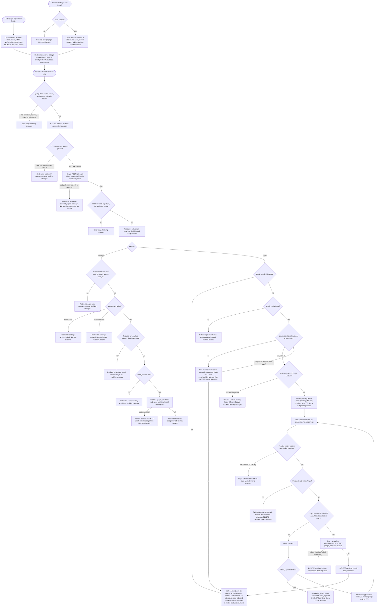

# Sign in with Google: flow and state plan

## Summary

Today a user signs in with email and password at `POST /login`. The server checks the password with bcrypt, counts failures, and on success calls `start_session(user_id)`. That function writes a `sessions` row and sets the `sid` cookie.

This plan adds Google sign-in as a second way to reach that same `start_session` call. A user starts from the login page ("Sign in with Google") or from Account Settings ("Link Google"). The server records a short-lived attempt, sends the browser to Google, and takes the browser back. Then the server does one of four things: signs the user in, links the Google account, refuses, or asks for the account's password first.

Every successful Google sign-in ends in the normal session. No new session type is added. Google access and refresh tokens are never stored.

The flow is shaped this way for two reasons. First, every Google account is identified by Google's `sub`, because emails can change. Second, an existing account is only linked after its password is entered. A stranger cannot take over an account just by owning a Google account with the same email.

## Terms

- **OpenID Connect (OIDC)**: a login protocol. Google tells us who the user is in a signed ID token.
- **Authorization code**: a one-time code that Google gives the browser after login. Our server swaps it for tokens, once.
- **PKCE**: we make a random secret, the code verifier, and keep it on the server. At the start we send only its hash to Google. At the swap we send the secret. A stolen code is useless without it.
- **state**: a random value we send to Google and get back. It proves that a callback belongs to the attempt we started.
- **nonce**: a random value that Google copies into the ID token. It proves the token was made for this attempt.
- **ID token**: a signed token from Google. We read three claims from it: `sub`, `email` and `email_verified`.
- **sub**: Google's permanent id for one Google account. It is the only key we use to identify a Google account.
- **Attempt**: a Redis record for one Google round trip. It lasts 10 minutes and can be used once.
- **Pending link**: a Redis record that means "after the right password, link this Google `sub` to user U." It lasts 10 minutes.
- **Origin**: the page where the attempt started, either the login page or Account Settings.
- **start_session(user_id)**: the existing function that creates a session. Both password login and Google sign-in end here.
- **GETDEL**: a Redis command that reads a key and deletes it in one step. Two requests cannot both read the same attempt.
- **Neutral message**: a message that does not reveal whether an email has an account.

## Flowchart



## How it runs, step by step

1. **Start, from either page.** The user clicks the button on the login page or on Account Settings. The server makes a random state, nonce and code verifier. It stores them in Redis under the state key, with the origin, the `next` page (login only) and the user id (settings only). The record lasts 600 seconds, which is the limit for the whole round trip. The state is also set in a browser cookie, so the callback can check that it is the same browser. Settings start needs a valid session. Without one, the user goes to the login page and nothing changes. If Redis is down, no attempt is created and the user sees a neutral error. Nothing is linked.

2. **Round trip to Google.** The browser is redirected to Google. The request asks for `openid email profile` and sends the state, the nonce and the PKCE challenge. The user signs in at Google, or presses Cancel. Our server holds nothing during this step.

3. **Callback: check the state.** Google sends the browser back with the state. The server checks that the state in the query equals the cookie, and that the attempt exists in Redis. It then runs GETDEL, which reads and deletes the attempt in one step. From this point the attempt is spent, whatever happens next. Unknown, expired, reused or mismatched states all get the same error page, and nothing changes. Because GETDEL is atomic, two callbacks that arrive together cannot both continue.

4. **Google returned an error.** For example, the user pressed Cancel. The user goes back to the origin page with a neutral message. Nothing changes.

5. **Code exchange.** The server sends the code and the code verifier to Google's token endpoint. The tokens Google returns are held in memory for this request only. If the request fails (network error, timeout or a non-200 reply), the user goes back to the origin page with a neutral "try again" message. The code is never retried, because codes can be used only once. The user starts again from the origin page.

6. **Check the ID token.** The server checks the signature, the issuer, the audience, the expiry and the nonce. If any check fails, the user sees an error page. If all pass, the server reads `sub`, `email` and `email_verified`, then discards the Google tokens.

7. **Settings origin: link the account.** The server first checks that the session is still valid and belongs to the same user as the attempt. If not, the user goes to the login page with a neutral message. Then the server checks in this order:
   - If this `sub` is already linked to this user, show "already linked." Nothing changes.
   - If it is linked to another user, refuse: the account is in use.
   - If this user already has a different Google account, refuse: unlink the current one first.
   - If `email_verified` is false, refuse: verify your email first.
   - Otherwise insert a row in `google_identities`. The email does not need to match. If the insert hits a unique clash, because the account was linked at the same moment, refuse as above. If it succeeds, show "Google linked." No new session is created, because the user is already signed in.

8. **Login origin: a linked Google account.** If `sub` is already in `google_identities`, the server signs in the linked user. Google's email and `email_verified` are ignored, so an email change at Google still reaches the same account. Go to step 12.

9. **Login origin: unverified email.** If `sub` is not linked and `email_verified` is false, refuse and point the user to email and password. Nothing is created.

10. **Login origin: verified email, no matching user.** Lowercase the email and look for a matching `users` row. If none exists, create the user, the password-less account, and the link in one transaction. The new `users` row has `password_hash` NULL and `email_verified_at` set to now. The new `google_identities` row links the `sub` to it. If a concurrent signup takes the same email first, the unique clash sends the flow back to the match check in this step. The second time, the match is found and the flow goes to step 11. On success, go to step 12.

11. **Login origin: verified email, matching user U.** The link is not created yet. The server first checks whether U already has a different Google account. If so, refuse. Otherwise it creates a pending link in Redis (pending id, sub, U, origin and next, 600-second lifetime) and sets a pending cookie. It shows the password form for account U. No session exists yet. Asking for the password proves that the person owns the account before we link it. A verified Google email is the only way to reach this form, so the form does not reveal accounts to strangers.

    The password loop works like this:
    - If the pending record is missing or expired, or the cookie does not match, show "confirmation expired, start again." Nothing changes.
    - If U is locked (`locked_until` is in the future), reject with "Account temporarily locked." The password is not checked. Delete the pending link.
    - Otherwise check the password with bcrypt. A NULL `password_hash` counts as a wrong password, and bcrypt is not called.
    - **Wrong password:** add 1 to `failed_logins`. If the count reaches 5, set `locked_until` to now plus 15 minutes, reset `failed_logins` to 0, delete the pending link and show the locked message. Otherwise show the wrong-password message and keep the pending link until it expires, so the user can try again.
    - **Right password:** in one transaction, set `failed_logins` to 0 and insert the `google_identities` row (sub, U). If the insert hits a unique clash, because the Google account or the user was linked meanwhile, the transaction rolls back. Delete the pending link and refuse. If the insert succeeds, delete the pending link, which is no longer needed because the link is permanent. Go to step 12.

12. **Start the session.** The same code that password login uses runs: `start_session(user_id)`. It deletes the old `sessions` row if the browser had one, inserts a new row, and sets the `sid` cookie. It also clears the state, pending and oidc cookies. Then it redirects to `next` if that is a relative path on our site, and to `/home` otherwise.

## What happens when things fail

| Failure | What the user sees | What changes |
|---|---|---|
| Unknown, expired or reused state | Error page | Nothing |
| Google returns an error (for example, Cancel) | Origin page with neutral message | The attempt is spent |
| Code exchange fails (network, timeout or non-200) | Origin page with neutral "try again" | The attempt is spent. The code is not retried |
| ID token invalid (signature, iss, aud, exp or nonce) | Error page | The attempt is spent |
| Unlinked, unverified email | Refusal, point to email and password | Nothing |
| Settings: Google account linked to another user | Refusal | Nothing |
| Settings: user already has a different Google account | Refusal, unlink first | Nothing |
| Settings: session gone or changed at callback | Login page with neutral message | Nothing |
| Pending link expired | "Start again" page | Nothing |
| Wrong password | Wrong-password message | `failed_logins` plus 1. The pending link is kept |
| Fifth wrong password, or account already locked | Account temporarily locked | Lock set (fifth failure only). Pending link deleted. The password is not checked when already locked |
| Link conflict at insert (race) | Refusal | Transaction rolled back. Pending link deleted |
| Signup race on the same email | Goes to the password step | Email is matched again. No duplicate user |
| Redis unavailable | Neutral error | No attempt is created, so nothing is linked. Fails closed |

Redis restarts lose attempts in flight. Users restart the flow, which is acceptable.

## Where each piece of state lives

| Item | Where | How long it lasts | What removes it |
|---|---|---|---|
| Attempt: state, nonce, code verifier, origin, next, user id (settings only) | Redis key `oidc:{state}` | 600 seconds from start | GETDEL on any callback, or expiry |
| State cookie | Browser cookie: HttpOnly, Secure, SameSite=Lax, Max-Age 600 | From start to callback | Cleared at callback, or expiry |
| Pending link: sub, target user id, origin, next | Redis key `pending:{id}` | 600 seconds from creation | Deleted on success, lock or link conflict. Expiry. Kept after a wrong password |
| Pending cookie | Browser cookie, same flags | Same as the pending link | Cleared with the pending link |
| Google link | PostgreSQL table `google_identities` | Permanent | Unlink in settings (needs a password), or deleting the user. Not removed by sign-out, email change or password reset |
| Google-created user | `users` row with `password_hash` NULL and `email_verified_at` set | Permanent | Deleting the user. A password can be set later with the existing reset email |
| Failed count and lock | `users.failed_logins` and `users.locked_until` | Existing rules | Existing rules |
| Google tokens | Not stored. Held in memory for one callback | One request | Discarded after the ID token is read |
| Session | `sessions` row and `sid` cookie | Existing rules | Existing rules. `start_session` removes any older row |

## Unlinking (settings, outside the diagram)

Unlinking needs a valid session. If the user's `password_hash` is NULL, refuse. Tell the user to set a password with the existing reset email first. Otherwise delete that user's `google_identities` row. No password is asked for the unlink.

## Build and rollout

These changes belong to the database and to existing code. They are not part of the sign-in flow itself.

1. Allow `password_hash` to be NULL:

   ```sql
   ALTER TABLE users ALTER COLUMN password_hash DROP NOT NULL;
   ```

2. Create the link table. `sub` is the primary key, so one Google account links to at most one user. `user_id` is unique, so one user has at most one Google account:

   ```sql
   CREATE TABLE google_identities (
     sub       TEXT PRIMARY KEY,                                             -- Google subject id, max 255 chars
     user_id   BIGINT NOT NULL UNIQUE REFERENCES users(id) ON DELETE CASCADE, -- one Google account per user
     linked_at TIMESTAMPTZ NOT NULL DEFAULT now()
   );
   ```

3. Change password login. A NULL `password_hash` counts as a failed password. It gets the same generic message and the same failure count. The code must never call bcrypt on NULL.

## Open questions

These are decisions the plan makes that still need a yes or no:

1. **Settings linking refuses an unverified Google email.** Decided: the brief's rule for unlinked accounts applies to both entry points, so this plan applies it to settings as well.
2. **A linked user can still sign in with Google while the account is locked for password guessing.** Assumed yes, because the lock is about password guessing and Google sign-in does not use a password. Needs confirmation.
3. **Linking to an existing user does not change `email_verified_at`.** Assumed yes, because the link does not verify the email. Needs confirmation.
4. **Pressing Cancel on the password form deletes the pending link.** Optional. The 10-minute expiry covers it anyway. Needs a decision.