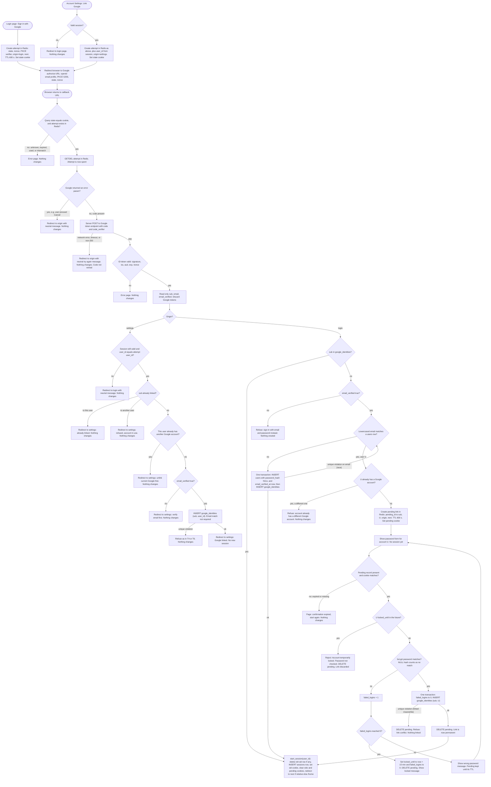

# Sign in with Google: flow and state plan

Google sign-in (OpenID Connect, authorization-code flow with PKCE, `state`, `nonce`, scopes `openid email profile`) sits beside email and password. Both entry points, every callback outcome and the password-confirmation loop are in the diagram. Every successful Google sign-in calls the existing `start_session(user_id)`, so the result is the same session as a password login. Google access and refresh tokens are never stored.

## Flowchart



## Notes on the flow

- **Start (both entry points).** Generate `state`, `nonce` and a PKCE `code_verifier` from random bytes. Store them in Redis under the state, with `origin`, `next` (login only) and `user_id` (settings only). Set the TTL to 600 s, which is the round-trip limit. The state is also set in a cookie so the callback can bind it to the browser that started the attempt. Settings start requires a valid session.
- **Callback is honoured once.** `GETDEL` makes the attempt single-use and atomic, so two concurrent callbacks cannot both proceed. Unknown, expired and already-used states all look the same and produce an error page with no state change.
- **Google error.** The attempt is validated and spent first, then the user returns to the origin page with a neutral message.
- **Failed code exchange.** The attempt is already spent. Nothing is created or changed. The user restarts from the origin page. The code is never retried, because authorization codes are single-use.
- **Linked sub.** Sign-in uses the linked user. Google email and `email_verified` are ignored, so an email change at Google still reaches the same account.
- **Unlinked, verified, no match.** The new user is created in one transaction with the link. If a concurrent signup takes the email, the flow re-runs the match and goes to the password branch.
- **Unlinked, verified, matched.** The link is not created here. A short-lived pending link is created, and the password form asks for that account's password. The only way to get the confirm step is a verified Google email, so the form does not reveal accounts to strangers.
- **Password loop.** Wrong passwords use the existing `failed_logins` counter. The fifth failure locks the account for 15 minutes and deletes the pending link. A locked account is rejected before bcrypt runs, and the pending link is also deleted then. The link is written in the same transaction that clears `failed_logins`.
- **Unlink (settings, not in the diagram).** Requires a session. If `password_hash` is NULL, refuse and point the user to the existing reset email to set a password. Otherwise delete the `google_identities` row for that user. No password is asked for the unlink.

## State

| Item | Where | Lifetime | Removed by |
|---|---|---|---|
| OIDC attempt: state, nonce, code_verifier, origin, next, user_id (settings) | Redis key `oidc:{state}` | TTL 600 s from start | `GETDEL` on any callback outcome, or TTL expiry |
| State cookie | Browser cookie, HttpOnly, Secure, SameSite=Lax, Max-Age 600 | Start to callback | Cleared on callback, or expiry |
| Pending link: sub, target user_id, origin, next | Redis key `pending:{id}` | TTL 600 s from creation | Deleted on success, lock or link conflict. Expiry. Kept on wrong password |
| Pending cookie | Browser cookie, same flags | Same as pending | Cleared with the pending record |
| Google link | PostgreSQL `google_identities` | Permanent | Unlink (settings, needs password), or user deletion (cascade). Not removed by sign-out, email change or password reset |
| Google-created user | `users` row with `password_hash` NULL and `email_verified_at` set | Permanent | User deletion. A password can be set later through the existing reset email |
| Failed count and lock | `users.failed_logins`, `users.locked_until` | Existing rules | Existing rules |
| Google tokens | Not stored. Held in memory during the callback only | Callback request | Discarded after reading the ID token |
| Session | `sessions` row and `sid` cookie | Existing | Existing rules. `start_session` removes any previous row |

## Schema change

```sql
ALTER TABLE users ALTER COLUMN password_hash DROP NOT NULL;  -- NULL for Google-created users

CREATE TABLE google_identities (
  sub       TEXT PRIMARY KEY,                                          -- Google subject id, max 255 chars; one user per Google account
  user_id   BIGINT NOT NULL UNIQUE REFERENCES users(id) ON DELETE CASCADE, -- one Google account per user
  linked_at TIMESTAMPTZ NOT NULL DEFAULT now()
);
```

Password login must treat a NULL `password_hash` as a failed password, with the same generic message and the same failure count. It must not call bcrypt on NULL.

## Failure summary

| Failure | What the user sees | State changed |
|---|---|---|
| Unknown, expired or used state | Error page | None |
| Google error (Cancel) | Origin page, neutral message | Attempt spent |
| Code exchange fails | Origin page, neutral try again | Attempt spent |
| ID token invalid (signature, iss, aud, exp, nonce) | Error page | Attempt spent |
| Unlinked, unverified email | Refusal, point to email and password | None |
| Unlinked sub already linked to another user (settings) | Refusal | None |
| Settings: session gone at callback | Login page, neutral message | None |
| Pending expired | Restart page | None |
| Wrong password | Wrong password message | failed_logins + 1, pending kept |
| Locked | Account temporarily locked | Pending deleted. Password not checked |
| Link conflict at insert (race) | Refusal | Transaction rolled back, pending deleted |
| Redis unavailable | Neutral error | No attempt created, so nothing is linked. Fails closed |

Redis restarts lose in-flight attempts. Users restart the flow, which is acceptable.

## Assumptions to confirm

1. Settings linking also refuses an unverified Google email. The brief's rule is written for unlinked subs in general, so this applies it to both entry points.
2. A linked user can still sign in with Google while the account is password-locked. The lock is about password guessing, so Google sign-in is not blocked. Confirm this.
3. Linking to an existing user does not change `email_verified_at`.
4. Pressing Cancel on the password form deletes the pending link. This is optional, since the TTL covers it.