# Sign in with Google: flow and state

## Summary

Today, a user signs in with email and password at `POST /login`. A correct password calls `start_session`, which creates the session. This change adds Google sign-in (OpenID Connect, authorization-code flow with PKCE) beside it, and also lets a signed-in user link Google from Account Settings.

The flow goes like this. The user starts at the login page or at settings. We save a short-lived record in Redis and send the browser to Google. Google sends it back to our callback. The callback checks the record, swaps the code for an ID token, and reads who the user is. It then either links the Google account, creates a user, asks for the account's password, or refuses. Every successful sign-in ends in the existing `start_session`, so there is no new session type.

It is built so that nothing is trusted until the callback checks it. All temporary state expires on its own after 10 minutes, so no cleanup job is needed.

It builds on `existing/auth_flow.md` and `existing/schema.sql`. It adds one table, makes `users.password_hash` nullable, and adds some Redis keys.

## Terms

- **sub**: Google's permanent ID for an account. We identify Google accounts by `sub`, never by email, because email can change.
- **ID token**: a signed statement from Google. We read only `sub`, `email` and `email_verified` from it, then discard it. We keep no Google access or refresh tokens.
- **state**: a random value that ties the callback to the attempt that began it. It is used once.
- **nonce**: a random value Google copies into the ID token, so we know the token belongs to this attempt.
- **PKCE code_verifier**: a random secret kept by us. Google only gives out tokens to whoever can prove they hold it.
- **bind cookie (`g_bind`)**: a cookie that proves the callback arrives in the same browser that started the flow. This stops an attacker feeding a victim's browser a callback URL the attacker started.
- **entry**: where the flow began, either `login` or `settings`.
- **pending link**: a half-finished link, stored in Redis, waiting for the user to type the password of an existing account.
- **`start_session(user_id)`**: existing function. It deletes any old `sid` session row, inserts a new `sessions` row, sets the `sid` cookie, and redirects to `next` or `/home`.
- **lockout**: existing rule. 5 wrong passwords set `locked_until` to now + 15 minutes and reset `failed_logins` to 0. While locked, the password is not checked.
- Emails are stored lowercased. Lowercase Google's email before comparing it.

## Flowchart

```mermaid
flowchart TD
  classDef fail fill:#fde8e8,stroke:#b42318,color:#000
  classDef ok fill:#e6f4ea,stroke:#1e7e34,color:#000
  classDef store fill:#fff7d6,stroke:#9a6700,color:#000

  subgraph START["1. Two entry points"]
    L0["Login page: Sign in with Google<br/>POST /auth/google/start<br/>entry = login, next validated as relative path"]
    S0["Account Settings: Link Google<br/>POST /account/google/link<br/>entry = settings, needs valid sid session"]
    S0 --> S0a{"This user already has a Google account linked?"}
    S0a -- yes --> S0x["Back to settings: Google is already linked"]:::fail
    S0a -- no --> B
    L0 --> B
    B["begin_google_flow:<br/>random state, nonce, PKCE code_verifier, bind value"]
    B --> R1[("Redis oauth:state:sha256 of state<br/>TTL 600s. Holds verifier, nonce, entry,<br/>user_id for settings, next, sha256 of bind value")]:::store
    B --> G["Set cookie g_bind, 10 min, HttpOnly, Secure, SameSite=Lax<br/>302 to accounts.google.com<br/>response_type=code, scope=openid email profile<br/>code_challenge S256, state, nonce"]
  end

  G --> GG(["User is at Google: signs in, consents or cancels"])
  GG --> CB["GET /auth/google/callback with state and code, or error"]

  subgraph CBK["2. Callback checks, same for both entries"]
    CB --> V{"Atomically get and delete the Redis state record.<br/>Found, and g_bind cookie hash matches?"}
    V -- "no: unknown, expired, used, or wrong browser" --> E1["Error page: link no longer valid.<br/>Nothing changed. Clear g_bind"]:::fail
    V -- yes --> V2{"Google sent error= ?"}
    V2 -- yes --> E2["Redirect to where they started:<br/>/login keeping next, or /account/settings.<br/>Neutral message: Google sign-in was not completed"]:::fail
    V2 -- no --> X["Server-to-server POST to Google token endpoint<br/>code + code_verifier + client secret, 5s timeout"]
    X --> X1{"Exchange OK and ID token valid?<br/>signature via JWKS, iss, aud, exp,<br/>nonce equals stored nonce"}
    X1 -- no --> E3["Redirect to where they started:<br/>Could not complete Google sign-in, try again.<br/>Log the cause. Nothing changed. No automatic retry"]:::fail
    X1 -- yes --> C["Keep only sub, email, email_verified.<br/>Drop tokens. Clear g_bind"]
    C --> EN{"stored entry"}
  end

  subgraph SET["3a. entry = settings: link"]
    EN -- settings --> ST1{"sid session valid and its user_id<br/>equals stored user_id?"}
    ST1 -- no --> E4["Error page. Nothing changed"]:::fail
    ST1 -- yes --> ST2{"sub already in user_google_identities?"}
    ST2 -- "to a different user" --> E5["Settings: that Google account is already<br/>linked to someone else"]:::fail
    ST2 -- "to this user" --> E5b["Settings: already linked, no change"]
    ST2 -- no --> ST3["INSERT identity sub, user_id.<br/>Email and email_verified are ignored.<br/>No password asked. Session unchanged"]
    ST3 -- "unique violation, lost a race" --> E5
    ST3 -- ok --> ST4(["Settings: Google linked"]):::ok
  end

  subgraph LOG["3b. entry = login"]
    EN -- login --> LG1{"sub in user_google_identities?"}
    LG1 -- "yes: linked" --> SIGN
    LG1 -- no --> LG2{"email_verified true?"}
    LG2 -- no --> E6["Redirect to /login: Google has not verified this email,<br/>use email and password. Nothing created"]:::fail
    LG2 -- yes --> LG3{"lowercase email matches a users.email?"}
    LG3 -- no --> CR["One transaction: INSERT user<br/>password_hash NULL, email_verified_at now<br/>and INSERT identity"]
    CR -- "unique violation: re-run from the sub check, once" --> LG1
    CR -- ok --> SIGN
    LG3 -- yes --> LG4{"Matched user already has a Google account linked?"}
    LG4 -- yes --> E7["Redirect to /login: this account is linked to a<br/>different Google account. Nothing changed"]:::fail
    LG4 -- no --> PEND["Create pending link"]
    PEND --> R2[("Redis oauth:pending:sha256 of id<br/>TTL 600s, fixed, never extended<br/>Holds sub, target user_id, next")]:::store
    PEND --> CF["Set cookie g_pending, 10 min, HttpOnly, Secure, SameSite=Lax<br/>Show: enter the password for this account"]
  end

  subgraph LOOP["4. Password confirmation loop: POST /auth/google/confirm"]
    CF --> P1{"g_pending cookie maps to a live Redis record?"}
    P1 -- no --> E8["Redirect to /login: Google sign-in expired, start again.<br/>Nothing changed"]:::fail
    P1 -- yes --> P2{"target user locked_until in the future?"}
    P2 -- yes --> DISC
    P2 -- no --> P3{"bcrypt compare submitted password"}
    P3 -- wrong --> W["failed_logins + 1.<br/>At 5: locked_until = now + 15 min, failed_logins = 0"]
    W --> W2{"Account now locked?"}
    W2 -- yes --> DISC["Delete pending record, clear g_pending.<br/>Link is thrown away"]:::fail
    DISC --> E9["Redirect to /login: Account temporarily locked"]:::fail
    W2 -- no --> CF2["Re-show form: incorrect password.<br/>Same pending record, same expiry"]
    CF2 --> CF
    P3 -- right --> P4["Transaction: failed_logins = 0, INSERT identity sub, target user_id"]
    P4 -- "unique violation: sub or user got linked meanwhile" --> E10["Delete pending. Redirect to /login: could not link"]:::fail
    P4 -- ok --> P5["Delete pending record, clear g_pending"]
  end

  P5 --> SIGN
  SIGN["start_session user_id, using stored next"] --> DONE(["Redirect to next or /home.<br/>Same sid cookie and sessions row as a password login"]):::ok

  subgraph UNL["5. Unlink, from Account Settings"]
    U0["POST /account/google/unlink, signed in"] --> U1{"user.password_hash is NOT NULL?"}
    U1 -- no --> U2["Refuse: set a password first using the<br/>Forgot password email. Nothing changed"]:::fail
    U1 -- yes --> U3(["DELETE identity row. Settings: unlinked.<br/>Sessions untouched"]):::ok
  end
```



## Notes on the steps

1. **Start** (the user presses the button). `begin_google_flow` makes the state, nonce, verifier and bind value, saves them in Redis, sets `g_bind`, and redirects to Google. From settings, a user who already has Google linked is stopped here. If Redis is down, show "try again later". Nothing is changed.
2. **Callback** (Google redirects the browser back). Read and delete the Redis state record in one atomic step, so an attempt is honoured once. Then check the `g_bind` cookie, check for a Google `error`, exchange the code, and validate the ID token. Every failure returns to where the user started and changes nothing. Only the Redis state record is consumed.
3. **Settings link.** The signed-in user must be the same user who started the flow. No password is asked and the emails need not match. The database's unique rules settle any race.
4. **Login outcomes.** A known `sub` signs in. An unknown `sub` with an unverified email is refused. A verified email that matches no user creates a user with no password and a verified email. A verified email that matches an existing user starts the password check.
5. **Password check.** The user has 10 minutes from when the pending link was created, and wrong passwords do not extend that. Wrong passwords use the existing lockout rules. A lockout, expiry or database conflict discards the link. A correct password inserts the link and signs in. It does not change `email_verified_at`.
6. **Unlink.** Allowed only if the user has a password. The delete statement guards this itself: `DELETE ... WHERE user_id=$1 AND EXISTS (SELECT 1 FROM users WHERE id=$1 AND password_hash IS NOT NULL)`.

All `POST` routes use the app's normal CSRF protection.

## Schema changes

```sql
ALTER TABLE users ALTER COLUMN password_hash DROP NOT NULL;  -- NULL = no password (Google-created)

CREATE TABLE user_google_identities (
  sub       TEXT PRIMARY KEY,                                   -- at most one user per Google account
  user_id   BIGINT NOT NULL UNIQUE REFERENCES users(id) ON DELETE CASCADE,  -- at most one Google account per user
  linked_at TIMESTAMPTZ NOT NULL DEFAULT now()
);
```

We do not store Google's email, tokens or name. A changed Google email changes nothing, and `users.email` is never written from Google data. The code checks the uniqueness rules first, to give friendly messages. The database constraints are what actually stop races.

## Where each piece of state lives

| State | Where | Created by | Removed by |
|---|---|---|---|
| state, nonce, verifier, entry, settings user_id, next | Redis `oauth:state:<sha256(state)>`, TTL 600s | Start | Atomic get-and-delete at the callback, otherwise TTL |
| Bind value | Cookie `g_bind` (HttpOnly, Secure, SameSite=Lax, 10 min). Only its hash is in the state record. | Start | Cleared at the callback, otherwise expiry |
| Pending link (sub, target user_id, next) | Redis `oauth:pending:<sha256(id)>`, TTL 600s from creation | Callback, when a verified email matches an existing user | Successful link, lockout, database conflict, or TTL |
| Pending id | Cookie `g_pending` (same flags, 10 min) | With the pending link | Cleared with it, otherwise expiry |
| Google link (permanent) | `user_google_identities` | Settings link, auto-create, or confirmed link | Unlink, or deleting the user (cascade) |
| Google-created user (permanent) | `users` row with NULL `password_hash` and verified email | Callback, verified email matching no user | Normal user deletion |
| Session (permanent until expiry) | `sessions` and `sid` cookie, unchanged | `start_session` | Existing rules (sign-out, reset, expiry) |

Keep these Redis keys out of eviction, for example with a `volatile-ttl` policy. If a key is lost anyway, the user sees "link no longer valid" and starts again. That fails safe.

## What happens on each failure

| Failure | Result | State changed |
|---|---|---|
| State unknown, expired, used, or bind cookie mismatch | Error page | None |
| Google returns `error=` (such as Cancel) | Redirect to `/login` or `/account/settings` with a neutral message. Google's error text is not shown. | State record consumed |
| Code exchange fails (network, timeout, `invalid_grant`, 5xx) | Redirect to origin page: "Could not complete Google sign-in, try again". Cause is logged. No retry, because the code is single-use and the state is spent. | State record consumed |
| ID token invalid (bad signature, `iss`, `aud`, `exp`, nonce mismatch; missing `sub` or `email`) | Same as failed exchange | State record consumed |
| Settings callback with no session or a different user | Error page | State record consumed |
| Unlinked sub, `email_verified` not true | Redirect to `/login`, "use email and password" | State record consumed |
| Verified email matches a user who has a different Google account | Redirect to `/login` with a refusal | State record consumed |
| Settings: Google account linked to someone else | Settings page with a refusal | State record consumed |
| Wrong password at confirm | Form re-shown, same pending record and expiry | `failed_logins` + 1 |
| Fifth wrong password, or target already locked | Pending deleted, "Account temporarily locked" on `/login` | Lockout applied; link discarded |
| Pending expired or cookie missing | Redirect to `/login`, "expired, start again" | None |
| Unique violation on link insert (race) | Pending deleted, refusal shown | None |
| Unique violation on user create (email registered meanwhile) | Re-run the decision once, which lands in password confirm | None |
| Redis unavailable at start or callback | Error page, "try again later" | None |
| Unlink without a password | Refusal pointing to the Forgot password email | None |

## Changes to existing behaviour

1. `password_hash` becomes nullable. `POST /login` treats a NULL hash like a wrong password: it runs a dummy bcrypt compare, counts the failure, and shows the same generic message. This keeps Google-only accounts from being distinguishable.
2. `start_session` takes an optional `next` argument, because the Google callback has no `next` query parameter. The stored value was validated as a relative path when the flow began.
3. Password reset needs no change. It is how a Google-created user sets a password, and it deletes all their sessions as it does today.

## Open questions

- **Lockout and Google sign-in:** a linked user who is locked out can still sign in with Google, because lockout guards password guessing only. Say so if lockout should block Google too.