# Sign in with Google: flow and state

This builds on `existing/auth_flow.md` and `existing/schema.sql`. It adds one table, one nullable column change and some Redis keys. Everything that ends in a session goes through the existing `start_session`.

## Context for a reader who hasn't seen the existing code

- The app is one server-rendered service. PostgreSQL holds users and sessions. Redis is already used for short-lived data.
- A password login ends in `start_session(user_id)`. That function deletes any old `sid` session row, inserts a new `sessions` row, sets the `sid` cookie and redirects to `next` or `/home`.
- Password lockout: 5 wrong passwords set `locked_until` to now + 15 minutes and reset `failed_logins` to 0. While locked, the password is not checked.
- Emails are stored lowercased. Lowercase Google's email before comparing it.

## Flowchart

```mermaid
flowchart TD
  classDef fail fill:#fde8e8,stroke:#b42318,color:#000
  classDef ok fill:#e6f4ea,stroke:#1e7e34,color:#000
  classDef store fill:#fff7d6,stroke:#9a6700,color:#000

  subgraph START["1. Two entry points"]
    L0["Login page: Sign in with Google<br/>POST /auth/google/start<br/>entry = login, next validated as relative path"]
    S0["Account Settings: Link Google<br/>POST /account/google/link<br/>entry = settings, needs valid sid session"]
    S0 --> S0a{"This user already has a Google account linked?"}
    S0a -- yes --> S0x["Back to settings: Google is already linked"]:::fail
    S0a -- no --> B
    L0 --> B
    B["begin_google_flow:<br/>random state, nonce, PKCE code_verifier, bind value"]
    B --> R1[("Redis oauth:state:sha256 of state<br/>TTL 600s. Holds verifier, nonce, entry,<br/>user_id for settings, next, sha256 of bind value")]:::store
    B --> G["Set cookie g_bind, 10 min, HttpOnly, Secure, SameSite=Lax<br/>302 to accounts.google.com<br/>response_type=code, scope=openid email profile<br/>code_challenge S256, state, nonce"]
  end

  G --> GG(["User is at Google: signs in, consents or cancels"])
  GG --> CB["GET /auth/google/callback with state and code, or error"]

  subgraph CBK["2. Callback checks, same for both entries"]
    CB --> V{"Atomically get and delete the Redis state record.<br/>Found, and g_bind cookie hash matches?"}
    V -- "no: unknown, expired, used, or wrong browser" --> E1["Error page: link no longer valid.<br/>Nothing changed. Clear g_bind"]:::fail
    V -- yes --> V2{"Google sent error= ?"}
    V2 -- yes --> E2["Redirect to where they started:<br/>/login keeping next, or /account/settings.<br/>Neutral message: Google sign-in was not completed"]:::fail
    V2 -- no --> X["Server-to-server POST to Google token endpoint<br/>code + code_verifier + client secret, 5s timeout"]
    X --> X1{"Exchange OK and ID token valid?<br/>signature via JWKS, iss, aud, exp,<br/>nonce equals stored nonce"}
    X1 -- no --> E3["Redirect to where they started:<br/>Could not complete Google sign-in, try again.<br/>Log the cause. Nothing changed. No automatic retry"]:::fail
    X1 -- yes --> C["Keep only sub, email, email_verified.<br/>Drop tokens. Clear g_bind"]
    C --> EN{"stored entry"}
  end

  subgraph SET["3a. entry = settings: link"]
    EN -- settings --> ST1{"sid session valid and its user_id<br/>equals stored user_id?"}
    ST1 -- no --> E4["Error page. Nothing changed"]:::fail
    ST1 -- yes --> ST2{"sub already in user_google_identities?"}
    ST2 -- "to a different user" --> E5["Settings: that Google account is already<br/>linked to someone else"]:::fail
    ST2 -- "to this user" --> E5b["Settings: already linked, no change"]
    ST2 -- no --> ST3["INSERT identity sub, user_id.<br/>Email and email_verified are ignored.<br/>No password asked. Session unchanged"]
    ST3 -- "unique violation, lost a race" --> E5
    ST3 -- ok --> ST4(["Settings: Google linked"]):::ok
  end

  subgraph LOG["3b. entry = login"]
    EN -- login --> LG1{"sub in user_google_identities?"}
    LG1 -- "yes: linked" --> SIGN
    LG1 -- no --> LG2{"email_verified true?"}
    LG2 -- no --> E6["Redirect to /login: Google has not verified this email,<br/>use email and password. Nothing created"]:::fail
    LG2 -- yes --> LG3{"lowercase email matches a users.email?"}
    LG3 -- no --> CR["One transaction: INSERT user<br/>password_hash NULL, email_verified_at now<br/>and INSERT identity"]
    CR -- "unique violation: re-run from the sub check, once" --> LG1
    CR -- ok --> SIGN
    LG3 -- yes --> LG4{"Matched user already has a Google account linked?"}
    LG4 -- yes --> E7["Redirect to /login: this account is linked to a<br/>different Google account. Nothing changed"]:::fail
    LG4 -- no --> PEND["Create pending link"]
    PEND --> R2[("Redis oauth:pending:sha256 of id<br/>TTL 600s, fixed, never extended<br/>Holds sub, target user_id, next")]:::store
    PEND --> CF["Set cookie g_pending, 10 min, HttpOnly, Secure, SameSite=Lax<br/>Show: enter the password for this account"]
  end

  subgraph LOOP["4. Password confirmation loop: POST /auth/google/confirm"]
    CF --> P1{"g_pending cookie maps to a live Redis record?"}
    P1 -- no --> E8["Redirect to /login: Google sign-in expired, start again.<br/>Nothing changed"]:::fail
    P1 -- yes --> P2{"target user locked_until in the future?"}
    P2 -- yes --> DISC
    P2 -- no --> P3{"bcrypt compare submitted password"}
    P3 -- wrong --> W["failed_logins + 1.<br/>At 5: locked_until = now + 15 min, failed_logins = 0"]
    W --> W2{"Account now locked?"}
    W2 -- yes --> DISC["Delete pending record, clear g_pending.<br/>Link is thrown away"]:::fail
    DISC --> E9["Redirect to /login: Account temporarily locked"]:::fail
    W2 -- no --> CF2["Re-show form: incorrect password.<br/>Same pending record, same expiry"]
    CF2 --> CF
    P3 -- right --> P4["Transaction: failed_logins = 0, INSERT identity sub, target user_id"]
    P4 -- "unique violation: sub or user got linked meanwhile" --> E10["Delete pending. Redirect to /login: could not link"]:::fail
    P4 -- ok --> P5["Delete pending record, clear g_pending"]
  end

  P5 --> SIGN
  SIGN["start_session user_id, using stored next"] --> DONE(["Redirect to next or /home.<br/>Same sid cookie and sessions row as a password login"]):::ok

  subgraph UNL["5. Unlink, from Account Settings"]
    U0["POST /account/google/unlink, signed in"] --> U1{"user.password_hash is NOT NULL?"}
    U1 -- no --> U2["Refuse: set a password first using the<br/>Forgot password email. Nothing changed"]:::fail
    U1 -- yes --> U3(["DELETE identity row. Settings: unlinked.<br/>Sessions untouched"]):::ok
  end
```



## Schema changes

```sql
ALTER TABLE users ALTER COLUMN password_hash DROP NOT NULL;  -- NULL = no password (Google-created)

CREATE TABLE user_google_identities (
  sub       TEXT PRIMARY KEY,                                   -- Google account id: at most one user per Google account
  user_id   BIGINT NOT NULL UNIQUE REFERENCES users(id) ON DELETE CASCADE,  -- at most one Google account per user
  linked_at TIMESTAMPTZ NOT NULL DEFAULT now()
);
```

- We do not store Google's email, tokens or name. A changed Google email therefore changes nothing, and `users.email` is never written from Google data.
- The two uniqueness rules are enforced by the database. The code checks first for friendly messages, but the constraint is what stops races.
- The unlink statement should guard the password rule itself: `DELETE ... WHERE user_id=$1 AND EXISTS (SELECT 1 FROM users WHERE id=$1 AND password_hash IS NOT NULL)`.

## Where each piece of state lives

| State | Where | Created | Removed by |
|---|---|---|---|
| state, nonce, PKCE verifier, entry, settings user_id, next | Redis `oauth:state:<sha256(state)>`, TTL 600s | `begin_google_flow` | Atomic get-and-delete at the callback (so one use only), otherwise Redis TTL |
| Browser bind value | Cookie `g_bind` (HttpOnly, Secure, SameSite=Lax, Max-Age 600). Only its hash is in the state record. | `begin_google_flow` | Cleared at the callback, otherwise cookie expiry |
| Half-finished link (sub, target user_id, next) | Redis `oauth:pending:<sha256(id)>`, TTL 600s from creation | Callback, when a verified email matches an existing user | Successful link, lockout, unique violation, TTL, or the cookie being lost |
| Pending id | Cookie `g_pending` (same flags, Max-Age 600) | With the pending record | Cleared with the record, otherwise cookie expiry |
| Google link (permanent) | `user_google_identities` | Callback (settings link, auto-create, or confirmed link) or confirm step | Unlink, or deleting the user (cascade) |
| Google-created user (permanent) | `users` row with NULL password_hash and verified email | Callback, unlinked sub with verified email matching no user | Normal user deletion |
| Session (permanent until expiry) | `sessions` and `sid` cookie, unchanged | `start_session` | Existing rules (sign-out, reset, expiry) |

- The 10-minute round trip is the state record's TTL. Nothing needs a cleanup job.
- The bind cookie stops someone feeding a victim's browser a callback URL they started.
- Keep these Redis keys out of eviction, for example with a `volatile-ttl` policy. If a key is lost anyway, the user sees "link no longer valid" and starts again. That fails safe.

## What happens on each failure

| Failure | Result | State changed |
|---|---|---|
| State unknown, expired, already used, or bind cookie mismatch | Error page | None |
| Google returns `error=` (such as Cancel) | Redirect to the origin page (`/login` or `/account/settings`) with a neutral message. Google's error text is not shown. | State record consumed only |
| Code exchange fails (network, timeout, `invalid_grant`, 5xx) | Redirect to the origin page: "Could not complete Google sign-in, try again". Cause is logged. No retry, because the code is single-use and the state is already spent. | None |
| ID token invalid (bad signature, `iss`, `aud`, `exp`, or nonce mismatch; missing `sub` or `email`) | Same as a failed exchange | None |
| Settings callback with no session, or a different user's session | Error page | None |
| Unlinked sub, `email_verified` not true | Redirect to `/login`, "use email and password" | None |
| Verified email matches a user who already has a different Google account | Redirect to `/login` with a refusal | None |
| Settings: Google account linked to someone else | Settings page with a refusal | None |
| Wrong password at confirm | Form re-shown. The pending record and its expiry are kept. | `failed_logins` + 1 |
| Fifth wrong password, or target already locked | Pending record deleted, "Account temporarily locked" on `/login` | Lockout applied; link discarded |
| Pending record expired or cookie missing | Redirect to `/login`, "expired, start again" | None |
| Unique violation on link insert (race) | Pending deleted, refusal shown | None |
| Unique violation on user create (someone registered that email meanwhile) | Re-run the decision once, which lands in the password-confirm path | None |
| Redis unavailable at start or callback | Error page, "try again later" | None |
| Unlink without a password | Refusal pointing to the Forgot password email | None |

## Changes to existing behaviour

1. `password_hash` becomes nullable. `POST /login` treats a NULL hash like a wrong password: it runs a dummy bcrypt compare, counts the failure, and shows the same generic message. This keeps Google-only accounts from being distinguishable.
2. `start_session` takes an optional `next` argument, because the Google callback has no `next` query parameter. The stored value was validated as a relative path when the flow began.
3. Password reset needs no change. It is how a Google-created user sets a password. It also deletes all of their sessions, as it does today.

## Assumptions to confirm

- **Lockout and Google sign-in:** a linked user who is locked out can still sign in with Google. Lockout guards password guessing only. Say so if you want lockout to block Google sign-in too.
- **Confirm window:** the 10 minutes run from when the pending record is created, and wrong passwords do not extend it.
- **Unverified local email:** linking after a correct password does not change `email_verified_at`.
- **Settings link:** it ignores `email` and `email_verified`, as the brief says emails need not match.
- **Forms and CSRF:** all `POST` routes above use the app's normal CSRF protection.
