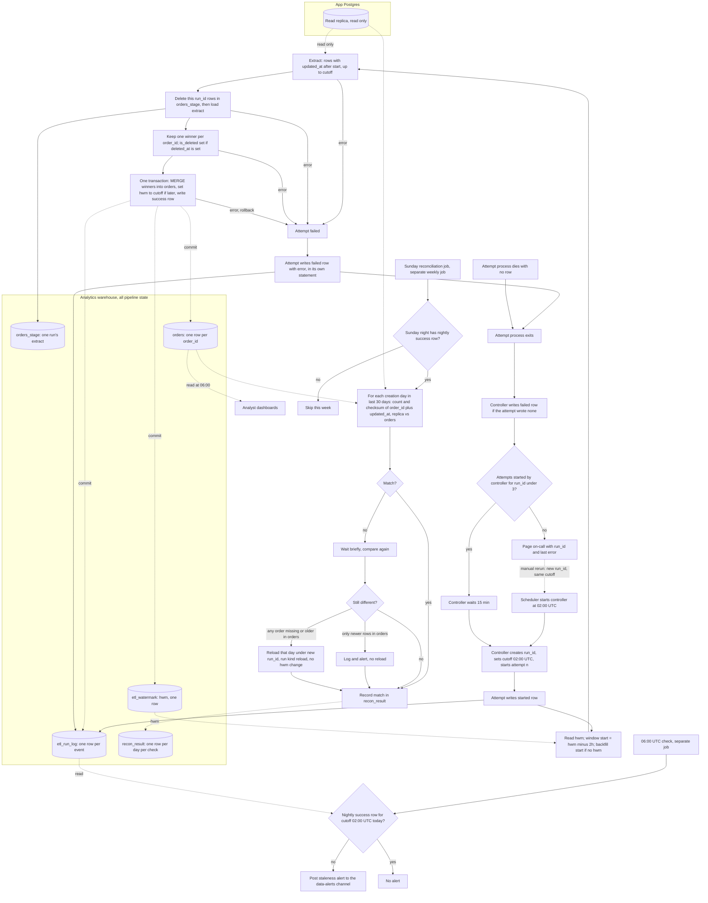

# Nightly `orders` ETL into the warehouse

## What this is

Nothing copies the app's `orders` table to the warehouse today. This job does that every night. The scheduler starts a run at 02:00 UTC. Each attempt reads every order that changed since the last good night, minus a 2-hour overlap, from the read replica. It loads those rows into a staging table, keeps the newest version of each order, and writes them into the serving table `orders` in one transaction. The same transaction moves the high-water mark, which records the last good night. If an attempt fails, the controller waits 15 minutes and tries again, up to three attempts in all. After the third failure it pages on-call. A separate check at 06:00 UTC alerts if tonight's load did not commit. On Sundays, a reconciliation compares the last 30 days with the replica and reloads any day that differs.

The design follows from two facts. We cannot write to the app database, so all pipeline state lives in the warehouse. Dashboards must never see half a night, so a night commits in full or not at all. The overlap picks up rows that become visible late. The Sunday check catches rows that become visible later than the overlap covers.

## Terms

- **Replica**: a read-only copy of the app's Postgres. The job reads only from here.
- **updated_at**: the time a row was last written. Every write sets it, including a delete.
- **deleted_at**: set when the app deletes an order. Rows are never hard-deleted, so a deleted order still exists as a row.
- **Cutoff**: 02:00 UTC for a night. Every attempt of one run uses the same cutoff.
- **Controller**: the scheduled job that starts a run and runs its attempts one after another. It is the only part that waits 15 minutes and starts the next attempt.
- **Run**: one job with one `run_id`. A run has up to three attempts.
- **Run kind**: `nightly` for the 02:00 job, `reload` for a Sunday reload.
- **Attempt**: one try within a run. Each attempt is its own process.
- **High-water mark (hwm)**: the cutoff of the last nightly run that committed. Stored in `etl_watermark`, which has one row.
- **Lookback**: 2 hours. The extract starts at hwm minus 2 hours.
- **`etl_run_log`**: one row per event in the warehouse: a started attempt, a failed attempt, or a committed run.
- **`orders_stage`**: a staging table that holds one run's extract. Rows are tagged with their `run_id`.
- **Row hash**: a hash of all the columns of a row. It breaks ties between versions with the same `updated_at`.
- **Winner**: the version of an order that counts. The later `updated_at` wins. If they are equal, the larger row hash wins.
- **MERGE**: a SQL statement that inserts new orders and updates existing ones, matched on `order_id`.
- **`orders`**: the serving table. One row per `order_id`. Dashboards read only this table.
- **`recon_result`**: a warehouse table with one row per day per reconciliation check.

## Diagram

Notes on the diagram:

- Dotted arrows are reads or commits. Solid arrows are the order of work.
- The controller decides whether to retry. An attempt only does its own work and writes its own log rows.
- Attempts never overlap. The controller starts the next attempt only after the previous attempt process has exited.
- The success row is written inside the commit transaction. It exists only if the night committed.

## Steps

1. **Start.** The scheduler starts the controller at 02:00 UTC. The controller creates a new `run_id`, fixes the cutoff at 02:00 UTC, and starts attempt 1. Each attempt first writes a "started" row to `etl_run_log` in its own statement. The row survives a later rollback, so there is always a record that the attempt began.
2. **Find the window.** The attempt reads the hwm from `etl_watermark` and sets the window start to hwm minus 2 hours. The overlap covers rows that became visible after their `updated_at`, up to 90 minutes late, plus a margin. Without it, a late row would be skipped forever. If there is no hwm row, which happens only on the first run, the start is the configured backfill start. If this step fails, the attempt fails and nothing has changed.
3. **Extract.** The attempt reads from the replica every row with `updated_at` after the window start and at or before the cutoff. It only reads. If this step fails, the attempt fails.
4. **Stage.** The attempt deletes this `run_id`'s rows in `orders_stage`, then bulk loads the extract. Clearing first means a retry cannot double rows. Other runs' rows are never touched. If this step fails, the attempt fails.
5. **Pick winners.** The attempt keeps one row per `order_id`, the winner. It sets `is_deleted` to true when the winner has `deleted_at` set. A delete is a write, so the deleted version is the newest and wins. Deleted orders stay as flagged rows and are never removed. If this step fails, the attempt fails.
6. **Commit.** One warehouse transaction does three things:
   - MERGE the winners into `orders`, matched on `order_id`. A new id is inserted. An existing id is updated only when the staged winner beats the stored row, meaning a later `updated_at`, with ties going to the larger row hash. Otherwise the stored row is left alone. This guard stops an older copy from overwriting a newer one.
   - For a nightly run only: set `etl_watermark` to the cutoff, but only if the cutoff is later than the stored one. The hwm only moves forward.
   - Write a success row to `etl_run_log` with the run kind.

   All three commit together or none do. If any error happens, the whole transaction rolls back, so `orders` and the hwm are unchanged, and the attempt fails.
7. **Retry or page.** When an attempt fails, it writes a "failed" row with the error to `etl_run_log` in its own statement, so the row survives the rollback. The controller waits until the attempt process has exited. If the process exited without writing a success or failed row, the controller writes the failed row itself. The controller counts the attempts it has started for this `run_id`. If there are fewer than three, it waits 15 minutes and starts the next attempt with the same `run_id` and cutoff. If there are three, it pages on-call with the `run_id` and the last error. Nothing reruns on its own after that.
8. **Manual rerun.** On-call starts a new run with a new `run_id` and the same 02:00 cutoff as the missed night. It gets three fresh attempts. The old run's rows stay in `etl_run_log` as history. The hwm is not moved back. The next night still starts from the last good hwm, so its window also covers the missed night.

## What happens when things fail

| Where it fails | What happens | Data state |
| --- | --- | --- |
| Steps 2 to 5 | Attempt fails, failed row written, controller retries after 15 min | `orders` and hwm unchanged |
| Step 6 | Whole transaction rolls back, failed row written, controller retries | `orders` and hwm unchanged |
| Attempt process dies with no failed row | Controller writes the failed row once the process has exited, then retries | Unchanged |
| Attempt process never exits | The controller keeps waiting, so the run stays open. See open questions | Unchanged |
| Controller host lost while waiting | No further attempts. The last attempt may have only a started row. The 06:00 check catches it | `orders` and hwm unchanged; dashboards show the last good night |
| Third failure | Page on-call. No further automatic attempts | hwm still the last good night |
| Manual rerun fails | Same as above, counted against the new `run_id` | hwm unchanged |
| No nightly success row by 06:00 UTC | Staleness alert to the data-alerts channel | Dashboards show the last good night |
| Scheduler never starts the run | No row is written. The 06:00 check is the only thing that catches it | Dashboards show the last good night |
| Replica behind the lookback | Found by the Sunday reconciliation | Fixed by reload |
| Reconciliation finds only newer rows in `orders` | Log and alert, no reload | Warehouse kept as is |
| Sunday night has no nightly success row | No reconciliation that week | Alert already sent at 06:00 |
| Reconciliation check errors | Error recorded in `recon_result`; day checked again next Sunday | Unchanged |
| Reload fails at steps 4 to 6 | Transaction rolls back, failed row written; day checked again next Sunday | `orders` and hwm unchanged |

## Staleness check and dashboards

The 06:00 UTC check is a separate job. It looks in `etl_run_log` for a success row with run kind `nightly` and cutoff 02:00 UTC that day. Reload rows are ignored. A success row exists only if its transaction committed, so it is the commit signal. If there is none, the job posts an alert to the data-alerts channel. It reads no other table.

Analyst dashboards read only `orders` at 06:00 UTC. They see the last committed night, never a partial one, because the MERGE and the hwm move commit together.

## Sunday reconciliation

This is a separate weekly job. It does not run inside the nightly run. It starts after the nightly retries should have finished. The brief gives no start time, so that is an open question.

1. The job first checks that Sunday's night has a nightly success row. If not, it skips the week. The 06:00 alert already covered the gap.
2. For each order-creation day in the last 30 days, it computes a row count and a checksum of `order_id` plus `updated_at`. It does this once on the replica and once in `orders`, using the same hash function. This only reads.
3. If the two match, it records the match in `recon_result`.
4. If they differ, it waits briefly and compares again. This way, writes that land during the check do not count as differences.
5. If they still differ:
   - If every difference is a newer row in `orders`, the replica is behind. The job logs and alerts. It does not reload.
   - If any order is missing from `orders`, or is older there than on the replica, the job reloads that day.
6. A reload takes a full extract of that creation day from the replica, ignoring the `updated_at` window. It runs steps 4 to 6 of the nightly flow under its own new `run_id`, with run kind `reload`. Its staging rows have their own `run_id`, so they never touch the nightly run's rows. The MERGE rule still applies. The replica version is newer than the stale stored row, so it replaces it. The reload's success row carries the 02:00 UTC cutoff of that Sunday night, but its run kind is `reload`, so the 06:00 check ignores it.
7. A reload never changes the hwm. If a reload fails, the failure is recorded and the day is checked again next Sunday.

Reconciliation never changes the hwm.

## Build and rollout

The brief sets no build or rollout steps. Two settings must be chosen before the first run: the backfill start date and the host that runs the controller. Both are open questions below.

## Open questions

- What is the backfill start date for the first run, and where is it set? The brief gives neither.
- What time does the weekly Sunday reconciliation job start? The brief says only "after the nightly retries."
- Who acts on the 06:00 staleness alert? The brief names no owner.
- Do analyst dashboards filter on `is_deleted`, or is that left to the analysts? The brief does not say.
- How long may one attempt run before it counts as hung? The brief sets no limit. Until one is set, a hung attempt holds the run open, because the controller waits for the process to exit.
- Which host runs the controller? The brief does not say. If that host is lost, the retries stop with it.