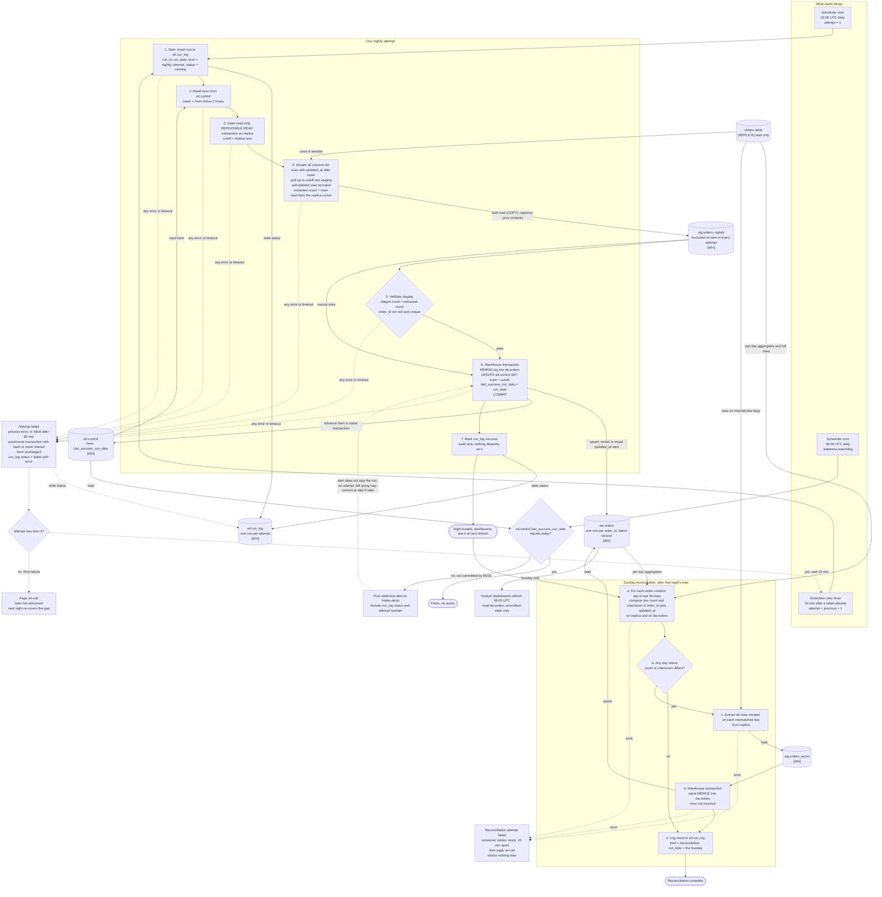

# Nightly orders ETL into the warehouse

## Summary

Today the app's `orders` table is not copied anywhere. This pipeline copies it into the analytics warehouse every night and keeps the copy correct when rows arrive late or change after export.

The main flow: at 02:00 UTC the scheduler starts an attempt. The attempt reads the stored high-water mark from the warehouse, extracts every order changed since 2 hours before that mark from the read replica, loads them into a staging table, checks them, and merges them into `dw.orders`. The merge and the mark advance commit together in one warehouse transaction. If an attempt fails, the scheduler retries it up to two more times, then pages on-call. At 06:00 a watchdog alerts if the night has not committed. On Sundays a reconciliation compares the last 30 days between replica and warehouse and reloads any day that differs.

Why it is shaped this way:
- We have no write access to the app database, so all pipeline state lives in the warehouse.
- Bulk imports can make a row visible up to 90 minutes after its `updated_at`, so each night re-reads an overlap of 2 hours. Rows are therefore extracted more than once, so the merge must be safe to repeat.
- Dashboards refresh at 06:00 whether or not we are done, so the data and the mark commit in one transaction. Dashboards never see half a night.

## Terms

- **Replica**: the app's read-only Postgres read replica. The only source of order data.
- **Warehouse**: the analytics database. It holds the copy and all pipeline state.
- **Scheduler**: the existing job scheduler. It starts each attempt as a process, watches its exit code and run time, and holds the retry timer and attempt count. Which product it is, is not known.
- **Attempt**: one run of the nightly sequence. It fails if the process exits with an error or runs longer than 60 minutes (the scheduler then kills it).
- **High-water mark (hwm)**: a stored timestamp meaning "everything up to here has been loaded". It is stored in the warehouse.
- **Lookback**: the 2 hours subtracted from hwm to start each window. It covers the 90-minute bulk-import delay with 30 minutes of margin.
- **Cutoff**: the replica's `now()`, taken once per attempt. It is the upper end of the window and becomes the new hwm.
- **Staging table**: a scratch table in the warehouse that holds one attempt's extracted rows before the merge.
- **Soft delete**: the app never deletes rows. It sets `deleted_at`, which also bumps `updated_at`. The warehouse keeps these rows with `is_deleted = true`.
- **Reconciliation**: the weekly check that compares per-day row counts and checksums between replica and warehouse.

## Diagram

Rectangles are steps. Cylinders are stores, tagged [WH] (warehouse) or [REPLICA]. Dotted edges are failure paths.

## How it runs

### What starts each step

| Step | Trigger |
|---|---|
| Nightly attempt 1 | Scheduler cron, 02:00 UTC. |
| Attempts 2 and 3 | Scheduler retry timer, 15 minutes after the previous attempt failed. |
| Page on-call | The third failed attempt. |
| Sunday reconciliation | Success of Sunday's nightly load, so it never runs alongside the load. If Sunday's night ends in a page, it is skipped that week. The following Sunday looks back 30 days and covers the gap. |
| Reconciliation retries | The scheduler, with its own attempt count and 15-minute timer. |
| Staleness check | Scheduler cron, 06:00 UTC, separate from the job, so it fires even if the job hangs. |

### Where state lives

All state is in the warehouse. The scheduler holds only the attempt count and retry timer. The replica holds none.

- **`etl.control`**: one row, `orders_nightly`. Holds `hwm` (UTC timestamptz) and `last_success_run_date`. Both change only in the step 6 transaction. It is the only authority on the mark. If the row is missing, seed `hwm` at the epoch for a full initial load.
- **`etl.run_log`**: one row per attempt, nightly or reconciliation. Columns: `run_id`, `run_date`, `kind`, `attempt`, `cutoff`, `rows_extracted`, `status`, `error`, timestamps. It feeds audit and alert text. Correctness never depends on it.
- **`stg.orders_nightly`, `stg.orders_recon`**: staging. Truncated at the start of every attempt, so a failed or repeated attempt leaves nothing behind.
- **`dw.orders`**: the target. Primary key `order_id`. Has `created_at` (used by reconciliation), `updated_at`, `deleted_at`, and `is_deleted` (set on load to `deleted_at IS NOT NULL`).

### The nightly attempt, step by step

1. **Start.** Triggered by the cron or the retry timer. Inserts a `run_log` row with status `running`.
2. **Read the mark.** Reads `hwm` from `etl.control`. The window starts at `hwm - 2h`. Each attempt re-reads `hwm`, so a retry never reuses a failed attempt's cutoff.
3. **Open a snapshot.** Opens a read-only `REPEATABLE READ` transaction on the replica and takes `cutoff = now()` there, once. This gives one consistent view with a fixed upper bound.
4. **Extract and stage.** Selects all columns where `updated_at > hwm - 2h AND updated_at <= cutoff`, soft-deleted rows included. It streams straight from the replica cursor into `stg.orders_nightly` with the warehouse bulk loader (COPY), so a large night is never held in memory. It counts rows as they leave the cursor. That is the extracted count.
5. **Validate.** Checks that the staged count equals the extracted count, that `order_id` is never null, and that it is unique. Uniqueness is expected from one snapshot, so this guards against bad data and is not a dedupe step. Any failed check fails the attempt.
6. **Merge and advance, in one warehouse transaction.**
   - `MERGE INTO dw.orders t USING stg.orders_nightly s ON t.order_id = s.order_id`.
   - `WHEN MATCHED AND s.updated_at >= t.updated_at` update all columns, setting `is_deleted`. `WHEN NOT MATCHED` insert.
   - `UPDATE etl.control SET hwm = GREATEST(hwm, cutoff), last_success_run_date = run_date`.
   - Commit.
7. **Mark success.** Sets the `run_log` row to `success`. This is audit only. If it fails, the data and mark are already committed, so the failure is logged and ignored, no retry happens, and the row may stay `running`.

Why the merge looks like this:
- The `updated_at >=` guard means an older copy never overwrites a newer one, so `dw.orders` holds one row per order, always the latest version, even after an out-of-order reload.
- `>=` rather than `>` makes re-applying an identical row a harmless no-op. That is what makes overlap and reruns safe.
- The mark moves in the same transaction as the data, so it advances only if the data committed. `GREATEST` keeps it from moving backwards. Dashboards read committed state only, so they see the whole night or none of it.
- This assumes the warehouse has a transactional `MERGE` (or delete-and-insert in one transaction). If not, load a shadow table and swap it in atomically with the same mark rule.

### Clocks, lag and the cutoff

- `updated_at` is stamped by the app's database. `cutoff` and `hwm` come from the replica's clock. We assume the clocks agree within seconds, which is tiny next to the 2-hour lookback. This is not checked.
- Setting `hwm = cutoff` (rather than the largest `updated_at` seen) keeps the mark moving on quiet nights. It is safe because the lookback and the Sunday reconciliation cover rows that become visible later.
- If the replica lags when the cutoff is taken, some rows are missed that night. The mark still advances. The next nights' lookback re-reads the period and picks them up if the lag is under the margin. Longer lag is left to the Sunday reconciliation.

### Staleness watchdog (06:00 UTC)

It only reads `etl.control.last_success_run_date`. If that is not today, it posts to #data-alerts with the `run_log` status and attempt number, so the channel can see whether the job is retrying, hung or paged. It never stops a running attempt. If an attempt commits later, dashboards pick it up at their next refresh, and a recovery note is posted to #data-alerts when `last_success_run_date` becomes today. Dashboards refresh at 06:00 regardless.

### Sunday reconciliation

It catches rows that arrive later than the lookback covers, such as when the replica falls far behind.

- **Compare.** For each `created_at` day in the last 30 days, compute `count(*)` and an order-independent checksum on both replica and `dw.orders`. The checksum is the sum of a 64-bit hash of `order_id || '|' || updated_at` (UTC, microsecond precision). Both sides must use the identical definition. It catches missing rows, extra rows and changed `updated_at`, including soft deletes.
- **Reload.** For each mismatched day, extract all that day's rows (deleted ones too) from the replica into `stg.orders_recon`, then run the same guarded `MERGE`. It does not touch `hwm`, so it cannot affect the nightly window.
- **Harmless extra reloads.** A day that differs only because orders changed after the nightly cutoff is reloaded too. The merge is idempotent, so this does no harm.
- **Failure.** The scheduler retries it twice, 15 minutes apart, then pages on-call. `run_log` rows use `kind = reconciliation` and `run_date` = the Sunday. A failed reconciliation blocks nothing: not the nightly status, `hwm` or the staleness check.

## What happens when things fail

| Where | What happens |
|---|---|
| Any step before the commit (error, or killed at 60 minutes) | The warehouse transaction rolls back or never started. `hwm` is unchanged. The scheduler writes `failed` to `run_log` if the process could not, outside the merge transaction, so it survives. Staging is cleared by the next attempt. |
| Attempt 1 or 2 fails | The scheduler waits 15 minutes after the failure and starts the next attempt from step 1. Worst case, three 60-minute attempts and two waits end around 05:30, before 06:00. |
| Attempt 3 fails | Page on-call. `hwm` stays put. The next night's window starts at the old `hwm - 2h`, so it loads the missed data with no gap. Data catches up once the cause is fixed. |
| Step 7 fails | Logged and ignored. See step 7. |
| Manual rerun of a night that already succeeded | Safe. It reads the current, later `hwm`, extracts a mostly overlapping window and merges it as no-ops. |
| Night not committed by 06:00 | Staleness alert. Nothing is stopped. |
| Reconciliation fails | Own retries, then a page. Blocks nothing. |

## Decisions worth confirming

- **60-minute attempt limit.** The brief gives none. We chose 60 minutes so three attempts and two waits finish before 06:00.
- **15-minute retry delay.** Measured from the previous failure, as the brief says.
- **`hwm = cutoff`.** See the clocks section.

## Open questions

- Which scheduler product is used, and can it enforce a run-time limit and a retry timer as described? Not known.
- Is the replica clock close enough to the app database clock? Assumed, not checked.