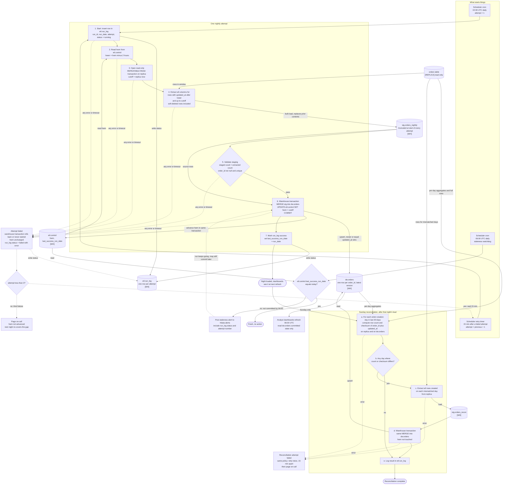

# Nightly orders ETL into the warehouse

## How to read this

- Rectangles are steps. Cylinders are state or data stores.
- Every store is tagged **[WH]** (warehouse) or **[REPLICA]**. All pipeline state is in the warehouse, because we have no write access to the app database.
- Dotted edges are failure paths.
- There are three triggers: the 02:00 UTC nightly run, the 06:00 UTC staleness watchdog, and the Sunday reconciliation. The reconciliation is chained to the nightly run's success. It is not on its own clock.

## What starts each step

| Step | Trigger |
|---|---|
| Nightly attempt 1 | Scheduler cron, 02:00 UTC. |
| Retry attempts 2 and 3 | The scheduler's retry timer fires 15 minutes after the previous attempt fails, not after it started. |
| Page on-call | The third failed attempt. |
| Sunday reconciliation | Success of Sunday's nightly load, so it runs after the load and never alongside it. If Sunday's night ends in a page, reconciliation is skipped that week. The next night's catch-up window still covers the gap, and the following Sunday's reconciliation looks back 30 days. |
| Staleness check | Scheduler cron, 06:00 UTC, separate from the job. It still fires if the job hangs or the scheduler never started it. |

## Where the state lives

All state is in the warehouse.

- **`etl.control`** has one row per pipeline, `orders_nightly`.
  - `hwm` is a UTC timestamptz.
  - `last_success_run_date` is the date of the last committed run.
  - It is the only authority on the high-water mark.
- **`etl.run_log`** has one row per attempt, for both nightly and reconciliation runs.
  - Columns are `run_id`, `run_date`, `kind`, `attempt`, `cutoff`, `rows_extracted`, `status`, `error` and timestamps.
  - It is for audit and alert content. The pipeline's correctness does not depend on it.
- **`stg.orders_nightly`** and **`stg.orders_recon`** are scratch tables. They are truncated at the start of every attempt, so a failed or repeated attempt leaves nothing behind.
- **`dw.orders`** is the target.
  - It has a primary key on `order_id`.
  - It has `created_at` (needed by reconciliation), `updated_at`, `deleted_at` and `is_deleted`.
  - `is_deleted` is derived on load as `deleted_at IS NOT NULL`.
  - Deleted orders are kept.
- **Attempt count and retry timer** belong to the scheduler. Each attempt also records its number in `run_log`.

The scheduler is the only state outside the warehouse. The replica holds no pipeline state.

## Extraction

- **Window.** `updated_at > hwm - 2h AND updated_at <= cutoff`.
  - The cutoff is taken once, as `now()` on the replica when the snapshot transaction opens.
  - The query runs in a read-only `REPEATABLE READ` transaction, so one night gets one consistent snapshot with a fixed upper bound.
  - Soft-deleted rows match like any other write, because setting `deleted_at` bumps `updated_at`.
- **Margin.** The 2-hour lookback covers the 90-minute bulk-import window with 30 minutes of margin. Replica lag beyond that margin is what the Sunday reconciliation exists for.
- **Per-attempt re-read.** Each retry re-reads `hwm` and takes a new cutoff. It never reuses the failed attempt's cutoff, so a retry cannot skip rows.
- **First run.** If `etl.control` has no row, seed `hwm` at the epoch for a full initial load.

## Staging and validation

- The extract bulk-loads into `stg.orders_nightly`.
- Before touching the target, check that the staged count equals the extracted count, that `order_id` is non-null, and that `order_id` is unique.
- Uniqueness is expected, because one snapshot returns each order once. The check is a guard against bad data, not a dedupe step.
- A failed check fails the attempt.

## Merge logic

Everything happens in a single warehouse transaction:

1. `MERGE INTO dw.orders t USING stg.orders_nightly s ON t.order_id = s.order_id`
   - `WHEN MATCHED AND s.updated_at >= t.updated_at THEN UPDATE` all columns, with `is_deleted = (s.deleted_at IS NOT NULL)`.
   - `WHEN NOT MATCHED THEN INSERT`.
2. `UPDATE etl.control SET hwm = GREATEST(hwm, :cutoff), last_success_run_date = :run_date`
3. `COMMIT`

Why this design:

- **One row per order, always the latest version.** The `updated_at >= t.updated_at` guard means an older copy can never overwrite a newer one. An out-of-order reload, such as a reconciliation reload, can't regress a row.
- **`>=` rather than `>`.** Re-applying an identical row is harmless, so reruns are idempotent.
- **Re-extracted rows.** The overlap from the lookback re-extracts rows that are already loaded. The merge turns them into no-op updates.
- **No half-loaded night.** Dashboards read committed state only. Either the whole night's merge and the hwm advance are visible, or none of it is.
- **Atomic hwm.** The high-water mark moves in the same transaction as the data. It advances to `cutoff` only if the data committed, and `GREATEST` keeps it monotonic.
- **Warehouse assumption.** This assumes the warehouse supports a transactional `MERGE` or an equivalent delete-and-insert in one transaction. If it doesn't, load into a shadow table and swap it in atomically, keeping the same hwm rule.

## Failure and retry

- **Where a failure can happen.**
  - Any failure before the commit means rollback or no write to `dw.orders`.
  - `hwm` is unchanged and staging is discarded on the next attempt.
  - The `failed` status goes to `run_log` outside the merge transaction, so it survives the rollback.
- **Retries.** Attempts 2 and 3 start 15 minutes after the previous failure. They run the whole sequence again from step 1.
- **After the third failure.** Page on-call. `hwm` stays where it was. The next night's window starts at the old `hwm - 2h`, so the next night's job loads the missed data without a gap. The page asks a human to investigate, and the data catches up on its own once the cause is fixed.
- **Rerunning a night.** A manual rerun of a night that already succeeded is safe. It re-reads the current `hwm`, which is later, extracts a window that mostly overlaps, and merges as no-ops.
- **Late commit.** If a run is still going at 06:00, it continues. If it commits later, dashboards pick it up at their next refresh. The watchdog alert stands, so post a recovery note in #data-alerts when `last_success_run_date` becomes today.

## Staleness alert (06:00 UTC)

The watchdog is independent of the job. It only reads `etl.control.last_success_run_date`.

- If that date is not today, post to #data-alerts. Include the `run_log` status and attempt number so the channel can see whether it is retrying, hung or paged.
- The dashboards refresh at 06:00 regardless. Because of the single-transaction commit, they show either the previous night's complete state or the new night's complete state.

## Sunday reconciliation

It runs after Sunday's nightly load succeeds and covers late arrivals that the lookback misses, for example when the replica falls behind.

- **Per-day comparison.**
  - For each `created_at` day in the last 30 days, compute `count(*)` and an order-independent checksum.
  - The checksum is the sum of a 64-bit hash of the canonical string `order_id || '|' || updated_at` in UTC at microsecond precision.
  - The format must be identical on both sides. Compute it with the same definition on the replica and on `dw.orders`.
  - It catches missing rows, extra rows, and rows whose `updated_at` differs. A soft-delete changes `updated_at`, so it is detected too.
- **Reload.** For each mismatched day, extract all of that day's rows from the replica, including deleted ones, into `stg.orders_recon`, then run the same guarded `MERGE`. It does not touch `hwm`, so it can't affect the nightly window.
- **Timing quirk.** A day that mismatches only because orders changed on the replica after the nightly cutoff is also reloaded. This is harmless, because the merge is idempotent and the next nightly picks those rows up anyway.
- **Reconciliation failure.** It uses the same policy as the nightly run: retry twice, 15 minutes apart, then page on-call. It does not change the nightly job's status or the staleness check.

## Decisions worth confirming

- **`hwm = cutoff` rather than `max(updated_at)`.** This keeps the mark moving on quiet nights. It is safe because the 2-hour lookback and the Sunday reconciliation cover rows that become visible later.
- **Retry timing.** The 15 minutes is measured from the failure of the previous attempt, as the brief says. Three attempts at the worst case fit well before 06:00 unless an attempt itself runs long.
