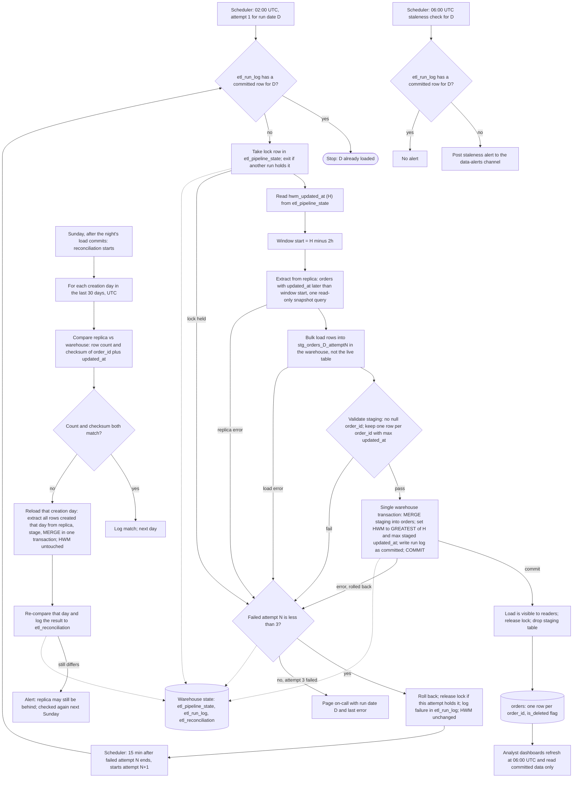

# Nightly orders ETL into the warehouse: pipeline plan

## Summary

Every night a job copies the app's `orders` table from the Postgres read replica into the analytics warehouse. The job never writes to the app database. It reads only rows changed since a stored timestamp, the high-water mark (HWM), minus a 2-hour safety overlap. It loads those rows into a temporary staging table, then merges them into the live `orders` table. In the same warehouse transaction it moves the HWM forward. If anything fails, nothing changes and the job retries. The live table keeps one row per order, its latest version, and marks deleted orders with `is_deleted`. Every Sunday a reconciliation compares 30 days of order counts and checksums with the replica and reloads any day that differs.

The overlap exists because the app can make a row visible up to 90 minutes after its `updated_at` time, since bulk imports stay open that long. Rows that become visible later than the overlap covers are the reconciliation's job.

## Terms

- **Replica**: a read-only copy of the app's Postgres database. The job reads it and never writes to it.
- **Warehouse**: the analytics database. It holds the live `orders` table and all pipeline state.
- **`updated_at`**: the time a row was last written. Every write sets it, including deletes.
- **`deleted_at`**: set when an order is deleted. The app never hard-deletes, so deleted orders still exist with this value set.
- **HWM (high-water mark)**: a UTC timestamp stored in `etl_pipeline_state`. It records how far loads have got. Only a committed load moves it.
- **Window**: the rows one night's extract reads, those with `updated_at` later than the HWM minus 2 hours.
- **Staging table**: a temporary table, `stg_orders_<D>_attempt<N>`, that holds one attempt's extract. Readers never see it.
- **MERGE**: one warehouse statement that updates matching rows and inserts new ones.
- **Lock**: a row in `etl_pipeline_state` that marks a job as running. A job that finds it held exits.
- **Run date (D)**: the night a run is loading for. The 02:00 UTC run for a given day has run date D.
- **Attempt N**: one try at run date D. Attempts 1, 2 and 3 are the scheduled tries.
- **Creation day**: the UTC date of an order's `created_at`. Used only by the reconciliation.
- **Checksum**: one number computed over many rows. Equal checksums on both sides almost certainly mean the same rows. Here it is the sum of a 64-bit hash of `order_id || '|' || updated_at`, computed the same way on both sides.

**Where data and state live**

| Item | Location | Notes |
|---|---|---|
| Source data | App Postgres read replica | Read only. |
| Extract staging | `stg_orders_<D>_attempt<N>` in the warehouse | One per attempt. Dropped on commit. Kept on failure for debugging. |
| Live table | `orders` in the warehouse | One row per `order_id`. Dashboards read only this. |
| HWM and lock | `etl_pipeline_state` in the warehouse | One row per pipeline: `hwm_updated_at` (UTC), `lock_holder`, `lock_taken_at`. |
| Run log | `etl_run_log` in the warehouse | `run_date`, `attempt`, `status` (started, failed, committed), `rows_extracted`, `error`, timestamps. |
| Reconciliation log | `etl_reconciliation` in the warehouse | `creation_day`, replica count and checksum, warehouse count and checksum, result, `reloaded_at`. |

The HWM lives in the warehouse, so it moves only in the same transaction as the data it describes.

## Flowchart

## How a night runs

1. **Start.** The scheduler starts attempt 1 at 02:00 UTC for run date D. Each retry starts 15 minutes after the previous attempt has ended as failed. The job first checks `etl_run_log` for a committed row for D. If one exists, the job stops, because that night is already loaded.

2. **Take the lock.** The job writes its name and the time into the lock row in `etl_pipeline_state`. If the lock is already held by another run, the job exits without waiting. It logs a failed attempt and counts it as one.

3. **Read the window.** The job reads H, the HWM, from `etl_pipeline_state`. The window starts at H minus 2 hours. The first run has H set to 1970-01-01 UTC, so its window is the whole table. That first run is the backfill.

4. **Extract.** The job reads from the replica in one read-only snapshot query. It takes every column of `orders` with `updated_at` later than the window start, including `deleted_at`. It does not remove duplicates here. A replica error is a failure. Zero rows is a success, meaning nothing changed in the window.

5. **Stage.** The job bulk loads the extract into `stg_orders_<D>_attempt<N>` in the warehouse. It sets `is_deleted` to true when `deleted_at` is set. Each attempt has its own staging table, so a retry never reads a half-written earlier attempt.

6. **Validate.** If any `order_id` is null, the attempt fails. Otherwise the job keeps one row per `order_id`, the row with the greatest `updated_at`.

7. **Merge and commit.** The job runs these four steps in one warehouse transaction:
   - a. MERGE the staged rows into `orders`. A staged row replaces the live row only when its `updated_at` is later. A row with the same or an older `updated_at` is ignored. This makes overlapping windows and reruns safe. New orders are inserted. Each updated or inserted row also gets `loaded_at` set to the run's start time.
   - b. Set the HWM to the greater of H and the largest `updated_at` among the staged rows. The HWM never moves backwards. If the window was empty, it stays at H.
   - c. Mark this run date's `etl_run_log` row as committed.
   - d. Commit. Any error rolls back all three steps, so the HWM moves only when the data has loaded.

   Readers see the previous night until the commit, then this night. They never see a partial merge.

8. **Clean up on success.** After the commit, the job releases the lock and drops the staging table.

9. **Handle failure.** Any error in steps 2 to 7, or a timeout, counts as a failed attempt. The job rolls back the attempt's transaction. It leaves committed data and the HWM unchanged. It releases the lock if this attempt holds it, logs the failure and its error in `etl_run_log`, and keeps the staging table for debugging. If the failed attempt was number 1 or 2, the next attempt starts 15 minutes later. If attempt 3 failed, the job pages on-call with run date D and the last error.

   Each attempt has a 50-minute timeout. Worst case: attempt 1 runs 02:00 to 02:50, attempt 2 runs 03:05 to 03:55, and attempt 3 runs 04:10 to 05:00. All three end by 05:00, before the 06:00 check.

10. **Staleness check.** A separate job, scheduled independently at 06:00 UTC, looks for a committed `etl_run_log` row for D. If there is none, it posts a staleness alert to #data-alerts. Dashboards refresh at 06:00 either way and show the last committed night, which is consistent. If the load commits after the alert, the alert is not retracted. The next check or the run log records the recovery.

11. **Sunday reconciliation.** This starts on Sunday, after that night's load commits. It takes the lock, so it exits if another run holds it. For each creation day in the last 30 days, it compares the replica and the warehouse on two numbers: the row count, and the checksum over `order_id` and `updated_at`. Deleted orders count on both sides. If both numbers match, it logs a match and moves to the next day. If either differs, it reloads that creation day. It extracts every row created that day from the replica, not only rows changed in the window. It stages them and MERGEs them with the same rule, in one transaction. The HWM is not touched. It then compares the day again and logs the result in `etl_reconciliation`. If the day still differs, it raises an alert. A replica that is still catching up keeps differing until a later Sunday check passes.

## What happens when things fail

| Failure | Where it happens | What happens |
|---|---|---|
| Lock held by another run | Take lock | Attempt exits, is logged as failed, and counts toward the three attempts. The lock is not touched. |
| Replica connection or query error | Extract | Attempt fails. Retry follows step 9. HWM unchanged. |
| Staging load error | Stage | Same as above. |
| Null `order_id` | Validate | Attempt fails. Retries fail the same way until the source data is fixed. |
| Merge or commit error | Merge and commit | The whole transaction rolls back, including the HWM and the run log. |
| Attempt runs over 50 minutes | Any step | Counts as a failure. |
| Attempt 3 fails | After attempt 3 | Page on-call with run date D and the last error. |
| No committed load by 06:00 | Staleness check | Post a staleness alert. Dashboards show the last committed night. |
| Rerun of an already loaded night | Start | Scheduled reruns stop at the committed-row check. A manual rerun can run anyway, because the merge is idempotent. |
| Rows visible after the overlap | Sunday reconciliation | Count or checksum differs, so that creation day is reloaded. |
| Reloaded day still differs | Sunday reconciliation | Alert. The next Sunday check tries again. |

## Build and roll out

- Create `etl_pipeline_state` with one row for the pipeline, the HWM set to 1970-01-01 UTC, and the lock empty. Create `etl_run_log` and `etl_reconciliation` before the first run.
- Confirm that the warehouse supports MERGE and multi-statement transactions. If it does not, load into a shadow table and swap it in atomically. The rules above stay the same.
- Confirm that `orders` has `created_at` and that every write sets `updated_at`.
- Schedule the staleness check as its own job, separate from the nightly job.

## Open questions

- The brief does not name `created_at`. The reconciliation depends on it. Confirm that it exists and is set on insert.
- The first run loads the whole table within one 50-minute attempt. Confirm this is long enough. If it is not, raise the timeout for the first run only.
- Rows created more than 30 days ago that become visible after the overlap are never reconciled. Confirm that the business accepts this.
- Two rows with the same `updated_at` but different content are not resolved. The merge keeps the existing row, and the checksum cannot see the difference. If the app can produce such ties, add a source version column or a row hash to the merge and the checksum.
- If the Sunday night's load fails, the reconciliation does not start that day. Confirm that catching up on the next Sunday is acceptable.
- The HWM is one timestamp for the whole pipeline. If a night fails for several days, the HWM stays put and the next successful night's window reaches back to it. That covers every missed row, but the window and extract grow with the gap.
- Creation days are measured in UTC. Confirm this matches how the business counts orders.