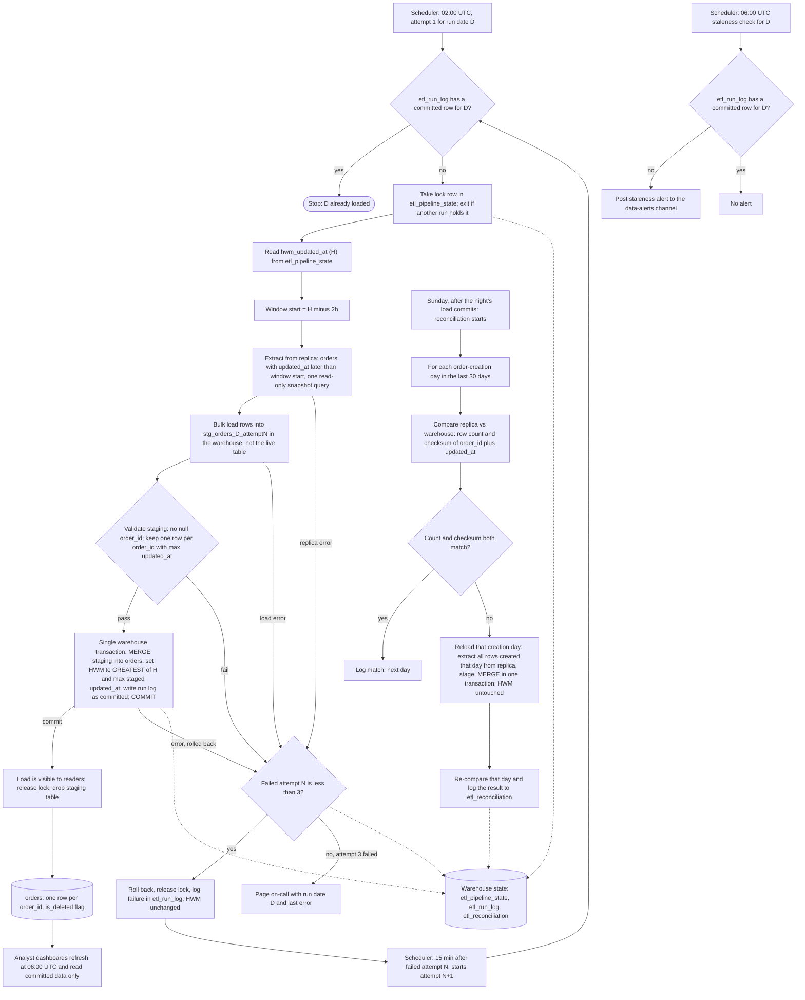

# Nightly orders ETL into the warehouse: pipeline plan

## Summary

A nightly job copies the app's `orders` table from the Postgres read replica into the analytics warehouse. Each night it extracts rows whose `updated_at` is later than the stored high-water mark (HWM) minus a 2-hour lookback. It loads them into a per-attempt staging table in the warehouse, then merges them into `orders` in one warehouse transaction that also advances the HWM. The live table holds one row per `order_id`, the latest version, with an `is_deleted` flag. A Sunday reconciliation compares 30 days of counts and checksums against the replica and reloads any day that differs.

## Flowchart



## Where things live

| Item | Location | Notes |
|---|---|---|
| Source data | App Postgres read replica | Read only. No writes to the app database. |
| Extract staging | `stg_orders_<D>_attempt<N>` in the warehouse | Per attempt. Dropped on commit. Kept on failure for debugging. |
| Live table | `orders` in the warehouse | One row per `order_id`. Dashboards read only this. |
| HWM and lock | `etl_pipeline_state` in the warehouse | One row per pipeline: `hwm_updated_at` (UTC), `lock_holder`, `lock_taken_at`. |
| Run log | `etl_run_log` in the warehouse | `run_date`, `attempt`, `status` (started, failed, committed), `rows_extracted`, `error`, timestamps. |
| Reconciliation log | `etl_reconciliation` in the warehouse | `creation_day`, replica count and checksum, warehouse count and checksum, result, reloaded_at. |

Nothing is written to the app database. The HWM lives in the warehouse, so it moves only in the same transaction as the data it describes.

## Extract

- Window: `updated_at > H - 2h`, where H is the stored HWM. On the first run, H is set by a one-time backfill of the full table.
- Single snapshot query on the replica, read only, selecting all columns, including `deleted_at`.
- Row-level dedupe happens in staging (see Merge), not in the extract.

## Staging and validation

- Bulk load the extract into `stg_orders_<D>_attempt<N>`. Each attempt gets its own table, so a retry never sees a half-written earlier attempt.
- Derive `is_deleted = deleted_at IS NOT NULL` at staging time.
- Validation before the merge: reject the attempt if any `order_id` is null. Dedupe to one row per `order_id`, keeping the row with the greatest `updated_at`.
- An empty window is a valid success. Zero rows means no change in the window. A replica connection error is a failure, not zero rows.

## Merge rule

Run inside the single transaction described below:

```sql
MERGE INTO orders AS t
USING stg_deduped AS s
  ON t.order_id = s.order_id
WHEN MATCHED AND s.updated_at > t.updated_at THEN
  UPDATE SET <all columns from s>, is_deleted = s.is_deleted, loaded_at = :run_started
WHEN NOT MATCHED THEN
  INSERT (<all columns>, is_deleted, loaded_at) VALUES (<s columns>, s.is_deleted, :run_started);
```

- A staged row that is not newer than the live row is ignored. This makes overlapping windows and re-runs safe: replaying a night changes nothing.
- Deletes are writes that bump `updated_at`, so they arrive through the same rule. Deleted orders stay in `orders` with `is_deleted = true`. Nothing is hard-deleted.
- Equal `updated_at` with different content is an unresolved edge (see Open boundaries).

## HWM update and commit

Within one warehouse transaction:

1. MERGE staging into `orders`.
2. Set `hwm_updated_at = GREATEST(H, MAX(updated_at) over staged rows)`. The HWM never moves backwards. If the window is empty, it stays at H.
3. Set the run log row for D to `committed`.
4. COMMIT. Any error rolls back all three steps, so the HWM advances only when the data has loaded.

Dashboards read `orders` under the warehouse's normal isolation, so they see either the previous night or this night, never a partial merge. If the warehouse cannot isolate multi-statement transactions from readers, load into a shadow table and swap it in atomically.

Why the lookback is enough: the HWM never exceeds the extraction time, and a bulk-imported row is visible at most 90 minutes after its `updated_at`. A row invisible at one night's extraction therefore has `updated_at` within the last 90 minutes before that extraction, which is later than the next night's window start (2h before the HWM). The 2-hour lookback leaves 30 minutes of margin beyond the 90-minute visibility lag. Replica lag beyond that is the reconciliation's job.

## Lock and idempotency

- A lock row in `etl_pipeline_state` allows one writer at a time. The nightly job, retries, and the Sunday reconciliation all take it. A held lock means exit, not wait, and is logged as a failed attempt.
- Before starting, the job checks for a committed row for D and stops if one exists. Scheduled reruns of a loaded night are therefore no-ops. A manual rerun can run anyway, because the merge is idempotent.
- Only the commit advances the HWM, and the window depends only on the HWM, so a retry of the same night reads the same window.

## Failure and retry

- Every failure (replica error, staging error, validation failure, merge error, lock held, timeout) rolls back the attempt's transaction, drops nothing committed, leaves the HWM unchanged, releases the lock, and logs the failure.
- Attempts run at 02:00, 02:15, and 02:30 UTC. On the third failure, page on-call with run date D and the last error. Staging tables from failed attempts are kept for debugging.
- Each attempt has a 50-minute timeout, and a timeout counts as a failure. Worst case, three attempts end before 05:00, so the 06:00 check has time to see the outcome.

## Staleness alert

- A separate 06:00 UTC check, scheduled independently of the nightly job, looks for a committed `etl_run_log` row for D.
- No committed row means post a staleness alert to the data-alerts channel. Dashboards still refresh at 06:00 and show the last committed night, which is consistent.
- If the load commits after the alert, the alert is not retracted. The following check or the commit log records the recovery.

## Sunday reconciliation

- Runs on Sunday after the night's load commits, and takes the lock.
- For each order-creation day in the last 30 days (`created_at` date), compare on the replica and the warehouse:
  - row count, and
  - an order-independent checksum over `order_id` and `updated_at`, for example the sum of a 64-bit hash of `order_id || '|' || updated_at`, computed identically on both sides.
- Include deleted orders on both sides. The warehouse keeps them, and the replica still has them with `deleted_at` set.
- On mismatch, reload that creation day: extract all rows with that `created_at` date from the replica (not limited by `updated_at`), stage them, and MERGE using the same rule, in one transaction. The HWM is not touched.
- Re-compare the reloaded day and log the result to `etl_reconciliation`. If it still mismatches, alert. A replica that is still behind will keep mismatching until it catches up, and the next Sunday check picks it up.

## Open boundaries and assumptions

- Assumes the orders table has `created_at` (used for the reconciliation day) and `updated_at` set on every write. The brief does not name `created_at`; confirm it.
- Assumes the warehouse supports MERGE and multi-statement transactions. If not, use the shadow-table swap above.
- Equal `updated_at` with different content is not resolved by the merge, and the checksum includes `updated_at` but not the row content, so it would not catch the difference. If the app can produce such ties, add a source version column or a row hash to the merge and checksum.
- Rows created more than 30 days ago that become visible after the lookback are not reconciled. Confirm that this matches the business requirement.
- The HWM is a single pipeline-wide timestamp, so one stuck night holds the window open for the next night. Missed nights are covered by the next successful window, provided the gap stays within the 2-hour margin logic.
- Assumes an order-creation day in the last 30 days is measured in UTC.