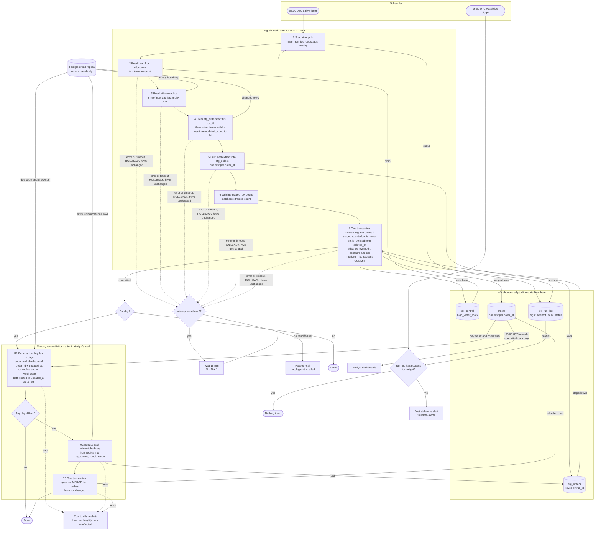

# Nightly orders ETL into the warehouse

This job copies the app's `orders` table into the analytics warehouse every night. Today there is no pipeline. The job starts at 02:00 UTC and extracts the rows changed since the last successful run, stepping back 2 hours to catch late-visible rows. It loads them into a staging table, then merges them into `orders` in one transaction that also moves the progress marker forward. Dashboards therefore never see a half-loaded night. Each night's extract overlaps the last, so the merge keeps exactly one, newest row per order, and re-running does no harm. Late rows that even the overlap misses are fixed by a weekly Sunday check.

## Terms

- **Read replica**: the copy of the app's Postgres database that we read from. We never write to it.
- **Warehouse**: the analytics database. It holds all pipeline state, because we cannot write to the app database.
- **`orders`**: the warehouse table that dashboards read. One row per `order_id`.
- **`stg_orders`**: the staging table. It holds one attempt's extracted rows, tagged with that attempt's `run_id`, so a failed load never touches `orders`.
- **High-water mark (HWM)**: the `updated_at` time up to which data is safely loaded. It is stored in `etl_control` (one row per pipeline).
- **`etl_run_log`**: one row per attempt: `run_id`, `night`, `attempt`, `lo`, `hi`, `status`, `rows_extracted`, `started_at`, `finished_at`.
- **Lookback**: we extract from `HWM - 2h`. Bulk imports can keep a transaction open for 90 minutes, and `updated_at` is stamped at write time, not commit time. A row can therefore become visible up to 90 minutes after its `updated_at`. The 2 hours leave a 30-minute margin.
- **`is_deleted`**: the app never hard-deletes. It sets `deleted_at`, which is also a write. We keep these orders and flag them `is_deleted`.
- **Compare-and-set**: an update that applies only if the value is still what we read at the start. It stops two attempts both moving the HWM.
- **Reconciliation**: a Sunday check that compares counts and checksums between replica and warehouse and reloads days that differ.

## Steps while running

Each attempt gets a new `run_id`. Steps 1 to 7 repeat on each attempt (N = 1 to 3).

1. **Start.** The scheduler starts attempt 1 at 02:00 UTC. The job inserts an `etl_run_log` row with status `running`.
2. **Read the HWM** from `etl_control` and set `lo = HWM - 2h`. The HWM value read is kept for step 7.
3. **Pick `hi`** as the smaller of `now()` and the replica's `pg_last_xact_replay_timestamp()`. A lagging replica therefore cannot push the HWM past data it has not replayed.
4. **Extract and stage.** First run `DELETE FROM stg_orders WHERE run_id = :run_id` so a retry starts clean. Then read from the replica every row where `lo < updated_at <= hi`, including rows with `deleted_at` set. The replica holds one row per order, so staging gets one row per `order_id` (unique key on `(run_id, order_id)`). Bulk-load these into `stg_orders`.
5. **Validate** that the staged row count equals the extracted count.
6. **Commit, in one warehouse transaction:**
   - Merge `stg_orders` into `orders`. Insert new orders. Update an existing order only if the staged `updated_at` is newer. Set `is_deleted = (deleted_at IS NOT NULL)`.
   - Advance the HWM to `hi` with a compare-and-set. It must change exactly 1 row, or the transaction rolls back.
   - Mark the run log row `success`.

   ```sql
   BEGIN;
   MERGE INTO orders d USING stg_orders s
     ON d.order_id = s.order_id AND s.run_id = :run_id
   WHEN MATCHED AND s.updated_at > d.updated_at THEN
     UPDATE SET <all columns from s>, is_deleted = (s.deleted_at IS NOT NULL)
   WHEN NOT MATCHED THEN
     INSERT (<all columns>, is_deleted) VALUES (<s columns>, s.deleted_at IS NOT NULL);
   UPDATE etl_control SET high_water_mark = :hi
    WHERE pipeline = 'orders' AND high_water_mark = :hwm_read_at_start;  -- must affect 1 row, else ROLLBACK
   UPDATE etl_run_log SET status = 'success' WHERE run_id = :run_id;
   COMMIT;
   ```

   Dashboards see either the old `orders` or the whole new night, never part of it.
7. **Sunday only: reconcile.** After a committed load on a Sunday, run the reconciliation below.

**Why re-running is safe.** `orders` has a unique key on `order_id`. The "newer `updated_at`" guard means a re-extracted or stale row never overwrites a newer version, so a repeat run changes nothing. The HWM moves only inside the commit, and only forward.

**Staleness watchdog.** At 06:00 UTC, a separate scheduler entry checks `etl_run_log` for a `success` row for tonight's night. If there is none, it posts a staleness alert to #data-alerts. This covers a failed night, a night still retrying and a slow load. Dashboards refresh at 06:00 UTC regardless and read only committed `orders` data.

**Sunday reconciliation.**
1. For each order-creation day (`created_at::date`) in the last 30 days, compute `count(*)` and a checksum on both the replica and the warehouse. The checksum is the sum, modulo 2^64, of a per-row hash of `order_id || updated_at`. Both sides count only rows with `updated_at <= HWM`, so rows written after the load's cut-off do not look like mismatches.
2. For each day that differs, extract the whole day from the replica into `stg_orders` under a `recon` run id. Merge it with the same guarded merge in one transaction. This never touches the HWM, and it cannot undo newer data.

## What happens when things fail

| Where | What happens |
|---|---|
| Any error or timeout in steps 2 to 6 | The transaction rolls back and the HWM stays unchanged. Staging is outside the transaction, so `orders` is untouched. |
| Attempt 1 or 2 fails | The scheduler waits 15 minutes and starts the next attempt. It recomputes `lo` and `hi` from the unchanged HWM. |
| Attempt 3 fails | The run log status becomes `failed` and the job pages on-call. |
| Overlapping attempts | Not possible: each attempt has a timeout and the scheduler runs one at a time. The compare-and-set is a second guard. |
| Load not committed by 06:00 | The watchdog posts to #data-alerts. Dashboards show the last committed data. |
| Reconciliation fails | It is not retried. It posts to #data-alerts. The HWM and nightly data are unaffected, and next Sunday's run covers the same days. |

## Pipeline flowchart



## What starts each step

| Step | Started by |
|---|---|
| Nightly attempt 1 | Scheduler, 02:00 UTC |
| Attempts 2 and 3 | The scheduler, 15 minutes after the previous attempt failed |
| Page on-call | Third failed attempt |
| Sunday reconciliation | Successful commit of the nightly load, only on Sunday |
| Staleness check | Scheduler, 06:00 UTC |
| Dashboard refresh | Dashboard schedule, 06:00 UTC. It reads committed `orders` rows only. |

## Setup and rollout

- Seed `etl_control.high_water_mark` to the epoch. The first run is then a full backfill.
- The warehouse must support multi-statement transactions with snapshot-isolated readers. Without `MERGE`, use `UPDATE ... FROM` plus `INSERT ... WHERE NOT EXISTS` in the same transaction.

## Open questions

- Does the warehouse really support multi-statement transactions with snapshot-isolated readers? The design depends on it.
- Anything that becomes visible later than the 2-hour lookback is caught only by Sunday's reconciliation, so it can stay missing for up to a week. This is accepted by the brief.
