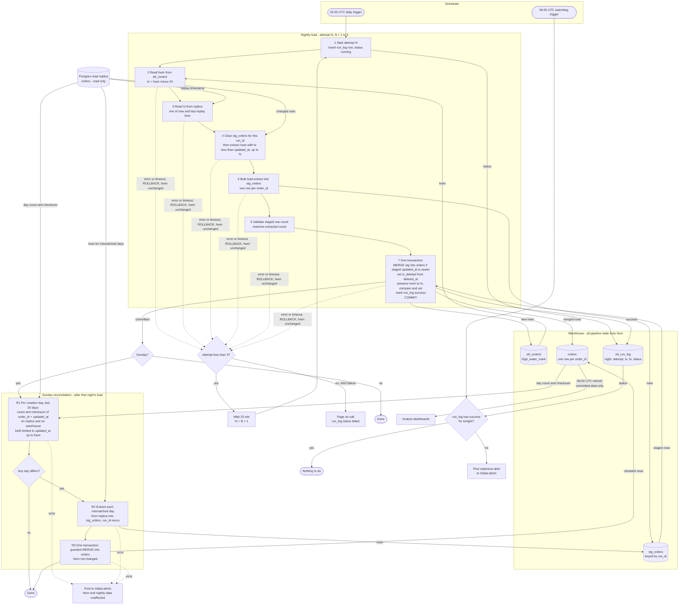

# Nightly orders ETL into the warehouse

## How it works

- **Trigger.** The scheduler starts the job at 02:00 UTC. Every later step is started by the step before it, except the 06:00 watchdog, which has its own scheduler entry.
- **Source.** The job reads only from the Postgres read replica. It never writes there.
- **State.** All state lives in the warehouse:
  - `etl_control` holds one row per pipeline, with `high_water_mark` (HWM).
  - `etl_run_log` has one row per attempt: `night`, `attempt`, `lo`, `hi`, `status`, `rows_extracted`, `started_at`, `finished_at`.
  - `stg_orders` is the staging table, keyed by `run_id`.
  - `orders` is the target table that dashboards read.
- **Extract window.**
  - `lo = high_water_mark - 2h`.
  - `hi = min(now(), pg_last_xact_replay_timestamp())`, read from the replica. This stops a lagging replica from pushing the HWM past data it has not replayed yet.
  - The extract takes rows where `lo < updated_at <= hi`. It includes rows with `deleted_at` set, since a delete is just a write.
- **Staging.**
  - Each attempt first runs `DELETE FROM stg_orders WHERE run_id = :run_id`, so a retry starts clean.
  - It then bulk-loads the extract with that `run_id`.
  - Staging is outside the commit transaction, so a failed or half-finished load never touches `orders`.
  - The replica holds one row per order, so staging has one row per `order_id`. A unique key on `(run_id, order_id)` enforces this.
- **Commit.** One warehouse transaction does three things:
  1. It merges staging into `orders`.
  2. It advances the HWM with a compare-and-set.
  3. It marks the run log row `success`.

  Dashboards therefore see either the old state or the whole new night. At 06:00 they read only committed `orders` data.

```sql
BEGIN;
MERGE INTO orders d USING stg_orders s
  ON d.order_id = s.order_id AND s.run_id = :run_id
WHEN MATCHED AND s.updated_at > d.updated_at THEN
  UPDATE SET <all columns from s>, is_deleted = (s.deleted_at IS NOT NULL)
WHEN NOT MATCHED THEN
  INSERT (<all columns>, is_deleted) VALUES (<s columns>, s.deleted_at IS NOT NULL);

UPDATE etl_control SET high_water_mark = :hi
 WHERE pipeline = 'orders' AND high_water_mark = :hwm_read_at_start;  -- must affect 1 row, else ROLLBACK
UPDATE etl_run_log SET status = 'success' WHERE run_id = :run_id;
COMMIT;
```

- **Why this is safe to re-run.**
  - `orders` has a unique key on `order_id`.
  - The `s.updated_at > d.updated_at` guard means a re-extracted or stale row never overwrites a newer version.
  - A repeat run changes nothing.
  - The HWM moves only inside the commit, and only forward. The compare-and-set also stops two overlapping attempts from both advancing it.
  - Deleted orders stay in `orders` with `is_deleted = true`.
- **Retry.**
  - Any error or timeout in steps 2 to 7 rolls back the transaction and leaves the HWM unchanged.
  - The scheduler waits 15 minutes and runs attempt 2, then attempt 3.
  - Each attempt recomputes `lo` and `hi` from the unchanged HWM.
  - After the third failure the job pages on-call.
  - Each attempt has a timeout and the scheduler allows one run at a time, so attempts never overlap.
- **Staleness watchdog.** At 06:00 UTC a separate scheduled check looks in `etl_run_log` for a `success` row for tonight's night. If there is none, it posts to #data-alerts. This covers a failed night, a night still retrying, and a slow load.
- **Sunday reconciliation.**
  - It runs as the last step of the nightly job, only when that night's load committed and the day is Sunday.
  - For each order-creation day (`created_at::date`) in the last 30 days, it computes `count(*)` and a checksum over `order_id` + `updated_at` on both the replica and the warehouse. The checksum is an order-independent aggregate of a per-row hash, such as the sum of `hash(order_id || updated_at)` modulo 2^64.
  - Both sides count only rows with `updated_at <= hwm`. This ignores rows written after the load's cut-off, so they do not show up as false mismatches.
  - It reloads each mismatched day by extracting that whole day from the replica into staging under a `recon` run id. It then merges with the same guarded merge in one transaction.
  - Reconciliation never touches the HWM.
  - Because the merge only updates when `updated_at` is newer, reconciliation also cannot undo newer data.
- **Reconciliation failure.** If reconciliation fails, it is not retried automatically and does not affect the HWM or the nightly data. It posts to #data-alerts, and the next Sunday run will cover the same days.
- **Assumptions to confirm.**
  - The warehouse supports multi-statement transactions with snapshot-isolated readers.
  - Where there is no `MERGE`, use `UPDATE ... FROM` plus `INSERT ... WHERE NOT EXISTS` in the same transaction.
  - The first run seeds `high_water_mark` to the epoch, which is a full backfill.
  - The 2-hour lookback leaves a 30-minute margin over the 90-minute transaction limit. Anything later than that is caught by the Sunday reconciliation.

## Pipeline flowchart



## What starts each step

| Step | Started by |
|---|---|
| Nightly attempt 1 | Scheduler, 02:00 UTC |
| Attempts 2 and 3 | The scheduler, 15 minutes after the previous attempt failed |
| Page on-call | Third failed attempt |
| Sunday reconciliation | Successful commit of the nightly load, only on Sunday |
| Staleness check | Scheduler, 06:00 UTC |
| Dashboard refresh | Dashboard schedule, 06:00 UTC. It reads committed `orders` rows only. |
