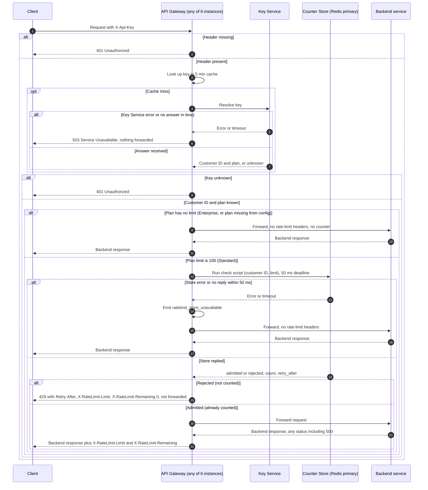

# Per-customer rate limiting on the public API: design v1

## What this is

Today every public request goes through the API Gateway. The gateway asks the Key Service which customer an API key belongs to and which plan that customer is on. Then it forwards the request to the backend service that owns the route. This design adds one check between those two steps. Each Standard customer gets 100 requests per clock minute, shared by all of that customer's keys. The count lives in one shared Redis primary, so all six gateway instances see the same count. The check and the count update run as one Redis script, so two instances cannot both take the last slot. If Redis errors or takes longer than 50 ms, the gateway forwards the request anyway and emits a metric. Enterprise has no limit yet, so Enterprise requests skip the check for now.

The shape is chosen for two reasons. A counter kept inside each gateway would give a customer six times the limit. One script stops two instances from racing. Failing open means a counter outage cannot take the API down.

## Terms

- **API Gateway**: the front door for all public traffic. Six stateless instances sit behind a load balancer. Any instance can take any request.
- **API key**: the secret a client sends in the `X-Api-Key` header.
- **Key Service**: the existing service that turns an API key into a customer ID and a plan name. It returns the plan name only, not a number.
- **Plan config**: a lookup table from plan name to limit. Standard maps to 100. Enterprise has no entry yet.
- **Counter store**: a Redis server. The gateway uses only the primary.
- **Window**: one clock minute, for example 12:05:00 to 12:05:59.
- **Counter key**: a Redis key named `rl:<customerId>:<windowStart>`. There is one per customer per window. It expires after 120 seconds, so it outlives its 60-second window.
- **Check script**: a short Lua program. Redis runs it as one unit, with no other command in between. It reads the count and adds one only if the customer is under the limit.
- **Deadline**: the 50 ms the gateway waits for the counter store before it gives up.
- **Admitted**: the check counted the request and let it through.
- **Rejected**: the check refused the request. A rejected request is not counted.
- **Fail open**: the gateway forwards a request without checking it and without rate-limit headers.

## Request flow



Notes on the diagram. The Key Service path is shown only on a cache miss. A rejected request never reaches the backend. An admitted request is counted before it is forwarded, so the count stays used even if the backend fails.

## How each step works

1. **Missing key.** A request arrives with no `X-Api-Key` header. The gateway returns 401 and touches no counter. The body is the gateway's existing 401 body. A client cannot tell a missing key from an unknown one.
2. **Key lookup.** A request with a key arrives. The gateway checks its own in-memory cache, which holds each answer for 5 minutes. Each instance has its own cache. On a miss, it asks the Key Service.
3. **Key Service failure.** The Key Service errors or does not answer in time on a cache miss. The gateway returns 503 and forwards nothing. It cannot tell who the customer is. Forwarding without knowing the customer would skip the rate limit and the authentication check. It touches no counter.
4. **Unknown key.** The Key Service says the key does not exist. The gateway returns 401, as in step 1. It touches no counter.
5. **No limit for the plan.** The customer's plan has no limit. Enterprise is this case today. So is any plan name missing from plan config. The gateway forwards the request with no rate-limit headers and no counter. For a missing plan name, it also logs a warning. It skips the check rather than returning 503, so one config typo cannot take a whole plan down. The customer is already authenticated, so only the limit is dropped.
6. **Check.** A Standard customer's request reaches the check. The gateway calls the check script with the customer ID and the limit (100), under a 50 ms deadline. Redis runs the script as one unit. Nothing else runs between its read and its write, so the gateway cannot die between them. The script is:

   ```lua
   -- ARGV[1] = limit (integer), ARGV[2] = customer ID
   local t = redis.call('TIME')
   local now = tonumber(t[1])
   local window_start = now - (now % 60)
   local key = 'rl:' .. ARGV[2] .. ':' .. window_start
   local retry_after = 60 - (now % 60)
   local count = tonumber(redis.call('GET', key) or '0')
   if count >= tonumber(ARGV[1]) then
     return {0, count, retry_after}          -- rejected, no increment
   end
   count = redis.call('INCR', key)
   if count == 1 then redis.call('EXPIRE', key, 120) end
   return {1, count, retry_after}            -- admitted
   ```

   The script reads Redis's clock, so gateway clock skew does not matter. A rejected request leaves the count unchanged. A new minute uses a new key, so the count starts at zero with no reset step. The old key expires on its own. The expiry is set on the INCR that makes the count 1, which is every new key.
7. **Store error or deadline.** The script errors, or Redis does not reply within 50 ms. The gateway emits `ratelimit_store_unavailable` and forwards the request with no rate-limit headers. It does not retry. If the script ran before the deadline, its increment stands, so the customer loses one unit for this request. Undoing the increment would need the same store that just timed out, so v1 accepts the loss.
8. **Rejected.** The count is already at the limit. The gateway returns 429 and does not forward the request. The count does not change. The response carries `Retry-After`, `X-RateLimit-Limit` and `X-RateLimit-Remaining: 0`. `Retry-After` is `60 - (now mod 60)` seconds, the time until the next minute starts. In practice it is 1 to 59 seconds.
9. **Admitted.** The script has already counted the request. The gateway forwards it and returns the backend's response, whatever its status. The response carries `X-RateLimit-Limit` (the plan limit) and `X-RateLimit-Remaining` (the limit minus the count after this request, never below 0). The remaining value comes from the same script call as the count, so a window change after the script does not alter it. Admitted responses carry no reset-time header. The backend's own timeout is the gateway's existing setting and is not part of this plan.

## What happens when things fail

| What fails | Client gets | Forwarded? | Counter changed? |
|---|---|---|---|
| Header missing | 401 | No | No |
| Key unknown | 401, same as missing | No | No |
| Key Service error or no answer, on a cache miss | 503 | No | No |
| Plan has no limit, or plan missing from config | Backend response, no rate-limit headers (warning logged for a missing plan) | Yes | No |
| Store error or no reply within 50 ms | Backend response, no rate-limit headers, metric emitted | Yes | Maybe one unit |
| Over the limit | 429 with `Retry-After` and rate-limit headers | No | No |
| Backend returns 500 after admission | The 500, with rate-limit headers | Yes | Yes |
| Backend fails or times out after admission | The gateway's own error (existing 502 or 504), with rate-limit headers | Yes | Yes |
| Redis failover | Same as store error | Yes | Possibly a few increments lost |

After a backend failure, the budget is not refunded. The client still gets the two admitted-request headers on the error.

## Design choices

- **Window.** Fixed 60 seconds, aligned to the clock minute. A burst of up to twice the limit can pass across a minute boundary. A sliding window is a later change if this matters.
- **Store.** One Redis primary, shared by all gateway instances.
- **Headers.** The brief requires only `Retry-After` on a 429. The other two headers, on 429 and on admitted responses, are a choice. They let a rejected client still see its limit.
- **Plan change lag.** A plan change takes up to 5 minutes to apply, because the key cache holds the plan. Accepted.

## How to build and check it

Before launch, check these:

- A request with a missing or unknown key returns 401 and leaves the counter key unchanged.
- The 101st request in one window returns 429 with an integer `Retry-After` from 1 to 60. The counter stays at 100.
- Requests sent at once across six gateway instances admit exactly 100 in one window.
- A backend 500 still uses budget.
- With the store stopped or slower than 50 ms, requests are forwarded, the metric fires, and no rate-limit headers appear.

## Open questions

- **Enterprise limit: open.** Product has not decided it, so no number is in code. The proposal is to ship Standard only and let Enterprise requests skip the check behind a flag. The alternative is to hold the Enterprise rollout. Do not ship a guessed number.
- **Enterprise flag timing.** Not decided whether the flag is read per request from plan config or at deploy time.
- **Plan config location.** Not decided where the plan-name-to-limit table lives: a file, an environment variable or a service.
- **Key Service call.** The brief does not say how the gateway calls the Key Service (address or protocol). This plan keeps the existing call as it is.
- **Unknown-key caching.** Not known whether the gateway's 5-minute cache also stores unknown-key answers. This plan does not depend on it.
- **Primary discovery.** Not decided how the gateway finds the current primary after a failover: a managed endpoint, Sentinel or a DNS name. Until it is decided, calls during a failover error or time out, and requests fail open.
- **Failover loss.** Redis replicates asynchronously, so a failover can lose the last few increments, and a customer can go slightly over the limit. Accepted for v1.
- **Alerting.** Thresholds for `ratelimit_store_unavailable` and any rejection-rate metric are not defined.