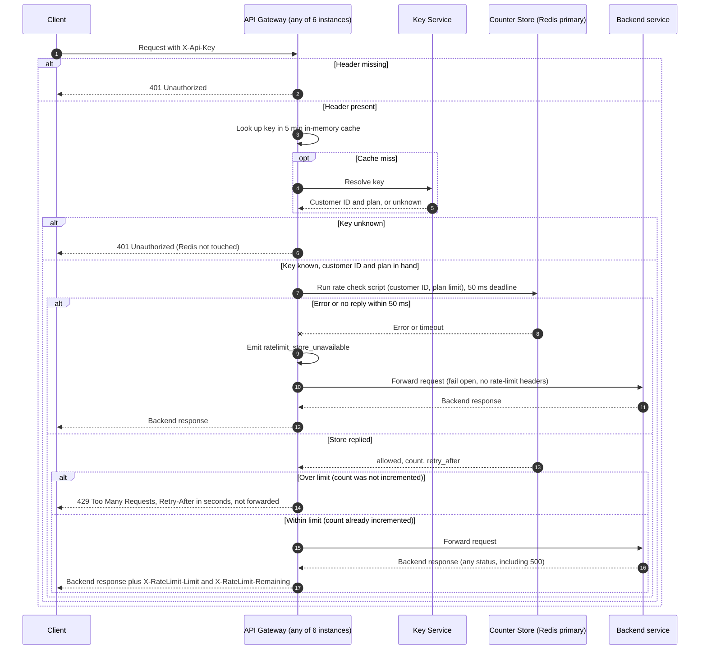

# Per-customer rate limiting on the public API: design v1

Each customer gets one shared budget of 100 requests per minute on Standard, checked in the API Gateway after authentication. The counter lives in a shared Redis primary, and the check plus increment runs as one atomic Lua call, so the six gateway instances cannot overshoot. The Enterprise limit is open. The store has a 50 ms budget and fails open.

## Request sequence



## Notes on the diagram

1. Authentication comes first. Both 401 paths return before any call to the counter store, so a missing or unknown key never reads or changes a counter (requirement 3).
2. The check and the increment are one step inside Redis. The script reads the count, and increments only when the count is under the limit. Two instances cannot both see 99 and both admit a request. A rejected request never increments, so a 429 does not use budget (requirement 4). A request that is admitted and then fails at the backend is not refunded (requirement 5).
3. The counter is keyed by customer ID, which the Key Service returns for every key. Several keys for one customer share one budget (requirement 1).
4. The fail-open path adds no rate-limit headers. The request did not pass the check, so the headers would have no truthful values. The gateway does not retry, and it does not count fail-open requests in v1.
5. The 50 ms budget is a client-side deadline on the Redis call. If the deadline fires, the increment may still land in Redis. That is acceptable for v1.

## Decisions

| Topic | Decision |
|---|---|
| Counter store | Redis, one primary. Shared by all gateway instances (requirement 7). |
| Key | `rl:<customerId>:<windowStart>`, with a TTL of 120 s so each key outlives its 60 s window. |
| Window | Fixed 60 s window aligned to the clock minute. Weakness: a burst of up to 2 times the limit is possible across a window boundary. Sliding window is a later change if this matters. |
| Atomicity | One Lua script does check, then increment only if allowed. Runs on the primary only, never on a replica. |
| Clock | The script reads Redis `TIME`, so gateway clock skew does not affect windows or Retry-After. |
| Retry-After | `60 - (now mod 60)` seconds. Always an integer from 1 to 60. |
| Headers on allowed requests | `X-RateLimit-Limit` = plan limit. `X-RateLimit-Remaining` = limit minus count after increment, floored at 0. |
| Headers on 429 | `Retry-After`, `X-RateLimit-Limit`, and `X-RateLimit-Remaining: 0`. This goes beyond the brief and is a choice I made. |
| Fail open | 50 ms deadline. On error or timeout: forward the request, emit `ratelimit_store_unavailable`, add no rate-limit headers. |
| Plan change lag | Up to 5 min, because the existing key cache holds the plan. Accepted. |

## Script sketch

```lua
-- ARGV[1] = limit (integer), ARGV[2] = customer ID
local t = redis.call('TIME')
local now = tonumber(t[1])
local window_start = now - (now % 60)
local key = 'rl:' .. ARGV[2] .. ':' .. window_start
local retry_after = 60 - (now % 60)
local count = tonumber(redis.call('GET', key) or '0')
if count >= tonumber(ARGV[1]) then
  return {0, count, retry_after}          -- rejected, no increment
end
count = redis.call('INCR', key)
if count == 1 then redis.call('EXPIRE', key, 120) end
return {1, count, retry_after}            -- admitted
```

## Open items

- **Enterprise limit: OPEN.** Product has not decided it, so no number is set in code. The limit is read from plan config. Proposed default until Product decides: ship Standard enforcement only, and let Enterprise requests skip the check (no headers, no counter) behind a flag. The alternative is to hold the Enterprise rollout. Either way, do not ship a guessed number.
- **Failover loss.** Redis replication is asynchronous, so a primary failover can lose the last few increments. The customer could then exceed the limit by a small amount. Accepted for v1.
- **Alerting.** Thresholds for `ratelimit_store_unavailable` and any rejection-rate metric are not defined.

## Verification to run before launch

- A request with a missing or unknown key returns 401 and leaves the counter key unchanged.
- The 101st request in one window returns 429 with an integer `Retry-After` from 1 to 60. The counter stays at 100.
- Requests spread over six gateway instances, sent concurrently, admit exactly 100 in one window.
- A backend 500 still consumes budget.
- With the store stopped or delayed past 50 ms, requests are forwarded, the metric fires, and no rate-limit headers appear.