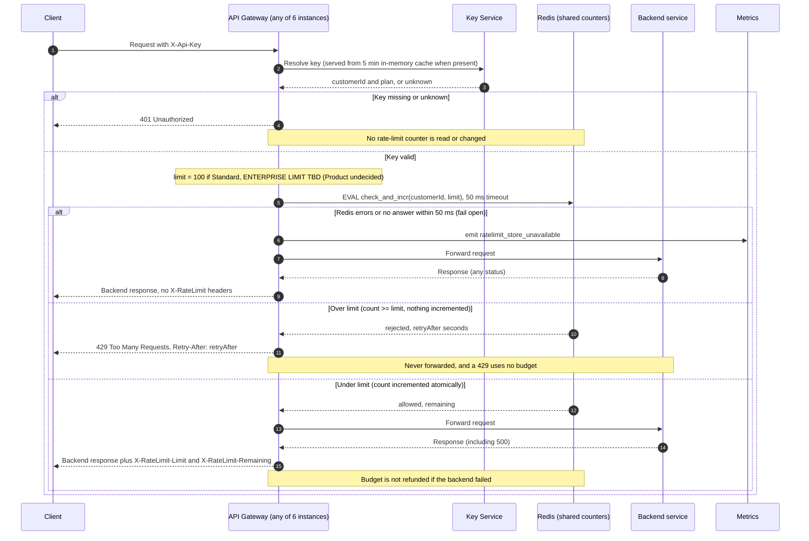

# Per-customer rate limiting on the public API

## Design decisions

**Store: Redis.**
- One shared Redis instance holds all counters, so the 6 gateway instances see the same count (requirement 7).
- Keys are `rl:{customerId}:{windowStart}`. They are per customer, not per key, so a customer's several API keys share one budget (requirement 1).

**Window: fixed one-minute window.**
- `windowStart = floor(redisTime / 60)`. Redis's own clock (`TIME`) is used, not the gateway's, so instance clock skew can't shift windows.
- Each key is set to expire at the end of its window, plus a small margin, so old counters clean themselves up.
- Known trade-off: a client can send up to 2x the limit across a window boundary (100 at 0:59, 100 at 1:00). This is accepted for a first version. A sliding window is a later option.

**Preventing overshoot across instances.**
- The check and the increment run as one Lua script, so they are a single atomic step in Redis.
- The script reads the count. If `count >= limit`, it returns "rejected" and changes nothing. Otherwise it does `INCR`, sets the expiry on the first hit, and returns `remaining = limit - newCount`.
- Because it is atomic, concurrent requests on different instances can't both take the last slot. Rejected requests never increment, so 429s use no budget (requirement 4).

**Retry-After.**
- The script returns the seconds left in the current window (`windowEnd - redisTime`), rounded up and at least 1. The gateway sends it as `Retry-After`.
- The count resets at the next window, so retrying after that many seconds will succeed.

**Counting.**
- The increment happens at check time, before forwarding. A backend 500 therefore still counts (requirement 5).
- 401s return before any Redis call (requirement 3).

**Headers.** `X-RateLimit-Limit` is the plan limit. `X-RateLimit-Remaining` is the value returned by the script. Both are added to every response that passed the check, whatever the backend status.

**Fail open (requirement 8).**
- The Redis call has a hard 50 ms timeout. Any error or timeout counts as unavailable.
- The gateway then forwards the request normally and emits the `ratelimit_store_unavailable` metric.
- The response carries no `X-RateLimit-*` headers, because the real remaining count is unknown and a made-up value would mislead clients.
- No retry and no local fallback counter. During an outage the limit is simply not enforced.

## Open items

- **Enterprise limit:** undecided by Product. It stays `TBD` in the diagram and should be a config value with no default, so a missing value is visible rather than silently becoming 100. Until it is set, the gateway should fail startup or alert, not guess.
- **Redis availability:** whether to run a replica or failover is not covered here. Fail-open means an outage costs enforcement, not availability.
- **Alerting:** a threshold on `ratelimit_store_unavailable` should be set up, since fail-open hides the problem from clients.
