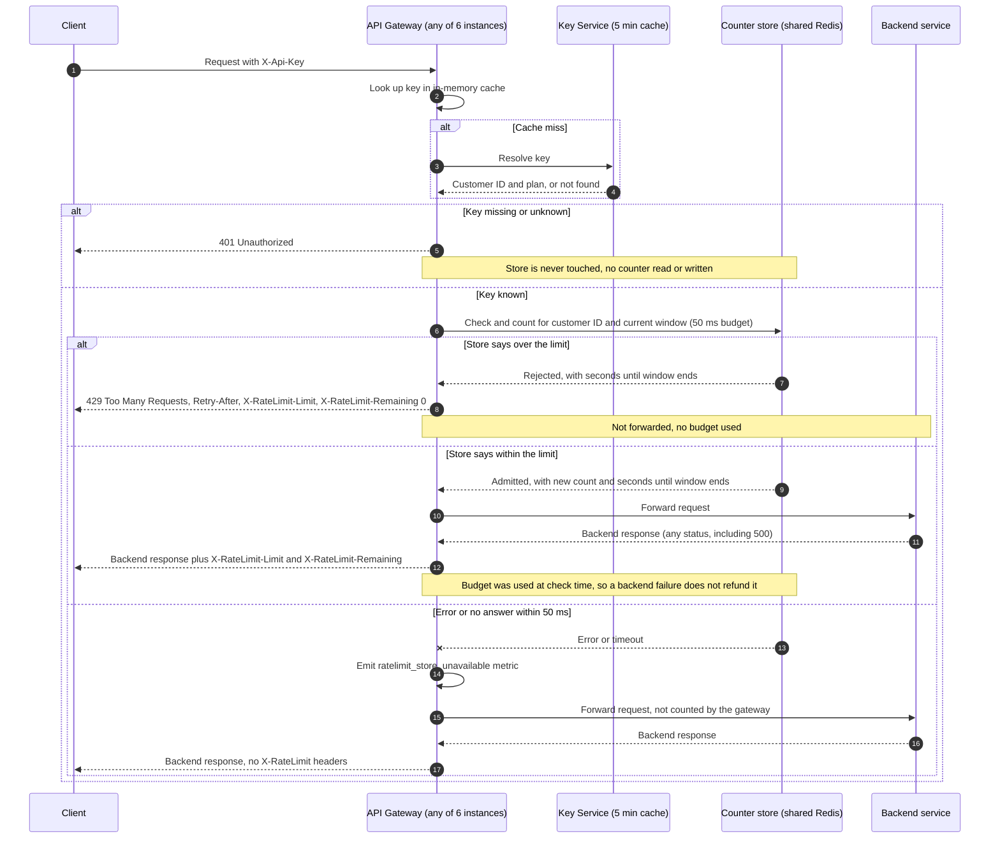

# Per-customer rate limiting on the public API

## What this is

Today the API Gateway checks each client's API key and forwards every authenticated request to the backend. It keeps no per-customer request counts. This design adds a request limit per customer, so one busy customer cannot slow the API for everyone else. Standard customers get 100 requests per minute. The Enterprise limit is not decided yet.

Each request goes through four stages. First, the gateway resolves the API key. An unknown or missing key gets 401, and the counter store is not touched. Second, a known key goes to a shared Redis counter store, which checks and counts the request in one atomic step. Third, if the customer is over the limit, the gateway returns 429 and does not forward the request. Otherwise it forwards the request and returns the backend's answer with rate-limit headers. Fourth, if the counter store errors or does not answer within 50 ms, the gateway forwards the request without counting it and records a metric. A counter outage must not take the API down.

The counter lives in one shared store, not in each gateway. So all 6 gateway instances share one budget per customer. Counts are keyed by customer, not by API key, so a customer with several keys has one budget.

## Terms

- **API key**: a secret string that a client sends in the `X-Api-Key` header.
- **Customer ID**: the identifier of the customer who owns one or more API keys.
- **Plan**: the customer's service level, either Standard or Enterprise. The plan sets the limit.
- **Key Service**: the service that turns an API key into a customer ID and a plan.
- **Key cache**: the gateway's in-memory copy of those answers. It is kept for 5 minutes.
- **Counter store**: a single shared Redis server that holds the request counts.
- **Window**: one fixed one-minute period. Counts start again at each minute boundary.
- **Budget**: the number of requests a customer may make in one window. This is the plan limit.
- **Admitted or rejected**: whether the counter store let the request use budget.
- **Atomic script**: a Lua script that Redis runs in one step, so no other command runs in the middle.
- **Fail open**: when the counter store cannot answer, let the request through without counting it.
- **Retry-After**: a response header that tells the client how many seconds to wait before retrying.

## Sequence

## Steps

1. **Client sends a request with `X-Api-Key`.** The gateway (any of its 6 instances) looks the key up in its 5-minute cache. On a cache miss, it asks the Key Service. A request with no key header skips the lookup and is treated as unknown. If the key is missing or unknown, the gateway returns 401 and stops. Nothing is counted. The key cache lives in gateway memory and holds no counts.

2. **Gateway asks the counter store to check and count.** This happens only for known keys. It sends the customer ID, the plan limit and the window. The counter store holds one counter per customer per window, under the key `rl:<customerId>:<windowStart>`. Each counter expires after 120 seconds.

3. **The Redis script runs in one step on the server.**
   a. It reads the current count. A missing counter counts as 0.
   b. If the count is at or above the limit, it rejects the request. It does not increment, so a 429 uses no budget. It returns the seconds until the window ends.
   c. Otherwise it increments the counter. If the new value is 1, it sets the expiry to 120 seconds. It returns admitted, the new count and the seconds until the window ends.

   The script works out the window start from the Redis server clock (`TIME`). This way every gateway instance agrees on where a window begins. Because the script runs in one step, two instances racing for the last slot cannot both be admitted. The count can reach the limit but never pass it.

4. **If rejected, the gateway returns 429.** It sets `Retry-After` to the seconds until the window ends, rounded up, with a minimum of 1. It also sends `X-RateLimit-Limit` with `X-RateLimit-Remaining: 0`. The second pair of headers is the author's choice, not a requirement. The request is never forwarded.

5. **If admitted, the gateway forwards the request.** It sends the request to the backend that owns the route, then returns the backend's response, whatever its status. It adds `X-RateLimit-Limit` (the plan limit) and `X-RateLimit-Remaining` (the limit minus the new count). A backend failure does not give the budget back.

6. **If the counter store errors or does not answer within 50 ms, the gateway fails open.** It forwards the request without counting it, emits `ratelimit_store_unavailable`, and returns the backend's response with no rate-limit headers. The Redis script may still finish after the gateway gives up, so that request could be counted anyway. This is accepted. It can only reduce a customer's budget by the requests in flight during the outage.

## What happens when things fail

| What fails | What the client gets | What the system does |
|---|---|---|
| Key missing or unknown | 401 Unauthorized | No counter is read or written |
| Request is over the limit | 429 with Retry-After | Not forwarded, no budget used |
| Backend returns 500 | The 500, with rate-limit headers | Budget stays used |
| Counter store errors or times out (50 ms) | Backend response, no rate-limit headers | Forwarded, not counted by the gateway, metric emitted |
| Plan changes or a key is revoked | Old plan or key still works | Takes up to 5 minutes to reach the gateway, because of the cache |

## Decisions and reasons

- **One shared Redis store.** All 6 gateway instances must share one count. Otherwise a customer could get 6 times their limit.
- **Counts keyed by customer ID.** A customer's keys share one budget.
- **Fixed one-minute windows.** They are the simplest correct option for v1. Known trade-off: a customer can send up to 2 times the limit across a window boundary. A sliding window is the upgrade path if this is abused.
- **Atomic script.** It stops two instances from both admitting the last slot.
- **Fail open.** A counter outage must not stop the API.

## Open questions

1. **Enterprise limit.** Product has not decided it. Until it is set, Enterprise traffic is either not enforced or uses a placeholder that product has approved.
2. **Boundary burst.** A customer can send up to 2 times the limit across a window boundary. This is accepted for v1. Revisit it if it is abused.
3. **Alert threshold for `ratelimit_store_unavailable`.** Not set. It is needed before launch, so that a silent fail-open outage is noticed.
4. **Key Service unreachable on a cache miss.** This design does not say what the gateway does. It must be decided before launch.