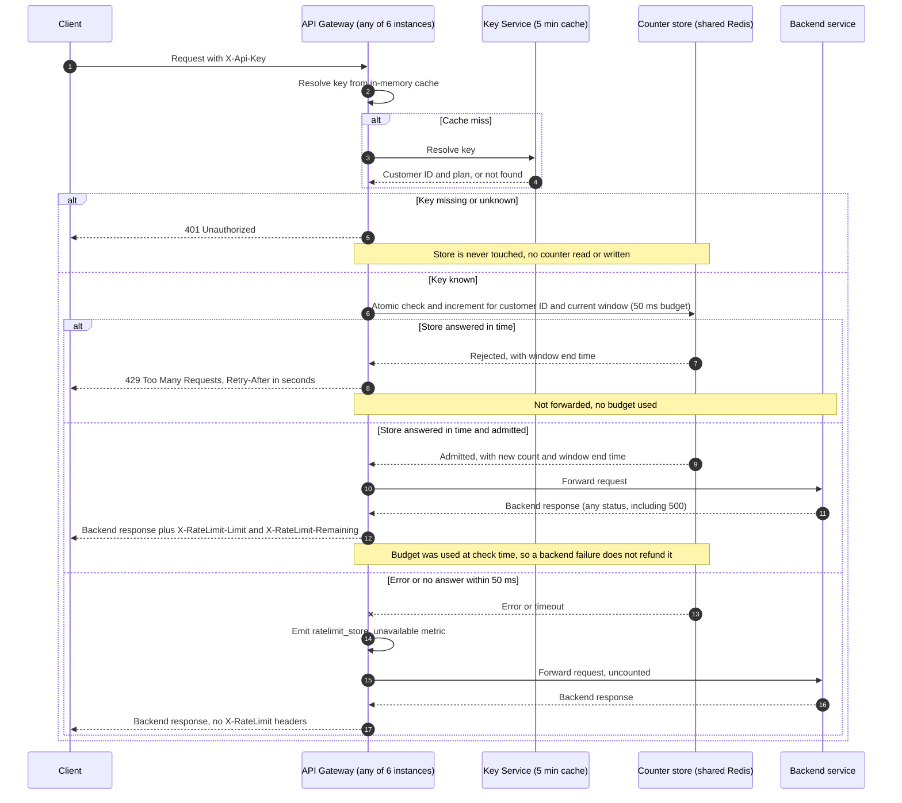

# Per-customer rate limiting on the public API

## Sequence

## Notes

**Store.** A single shared Redis holds one counter per customer per window, with the key `rl:<customerId>:<windowStart>`. Every gateway instance talks to the same store, so 6 instances share one budget per customer (requirement 7). Counters are keyed by customer ID, not API key, so all of a customer's keys share one budget (requirement 1).

**Check-and-increment is one atomic Lua script.** Each check runs once, server side, and reads the limit from the plan the gateway passes in. The script does the following:

1. Read the current count for the key. A missing key counts as 0.
2. If the count is at or above the limit, return rejected with the window end time. Do not increment, so 429 responses use no budget (requirement 4).
3. Otherwise `INCR` the key. If the new value is 1, set an expiry of 120 seconds. Return admitted with the new count and the window end time.

Because the script is atomic, two instances racing for the last slot cannot both be admitted. The count can reach the limit but never pass it.

**Window.** Fixed one-minute windows, aligned to the Redis server clock (`TIME`), so every instance agrees on the boundary. Known trade-off: a customer can send up to 2x the limit across a window boundary, for example 100 at the end of one minute and 100 at the start of the next. Accepted for v1. A sliding window is the upgrade path if this matters.

**Retry-After.** `Retry-After` = window end minus now, rounded up to whole seconds, with a minimum of 1. It is always between 1 and 60.

**Headers.** On admitted requests, `X-RateLimit-Limit` is the plan limit and `X-RateLimit-Remaining` is `limit - newCount`. On 429, the response carries `Retry-After`, and I also send `X-RateLimit-Limit` with `X-RateLimit-Remaining: 0`. This is my choice, not a requirement. On fail-open, no rate-limit headers are sent, since no count exists.

**Limit by plan.**
- Standard: 100 requests per minute.
- Enterprise: **OPEN**. Product has not decided this number. The gateway reads it from plan configuration, so no code change is needed when it is set. Until then, Enterprise traffic must not be enforced, or must use a placeholder that product has signed off on.

**Fail open.** The store call has a 50 ms timeout on the gateway side. On error or timeout, the gateway forwards the request without counting it and emits `ratelimit_store_unavailable`. The Redis script may still complete after the gateway gives up, so that request could be counted. This is acceptable: it can only reduce a customer's budget by the requests in flight during the outage.

**Ordering.** Authentication runs first and never touches the store, so an unknown or missing key gets 401 with no counter read or write (requirement 3). The rate-limit check runs after authentication and before forwarding (requirement 4). Backend failures do not refund budget (requirement 5).

**Known latency.** A plan change or key revocation in the Key Service can take up to 5 minutes to reach a gateway because of the cache. A customer whose plan was upgraded may stay on the old limit for up to 5 minutes.

## Open items

1. Enterprise limit: product decision, not chosen here.
2. Fixed-window boundary burst (up to 2x the limit across a boundary): accepted for v1, revisit if abused.
3. Alerting threshold for `ratelimit_store_unavailable`: not specified; needed before launch so a silent fail-open outage is noticed.
