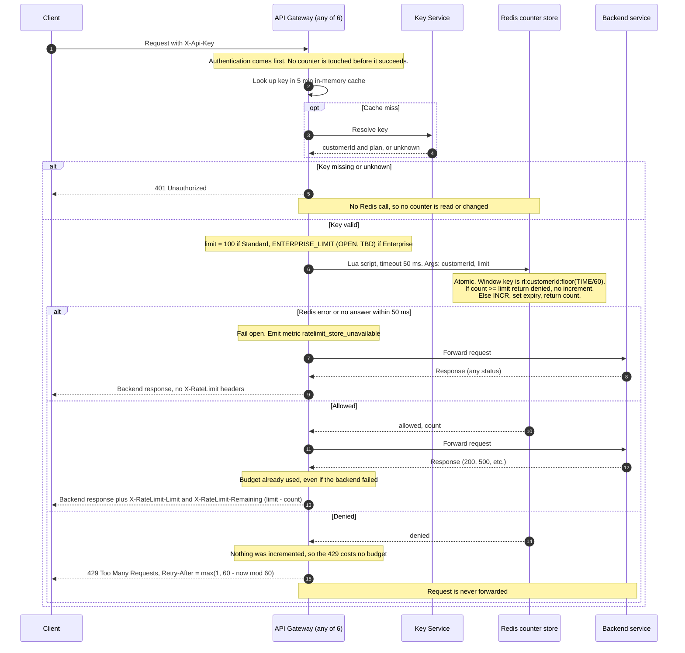

# Per-customer rate limiting on the public API

## Summary

Today, every public request reaches one of 6 identical API Gateway instances. The gateway reads the `X-Api-Key` header and asks the Key Service which customer and plan the key belongs to. It remembers the answer in memory for 5 minutes. Then it forwards the request to the backend service that owns the route and returns the backend's response.

This design adds a rate-limit check between "who is this?" and "forward it". The gateway asks a shared Redis counter store whether the customer has budget left in the current minute. If yes, the request is counted and forwarded. If no, the gateway answers `429` and forwards nothing. Redis is shared so that 6 instances cannot give a customer 6 times the limit. If Redis fails, the gateway lets the request through, because a counter problem must not take the API down.

## Terms

- **Customer**: the account that owns one or more API keys. The budget belongs to the customer, so all of its keys share it.
- **Plan**: Standard or Enterprise. The plan decides the limit.
- **Limit**: the number of requests allowed per minute. Standard is 100. Enterprise is not decided yet (see Open questions).
- **Window**: one clock minute (for example 12:03:00 to 12:03:59). Each window has its own count, and the count starts at 0.
- **Counter store**: one shared Redis (a primary with a replica). It holds only rate-limit counts. Each count lives under the key `rl:{customerId}:{windowNumber}`, where windowNumber is Redis time in seconds divided by 60, rounded down.
- **Lua script**: a small program that Redis runs as a single step. No other command can run in the middle of it. This stops two gateways from both reading "99" and both allowing a request.
- **Fail open**: when the counter store cannot answer, allow the request.

## How a request flows

1. **Client sends a request.** The gateway instance that receives it looks up the `X-Api-Key` in its 5-minute in-memory cache. On a miss it asks the Key Service, which returns the customer ID and plan, or says the key is unknown.
   - Failure: a Key Service outage is existing behavior and this design does not change it.
2. **Authentication decision.** If the key is missing or unknown, the gateway returns `401 Unauthorized`. It never calls Redis, so no counter is read or changed. Authentication comes first.
3. **Pick the limit.** Standard customers get 100. Enterprise customers get the configured `ENTERPRISE_LIMIT`.
   - Failure: if the plan is Enterprise and no limit is configured, the gateway logs a warning and skips the check for that customer (treated like fail open). Nobody gets a guessed number.
4. **Check and count.** The gateway runs the Lua script on Redis with a 50 ms timeout, passing the customer ID and the limit. The script uses Redis's own clock, so the gateways' clocks do not matter. It does this:
   - If the count is already at or above the limit, it returns "denied" and changes nothing.
   - Otherwise it adds 1 to the count, sets the key to expire about 60 seconds after its window ends so old counts clean themselves up, and returns the new count.
5. **Allowed.** The gateway forwards the request to the backend. The request has already been counted, so it uses budget even if the backend then fails with a 500. The gateway returns the backend's response with two added headers: `X-RateLimit-Limit` (the plan limit) and `X-RateLimit-Remaining` (limit minus count, never below 0). This applies to errors from the backend too.
6. **Denied.** The gateway returns `429 Too Many Requests` and does not forward the request. The response has a `Retry-After` header in whole seconds, set to `max(1, 60 - (now mod 60))`, where now is Redis time in seconds. That is the time until the current window ends, when the budget resets. A 429 does not use budget, because the script changed nothing.
7. **Counter store fails.** If Redis returns an error or does not answer within 50 ms, the gateway forwards the request anyway and emits the `ratelimit_store_unavailable` metric. The response is the normal backend response with no `X-RateLimit-*` headers, because the count is unknown. If a late reply arrives, it is ignored. The script may still have counted that request, which is fine.

## What happens when things fail

| What fails | What happens |
|---|---|
| Key missing or unknown | `401`, no Redis call |
| Backend returns an error | Response passed through, request still counted |
| Redis error or no answer in 50 ms | Request forwarded, metric emitted, no rate-limit headers |
| Enterprise plan with no limit set | Warning logged, check skipped |
| Redis failover | Up to a few seconds of counts may be lost, so customers may get a little extra budget. Accepted. |
| Key Service outage | Unchanged existing behavior |

## Diagram

## Notes on the design

- **Why a fixed window:** it is simple and cheap for a first version. The cost is that a customer can send 100 requests at the end of one minute and 100 at the start of the next, so up to 200 in a short burst. A sliding window can replace it later without changing what clients see.
- **Why fail open:** a counter outage then removes limiting but not availability. Alert on `ratelimit_store_unavailable`, because an unnoticed outage means no limiting.
- **Out of scope:** 429 responses carry only `Retry-After`.

## Open questions

- **Enterprise limit:** Product has not set it. `ENTERPRISE_LIMIT` has no default. Until Product sets or approves a number, deploy with Enterprise customers unlimited or at a number Product explicitly approves. Do not ship a guessed value.
